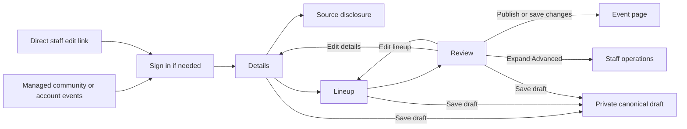
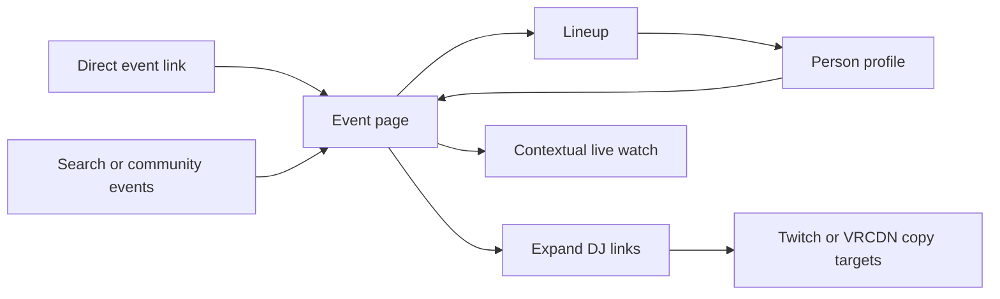

# Event Schema

## Status

Current recommendation and implementation note for `#34`, `#35`, `#36`, `#93`, `#119`, `#121`, `#123`, `#124`, `#132`, `#134`, and `#138`.

## Event Records

Events are the primary scheduling object. They are not modeled as appearances or profile-page blocks. Timed slots are child schedule records under the canonical event.

Current event fields include:

- automatically generated event code for `/<community>/events/<event-code>`
  public routes (stored in the existing `slug` field)
- title and sort title
- timed start, optional doors/end, or an explicit date-only schedule
- optional canonical event time zone
- optional linked community profile
- optional public description (stored as `summary`)
- optional private manager notes (stored as `notes`)
- optional primary poster image URL
- source type, source label, and optional source URL
- typed media links
- publication state
- scheduled or cancelled event status
- submitter identity for provenance; contributed events separately track scoped
  contributor editing until staff takeover

Generated durable short links such as `/l/<code>` are tracked in [Generated Short Links](./generated-short-links.md). An event uses that same generated code in its canonical community-scoped URL. Event codes are not editable.

## Event Times

Timed events store `startAt`, optional `doorsOpenAt`, and optional `endAt` as timestamps. `scheduleKind` is `timed` or `date_only`; legacy rows without it are read as timed. `eventDate` is the authored `YYYY-MM-DD` calendar date. The optional `timezone` field supplies the authoring zone for timed events. Existing owner authoring remains a timed-event interface; contribution authoring adds the date-only write path separately.

Date-only events omit `startAt`. Public cards show the authored date and `Time TBA` without converting it into the viewer's timezone. ICS emits `DTSTART;VALUE=DATE`; Discord exports the date and `Time TBA` without a Discord timestamp. Date-only events never activate watch playback, scheduled media workers, or instance telemetry windows. Public projections suppress stale timed fields and slots.

`sortAt` is an internal index key, never a start instant or public JSON field. Timed rows use their start instant; date-only rows use a sortable UTC date key. Participant and world caches use `eventSortAt` and `eventSortEndAt`; timed slot playback keeps its own exact start and end instants. Date-only upcoming eligibility lasts until the authored date ends in UTC-12, so timezone-boundary viewers do not lose the listing early.

Timed events with no known end remain current through six hours after `startAt`,
including the final millisecond. Discovery, upcoming lists, community and person
lists, world activity, search ranking, and the scheduled watch window use that
same runtime end. An explicit `endAt` always wins. The runtime fallback never
writes an authored `endAt`, adds an end to public schedule output, or changes
calendar export. Date-only expiry remains the authored date's end in UTC-12.

Discovery caps each index scan at 500 raw candidates before runtime filtering.
Future events and date-only dates have separate allowances. The date-only
lookback index includes `scheduleKind`; expired timed rows cannot consume it.
Ongoing candidates combine two bounded scans: ascending known ends at or after
now and descending starts at or before now. The start ordering places current
unknown-end events ahead of older unknown-end rows.
The scans include legacy timed events without `scheduleKind` and retain explicit
ends beyond six hours. Live search projection uses the current authored schedule.

Person and world lists classify runtime eligibility from the current event,
so older association caches containing a start-only end need no backfill for
this behavior. Person lists first retain started links with a current cached end
or a start within the inclusive six-hour fallback. Older expired links do not
require event hydration; explicit long-event caches remain eligible. The loaded
event still determines final eligibility. The existing bounded association scans
still apply. Future starts
can fill the known-end scan, and recently expired rows can fill the start scan.
An ongoing event outside both raw allowances and the featured fallback can be
absent from discovery. The separate future allowance still runs. With the
date-only switch disabled, that allowance reads the shared start index and
filters entity type after its raw cap; non-event rows can fill it and hide a
future event outside the featured fallback. With the switch enabled, the future
index includes the event type before the raw cap. These are
candidate limits, not shorter runtime windows; no scan expands to read an
unbounded number of nonmatching rows.

Public search reads at most 256 candidates across its keyword and profile-name
indexes. Event candidates resolve their current schedules before result ordering
and the requested limit. Selected events reuse their loaded event records;
communities are loaded only for selected results and visibility-driven refill.
Profile and
media-kit hydration remains limited to the ranked window needed to fill results,
with the existing refill after hidden records are removed. Search documents do
not store an authored or synthetic end for this ranking rule.

### Schedule migration and rollout

The Convex deployment variable `EVENT_DATE_ONLY_ENABLED` defaults to false. The deployment operator owns it. Deploy the widened schema and new indexes first, then invoke internal mutation `eventScheduleMigration:backfill` with `{ "batchSize": 100 }`. Persist its returned `phase` and `cursor`, passing both into the next call until `done` is true. The phases cover events, participants, worlds, slots, and search documents. Each transaction processes at most 100 rows and can be replayed. Verify completion and index readiness before setting the variable to `true`; recreate or roll back the switch by setting it to `false`. No secret or rotation is involved. Turning it off after date-only publication hides those records from legacy index listings, so disable new contribution writes first when rolling back.

New date-only publication must call `requireDateOnlyEventsEnabled()` and `normalizeEventSchedule({ kind: "date_only", date })` from `convex/_eventSchedule.ts`, then write the canonical event, association sort caches, and search document in the same transaction. New timed contribution publication must require an explicitly selected timezone before normalization. `normalizeEventSchedule` itself remains a pure validator usable by migration and read paths. Existing timed writes dual-write the new schedule fields while reads retain the old indexes until the switch is enabled. This change does not run a deployed migration or enable publication automatically.

`doorsOpenAt` is public and optional. When provided, it must be at or before `startAt`; it does not change the event start, slot offsets, participant associations, or event-world association timestamps.

The editor parses event date/time inputs in the named event timezone. A local time skipped by a daylight-saving transition is invalid; a repeated local time requires an explicit earlier/later choice. An unchanged owner timestamp keeps its exact instant. Public event cards, pages, and set times render directly in the viewer's local timezone; they do not repeat a canonical-timezone line.

Session rows remain canonical event-time schedule rows. The editor template uses relative minute offsets from `startAt`, not `doorsOpenAt`, so schedule storage and Discord timestamp generation remain tied to the canonical event/session timestamps.

Private manager notes reuse the existing `notes` field. They are returned only by authorized event-management reads and accepted by authorized browser or API writes. They are excluded from public event pages, search documents, MCP documents, public API responses, calendar output, Discord export, link-preview metadata, and generated link-preview images.

## Community Authority

Owner event writes require the current community owner or an active authority
carrying `manage_events`. Contribution publication is separate: any signed-in
account can publish for a public community through versioned intake after
preflight, without verified email. User-scoped API/MCP credentials need
`events:contribute`, not `events:write`.

The contributor can correct title, schedule, venue, source URL, description and
lineup, or retract their own event before staff takeover. They cannot reattach a
community, change provenance/trust, or control private notes, streams or media.
Staff edits and explicit takeover close direct editing. Later corrections enter
the existing report inbox. Staff can remove immediately; platform removal requires
a separate active moderator grant. Reports alone never retract a listing.
Publication and correction update canonical rows and public indexes atomically.
Removal hides public detail, discovery, community/person/world lists and feeds.
Exact fingerprints suppress immediate recreation; this is not fuzzy spam detection.

Contributor-selected event-world associations start unconfirmed. They can appear
on the event page, but world-page activity requires a confirmed association.
Contributor-linked performers retain their source attribution. The event retains
`sourceType=contributor`.
Private actor IDs and poster evidence never enter the public event DTO. See
[source retention](./event-intake-sources.md) and the
[integrated checkpoint](../testing/event-intake-checkpoint.md).

The browser editor obtains its community choices from
`events:listManagedCommunities`, which combines active ownership and active
`manage_events` grants and returns public community display data only. Its optional
`imageUrl` uses the existing discovery media-kit resolver, including the chosen
logo or avatar and automatic fallback. Private and unlisted image fields remain
excluded, even for owners and staff. Revoking a grant removes the choice and
blocks subsequent writes immediately.

`events:listManagedEvents` applies the same live authority and backs the private
account event list. It returns bounded editor links and schedule/publication
status, not event-media secrets or raw actors.

A small `communityAuthorities` table is reserved for the next authority layer:

- one community owner in v1
- familiar starter roles such as `admin` and `mod`
- capability flags such as `manage_events`

Current recommendation: split the singleton ownership link from delegable staff-role assignments. `owner` is a special community authority state, not an ordinary role row. Non-owner role assignments can start with seeded role keys such as `admin` and `mod`, but backend checks should use capability flags so the role vocabulary can evolve.

Starter capabilities:

- `edit_community_profile`: edit public community profile fields and presentation.
- `manage_roster`: add, remove, and annotate community roster members.
- `manage_events`: create and edit community events, slots, lineup links, event-world links, and public event metadata.
- `manage_event_media`: configure event media programs, sources, outputs, worker lifecycle, fallback publication, and media-control commands.
- `view_event_operations`: read private current/next slot, readiness, source status, and command history without editing.
- `manage_staff`: invite, assign, revoke, and audit non-owner staff roles.
- `manage_integrations`: configure community-owned import/export or partner integration settings.
- `manage_billing`: access ordinary community billing settings where product policy allows.

Owner-only actions include ownership transfer, owner removal, destructive community deletion/suppression, capability policy changes that could remove owner control, and any final sensitive billing authority that can terminate or transfer the community's account-level relationship. Ownership transfer should require an explicit acceptance flow rather than a silent reassignment.

Event schedule writes use `manage_events`; event media-control calls use `manage_event_media` or a scoped event token; read-only operator panels can use `view_event_operations`. Owner browser creation starts a `draft_private` event attached to an authorized community. Contribution drafting uses a separate private intake row and publication creates the public event in one transaction. Publish, unpublish, cancel, and restore actions recheck the same current authority.

`eventAuditEvents` records creation, updates, slot replacement, publication, cancellation, and restoration with the actor, surface (`browser`, `api`, `mcp`, `operator`, or `system`), changed fields, optional reason, and timestamp. Existing events have no fabricated history before this table's rollout.

`events:listEventAudit` rechecks current edit authority and returns a bounded,
newest-first history without raw actor identifiers. The event editor presents
that history to the current owner or active `manage_events` staff member.

## Public lineup

The public event `lineup[]` merges confirmed timed slots, ordered untimed
`eventLineupEntries`, and legacy participant-only records. A participant already
represented by a slot or untimed entry does not add another row. Multiple actual
sets remain separate. Unmatched names stay visible without guessing a person;
matched public people supply their discovery-visible portrait, appearance, and links.

`replaceEventLineup(db, event, entries, now)` in `convex/_eventLineup.ts` replaces
the complete authored lineup inside an authorized event mutation. Each entry has
`clientKey`, `position`, `performerLabel`, and optional `personSlug`, `roleLabel`,
`startAt`, and `endAt`. `sanitizeEventLineupInput` bounds and validates these values.
Only a published, publicly surfaced person can be matched on write. Timed entries
populate `eventSlots`; untimed entries use `eventLineupEntries` indexed by event
and position. Matched people also populate `eventParticipants` with schedule sort
caches for discovery. Date-only events accept untimed rows only. Existing timed
sets retain their playback identity and selected stream when the person is unchanged.
The legacy owner editor continues using its existing slot and participant writes.

Untimed storage also accepts optional internal `sourceType`, `sourceLabel`,
`sourceUrl` and `notes`. Canonical stable-key conversions and legacy date-only
conversion retain slot provenance in these fields without retaining hidden times.
Unchanged untimed saves carry it forward; retiming restores it onto the new slot.
Old records without these fields and new rows fall back to event source type/label.
There is no backfill. These fields are absent from canonical wire inputs and the
explicit public/editor lineup and operator slot projections. After retiming, the
existing public `slots[].source` still exposes source type, label and sanitized
URL; notes stay private. That timed-slot projection is unchanged.

The owner/staff editor uses the shared Details, Lineup, and Review
navigation. A Details disclosure retains the existing poster URL and media/link fields;
private single-poster intake remains a separate contributor workflow. Details
contains the current title, description, timing, timezone, and applicable
`Where (optional)` controls, stored as `venueLabel`. Contributor drafts select
a community from public directory search results; search text is separate from
the selected slug, and Clear stores null. Staff community authority stays fixed
by the route, and scoped corrections do not expose community selection. Lineup
shows matched public portraits or initials beside timed and
untimed performers, with timed rows displaying their actual event-local dates.
Review contains publication controls and a collapsed Advanced area for live
output, worker status, cancellation, restoration, and audit history.

Inactive step fields stay mounted for canonical FormData serialization.
Publication reveals the first invalid field's step and focuses it before calling
the existing create/update command. An unselected timezone search, a nonexistent
local start time, or a repeated time without an occurrence choice also returns
to Details and focuses the corresponding timing control. Save draft remains available on every step
under the existing canonical validation rules. Publication still redirects to
the event page. These presentation changes do not alter `events:write`, community
authority checks, stream assignment, or VRCDN output commands.

The public page shows one Lineup with optional local set times and portraits or
initials. Performer names lead to their profiles. A collapsed DJ links section at
the bottom groups unique VRCDN and Twitch targets; other socials remain on the
person's profile. Event reference/calendar links and contextual watch stay separate.

## Participant associations

`eventParticipants` links person profiles to events. This keeps profile-facing event views derived from a canonical event record rather than making `appearance` the core object.

Participant links support:

- claimed and unclaimed published person profiles
- freeform role labels such as `Performer`, `Staff`, or a community-specific label
- source type, source label, and optional source URL
- confirmation state
- optional notes

Public person profile pages should only render published events through confirmed participant links to public person profiles.

Approval, dispute handling, notifications, RSVP/interested state, and friend-aware discovery are follow-on work tracked outside this first `#35` association slice.

## Event Slots

`eventSlots` stores ordered set-time records under a canonical event. Slots are the detailed schedule layer for multi-DJ or multi-performer events; they do not replace `eventParticipants`.

Slot records support:

- event id and denormalized event start timestamp for query/sort stability
- zero-based position
- start time and optional end time
- optional linked person profile
- public display label for unlinked or tentative performers
- freeform style or role label such as `House`, `Trance`, `VJ`, or `Host`
- source type, source label, optional source URL, confidence, and review state
- optional notes

Confirmed slot performers are also deduped into `eventParticipants` on event save so person profile upcoming-event views continue to work from broad profile-event associations. The combined explicit participants plus linked slot performers must stay within the event participant cap. The slot record remains the ordered set-time detail; the participant record remains the profile-event relationship.

Slot start times must be at or after the event start. When an event end time is provided, slot end times must stay within that event window. Public projection keeps the slot row when a linked performer profile is no longer publicly readable, but drops the performer link and falls back to the public slot display label.

Canonical slot times are stored as timestamps. Discord timestamp tokens such as `<t:1781474400:F>` are generated from saved event/slot timestamps for display or export; they are not canonical storage.

The first slot editor uses relative minute offsets from the event start for operator-friendly sequential scheduling. Backend storage still receives absolute timestamps after the operator confirms the event start and a valid IANA timezone.

Public previews include at most three ordered upcoming slot summaries. Discovery and profile queries include an event already in progress through its explicit end or the shared inclusive six-hour runtime window when `endAt` is absent, subject to their candidate limits.

## Recurring events

A series owns the schedule of a repeating night. Each night is an ordinary `events` row, so public pages, search, ICS, the board, and share cards treat it as the event it is. The code is in `convex/_eventSeries.ts`, `convex/eventSeries.ts`, and `convex/_eventSeriesModel.ts`.

| Status | Decision |
| --- | --- |
| Locked decision | A series owns schedule, title, world or venue, and community. A night owns lineup, poster, and any one-off override of summary or time. |
| Locked decision | Editing a night changes only that night and records what changed as overrides. Editing the series changes every upcoming night that has not overridden that field. |
| Locked decision | Connector exports create a real series on Google Calendar and Discord, and VRChat gets occurrences. Not built: `eventSyncLinks` has no `seriesId` yet, so VRDex series are not linked and connectors see each night as a plain event. |
| Current recommendation | Nights are real `events` rows materialised sixty days ahead. |
| Current recommendation | Rules are a fixed set (weekly, every two weeks, monthly on the nth or last weekday), not free RRULE. |
| Current recommendation | A night whose merged times would not fit keeps its times, and the skipped fields become overrides so it shows `Reset to series`. |
| Current recommendation | Stream programmes are copied once and never fanned out. |

### Series records

`eventSeries` fields:

- `communityProfileId`, `title`, `summary`, `timezone`, `venueLabel`, `worldSlug`, `mediaLinks`, `watchMode`, `watchSurfaceEnabled`, `bannerImageUrl`, `thumbnailImageUrl`, and `sourceUrl`, with the same shapes as on `events`
- `sourceLabel`, copied from the first night at creation and onto each new night. It is not series-owned: it never fans out and is never an override
- `rule`: `frequency` (`weekly`, `biweekly`, `monthly_weekday`), `weekday` (`0` to `6`, `0` is Sunday), `ordinal` (monthly only: `1` to `4`, or `-1` for the last weekday), and `startTime`, optional `endTime`, and optional `doorsTime` as `HH:MM` wall-clock times in the series `timezone`
- `startsOn`, optional `endsOn` (inclusive), and optional `count` (`1` to `520`, counted from `startsOn`); when both bounds are set, the first one reached ends generation; `endsOn` may not precede `startsOn` when set, and the `Ends` date enforces this with a native `min` (the event date in the form, `startsOn` in the series editor). The exception: `eventSeries.end` can leave `endsOn` before `startsOn` on a series that has not started yet, and `seriesUpdatePatch` validates only the changed bounds
- `horizonDays`: `60` on every new series, stored so it can vary per series later without a migration
- `authorityUserId`, `state` (`active`, `ended`, `removed`), `createdAt`, and `updatedAt`

A `doorsTime` later than `startTime` falls on the previous day, so overnight doors are legal. An `endTime` at or before `startTime` falls on the next day. The biweekly anchor is the first matching weekday on or after `startsOn`. Indexes: `by_communityProfileId_state` and `by_state`.

### Occurrence fields

`events` gains `seriesId`, `occurrenceDate` (the local date the rule produced), `overrides` (the series-owned field names this night has set itself), and `seriesRetiredAt` (when an edit to an active series retired this night). An event with `seriesId` is an occurrence. Moving a night to another community clears all four, because a series stays inside its community.

`by_seriesId_occurrenceDate` is unique by convention. Convex has no unique index, so the materialiser looks the key up before it adopts or creates on any date. An unpublished night keeps its key, so its date is never created a second time.

`seriesRetiredAt` separates a night the series retired from one staff unpublished. Only retirement on an `active` series sets it, and any publish clears it, so a published night never carries it.

### Series-owned and night-owned fields

| Owner | Fields |
| --- | --- |
| Series | `title`, `summary`, `timezone`, `venueLabel`, `worldSlug`, `mediaLinks`, `watchMode`, `watchSurfaceEnabled`, `bannerImageUrl`, `thumbnailImageUrl`, `sourceUrl`, plus `startAt`, `doorsOpenAt`, and `endAt` from the rule times |
| Night | `notes`, lineup and slots, poster artwork |

The locked split names summary and time, and the rule is wider in practice: any series-owned field can become an override on a night. `SERIES_OWNED_EVENT_FIELDS` is the canonical list.

### Creating a series

A series starts from a published timed event that is not already in a series. That event becomes the first night with empty overrides, even if it has already started, which is the one exception to past nights never changing. Materialisation still starts from today, so nothing earlier is backfilled.

- Browser: the `Repeats` control appears on the Details stage when the flag is on and the event has a time and no series. Publishing calls `eventSeries.create`, which requires `manage_events` and derives `weekday` and `ordinal` from the start date.
- API and MCP: `POST /api/v0/events` and `vrdex_event_create` accept `repeat`, with `weekday` required and unknown keys rejected. `repeat` is checked before the event is created: it requires the flag and `timezone`, and the weekday and ordinal must select the event's own start date. A monthly `ordinal` that is omitted comes from the start date, and day 29 or later means the last weekday. MCP relays the real denial message, and a replay returns the same `seriesId`. The update contract strips `repeat`.
- Contributor intake and the channel intake agent never create a series.

### Materialisation

`materializeSeries` runs when a series is created, after each edit to an active series, and from the daily `materialize event series` cron at 06:20 UTC. It does nothing for a series that is not `active` or whose community is not public.

The window runs from the later of `startsOn` and today, both in the series `timezone`, through the date `horizonDays` ahead. For each rule date, in order:

1. If the date's `seriesId` plus `occurrenceDate` key exists, skip it, first returning a retired night (see Ending and removing).
2. Adopt a matching standalone event.
3. Skip the date if the rule start does not exist that day (see Daylight saving).
4. Skip the date if the rule start has passed.
5. Create a published night with the series-owned fields, empty night-owned fields, and empty `overrides`.

A series world that is missing or unpublished leaves the night without a world link and does not fail the run. Each series runs in its own transaction. In the daily run, a failure raises the `series_materialize_failed:` alert described in [Convex environments](../deployment/convex-environments.md), and the next success resolves it. When materialisation runs inside a create or an edit, a failure fails that mutation instead.

### Adoption

Adoption runs before creation on every date, so creating a series is safe for a community whose upcoming nights already exist. A candidate is an event of the same community with that `eventDate` that:

- has no `seriesId` and no `moderationRemovedAt`
- is `published` and `scheduled`
- has the series title, compared trimmed and case-insensitively
- has not started: a timed event whose `startAt` has passed is not adopted, and a date-only event in the window is, because it has no start

The first match gets `seriesId`, `occurrenceDate`, and an override for every series-owned field that differs from the series. A published contributed event that matches is adopted the same way.

### Daylight saving

Rule times resolve through `resolveEventLocalTime`.

- A start that does not exist on a date skips that occurrence, and the date is returned in `skipped`.
- An ambiguous time takes the earlier instant.
- A doors or end time that does not exist is left off that night.
- A series edit leaves the time fields alone on a date whose start does not exist.

### Editing a night

Browser, API, and MCP saves and contributor edits (`updateActorContribution`) all record overrides. Each series-owned field the save changed is added to `overrides`, and `worldSlug` is added when the linked published world changed. A save never removes an override, so typing the series value back in leaves the field overridden.

`eventSeries.resetOverride` clears one field and copies the series value back. It requires `manage_events`, rejects a night that has started, including a date-only night whose date has passed, and rejects a moderation-removed night with `REMOVED_EVENT`. A reset that cannot apply, because the night's other times or slots cannot take the series time or the rule start does not exist that day, throws. The transaction rolls back, so the time and the override stay, and the note shows the generic error.

On a night, `Part of a series.` and `Edit this night` always show. `Edit the series` is hidden unless the series is `active` and the flag is on. `Reset to series` is hidden under the same condition and also needs a `startAt` still in the future. `Where` resets `venueLabel` and `worldSlug` together.

### Editing a series

`eventSeries.update` patches the series row. A `timezone` change counts as a change to all three time fields, and a rule time change counts as a change to its time field. An edit that changes `startTime` or `doorsTime` is rejected when doors would open more than 12 hours before the start; creation has no such limit. In the series editor, changing `Starts` moves `Doors open` and `Ends (optional)` by the same delta, wrapping past midnight, and either can be retyped afterwards. On an `active` series it then runs, in order: retirement when the rule, `endsOn`, or `count` changed (see Ending and removing), fan-out, and materialisation.

Fan-out reaches every published night that has not started, where a date-only night counts as upcoming through its own date. It skips moderation-removed nights, and on each night it skips that night's overrides. Time fields are skipped on a date-only night.

- Timed slots store absolute times, so a night whose start moves has its slots moved by the same delta.
- Overridden `doorsOpenAt` and `endAt` move by that delta too, so doors set an hour before the start stay an hour before it.
- If the merged times would still fail the editor's checks (doors after start, end at or before start, a slot outside the new bounds), the night keeps all its times and the time fields that edit would have changed become overrides, so `Reset to series` appears and later edits stop targeting them. A warning is logged, and non-time fields still apply.

An `ended` or `removed` series accepts only series-row edits: no fan-out, no retirement, no materialisation. The series editor is reachable only while `Edit the series` shows, and it does not offer `count`, which `eventSeries.update` accepts.

### Ending and removing

`eventSeries.end` sets `state` to `ended` (the default) or `removed`, sets `endsOn` to today in the series `timezone`, and retires every upcoming published night. No browser control calls it yet.

Retirement never touches a started night and never hard-deletes:

- A bare night is unpublished to `draft_private` and keeps its key. On an `active` series it also gets `seriesRetiredAt`.
- A night with overrides, a lineup entry, or a slot stays published as a plain event, with `seriesId`, `occurrenceDate`, and `overrides` cleared.

An edit to an active series retires by the same rule, but only the nights the new rule or bounds no longer schedule. `removed` also hides the series page and drops the series link from its nights.

Retiring is reversible while the series is active. When materialisation reaches a date whose night has `seriesRetiredAt`, the rule's start is still ahead, the night's own start has not passed, and the night is not moderation-removed, it reapplies every series-owned field the night has not overridden and republishes it, keeping its URL and short link. So clearing `Ends`, raising `count`, or reverting a rule restores the nights. A night staff unpublished has no marker and stays unpublished.

### Stream programmes

A created night copies the programme of the latest occurrence that has one: media settings, broadcast policy, public and fallback links, and authorized outputs, with the programme in `draft`, or `ready` when its current output copies as `ready`, and `active` outputs as `ready`. Sources, scenes, sessions, and commands stay with the night. Adopted nights copy nothing.

Current recommendation: the copy happens once, at creation. Changing a programme affects only nights created from it later. This is a deliberate ceiling; fanning programme config into existing nights is a later change if weekly re-setup turns out to be common.

### Series page

`/<community>/series/<series-id>` lists up to twenty upcoming nights, and its `calendar.ics` emits those nights rather than an RRULE, so overrides are always right. Each night's page links to it with `Upcoming nights`. A `removed` series or a non-public community has no page.

### Flag

`VRDEX_RECURRING_EVENTS_ENABLED` is off unless it is exactly `true`; see [Convex environments](../deployment/convex-environments.md#recurring-events). With it off, the `Repeats` control is hidden, `repeat` on API and MCP is rejected with `Recurring events are not enabled.`, `eventSeries.create`, `update`, `end`, and `resetOverride` throw the same message, and the cron materialises nothing. Nights and series pages that already exist stay in place.

## Discord Event Export

First `#121` slice: the event editor can preview and copy one deterministic Discord-ready post generated from the public event projection.

The export includes the event title, canonical `/<community>/events/<event-code>` URL, host and world names when projected, Discord timestamp tokens for the event time and slot times, slot lineup rows or public participant rows, and projected public media/watch links. It does not post to Discord, run a bot/Gateway flow, use arbitrary user-authored templates, or include private operator/media-control state.

## Discord Intake

A `discord_announcements` connector turns posts in one Discord channel into held drafts, published events, or updates through `applyEventCandidate` (see [Connectors](#connectors)). The gateway relays each post to `internal.discordIntake.recordMessage`; runs need both `VRDEX_DISCORD_INTAKE_ENABLED` and `VRDEX_EVENT_CONNECTORS_ENABLED` on (see [Convex environments](../deployment/convex-environments.md#discord-intake)).

The Integrations page connects a channel through `convex/discordIntake.ts`, all three behind `VRDEX_DISCORD_INTAKE_ENABLED`:

- `connectContext` returns `enabled: false` and nothing else while the flag is off. Otherwise, for a caller with `manage_integrations`, it returns the guilds they hold a live proof for and `preselectedGuildId`: the community's linked guild they can manage (primary first), else their only guild, else `null`.
- `listConnectableChannels` needs `manage_integrations` and a `manager` guild proof. It reads the bot's roles and the guild's channels and returns the text and announcement channels the bot can view and read history in, or `bot_missing` with the bot invite URL when Discord answers 403 or 404 for the bot's membership.
- `connectChannel` runs the same checks, then asks Discord for the channel and refuses (`CONNECTOR_TARGET`) unless it sits in that guild and is a text or announcement channel, so a guild proof cannot claim another server's channel.

`connectDiscordAnnouncements`, shared with the `/vrdex connect` command, refuses IDs that are not Discord snowflakes and names over 100 characters (`CONNECTOR_TARGET`).

Tables, in `convex/schema.ts`:

- `discordIntakeMessages`: one row per connector per relayed post, with author, content (at most 12,000 characters), Discord CDN attachments, and `editedAt` or `deletedAt`. A delete clears the row's content and attachments, and a redelivered copy of a deleted post changes nothing. `authorUserId` is set only when exactly one VRDex user has verified that Discord ID. Posts created before the connector existed are never recorded, so they are never read. Bot posts are dropped.
- `discordIntakeRuns`: one debounced run per connector and Discord author: its `triggerMessageIds`, state (`pending`, `running`, `done`, `failed`), the agent's `decision`, a `reason` (the apply outcome, a skip reason, or a failure code), the working `draftId`, the resulting `eventId`, `startedAt`/`finishedAt`, and `stalledRetry` on a run the stalled-run sweep requeued, so that run is not requeued again. The `by_state_startedAt` index finds `running` rows past the 15-minute lease for that sweep.
- `discordIntakeSources`: which post fed which event or draft, one row per connector and message, with the sync link's `externalId` the post resolved to and the run that last used it.

Each new or changed post restarts its author's quiet window: the connector's `quietWindowSeconds`, default 120 and clamped to 30..600. A create or update matching the stored content and attachments, and a repeat delete, restart nothing. Every changed post from that author in the window joins the same `pending` run, keyed by connector and Discord author, and the run starts once the author goes quiet.

`claimRun` starts a run, or closes it `done` with a skip reason:

- `connector_inactive`: `VRDEX_DISCORD_INTAKE_ENABLED` or `VRDEX_EVENT_CONNECTORS_ENABLED` is off, or the connector is not `active`, is `off`, or lost its community. A run that is no longer `pending` is left as it is.
- `deferred`: another run of the same author on the connector is still `running`, whatever its age. The run stays `pending` and is rescheduled one quiet window later; new posts from the author keep joining it. Only the five-minute sweep closes a `running` run older than 15 minutes, as `failed` with reason `stalled`, so it reaches the ops alarm.
- `authority_lost`: the authority user lost `manage_integrations`; the connector pauses with that `lastError`.
- `binding_cap`: the connector already started 20 runs this UTC day; it pauses with that `lastError`, ops is emailed once (`discord-intake-cap:` alert key, connector and community IDs only), and `resumeConnector` at the next UTC midnight resolves the alert and reopens the connector if it is still paused for that reason.
- `source_deleted`: every trigger post was deleted and a link was flagged. Whenever any trigger post was deleted, for each event the run's posts fed, when every `discordIntakeSources` row of that event points at a deleted post, the connector's link for the event becomes `external_deleted`. The event itself is never touched. A run with a live trigger left continues after flagging.
- `trigger_deleted`: every trigger post was deleted and no link needed flagging.

A started run reads the author's posts on the connector from the last 6 hours plus its trigger posts. The draft's source text lists live posts oldest first as `Author (ISO time): content`, keeping the newest posts within 12,000 characters. The model gets its own text with two labelled sections of live posts, oldest first, within the same limit: new or changed posts (the run's triggers) with their message IDs, then earlier posts for context only. Context drops first when that text is too long. Discord runs carry one extra agent instruction: explicit evidence comes only from the new or changed posts. The source URL is the newest post's; it stays on the draft for staff and is never published, and `discord_announcements` does not carry `sourceUrl` on updates. Up to three PNG, JPEG, or WebP attachments within the poster size limit are offered as posters: the trigger posts' first, then those of context posts with no `discordIntakeSources` row, each group largest first. The agent also receives the events these posts produced before (`priorEvents`), and its `list_events` and `get_event` tools see only published, unremoved events of the connector's community: `list_events` returns those prior events first, then events dated from 7 days ago to 90 days ahead, at most 40; `get_event` returns public fields only, with the `updatedAt` a later update must match.

A Discord link's `externalId` is the first trigger post of the run that created it. Each source row stores the `externalId` its post resolved to, and a run whose trigger posts already have source rows reuses it, so an edited or follow-up post finds the same link and event however later runs regroup the posts. `saveRunDraft` creates the run's working draft once, owned by the authority user and carrying the connector's id. `finishRun` first downgrades explicit evidence to `inferred` in four cases: text evidence whose excerpt is missing or absent from the live trigger posts (ignoring case and whitespace), a field the apply would write as empty, judged on the mapped value, so an explicit `event.startDate` with no usable start keeps the start (time TBA excepted), and `lineup` evidence on a run that reached an event without `get_event`. It holds the candidate as a draft whatever the connector's mode in two cases: decision `new` with a link found while a trigger post has no source row, and a candidate with a `decision.slug` question. It applies the candidate with the run's ID as the idempotency key; an update patches only the fields the post states explicitly. When the link's held draft is still pending, `finishRun` writes the candidate into that draft's tentative block, evidence, and questions, which leaves the top-level fields staff set; moves the run's ready posters across, with their artwork when the held draft has none; and reports `draft`. The held draft keeps its first source text. `finishRun` records one source row per trigger post for the resulting event or draft, closes the run `done`, and expires the working draft whenever the result is not that draft. The run keeps its working draft unless the outcome is `draft`. `failRun` marks the run `failed` and expires its draft; a run that failed before its claim gets `startedAt` then, so it counts toward the alarm below and the daily cap. When a connector's three most recently started runs have all failed, ops is emailed once (`discord-intake:` alert key, connector and community IDs and the failure codes only); the next finished run, or removing or disconnecting the connector, resolves it.

## Event Link Previews

Published community event pages expose Open Graph and Twitter metadata at the canonical `/<community>/events/<event-code>` route. The crawler-facing query verifies that the routed community is public, the event belongs to that community, and the event is published before returning a deliberately small projection: event title, public description, start/end time, authored timezone, scheduled/cancelled status, public community identity, and one artwork URL.

Generated preview images prefer `posterImageUrl`, then `bannerImageUrl`, then `thumbnailImageUrl`. Remote artwork is fetched through the same bounded, redirect-aware, private-network-rejecting import boundary used for profile media, then decoded and resized once through a pixel-bounded PNG, JPEG, or WebP pipeline before it enters the generated image. Remote SVG artwork is not rasterized in this public request path; it falls back to the typography-only card along with invalid or unavailable artwork. Static preview images omit schedule text because link-preview crawlers do not provide the viewer timezone required for local-time rendering.

Metadata image URLs carry a revision derived only from the public share-card projection so a changed title, schedule, status, description, community identity, or artwork URL receives a new crawler URL. The image route accepts only that exact revision, rejects extra query parameters before downloading or rasterizing artwork, and marks successful images `no-store` so a shared HTTP cache cannot outlive an unpublish or privacy change. Backend failures return a non-cacheable unavailable response rather than a generic successful image.

Private manager notes, source internals, participant/session associations, media-control state, watch links, and operator data are excluded from both the projection and revision. Event artwork cannot point directly or through redirects at a generated event-preview path on any host, preventing recursive renders through production or deployment aliases.

## Calendar Import And Export

Public calendar export is a safe serialization layer. Google Calendar sync is a connector.

The shared ICS serializer supports a single public event export and selected public event feeds. Calendar output is derived from the public event projection and includes event title, UTC start/end timestamps, public summary, canonical VRDex URL, and public host/world location text. It must not include private operator notes, moderation fields, unreviewed imports, hidden profile/world data, or media-control internals.

Published cancelled events remain reachable by direct URL and export `STATUS:CANCELLED`; ordinary discovery and profile event lists exclude them. A cancelled event never promotes a watch surface.

Google Calendar is a `google_calendar` connector on the [connector tables](#connectors):

- It carries title, start, end, summary, and venue label (as the Google `location`). Poster, world, and lineup never move.
- Imports enter as intake candidates, like every other connector import. `listEvents` sends `eventTypes=default`, and items marked `private` or `confidential` are skipped, in reconcile matching too, so personal entries never import or link.
- A poll applies items one at a time. An item that throws moves to its own `import_item` job, so it retries alone, its final failure shows in `lastError` until the next successful job, and the sync token still advances.
- A linked export reads the Google item first, and an export that adopts an existing item uses the one it matched; a private or confidential item is never adopted. Where the clipped read-back already equals VRDex's value, Google's longer title, description, location, or all-day span stays; the description keeps or gains the event URL line.
- `dailySweep` queues a `reconcile` for each active importing connector, moving the 60-day recurring window forward, and revokes any Google credential over a day old with no live connector.
- Exports end the Google description with the VRDex event URL.
- An inbound Google cancellation flags the link `external_deleted`, on a held draft's link too; it never cancels the VRDex event. A later non-cancelled item sets the link back to `linked`. Polls list with `showDeleted=true`, so a full resync after a 410 still sees deletions; reconcile and the export dedupe list do not.
- The daily watch renewal emails ops when an active importing connector's watch has expired or has gone seven days without renewing (`google_watch_renewal_stale:`), and resolves the alert once the connector is no longer stale, including when it leaves `active`.
- A refused grant parks the credential's connectors as `needs_reauth` and emails ops (`google_reauth:`). The alert resolves when no connector on the credential is still parked.

## Connectors

Connectors sync a community's events with an external surface (Discord, Google Calendar, VRChat). Everything is gated by `VRDEX_EVENT_CONNECTORS_ENABLED`; see [Convex environments](../deployment/convex-environments.md#event-connectors).

Tables, with validators in `convex/_eventConnectors.ts`:

- `eventConnectors`: one connector per community, kind, and target, with direction, mode, the authority user whose `manage_integrations` permission every job re-checks, state, `lastSyncedAt`, and `lastError`. Indexes `by_communityProfileId` and `by_kind_target_channelId`.
- `connectorCredentials`: encrypted OAuth tokens for Google and Notion connectors.
- `eventSyncLinks`: one row per connector per external copy, keyed to an event or to a held draft. Indexes `by_connectorId_externalId` (unique by convention) and `by_eventId`.
- `eventSyncJobs`: the job queue. Indexes `by_connectorId_eventId_state` and `by_state_dueAt`.

The settings page manages connectors through `convex/eventConnectors.ts`, a browser-session API. Each function authorizes the signed-in user with `manage_integrations` (or community ownership or super admin) against the connector's stored community. With the flag off, `listForCommunity` returns `enabled: false` and no connectors, and the mutations throw `CONNECTORS_DISABLED`.

- `listForCommunity` returns the community's connectors, oldest first, without removed ones.
- `create` takes a community profile, kind, direction, mode, target, and optional credential, and makes the caller the authority user. The profile must be a community (`CONNECTOR_FORBIDDEN`). `notion` is reserved and `discord_announcements` connects only through the `/vrdex connect` command or `connectChannel`, which prove guild control (`CONNECTOR_KIND_RESERVED`); the direction must be one the kind allows (`discord_board` exports, and every kind can be `off`), else `CONNECTOR_DIRECTION_INVALID`; the target must carry exactly the kind's IDs (`guildId` and `channelId` for `discord_board`, `guildId` for `discord_scheduled_events`, `calendarId` for `google_calendar`, and `groupId` for `vrchat_calendar`, which `create` fills in itself), Discord IDs must be 17 to 20 digits, calendar and group IDs at most 256 characters, and each display name at most 100 characters (`CONNECTOR_TARGET`); a credential must be the caller's own and `active` (`CONNECTOR_CREDENTIAL`); and a live connector of the same kind and target IDs is `CONNECTOR_EXISTS`. A direction other than `off` queues a `reconcile`.
- `update` changes direction, mode, or `quietWindowSeconds` (an integer from 30 to 600, else `CONNECTOR_QUIET_WINDOW`), and throws `CONNECTOR_REMOVED` on a removed connector. Moving an active connector to a new direction other than `off` queues a `reconcile`. `state: "active"` resumes a `paused` connector only (else `CONNECTOR_RESUME_INVALID`): the caller becomes the authority user, `lastError` clears, and a `reconcile` is queued. On a `vrchat_calendar` connector the caller must also own the community or hold `manage_events` (else `CONNECTOR_FORBIDDEN`, leaving the connector unchanged), as `create` requires. A resume never clears `needs_reauth`; reconnecting the provider does that.
- `remove` marks the connector `removed`, keeps its links, and resolves its `connector-failures:` and `discord-intake:` ops alerts. Its pending jobs close as `connector_inactive` when claimed. The `/vrdex disconnect` command removes through the same `removeConnector`, so it closes both alerts too. Removing the last `google_calendar` connector on a credential revokes that credential locally.

The link is both the dedupe key and the echo guard. After a successful export the runner stores `externalId`, `lastExportedAt`, and `lastExportedHash`, the carried-field hash of what it sent (a kind that waits on a club operation puts that hash on the job's payload when the write is enqueued, because the event can change before the write settles); an inbound change with the same hash is the export coming back and is ignored. When the kind matched an external item an import had already linked (for example to a held draft), the runner adopts that link row instead of adding a second one for the same `externalId`. Deleting an export sets the link `vrdex_retracted`; kinds set `external_deleted` themselves on import. A link keyed to a held draft that is still pending blocks exports for that event.

`enqueueEventSync` in `convex/_eventSync.ts` is the single hook every event write path calls. A public event queues `export_upsert` on each active export or bidirectional connector; an unpublished or removed event queues `export_delete` only where a `linked` link exists. Each connector keeps at most one pending job per event: a newer change replaces the pending row in place and cancels its scheduled run. Connector-level jobs (`reconcile`, `import_poll`, `board_refresh`) never replace each other.

Jobs for one connector and event run one at a time; the other jobs for the same connector and event are a job's siblings. A job whose sibling is still in flight waits for that sibling's lease without spending an attempt, and runs as soon as the sibling finishes. A delete that reaches its run while the event is public again closes as `event_public`. An export that finishes after the event went private keeps its link and queues a delete for the copy it created. These checks apply only before a job has a club operation in flight: a reclaim settles that operation first, so an export that outlasts an unpublish still queues its delete, and a delete that outlasts a re-publish finishes before the re-publish's own export recreates the entry.

`internal.eventSync.runJob` claims a job with a 10 minute lease, re-checks the flag, connector state, and authority (a lost `manage_integrations` pauses the connector as `authority_lost`; the VRChat calendar kind checks `manage_events` separately, when it enqueues a club operation), dispatches to the kind module, and completes or fails it. A failure retries after 1, 2, 4, then 8 minutes; the fifth failure marks the job `failed` and records the error on the connector. A completed job clears the connector's failure count and `lastError` and resolves its alert, with one exception: on a `bidirectional` connector `import_poll`, `import_item`, and `reconcile` only update `lastSyncedAt`, because a successful read says nothing about writes, so an export has to succeed first. A failing event job closes as `superseded` when a sibling is pending or running. A stalled pending job closes as `superseded` only beside a pending sibling: beside a running one it retries, because the running one holds an older snapshot. The job's `event_sync_job` analytics event carries a reason code (`handler_error`, `lease_expired`, or `stalled`), never the error text, which stays in the job's and connector's `lastError`. A `reconcile` on an exporting connector also queues `export_upsert`, two seconds apart, for each unlinked public event from one day back to 90 days ahead. A kind can return `AwaitingClubOperation` to hold its job `running` without spending an attempt. Each hold is a 30 minute lease, after which the runner reclaims the job and the kind decides whether to keep waiting, so one wait can span several holds; the kind can also wake the job early.

The `recover event sync jobs` cron runs every five minutes. It fails running jobs whose lease expired more than five minutes ago (`lease_expired`) and pending jobs more than five minutes past due whose run never claimed them (`stalled`), each as a failed attempt, and deletes `done` and `failed` jobs after 30 days.

Kinds register their `SyncKindHandler` in `convex/eventSyncKinds/index.ts`; the types live in `convex/eventSyncKinds/types.ts`.

`discord_board` (`convex/eventSyncKinds/discordBoard.ts`) exports only: the bot keeps one embed message per event in one channel it posts to. The embed title links to the event page on `SITE_URL`, the description holds the lineup, and the fields are `Time` (or `Date` for a date-only event), `End`, `Host`, and `World` or `Worlds` (else `Venue`). The poster artwork is the image, and a cancelled event's description opens with a `Cancelled` line. An event is posted once it starts within 14 days and retired once its end is more than 24 hours past. A cancelled event is never newly posted: its live message is edited to show `Cancelled` and stays until retirement, and if that message has been deleted it is not posted again. A link whose `externalId` is `none:` plus the event ID means the event has no message.

Retirement, and a community that stops being public, removes the message through an `export_upsert`: the link stays `linked` with a `none:` ID, which is not a retraction. An unpublished or removed event is retracted through `export_delete` as for any kind. The `refresh discord event boards` cron runs daily at 06:15 UTC and queues one `board_refresh` per active export board (none while the flag is off, and none beside a pending one). The refresh queues `export_upsert`, two seconds apart, for each live message to remove and for each published, scheduled event from 7 days back to 14 days ahead that has no message, skipping events with a pending job. Creating a board requires the staffer's active control proof for its guild (`CONTROL_NOT_VERIFIED` otherwise). Before every new post the handler reads the channel and requires it to be a text or announcement channel of the target guild; anything else pauses the connector with `lastError` `discord_channel_mismatch` and posts nothing. A 403 from Discord pauses the connector with `discord_forbidden`, and a 404 on the channel read or a post (the channel is gone) with `discord_channel_missing`; a 404 on an edit posts a fresh message only for an event that could be newly posted (scheduled and within 14 days), and a 404 on a delete counts as deleted. The bot needs Send Messages, Embed Links, and Manage Messages in the channel, which the invite's `DISCORD_BOT_PERMISSIONS` in `convex/_discordRest.ts` grants. Staff connect a board from the Integrations page: `listBoardChannels` returns a guild's text and announcement channels by position, only after `authorizeBoardTarget` confirms the caller has `manage_integrations` on the community and an active control proof for the guild (`CONTROL_NOT_VERIFIED` otherwise), and `isEnabled` hides the Connect control while the flag is off. `VRDEX_CONNECTOR_DISCORD_BOARD_ENABLED` gates the kind, its channel listing, and its Connect control; see [Convex environments](../deployment/convex-environments.md#event-connectors).

Imports that create events go through the intake draft and publish path with the connector's id. `saveIntakeDraft` writes `connectorId` onto the `eventIntakeDrafts` row, and `publishIntakeDraft` with `connectorId` publishes only a draft carrying that id for an `active` connector, and only into that connector's community (else `CONNECTOR_DRAFT_MISMATCH`) and writes `connectorId` onto its `eventContributionReceipts` and `eventIntakePublishRequests` rows. A new event is the community's own listing: `sourceType: "community"`, the default `Community-submitted event` label, the authority user's `submitter` subject, and no `contributorUserId`; the contribution fingerprint still dedupes it. Connector writes skip the per-account caps (20 active drafts, 20 active poster sources, 10 publishes and 100 publish requests per day, 20 extractions per day through `authorizeExtraction` with `connectorId`, which also requires an `active` connector) and keep the 100 publishes per community per day cap. Rows carrying `connectorId` never count toward the authority user's own caps on their later web or API writes: the personal counts read `by_actor_connector_expiresAt` (drafts), `by_actor_connector_createdAt` (receipts and publish requests), and `by_actor_connector_state` (poster sources, which copy the draft's `connectorId`) with `connectorId` equal to `undefined`, which matches only rows without the field.

Imports update existing events through `internal.events.patchCommunityEventFieldsAsStaff`, a field-level patch in the intake field shape. It admits community owners, `manage_events` or `manage_integrations` staff, and super admins, and throws `VERSION_CONFLICT` before writing when `expectedUpdatedAt` is stale. Each patched field is compared with the canonical record (`correctionFields`), and only the fields that differ go through the same owner update path the API and MCP use, so unpatched fields, including the lineup, stay as they are. A start, date, or time zone change keeps the end and doors at their local wall times. A patch with no differing field writes nothing, enqueues nothing, and returns `changed: false`; a real change is audited with the staff user and the `system` surface. A patch the event cannot take (an invalid shape, a schedule that fails validation, such as a start moved before the event's doors, or a timed event turned date-only while `EVENT_DATE_ONLY_ENABLED` is off) throws `INVALID_EVENT_PATCH` with the reason, also before writing.

Every inbound item goes through `applyEventCandidate` in `convex/_eventCandidateApply.ts`, which takes the candidate, the connector, the authority user, an optional working draft (its poster and source text carry through), the link or `externalId`, the source's `externalUpdatedAt`, an `idempotencyKey`, and the `expectedUpdatedAt` the caller read. It takes an optional `forceHold` that files a held draft whatever the connector's mode. It re-reads the connector and throws `CONNECTORS_DISABLED` while the flag is off, and `CONNECTOR_FORBIDDEN` unless the stored connector is `active`, its direction is not `off`, and the given user is its authority user and still holds `manage_integrations`. The candidate's own community is never trusted; every draft and event lands in the connector's community. The target is the linked event, or the `decision.update` slug when it belongs to the connector's community. Outcomes, checked in this order:

- `not_event`: the candidate is not an event; nothing is written.
- `skipped_pending_draft`: the link points at a held draft that is still pending, so later polls do not file a second one.
- `skipped_echo`: the carried-field hash equals the link's `lastExportedHash`; only the link's import times move.
- `skipped_stale`: on a `bidirectional` connector the source's `externalUpdatedAt` is not newer than the event's `updatedAt`. VRDex wins, and the export its edit queued overwrites the copy. Import-only connectors have no stale guard.
- `draft`: `hold` mode saves the candidate as tentative fields with its evidence and questions into a draft carrying the connector's id, and links it (keeping the target `eventId`, so My events shows a proposed update). `autopublish` also lands here when the staff patch throws `INVALID_EVENT_PATCH`, or when a new event's draft fails publish validation (`INVALID_EVENT_PATCH`, including a date-only event while `EVENT_DATE_ONLY_ENABLED` is off), or when publishing it throws `NEAR_DUPLICATE`, `REPOST_BLOCKED`, or `TARGET_QUOTA`.
- `updated`: `autopublish` with a target patches only fields the source states explicitly (evidence `explicit`) and the connector kind carries; any explicit `lineup.*` evidence replaces the whole lineup, and an explicit start also sets time TBA.
- `conflict`: the staff patch threw `VERSION_CONFLICT` against `expectedUpdatedAt`; a held draft is filed as for `hold`.
- `published`: `autopublish` without a target publishes the working draft as the community's own listing and links it. A retry with the same `idempotencyKey` returns the first publish.

Every outcome queues an `event_sync_apply` product analytics event with the connector id, kind, mode, and outcome. A link is inserted only when the item has an `externalId`.

### VRChat calendar

The `vrchat_calendar` kind syncs a community's events with its connected VRChat group's calendar. It needs a connected group with an assigned collector account and the group's `calendar` feature, and `VRDEX_CONNECTOR_VRCHAT_CALENDAR_ENABLED` on; see [Convex environments](../deployment/convex-environments.md#event-connectors). A group has exactly one calendar, so there is no calendar or group picker.

`create` throws `CONNECTOR_UNAVAILABLE` when the flag is off or the group is not ready, and `CONNECTOR_FORBIDDEN` unless the caller also owns the community or holds `manage_events`, because every job the connector enqueues re-checks that on its authority user. A super admin who is not staff of the community is refused here. The stored target is always the integration's `groupId` plus a `timezone`: the caller's value when `Intl.DateTimeFormat` accepts it, else `UTC`. Any `groupId`, `calendarId`, or name the caller sends is ignored. `api.vrchatCalendarConnector.availability` takes a community profile, requires connector authority, and returns `enabled` (both flags) and `ready` (`create` would accept this caller), which drive the Integrations page's Connect control.

Carried fields are title, start, end, and summary. Exports also send the poster artwork and a last description paragraph of world names and the event URL; neither is imported. Titles are cut to 64 characters with an ellipsis (U+2026). VRChat sends no creation notification. Cancelling an event deletes its VRChat entry. Date-only events are not exported, and neither is an event that has already started, because VRChat refuses a past start. A switch to `import` stops exports too: a queued export finishes without writing and leaves its link as it is.

A cron enqueues an `import_poll` every 30 minutes for each active import or bidirectional connector. Polls import new and changed entries and flag linked entries missing from the list as `external_deleted`. A list only covers a date window, so a flag is not final: when a poll or reconcile lists that entry again, its link goes back to `linked` and the entry follows the normal changed-item path. An entry matches an unlinked event with the same title on the same local date, read in the event's own time zone. An importing connector can also match an event whose link is `none:`, and that row takes the entry's ID. An export never matches an entry linked to another event. Every VRChat call is a club operation run by the collector, never a direct call from Convex: the sync job returns `AwaitingClubOperation` and waits, and the operation's terminal state resumes it. See [Calendar operations](community-group-telemetry.md#calendar-operations).

A cancelled event, or an exported one changed to date-only, deletes its VRChat entry and leaves a `linked` link whose external ID is `none:` plus the event ID, which records that no entry exists. A date-only event whose entry was only paired, never exported, leaves the entry and its link alone: that entry is the organiser's. A `missed` operation is enqueued again without spending an attempt, because it was never submitted. A job waiting more than six hours on one operation records a failed attempt with `vrchat_operation_stalled` and emails ops at once under the connector's `connector-failures:` key, keeping the operation ID so its retries never enqueue a second write. An operation refused because the authority user lost `manage_events` pauses the connector with `authority_lost`, and resuming needs `manage_events` as described under `update`. A `feature_disabled` or `integration_unavailable` refusal also pauses the connector, with that code as its `lastError`; a community that replaced its group refuses `integration_unavailable`. A 404 flags an entry `external_deleted` only on a submitted write: a 404 at preflight is the group read, so it retries. A refused artwork upload rejects the operation, so the job retries under the runner's backoff. Artwork problems on the fetch side only drop the image, and the link records artwork only when the worker reports the upload, so the next update offers a dropped image again; see [Calendar operations](community-group-telemetry.md#calendar-operations).

## Event Operations Panel

The private operator command roster is separate from the public event page. It reads canonical event, slot, participant, world, and media-control records, then presents an event-running view for authorized staff.

Operator rows should show:

- current, next, and upcoming slot position.
- scheduled start/end times and overrun state.
- linked public performer profile when available, otherwise the public slot display label.
- private readiness state: `ready`, `needs_attention`, `not_ready`, or `unknown`.
- private source state when a media source exists, using the event media-control status vocabulary.
- private operator notes, last updated actor, and provenance/freshness for any advisory signals.

Manual panel actions should include:

- mark performer readiness.
- cue next, previous, or custom slot/source.
- preview a media source.
- hold current source or show a hold scene.
- publish a fallback watch link.
- copy or preview Discord-ready lineup output.
- add private operator notes.

The panel should separate manual actions from automatic/advisory signals. A local VRChat bridge can provide private hints, such as resolving a VRChat user/world/group or suggesting that a performer may be in a relevant instance, only when an operator runs an approved local bridge with appropriate credentials. Bridge-derived status is never a public fact, never required for event operation, and never sufficient for profile claim or public readiness. Public pages continue to project only safe event, slot, profile, image, and watch-surface data.

Authorization is capability-based: `view_event_operations` can read the panel, `manage_events` can edit schedule/roster data, and `manage_event_media` can send media/source/output commands. Every write should create an audit event with actor, capability or token scope, target row, command/action, result, and sanitized reason.

## Event Media Slots

Events currently support three public image slots:

- `posterImageUrl`: flyer/poster artwork and the legacy event image field
- `bannerImageUrl`: wide event-page hero artwork, falling back to `posterImageUrl`
- `thumbnailImageUrl`: compact card/discovery image, falling back to `posterImageUrl` and then `bannerImageUrl`

All three fields must be public HTTPS URLs in backend writes. Local Playwright fixtures may still use internal fixture paths for deterministic screenshots. Imported or community-submitted event images must keep source/provenance outside the image URL itself, and future file-backed event assets should map into these slots instead of replacing the public projection contract.

Public event cards may reuse discovery-visible profile and world images: host cards use the community profile's public avatar or banner, lineup cards use linked person profile public avatar or banner, and place cards use world hero imagery. Private profile fields, unlisted discovery fields, non-public worlds, and unsafe image URLs are not projected.

## Event Media Links

Event media links are intentionally more flexible than a rigid platform dropdown.

The first typed set is:

- `event_page`
- `watch`
- `stream`
- `vrcdn`
- `discord`
- `ticket`
- `other`

Each media link has a label, URL, and presentation hint. General links must use HTTPS. VRCDN media links may be supplied as VRCDN page URLs, HLS URLs, Quest-compatible `.live.ts` URLs, directly playable MP4/WebM/Ogg URLs, or PC-oriented technical protocols such as `rtspt://`; the backend stores stream variants as the canonical `vrcdn:{streamId}` identifier once it can derive the stream ID, since VRCDN publishes no page for a stream and each surface derives the endpoint it needs, while direct MP4/WebM/Ogg files stay as direct URLs for native playback.

The event editor treats VRCDN links as a provider-specific input surface: once it detects a stream ID, it shows copy-ready Quest MPEG-TS and PC RTSPT player URLs plus the browser preview page.

- `open` for normal outbound links
- `copy` for operational links such as VRCDN links that may need to be pasted into a world or tool

Future smart labeling, remembered vocabularies, URL-derived icons, and platform-specific UX are tracked in `#90`.

## Public Watch Surface

Public event pages promote one primary watch source above the normal link list only when `events.watchSurfaceEnabled` is true and the event is inside its scheduled watch window. Outside that window, or when the event-level setting is off, watch links stay in the normal link list.

Current recommendation: new event drafts default `watchSurfaceEnabled` to false and require an event-level opt-in. Community or person-level defaults should wait until the relevant ownership/settings surfaces exist.

Ready or active event-media outputs are projected into the same public media-link list as event-authored links. This lets operator-owned VRCDN outputs feed the public watch surface without duplicating the output URL in `events.mediaLinks`, but the event-level setting still controls whether those links are promoted. Draft, disabled, failed, ended, or errored media programs remain private.

Selection order is deterministic:

1. first `watch` link in saved media-link order
2. first `stream` link in saved media-link order
3. first `vrcdn` link in saved media-link order

Event-authored VRCDN/Twitch stream targets join performer links in the collapsed DJ links accordion, deduplicated by normalized target. Other event links remain in ordinary Links. This classification does not change the contextual watch player.

Embeds are limited to explicitly supported providers:

- YouTube watch, live, shorts, and embed URLs render through a `youtube-nocookie.com` iframe.
- Twitch channel, video, collection, and clip URLs render through Twitch's player or clips iframe with the current browser hostname passed as the required `parent` parameter.
- VRCDN page, HLS, Quest `.live.ts`, PC `rtspt://`, and direct MP4/WebM/Ogg URLs are normalized by stream ID. Direct MP4/WebM/Ogg URLs render as native video; the other VRCDN variants derive the Quest `.live.ts` transport stream and render through `mpegts.js`, the library and endpoint VRCDN's own preview page uses. **Do not route this back through HLS.** VRCDN publishes no HLS — the `.m3u8` answers `404` even while a stream is publishing, so the previous `hls.js` path never played a VRCDN stream at all. Truth table in `docs/backend/profile-schema.md`.
- The VRCDN player connects only when a viewer presses play, because a player is a viewer against the operator's capped plan. The event surface gates on the opt-in and the scheduled window, not on liveness, so it can offer a player for a stream that is not publishing.

Unsupported watch URLs fall back to a prominent outbound watch card during the scheduled watch window. Source liveness checks, operator status, and restream switching remain part of the larger media-control model tracked in `#124`; public UI should not expose those implementation boundaries as explanatory copy.

## Event Media Control Plane

The restreaming/media-control foundation uses event-scoped records rather than overloading the existing `events.mediaLinks` array. The first shippable path stores operator-owned VRCDN output metadata, marks a complete setup as `ready`, projects public playback links into event pages during the scheduled watch window, and records the scheduled worker lifecycle in Convex. Convex is the authoritative control-plane record for the intended start, readiness deadline, task status, stop request, and private artifact links; the operator ECS bridge claims queued start/stop commands and reports AWS task status back into those records.

Reserved control-plane tables include:

- `eventMediaPrograms` for the event-level media program, public watch links, direct fallback links, and active source/output/session pointers.
- `eventMediaSources` for performer streams, VJ streams, event cameras, VRCDN links, Twitch watch links, HLS/RTMP sources, hold visuals, and audio loops.
- `eventMediaScenes` for source scenes, hold slates, intros, outros, offline cards, and countdowns.
- `eventMediaOutputs` for operator-owned VRCDN, external RTMP, AWS HLS, IVS, or manual output targets.
- `eventMediaCommands` for queued operator, Discord, worker, or system commands such as start, stop, hold, next, source switch, fallback, and watch-link publication.
- `eventMediaSessions` for concrete worker runs, leases, current source/scene, health heartbeats, task status, scheduled start, ready-by deadline, stop request, and private artifact/report links.
- `eventMediaAuditEvents` for immutable operator and automation history tied back to events, programs, sessions, commands, sources, and outputs.

### Source Routing Model

`eventMediaSources` stores event-scoped inputs and fallbacks. A source can optionally point to an `eventSlots` row, a public person profile, or an operator-authored display label. Source records should be able to represent:

- performer-provided stream or watch links.
- VJ, host, or venue camera feeds.
- provider-normalized public playback links such as VRCDN, Twitch, YouTube, HLS, or direct file playback.
- private runtime inputs that are represented only by secret references.
- hold scenes, offline scenes, intro/outro scenes, image slates, and audio loops.
- direct fallback watch links that can be published when hosted output is unavailable.

Public playback URLs may be stored only when they contain no embedded credential, signature, query secret, or userinfo. Ingest URLs, stream keys, provider tokens, signed URLs, passwords, and combined credential URLs must stay in the configured secret store and appear in Convex only as scoped reference names.

Sources can carry public-safe labels and thumbnail hints, but public pages should derive performer identity from published `eventSlots` and public person-profile projections when possible. A current source attached to a public slot can expose `Now playing` with the slot label, public performer display name, and public profile thumbnail/banner fallback from the event card media model. It must not expose private readiness notes, provider health, raw source URLs, worker ids, or VRChat presence signals.

### Source Status

The control plane should keep relationship state and liveness state separate:

- `current`: selected by the active route or active session.
- `next`: selected by the upcoming slot, operator cue, or rule evaluation.
- `live`: a trusted adapter, worker probe, or operator confirmation says the source is currently usable.
- `offline`: a trusted adapter, worker probe, or operator confirmation says the source is not usable.
- `stale`: the last trusted status is older than the configured freshness window.
- `unknown`: no trusted status exists, the provider cannot be checked, or the check failed closed.

`current` and `next` describe routing position; `live`, `offline`, `stale`, and `unknown` describe usability. Automatic rules should require `live` before switching to a source. `unknown` and `stale` are safe for preview/manual confirmation, but should block automatic switching unless an operator explicitly confirms the command.

### Manual Controls

Manual operator controls are the first shippable command layer. They should work before automatic switching exists and can start as preview-only controls that create auditable command records without mutating a live worker.

The command vocabulary should include:

- `preview_source`: test a source privately without changing the public output.
- `switch_next`: switch to the cued next source.
- `switch_previous`: return to the previous source when rollback is safer than holding.
- `switch_source`: switch to an explicit custom source id.
- `hold_current`: keep the current source active and suppress automatic switching.
- `show_hold_scene`: move output to a hold, offline, intro, outro, or slate scene.
- `publish_fallback_link`: expose a public direct fallback link through the event watch surface.
- `start_program` and `stop_program`: manage the hosted worker session when one is configured.

Every command should record actor type, actor id or token id, requested source or scene, intended result, validation result, execution result, timestamp, and a sanitized reason when rejected. Rejections should avoid provider-specific secret-bearing detail.

### Automatic Rule Candidates

Automatic switching is a later rule layer, not the baseline control model. Rules should evaluate current schedule, slot overrun, source status, operator holds, and provider freshness before emitting a normal command.

Candidate rules include:

- switch when the next performer source is `live` and the current source is `offline`.
- switch when the current slot is past its end plus a configured grace period and the next performer source is `live`.
- keep holding the current source when the next source is `unknown`, `stale`, or `offline`.
- move to a configured hold scene when the current source is `offline` and no confirmed next source exists.
- publish a direct fallback watch link when hosted output is unavailable but a safe public performer or venue link exists.

Automatic rules must never bypass an operator-level hold, consent gate, destination authority gate, or source-specific block. Rule output should enqueue the same `eventMediaCommands` records used by manual controls so audit and rollback behavior stay consistent.

### Authorization And Tokens

Interactive controls require a signed-in current community owner or active authority carrying `manage_events` / `manage_event_media`. Worker, bridge, Discord, or external command surfaces use scoped event tokens rather than broad user sessions.

Scoped tokens should carry:

- event id and optional program id.
- allowed command verbs.
- allowed source, scene, or output ids when the token is narrower than the whole event.
- actor label for audit display.
- issued-at, expires-at, and revoked-at timestamps.
- last-used metadata and rotation state.

Tokens authorize command submission, not secret retrieval. Runtime secret access remains limited to the bridge or worker environment through the approved secret-reference map. Public pages never receive tokens, token ids, secret references, or command queue internals.

Public projection must stay narrow: public surfaces can show safe status, current source/output labels, public watch links, and direct fallback links. They must not expose worker identifiers, command queue internals, secret references, private setup notes, ingest URLs, stream keys, or provider-specific failure mechanics.

For `Now playing`, public projection should use only published event/slot data and public profile/image projections. If the active source is not attached to a published slot or safe label, the public page should fall back to the event title, host, or generic watch card instead of leaking private operator labels. Public output can say who is currently playing, but it should not say whether the next performer is late, offline, stale, missing, or privately marked not ready.

### Worker Scheduling

Current recommendation: schedule one worker session per event media program. `events.scheduleEventMediaWorker` requires a `ready` output, creates or updates the scheduled session, and queues a `start_program` command for the runtime. By default the worker is scheduled for `T-5 minutes` and must be ready by `T-2 minutes`, where `T` is the event start time. Custom values are accepted only when the scheduled start is before the event start and the ready deadline is at or after the scheduled start but still before the event start.

`events.recordEventMediaWorkerTaskStatus` records private task progress, worker ids, leases, health, and artifact links for trusted backend/operator calls. Artifact links must be private `s3://` URIs or HTTPS URLs without embedded credentials or query strings; do not store presigned URLs, stream keys, provider tokens, ingest URLs, or signed playback URLs in Convex.

The operator bridge API is token-gated by `VRDEX_EVENT_MEDIA_BRIDGE_TOKEN`:

- `events.claimEventMediaWorkerCommand` claims the oldest queued `start_program` or `stop_program` command and returns only the event/program/session/output payload needed by the worker launcher.
- `events.listEventMediaWorkerBridgeSessions` lists open sessions so the bridge can refresh ECS task status after launch.
- `events.recordEventMediaWorkerBridgeTaskStatus` records task definition ARN, task ARN, task status, health, and artifact links without requiring a signed-in editor identity.

The authenticated event editor uses `events.getEventMediaControlStatus` to show private program state, output state, worker status, queued command count, and artifact links. Public event pages must continue to receive only projected playback links.

`events.stopEventMediaWorker` marks the active session as stopping and queues a `stop_program` command. `events.markEventMediaWorkerEnded` closes the session, clears the active session pointer, and returns an active output to `ready` so a future session can reuse the configured account.

The first account model is `operator_owned`. Output credentials are represented only by scoped secret references in the control plane; secret values belong in encrypted provider secret storage, not in event records, docs, logs, or audit summaries.

### Operator-Owned VRCDN Outputs

Current recommendation: VRCDN output setup starts with operator-owned accounts only. VRDex stores setup metadata and a scoped secret reference, while the actual stream key or credential value stays in encrypted operator secret storage.

`eventMediaOutputs` can carry public-safe setup fields for a VRCDN target:

- `credential.storage`, currently `operator_secret_store`
- `credential.secretRef`, a scoped reference name only
- `vrcdnSetup.ingestRegion` for the operator-selected VRCDN ingest region
- `vrcdnSetup.targetVideoBitrateKbps`
- `vrcdnSetup.keyframeIntervalSeconds`
- `vrcdnSetup.audioSampleRateHz`
- `vrcdnSetup.targetAudioBitrateKbps`
- `compliance.sourceConsent`
- `compliance.destinationAuthority`
- `compliance.providerRules`
- `compliance.rightsClearedMedia`

Destination entitlement is deployment-owned. `VRDEX_VRCDN_OUTPUT_ACCOUNTS_JSON`
binds each key/reference to an owning community and optional explicit community
grants, like the Twitch registry. `events.listVrcdnOutputAccounts({currentSlug})`
requires media-management access and lists only entitled accounts; legacy
no-argument calls return an empty list. Key and direct-reference setup, persisted
ready outputs and worker publication all recheck the same binding. Revoking a
managed destination also removes its public output/program links while preserving
authored direct fallback links. See [migration and configuration](../deployment/restream-worker.md#vrcdn-destination-registry-migration).

The staff editor saves VRCDN output configuration independently from event content.
Its account, label, playback URLs and authorization acknowledgement have their own
saved snapshot for the leave guard. Event saves do not clear output edits, and
output saves do not clear event edits. A successful output save advances only the
snapshot submitted by that request. Failed saves, validation failures and edits
made while a request is pending stay dirty. Automatic account defaults initialize
untouched fields and their baseline together, preserving any authored value or
explicit clear made before the accounts arrive.

The `events.configureVrcdnOutput` mutation treats the output as `ready` only when a configured output account resolves to a credential reference and all required compliance gates are accepted. Missing gates remain `pending`; explicitly rejected gates are `blocked`. A blocked or incomplete output stays a draft and is not projected into public event pages. Editor UI should collapse these gates into one human authorization acknowledgement and keep credential references behind an `Output account` selector.

Secret references must not be URLs, ingest URLs, passwords, tokens, stream keys, or provider credential values. Those values must stay in the configured secret store and be read only by the runtime that needs to push the stream.

Open provider/legal gates remain outside the schema:

- provider terms and automation approval for the chosen destination
- source-owner consent for each live input VRDex processes
- destination account authority for the operator-owned output
- rights clearance for hold slates, music, visuals, logos, intro/outro media, VJ layers, and camera feeds
- takedown, abuse-response, and broadcaster-of-record review before any hosted managed output model ships

## Event-World Links

World linkage uses explicit `eventWorlds` records rather than storing world context only as event text.

Public world and Home activity surfaces should continue to use only:

- published events
- confirmed event-world associations
- published world records
- HTTPS-filtered public URLs

Automatic world inference, live VRChat presence, scraped popularity, and private attendance data remain non-goals for this slice.

## Unified public lineup

Canonical timed slots preserve playback identity. Untimed or unmatched entries use
ordered `eventLineupEntries`; matched entries retain a public person reference.
The shared lineup adapter projects both, preserves repeated sets and removes only
participant-only duplicates. Public rows show a portrait/fallback, name, optional
role and local set time. They do not repeat outbound links under every performer.

## Performer streams and roster links

Events optionally store `watchMode` (`event_stream` or `performer_sequence`). Missing values retain `event_stream`. Each slot optionally stores a normalized `selectedStreamId`, never copied profile links or playback URLs. Slot input `null` clears the choice; omitting a choice on a replacement row uses automatic resolution. Omitting schedule collections on an API/MCP update preserves their rows and choices.

Public detail slots include a stable row `playbackKey` and an optional `stream` with `streamId`, `pcUrl`, and `questUrl`. An explicit choice resolves only while that stream remains visible. An absent choice resolves only with one distinct live VRCDN stream. PC/Quest variants count once. Direct video files do not become live stream choices. Repeated appearances and freeform rows remain separate schedule entries. Cancelled events expose no resolved playable slots.

Event roster `outboundLinks` use the shared profile URL projection with the `discovery` visibility surface, matching event imagery. Unlisted links remain visible on their profile page but do not appear on event rosters or in event stream choices. Hidden performer identities disappear while their authored slot and saved choice remain available for authorized preservation. New selections must belong to the currently public performer; an unchanged saved selection can remain unavailable after source changes.

The authorized editor loader adds `selectedStreamId` and `streamChoices` to each slot, alongside the existing association snapshot. `events.getPersonStreamChoices({ slug })` supports a newly selected person with the same public discovery-safe choices. It uses one indexed profile lookup and returns an empty list for missing, hidden, or non-person profiles. No event editing authority grants access to private profile links.
