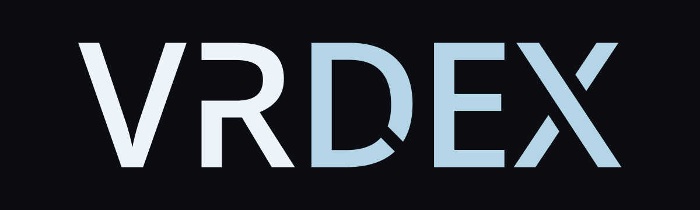

# Approved VRDex wordmark

Locked decision: BASIC approved this wordmark in chat on 2026-10-21.
Use this directory as the canonical asset source. The files are exact copies
of the selected exports from the [archived final spacing study](../../planning/assets/wordmark-studies-2026-10-21.md#approved-source).

## Files

| Version | SVG | Transparent PNG | Navbar PNG |
| --- | --- | --- | --- |
| Primary | [SVG](./vrdex-wordmark.svg) | [900 × 253](./vrdex-wordmark.png) | [137 × 39](./vrdex-wordmark-navbar.png) |
| Monochrome | [SVG](./vrdex-wordmark-mono.svg) | [900 × 253](./vrdex-wordmark-mono.png) | [137 × 39](./vrdex-wordmark-mono-navbar.png) |

The [preview SVG](./preview.svg) and PNG place the approved primary asset on
charcoal for inspection. Standalone wordmark exports have transparent canvases
and outlined paths, with no font or external-resource dependency.

## Locked design

- Open upper-left R stem, with its lower stem and diagonal retained.
- D cut slopes down-right at 45°, with the approved 8% wider opening.
- Both X gaps match the D cut's perpendicular width. The descending X stroke
  remains continuous.
- Slightly tighter letter spacing, with D/E brought closer by a further 3 px
  at 100 px cap height. Other gaps retain the selected spacing.
- VR is `#EDF3FA`; DEX is `#B4D5E5`. The supplied monochrome version uses
  `#EDF3FA` throughout.

The overall SVG canvas is 469.002 by 132, with a 100 px cap height and fixed
padding. Preserve its proportions and the selected letter spacing when scaling.
The navbar proof uses a 29 px cap height. App adoption is a separate
implementation step; this approval records the asset choice.

## Provenance and verification

The [archived source script](../../planning/assets/wordmark-studies-2026-10-21.md#approved-source)
reproduces the selected geometry and exports. The archive preserves all earlier
studies and their original paths; its index includes extraction and checksum
instructions. [manifest.json](./manifest.json) records approval, source archive
and the source study's path within that archive, along with canonical-file
checksums. Canonical exports were compared byte for byte
with the approved source, and the actual preview was rendered and inspected.

The letterforms derive from Open Sans Semibold 1.10, digitized data copyright
2011 Google Corporation, with custom R/D/X contours. Its Apache 2.0
[license](./LICENSE-OpenSans.txt) is included; the font itself is not bundled.
