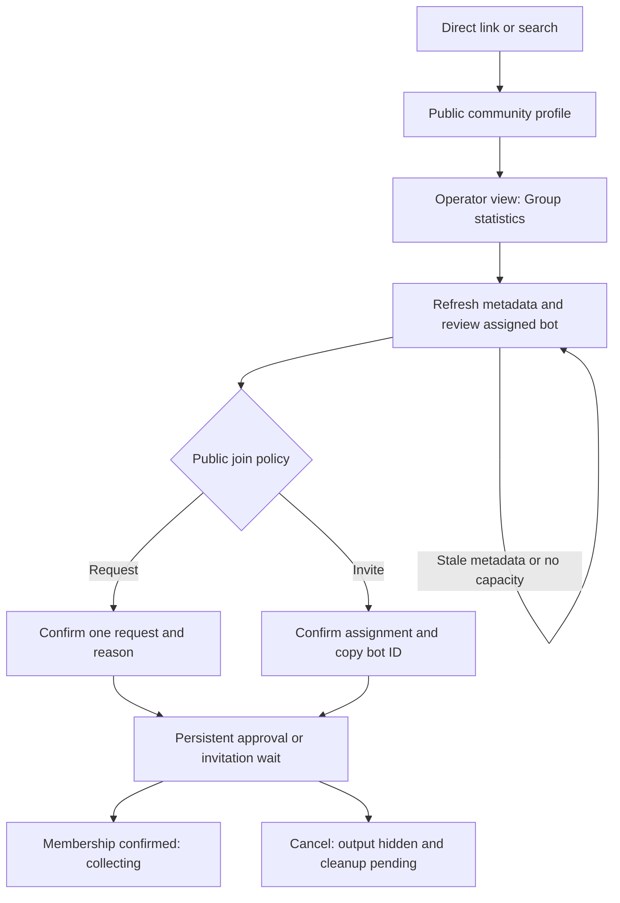

# Automatic group statistics release review

This change prepares automatic aggregate statistics for public community primary groups. It reuses the collector and preserves managed settings, group stops and retained history. Source validation does not authorize a release. BASIC still needs to approve the exact copy below, deployment, migration, one exact pilot group and later activation.

Keep admission disabled with limit zero. Recommend a one-group pilot only after the control plane, worker capability and alert delivery checks pass. This limits the first live change while leaving the existing managed service available. Homie Hub is not pre-approved. No account creation, fleet expansion, quota increase or provider-policy change is included.

The [approved design](../superpowers/specs/2026-10-25-automatic-group-statistics-design.md) and [implementation plan](../superpowers/plans/2026-10-25-automatic-group-statistics.md) define the feature. This document defines its release gates and preserves review evidence.

## Release order and stop conditions

1. Obtain release authorization. Record the full candidate Git SHA using `git rev-parse HEAD`, its immutable image digest, previous compatible image and approved target environment in the release record. Deploy the backward-compatible schema/control plane with `automaticEnrollmentEnabled=false`, `automaticEnrollmentLimit=0`, and no initial `automaticEnrollmentScope`. Missing values also deny admission. `configureFleet` preserves an existing scope if omitted; do not mistake omission for clearing it. Disabling the boolean and setting zero are the rollback gates.
2. Obtain migration authorization. Use the existing `migrations:runBackfillGroupObservationPolicies` runner, which runs the policy migration followed by rollup mapping in batches of 50. Rehearse with `dryRun` and inspect migration diagnostics, including `group_observation.reconciliation_required` and skipped ambiguous or pre-epoch rollups. Inspect completion and retained settings before continuing. Conflicting active group bindings must be reconciled explicitly; never silently merge their histories.
3. Deploy workers from the recorded SHA. Require `automatic_group_aggregates_v2` as well as the existing `telemetry_v1`, `vrchat_proof_v1` and `profile_link_destinations_v1` capabilities. Run the existing `collectorDeploymentReadiness` with that exact SHA, the configured account, all required capabilities and a fresh heartbeat window. Verify ECS task identity, immutable image digest and running health separately. Capability-aware claim dispatch rejects legacy workers even if another worker on the same account is current. Deploy public contracts/web after these checks.
4. Review and authorize the infrastructure change separately. The image-only release plan allowlist rejects the new alarm resources, so bootstrap this reviewed alarm change before expecting the normal image release lane to accept a clean plan. Verify every alarm action targets the existing SNS topic, its email subscription includes `basic@basicbit.net`, the subscription is confirmed and delivery is proven through an authorized test. The variable default is not delivery proof. The release workflow overrides it with `GROUP_TELEMETRY_BUDGET_ALERT_EMAIL` and rejects an empty value. Live subscription and delivery remain UNKNOWN here.
5. Obtain the exact immutable ID of an approved public/free-join pilot. Set limit one and scope `{kind: "pilot", vrchatGroupId: "<approved group>"}`, then enable admission. Preserve the existing fleet kill switch and request budget when calling `communityTelemetry:configureFleet`; both are required arguments. Verify provider-confirmed admission and non-empty aggregate collection, public web, REST, hosted MCP and stdio parity, verified opt-out, immediate public suppression and completed membership cleanup. Record named-data exclusion and managed behavior separately. A heartbeat, synthetic fixture or successful deploy does not prove any of these outcomes.
6. Only after separate activation authorization, run bounded existing `groupObservations:reconcilePage` backfill and increase the reviewed admission limit/scope. Keep monitoring within its coverage below. Do not create accounts or change capacity, request quotas or provider policy as an automatic response to waiting work.
7. Roll back admission first by disabling it and setting limit zero. New connecting admissions can no longer claim or reserve provider requests, including assignments allocated before rollback. An uncertain prior attempt can still verify membership with the same account, without joining. Existing active collection and cleanup remain available. Use authorized group stop/moderation controls to suppress affected output and fence leases before membership cleanup. Keep canonical policies and retained history. Never dispatch automatic work to old workers or remove schema fields while automatic records remain.

A provider request already authorized and sent before rollback cannot be recalled. Every later automatic request needs a fresh lease, policy and budget authorization. The join reservation persists `automaticAdmissionAttempt` before the provider call. A lost reply or confirmation leaves an uncertain attempt that can only inspect membership on the same account. Absence stops observation; it cannot cause another automatic join. Confirmed leave cleanup clears the attempt. Stop/resume defaults exclude previously suppressed history unless a verified operator explicitly republishes it. This supersedes the earlier admission-persistence limitation in ruling 13.

`automatic_group_aggregates_v2` supersedes v1 for automatic work and managed assignments with named history explicitly disabled. Both the request and a fresh heartbeat from the exact worker/account must advertise v2. V1 remains valid diagnostic metadata and can serve unchanged legacy managed assignments. Rolling back to a v1 worker pauses protected assignments; it does not authorize a downgrade of their privacy guards. No deployed worker upgrade is claimed here.

Adopted aggregate-only snapshot reads use the same current per-request authorization before metadata and instances. A stop or analytics disable between those calls prevents the instance read. That request scope remains enforced if named history is enabled during the snapshot. Collection authorization reads the current lease, canonical decision and analytics setting, independently of public visibility. Verified private/request/invite managed onboarding can collect privately while its public population remains hidden. Explicitly enabled management features keep their separate budgets and authorization, so stopping statistics can preserve posts without permitting more aggregate requests.

The optional `namedMembershipCollectionEnabled` field defaults to legacy managed behavior when absent. New automatic records and active automatic adoptions set it to false. The existing Connection page has a separate named-history choice. Enabling requires `manage_integrations` and fresh manager proof for the exact group; disabling requires `manage_integrations`. Publication settings never enable collection. A never-confirmed admission-required candidate enters ordinary managed onboarding after the same exact-group proof, using managed category defaults rather than an automatic public projection.

Cleanup uses the disconnected state rather than creating an operator kill switch. Authorized resume and orphan readmission retain the epoch and become claimable. An independent integration kill switch still blocks allocation and claims. Historical disconnected records with an already-set switch remain held until the existing operator control explicitly clears it; this change cannot infer why an old switch was set.

## PR 386 review corrections

Adopted `automatic_aggregate` publication refreshes visibility and join policy on each successful snapshot. Workers retain per-request metadata authorization even after named-history opt-in. Missing metadata or a failed poll invalidates automatic public eligibility; an older result cannot restore it. Explicit `managed_categories` publication keeps its existing category policy for private groups.

Directory-derived groups require a currently visible selected outbound link and that profile's own destination reference. Another profile's shared cache entry cannot keep a hidden association eligible. Verified control associations keep their existing behavior.

Managed instance reads and event associations resolve ownership through the current integration and epoch. Adoption therefore retains ownerless sessions collected before management, without rewriting history. Conflicting stored ownership and foreign integrations remain inaccessible.

Shared member snapshots retain their group history when automatic admission starts. Population observations retain the integration epoch. Explicit stop/resume still fences both histories, and the first new member observation after that fence persists even when its count is unchanged.

## Alarm coverage and response

Existing alarms cover task count, CPU, heartbeat, authentication, control-plane failures and restarts. A healthy collector can still have a stuck enrollment queue, so the authenticated heartbeat now returns only a backlog boolean. The worker logs it as `automaticEnrollmentBacklog` with value zero or one, without group IDs or provider records.

The signal requires an eligible, enabled automatic candidate queued for at least 15 minutes. Admission must be enabled, have a positive limit and a scope. Stopped, admission-required, orphaned and out-of-pilot candidates are excluded. Current contributor quota and automatic occupancy determine whether an intentional wait still applies; stored queue reasons alone do not suppress the alarm. An uncounted candidate waits 15 minutes after its last binding quota timestamp expires before it can signal backlog. That grace uses stored timestamps and does not restart on each heartbeat. Already counted candidates spend no further quota. A drop in occupancy or an authorized limit increase can make an old candidate actionable without another admission pass. Managed-policy waits remain excluded. The exact pilot group is read directly, even if other groups fill the queue.

The `all_eligible` check reads the first 50 automatic queue entries using the queue index. It is a bounded diagnostic, not a complete inventory of larger queues. Do not expand beyond this monitoring coverage until a reviewed paged diagnostic covers the larger queue. The alarm requires a positive signal in three consecutive one-minute periods after the 15-minute wait. Missing backlog metrics do not breach this alarm; the separate missing-heartbeat alarm covers collector absence.

On an alert, inspect the approved scope, queue reasons, collector capability/readiness, account health, available headroom and existing budgets. Repair the cause within its authorization or pause admission. Never expand capacity or rejoin a stopped group automatically. This task verifies source wiring only; Terraform planning/apply, CloudWatch emission, SNS subscription and email delivery remain live release checks.

## Source validation and remaining proof

Implementation through Task 7 starts at `bb3c401f5001f90c01644209f174603a6c92e353`. Task 8 evidence is in `.superpowers/sdd/2026-10-25-automatic-group-statistics/task-8-report.md`. The final whole-branch repair evidence, exact commands and commit are in `.superpowers/sdd/2026-10-25-automatic-group-statistics/final-fix-report.md`. Before release, capture the full final approved SHA in the release record and pass it unchanged to the image build and readiness query. No live release SHA is assigned by this document.

Local evidence includes backend policy/worker regressions, worker protocol tests, public contracts, MCP tests, web tests/types/lint, docs checks and the mounted desktop/mobile Playwright fixture. The mounted refresh regression starts with visible current values and a graph, then removes telemetry or permitted population fields in a successful response and verifies that stale visible values clear.

The earlier three-failure baseline at `042edb1a7` no longer describes the branch after merging main. PR 386 validation records the current Windows failures and exact incoming-main comparisons in `.superpowers/sdd/2026-10-25-automatic-group-statistics/pr386/implementation-report.md`. The full backend suite is not green; Linux CI remains required.

Local Convex generation succeeded in Task 6. Existing wrapper `DEP0190`, anonymous-mode beta/update notices, Git LF/CRLF warnings, Next middleware deprecation and webpack preview notices remain disclosed tooling follow-up. They do not establish a provider or production failure, and they are not repaired in this feature.

## Exact proposed copy

All wording below is proposed for BASIC's review before shipping. Utility labels are listed together with consequential sentences so approval can name exact text. Implementation and tests do not grant copy approval.

Task 5 Connection labels: `Publication`, `Automatic`, `Managed`, `Group statistics`, `Stopped`, `Enabled`, `Verification required`, `Republish retained history`, `Resume`, `Stop`.

Final repair Connection label: `Named membership history`. It starts unchecked on adoption and changes collection independently of Analytics or publication. The existing `Unable to save features.` fallback is reused. Worker-only guard errors are `Named membership collection is disabled.`, `Rollup collection scope does not match its community.` and `Event rollups require a managed event.` No new public explanatory sentence is added.

The retained-history checkbox needs explicit judgment because it republishes suppressed history. It defaults unchecked.

Task 5 errors:

- `Group observation is stopped. Resume before connecting.`
- `Group observation is stopped.`
- `Retained history is only available when resuming.`
- `A bounded moderation reason is required.`

The last error belongs to the internal moderation mutation. Existing `Refresh to continue.`, `Group connections require reconciliation.`, `VRChat group ID is invalid.` and structured control-proof errors are unchanged.

Task 7 graph labels: `Population history`, `People`, `Instances`, `Observation`, `No observations`, `{population} people · {instanceCount} instances`, `{value} people`.

Task 7 invalid-day sentence: `Choose a completed day of at most 24 hours.` A completed 23-hour local day is allowed; a 25-hour DST day exceeds the public range limit. The default remains the last 24 elapsed hours.

New accessibility name: `Observation details`. Existing `Inspect day`, `Last 24 hours`, `Current`, `Stale`, `In group instances`, `{count} active instances` and `Profile read failed` are unchanged.

Corrected Task 6 validation error: `Supply both bounds, with end after start, no later than now, and at most 24 elapsed hours apart.` This corrects the description of historical ranges without changing validation.

## Public documentation wording

The public telemetry documentation adds these exact paragraphs, also proposed for BASIC's copy review:

> Automatic statistics use a public community's primary VRChat group link. Eligible public, free-join groups can receive aggregate statistics within the configured admission limits. Linking a group does not grant ownership or management rights. Automatic public statistics exclude names, worlds, individual instance rows and private instance links.
>
> Verified group operators can stop observation or adopt management. Stopping hides current and historical statistics immediately while membership cleanup completes. Resuming shows new history by default; publishing retained history requires an explicit choice. Automatic enrollment remains disabled until a separately approved rollout.

The public-controls paragraph becomes:

> Managed categories are private by default. The club owner chooses which categories are public, available to all or selected staff roles, or owner-only. Existing public settings carry forward. Automatic collection uses a fixed aggregate-only public policy, which adoption preserves until the verified operator explicitly saves managed publication settings. The managed public telemetry surfaces are:

## Local visual evidence

Task 5 Storybook passed 18 desktop/mobile cases. `.cache/artifacts/group-observation-controls-storybook-desktop.png` and `.cache/artifacts/group-observation-controls-storybook-mobile.png` show the controls after explicit checkbox selection. The tests first verify unchecked submission, then selected submission. Storybook mutation responses are simulated; local Convex tests cover actual backend authorization and persistence.

The final repair Connection run passed 20 desktop/mobile cases. `.cache/artifacts/named-membership-history-storybook-desktop.png` and `.cache/artifacts/named-membership-history-storybook-mobile.png` show the independent unchecked choice after enabling and disabling it. Both screenshots were inspected. Backend tests cover exact-group authorization, rejected named ingestion before opt-in, and independent publication changes.

Task 7's final mounted run passed 12 cases. Its report records screenshots under `apps/web/test-results/`, synthetic JSON/DOM/link/history evidence, and hashes for `task-7-public-privacy-0.json` and `task-7-public-privacy-1.json` in the plan directory. Those inputs contain private sentinels, and the public output excludes them. Task 8 retains its new screenshots and final raw logs in the same plan scratch directory. None of this is hosted acceptance, provider-membership proof or a production privacy audit.

The controller owns final whole-branch review, the ordered decisions below and eventual scratch cleanup. This task does not push, merge, deploy, run live migrations, choose a pilot or activate admission.

## Ordered implementation rulings and costs

The following appendix preserves every ledger `Ruling` entry in source order. Costs describe the consequences of a wrong decision; these entries do not authorize release actions.

1. Preserve the source changes just merged from main, including person-proof endpoint recovery - the approved feature must not revert concurrent repairs - wrong adjudication costs reviewable source rework.

2. Task 1 may update additional managed consumers required by optional assignment ownership - the plan explicitly requires auditing every consumer, so preserving type-safe existing behavior takes precedence over its short file list - cost is a larger foundational diff.

3. No live bootstrap commands or production Convex mutation are allowed during implementation - local generation/test workflows only - cost is deferred runtime proof already required by Task 8.

4. For multiple disconnected historical integrations, select latest createdAt with ID tie-break only as canonical pointer, preserve all rows/history and mark observation stopped. Conflicting non-disconnected integrations get a stopped managed_conflict policy with no canonical pointer and audit diagnostic - no silent ownership/history merge - risk is a held group until reconciliation.

5. Allow a mechanical generated API import/map entry for new modules during Task 1, then require local-only generator comparison in Task 8 - installed codegen selects a deployment and the task must not touch an unknown hosted environment - risk is generated drift, covered by deferred local verification.

6. Rollup backfill skips pre-current-epoch buckets and ambiguous managing-profile mappings with diagnostics - assigning old history to a replacement group would be wrong - cost is retained rows requiring explicit reconciliation.

7. Task 1 must prevent cross-group reuse of an integration ID after canonicalization. A different-group reconnect allocates a new integration; same-group reconnect retains existing epoch semantics. Managed lookup selects current non-disconnected record or deterministic latest history - immutable identity/history safety is foundational, not a later enrollment feature - cost is a scoped connect/lookup regression.

8. inherited RED log has no command header, so retain observed failing assertions and label any command reconstruction as a reproduction recipe, not historical evidence; exact new GREEN commands required. Cost if wrong: a reconstructed command could be mistaken for recorded historical test evidence.

9. explicit legacy public group_size metadata remains available absent registry/integration; it does not grant automatic telemetry. Managed group policy overrides duplicates, and stop suppresses both paths. Independent optional publicationPolicy defaults existing managed records to managed_categories. Task1 reviewed checkpoint pushed to feature branch786bb9f4c. Cost if wrong: existing public member counts could disappear, or a duplicate profile could bypass managed privacy.

10. Legacy managed posts-only/analytics-disabled integrations retain independently and explicitly public group_size metadata, while telemetry and automatic fallback remain disabled. A real group-wide stop from verified opt-out/moderation/ban/removal suppresses both. Migration-derived analytics_disabled admission blocks must not be conflated with explicit all-observation stops; classify/model this centrally and test migration-to-readback. This preserves approved existing managed settings; wrong classification would either leak stopped statistics or regress public group counts. Task2 may adjust the minimal upstream policy/migration representation and must hand it to Tasks3/5.

11. Task3 must add an explicit unverified primary directory-reference path in the existing contribution flow, because outboundLinks do not create primary normalized associations and existing addVerifiedConnection requires proof. No first/footer URL inference. Directory-only provenance must be excluded from all ownership/control corroboration, even a different contributor, while verified/operator associations preserve behavior. Existing unclaimed/claimed edit permissions apply. Expand Task3 only to necessary input/contracts/UI/claim guards and focused tests. Approved spec already requires unclaimed contribution without ownership grant; cost is additional input-path work and security review. Detailed ruling appended to task-3-brief.md.

12. A plain directory contribution must not reactivate removed verified/operator control provenance. Create a separately provenanced active directory row, retain removed control history, reuse active directory rows idempotently, preserve active verified/operator provenance, and allow privileged/verified restoration only through their authenticated paths. Test self/other-user corroboration remains denied after removed-operator -> directory selection. Wrong choice would launder directory edits into claim evidence.

13. Task4 automatic recovery after confirmed membership resumes degraded for read-only membership verification, never connecting; automatic reassignIntegration is denied through shared operation guard. Existing account-ready recovery otherwise resets assignments to connecting and quarantine reassign can rotate accounts, violating no-rejoin. Preserve managed recovery. No crash-atomic provider-join ledger/schema is added because requirement concerns confirmed membership; the provider-join-to-confirmation persistence interval remains a stated runtime limitation for final review. Cost if wrong: an ambiguous initial join may need stricter durable attempt handling in final review.

14. The first explicit publication-setting save switching adopted automatic_aggregate to managed_categories requires active exact-group manager control proof, beyond profile ownership. The transition changes group-wide policy and the approved adoption path grants no authority through a directory contribution. Existing managed_categories save authorization remains unchanged. Cost if wrong: an adopted operator may need to refresh its group proof before the first save.

15. REST profile reads currently use a caller identity/route-class aggregate budget, with no resource/range response cache. Preserve that budget instead of splitting by range, which could allow budget bypass. Query canonical policy on every read and set no-store on profile GET responses for opt-out freshness; no new cache or resource budget is warranted. Transport regressions cover header and stop-after-earlier-read suppression. This satisfies plan cache/rate intent without inventing missing mechanisms; cost if wrong: fresh requests incur existing query work rather than a new cache.

16. Task7 may minimally repair Task6 producer continuity semantics. Per-bucket span fragments currently lose whether adjacent buckets were separated by an explicit failure; inferring from `<=5m` gaps could fabricate a bridge, while breaking every bucket would fragment normal history. Reuse existing observedSpans.startAt/endAt as the full continuous segment bounds within the requested window, repeated for its bucket fragments. Each bucket still contains only its own reduced points, with first/last/extrema, no new field. Chart joins only matching segment bounds and never distinct spans. Add focused cross-bucket continuity and explicit-failure regressions, update contract description/docs. Cost if wrong: reviewable span-bound semantics change before any release, with no persisted-data migration. No new privacy payload.

17. Task7 may use the existing enabled Playwright fixture-profile getter to return a null fixture-world result for a known fixture profile slug before absent localhost backend fallback. Existing mounted entity lookup fans out profile/world reads and otherwise emits an unrelated absent-local-world error. Keep the guard fixture-only (production getter returns null), preserve real world/profile resolution and private-sentinel checks, cover nearby helper if available. Cost if wrong: a fixture-world collision may be masked in tests; real production behavior must remain unchanged and is included in Task7 review scope.

18. Task8 closes a newly found rollback gap: disabling admission must also gate already allocated automatic connecting claims and admission/provider reservations, because allocation-only checks still permit new joins. Keep existing active reads and cleanup available. Cost if wrong: conservative initial admission pauses until configuration is explicitly re-enabled; managed work must remain unchanged.

19. Existing collector alarms do not cover healthy-worker sustained enrollment/capacity backlog. Add a minimal bounded indexed queue check to authenticated heartbeat, sanitized backlog signal in existing worker logs, metric filter and sustained alarm on existing SNS email topic `basic@basicbit.net`. Exclude disabled/zero/unscoped, stopped, admission-required, orphan and out-of-pilot candidates; exact pilot lookup avoids bounded-scan false negatives. No new service/API or fleet expansion, no Terraform apply/email test. Cost if wrong: false-positive capacity alerts or missed backlog within documented lookup limits; focused source/wiring tests and later live alarm proof remain required.

20. Supersede ruling 13's no-admission-ledger limitation. Persist an automatic admission-attempt boundary before provider join. Uncertain recovery uses the same account to inspect membership and stops if absent rather than rejoining without explicit authorized resume. The final reviewer demonstrated that removal after a successful unpersisted join is covered by the no-rejoin rule. Allow minimal compatible state/schema and current per-request authorization. Cost if wrong: uncertain first attempts can pause conservatively and need authorized recovery; this avoids a consent violation.

21. Add the minimal named-history toggle to existing Connection settings, an optional integration field and an authenticated mutation. Undefined preserves legacy managed behavior; automatic/adopted records explicitly disable named collection. Enabling requires integration-management permission and fresh exact-group manager proof. Disabling uses the existing permission. Enforce worker and direct-ingestion guards independently of publication. No new page, REST endpoint or MCP tool. Cost if wrong: an operator must refresh proof before enabling named history. Exact label remains subject to BASIC's copy review.

22. Add `automatic_group_aggregates_v2` to distinguish workers that enforce per-request authorization and the named-history choice. Require v2 in both the claim request and the exact worker/account's fresh heartbeat for automatic and explicitly aggregate-only managed assignments. Retain v1 for diagnostics and unchanged legacy managed work. Update release, rollback and readiness metadata together. Cost if wrong: protected assignments wait for a compatible worker rather than dispatching to a worker that can collect named records. Existing deployments are not presumed upgraded.

23. Preserve explicit aggregate request authorization across live settings changes. A snapshot that began with named collection disabled still requires current analytics and canonical observation policy after named collection is enabled. The request discriminator, not the mutable named-history flag, selects that guard. Keep generic management budgets separate. This closes the scoped review's remaining I1 transition bypass without new architecture or UI. Cost if wrong: a settings change could permit an unsent aggregate request after analytics was disabled.

## Super-admin admission release gate

The community profile now hosts Group statistics controls for an authorized super admin, including when it is unclaimed and the withheld-profile query returns null. Direct public links and search both reach the same profile. No owner claim or connection setup is required.

Local browser fixtures render the actual public profile and private-record host with a null withheld seed record. Fixture reads and mutations replace network calls and record submissions. Desktop/mobile screenshots cover confirmation, invitation waiting and cleanup. This is UI/source evidence, not a live provider or production acceptance result. Add `ci:browsers` and `ci:visuals` if a PR is authorized later.

Shipping requires BASIC's exact-copy review below, backend-first compatibility, the approved exact-head worker readiness proof, separately authorized public request/invite groups and collector accounts, and working alarm email delivery. Rollback must revoke grants before removing compatible workers and retain capacity while cleanup remains uncertain. See the [collector runbook](group-telemetry-collector.md#explicit-admission-compatibility-and-alarms) and [provider proof](../engineering/group-telemetry-provider-proof.md#explicit-admission-proof-boundary). No deployment, production configuration, push, merge or live membership operation is authorized by this document.

### Exact admission copy for BASIC review

Status: proposed. This packet does not record copy approval. Utility labels use the existing style. New explanatory and fallback sentences are verbatim:

- `Ask a group admin to invite the displayed bot as an ordinary member.`
- `Collection starts after membership is confirmed.`
- `Aggregate statistics only.`
- `Statistics are hidden. Capacity stays reserved until cleanup is confirmed.`
- `Inspect the assigned bot in VRChat. Withdraw a remaining request manually. Cleanup requires operator reconciliation before capacity can be released.`
- `Refresh required. Review the current group and bot.`
- `Could not copy bot ID.`
- `Unable to save admission.`

Utility/status labels: `Group statistics`, `Group`, `Visibility / join policy`, `Join policy`, `Metadata checked`, `Assigned bot`, `Authorized`, `Last inspection`, `Reason`, `Not yet`, `Unavailable`, `Unknown`, `Not admitted`, `Waiting for approval`, `Waiting for invitation`, `Collecting`, `Paused`, `Ended`, `Cleanup pending`, `Cancelled`, `Copy bot ID`, `Bot ID copied`, `Open bot profile`, `Request to join`, `Assign bot`, `Refresh metadata`, `Check status`, `Cancel admission`, `Confirm request`, `Confirm assignment`, `Back`.

Blocked-state labels: `Public primary group required`, `Public request or invite group required`, `Refresh metadata required`, `Conflicting connection`, `Statistics stopped`, `Cleanup required`, `Collector unavailable`, `No capacity`, `Managed groups waiting`, `No bot capacity`, `Admission unavailable`. Backend validation errors remain visible beside the affected controls. Their existing exact strings are defined in `convex/groupObservations.ts`.

Cancellation of an adopted admission hides output immediately, including a prior managed publication choice. A later authorized managed publication save can restore managed output; the canonical group stop and history boundary still apply. The retained admission grant is unchanged. Fresh successful pending inspections reset inspection failures; active aggregate failures remain consecutive. Confirmed outstanding requests require the same manual withdrawal and operator reconciliation guidance as uncertain cleanup.
