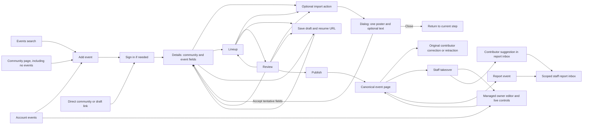
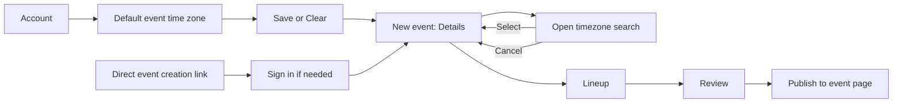

# Browser event contribution

The browser intake at `/events/new` uses `eventIntake.saveEventIntakeDraft`,
`getEventIntakeDraft`, and `publishEventIntake`. The `community` query parameter
preselects a community. Saving sets a resumable `draft` URL and stays on the form.
Publishing returns the command's canonical `eventPath`. The form records the successful
submitted snapshot before deciding whether to leave.

## Details identity and optional fields

Generic Add event starts without a selected community. A community entry link
preselects that community. The empty picker offers owner and staff communities
under Your communities; public search remains available for other groups.
Selection, preview and Review share the retained display name and image. Public
presentation refreshes without replacing known names with slugs. Staff editing
keeps its existing community restriction.

Where searches published worlds or accepts an explicit manual location. A saved
world and custom venue label remain separate. The label appears in the selected
world's Details. World-only locations display their resolved title in preview and
Review without storing a venue override. Hydration updates presentation only.
Switching to manual retains the displayed name in an editable location field,
including an empty field when public presentation is unavailable. Clearing its
text keeps that manual field open. The switch clears only the represented world
link. Unrelated published and protected world associations remain attached.

The authorized staff readback adds `editableWorldAssociation` for the first
projected public world. Its association ID stays in the parent command adapter.
Explicit replacement or clearing excludes only that ID from the preserved
snapshot. The mutation scopes preserved IDs to the current event and returns a
new mapping for the explicitly selected world. Unrelated saves keep the live
mapping. Public/API event projections contain no editor mapping or private slugs.

Doors-open time starts collapsed when absent. Stored or accepted imported values
expand it. Collapsing preserves the value; clearing the input removes it.
Original event post is optional and starts in a collapsed disclosure, preserving
the existing source URL and provenance rules.

Timezones are selected from the runtime IANA list with city and regional aliases.
Abbreviations are search terms, not stored fixed offsets. The compact selector
opens a search popover. Opening, searching and cancelling leave the selected
IANA value and occurrence choices unchanged. Selection commits once. Search results show
an abbreviation and offset only when the event start resolves to an instant;
incomplete or ambiguous starts show the region without guessing an offset.
Repeated local hours require an occurrence choice and missing local hours cannot
publish. Existing owner timestamps remain exact when unchanged.

Both editors display schedules in the private Account timezone preference,
otherwise the browser zone, otherwise UTC. The correction wrapper uses the same
viewer preference. Deliberate display-zone choices survive step navigation and
late preference data. Once a new draft has timing context, late defaults cannot
reinterpret it. Opening an editor or choosing its display zone never updates the
account preference.

The canonical event date, zone, occurrences and precise instants remain the
persistence source. Display conversion does not edit that state or cascade the
lineup. Deliberate clock edits resolve in the displayed zone and serialize through
the canonical zone. Starts invokes the existing elapsed-time cascade once, with
the explicit end fixed. An update outside the -1 through 7 day-offset bounds
leaves all prior fields intact and reveals the timing correction controls.

Staff records can have known absolute instants without a stored timezone.
Opening those records, converting the display zone and saving unrelated edits
preserve the missing source zone and exact start, end, doors and lineup timing.
Their controls and preview project the known instants into the editing zone.
A deliberate Starts, Ends or Doors clock edit establishes missing source context
in that selected zone. It reprojects untouched controls without moving their
instants. Only Starts reschedules the lineup. Date-only records and unresolved
contributor source clocks keep their existing explicit-authoring rules.

Accepted imports resolve in their supplied source date and zone before local
projection. Questions and evidence remain. Unknown source dates, missing zones,
DST gaps and unresolved repeated hours remain unresolved. Saved unresolved
clocks show their source context under `Unresolved time`; an absent source zone
has an explicit contextual picker. Correcting a clock makes its resolved instant
available in the local display. Pending invalid input blocks a display-zone
change or Time TBA toggle and receives focus. `Cancel` or Escape restores the
previous value without editing the schedule.

Selecting Time TBA uses the calendar date currently displayed in Starts.
Date-only previews keep that authored date. Switching back restores the precise
canonical schedule. A date edited while TBA is selected becomes one local start-date
change on restoration, retaining the explicit end and its conflict rules.
Only surviving lineup keys receive backed-up timing; removed rows never return.

## Scheduling and Review

An empty lineup offers `Slots` and `Minutes each`, initially 4 and 60. Only
`Generate` creates the rows. The setup disappears while rows exist, including
partial saved or imported rows. `Add slot` inserts at a resolved boundary;
positive whole-minute durations are limited to 1,440 and lineups to 80 rows.
Unknown boundaries require the existing timing controls or an untimed addition.
Insertion, removal and committed duration edits shift later timed rows by elapsed
minutes, preserving durations, gaps, keys, performer matches and stream choices.
Enter followed by blur commits a valid duration change once. Invalid duration
text, including blank or whitespace in controls without a clear operation, stays
pending until a valid commit or explicit Escape. Time TBA refuses that conversion
while a duration is pending, opens Lineup and its containing Details disclosure,
and focuses the input without changing its raw text or committed schedule.
After correction or Escape, TBA can proceed and restore the surviving schedule.
Intake has a compact duration control; staff supports compact and detailed controls.
Detailed controls that support clearing still commit an empty value. Changing Starts shifts
the timed lineup together. Compact row times use the editing timezone and retain
crossing dates, seconds and milliseconds where present. Repeated-hour ranges show
the offset for each instant. Details and Review show the friendly zone label;
ordinary rows do not repeat raw IANA identifiers.

`Reset lineup` requires confirmation and removes editable timed and untimed rows.
Cancel keeps edits; confirmation keeps details, artwork, timezone and explicit end.
Time TBA preserves timing only in the current editor backup; removed keys stay removed.
Staff and contributor lineups retain untimed row positions. The staff browser
uses canonical `lineup` for new events and deliberately edited lineups. An
unrelated save omits the lineup, including for legacy events. Existing external
`participantLinks` and `slotLinks` commands retain their contracts. Staff creation
still requires `startAt`.

Entered and persisted event ends remain fixed through all lineup/start edits.
Lineup and Review repeat an overrun with actual bounds. `Set event end to lineup end`
changes only the end to a fully known timed lineup end. Partial rows never produce
an invented extension target. Contributor drafts can retain unresolved overruns;
publication and staff saves must resolve them. Clearing Ends restores fully known
lineup derivation, while unknown ends remain absent.

Review contains one primary submit near its summary: `Publish event` for new events,
`Save and publish` for staff drafts, and `Save changes` for published staff events
or scoped contributor corrections. It reuses the existing form handlers and commands.
The button mounts only during Review so native Enter on earlier steps keeps navigation.
Pending guards prevent repeated submissions; Save draft and withdrawal stay secondary.
Contributor correction still sends only changed permitted fields and closes back to
its existing event surface. New publication and staff publication/save return directly
to the command's event page. Validation reveals and focuses Details or Lineup,
including missing timezone, DST gaps and unresolved repeated-hour choices.

### Performer identity

Timed and untimed rows share one `Performer` lookup. Typing or blurring a name
does not link a profile. Selecting a person links it; `Add manual entry` keeps the
entered text unlinked, even when search returns matches or fails. Manual rows
show `Unlinked` and `Link profile`.

`Display name as` holds optional billing text. Linking `Guest A` to Aurora keeps
`Guest A` as an override. A manual name equal to the selected profile name uses
default billing, so replacing that profile adopts the new person's name. An
already-explicit override retains its intent even if its text equals a profile
name. Changing the profile keeps that override. Clearing the
override adopts the selected profile's name, and later profile changes follow
the new name. A saved differing label opens the disclosure. Profile hydration
only updates presentation, preserves unavailable links and does not author a save.
The parent retains explicit override intent for the open editing session.
Intake publication requires a selected profile or a nonblank manual name. Search
text alone cannot satisfy that constraint; saving an incomplete draft remains allowed.

Browser creation accepts canonical lineup and venue fields. Existing browser
lineup edits reuse slot client keys or stored IDs and the editor's existing
standalone participant keys. The canonical helper uses authorized, current-event
participant IDs to preserve legacy source data and confirmation. Explicit new
matches still confirm. The update-only `retainedLineupAssociations` list preserves
associations the loaded editor did not represent. Every retained ID must belong
to this event and its loaded snapshot. Removing a represented row still removes
it. Public/API readback does not expose these editor-only lists or private slugs.

Stream choices and exact stored times remain on the row during identity edits.
An incompatible saved stream remains available to clear or replace explicitly;
the existing server ownership validation still applies.

### Legacy stored-slot identity

External legacy callers of `events.updateCommunityEvent` may still use the optional update-only
`storedSlotAssociations: Array<{ position: number; slotId: Id<"eventSlots"> }>`.
`position` is the submitted slot index before start-time sorting. Editor readback
uses legacy `playbackKey` for the stored ID, separately from local row keys.
Only surviving IDs in `preservedSlotAssociationIds` are mapped. New rows are unmapped.
The response returns current IDs at submitted positions. The canonical browser
adapter uses stable row keys instead.

After existing actor/event permission checks and before writes, the backend checks
integer in-range positions, unique IDs/positions, at most 80 mappings, protected
snapshot inclusion and current membership in the same event. Mappings require
submitted slots and cannot accompany canonical `lineup`. Matching by ID preserves
omitted legacy source label/URL/notes, hidden performer links and unchanged unavailable
streams through reflow. Deliberate removal/replacement still detaches/revalidates choices.
An unmapped row is new when mappings are supplied; omitting the argument retains
older API-owner compatibility. Create, slotLinks schemas, revision checks, permission
rules and canonical commands are unchanged. This is the controller-approved narrow
exception to the original no-payload-expansion constraint.

Continue advances without validating the other mounted stages. Publish reveals
and focuses invalid controls. Saving a partial draft remains available.

Accepted timing suggestions keep their proposal calendar dates in either
acceptance order. Accepting Date normalizes pending clocks onto that date, and
later Starts edits retain their calendar dates through draft save and resume.
Accept is disabled for clocks with no usable accepted or source date, or when a
translated offset would fall outside -1 through 7. Selecting a compatible Date
can make a dated suggestion available again. If a later base edit makes a pending
offset invalid, its prior reference date stays in the private tentative fields.

Time TBA keeps newly accepted timing in a reversible editor backup. Unrelated
remembered fields survive, and removed lineup keys cannot restore. Display-zone
changes preserve remembered instants and occurrence choices. Date-only saved and published
commands remain untimed. Reloading a date-only draft discards the backup and
cannot restore stale stored clocks.

Staff Details has Starts and an optional Ends control using the selected editing
timezone. An untouched stored end retains its instant, including the later
occurrence of a repeated hour. Clearing Ends sends null on update; creation
omits an unknown end. A final known lineup end remains valid when Ends is
clear. Staff creation still requires a known start, and date-only editing
retains its existing restrictions.

An unknown end remains absent from saved and public schedule fields. Public
listing eligibility and live status use the existing six-hour watch fallback
from the start. Explicit ends and date-only schedules retain their separate
rules. See [event runtime windows](../backend/event-schema.md#event-times).

The owner editor loads contributed date-only events with Time TBA selected.
Title, venue, artwork and lineup corrections preserve the authored date without
a start instant. Turning off Time TBA requires a start time. Contributed untimed
performers have editable names, optional person matches and roles, plus remove
controls. Lineup or schedule edits replace the canonical lineup and retain
unchanged timed-set stream selections. Content-only saves leave contributed
performer links unconfirmed. Schedule-only saves preserve each existing person
match's confirmation state. Canonical editor updates request that preservation
consistently, including repeated saves. The backend compares stable lineup keys
and resolved people across the whole submitted lineup: a genuinely new or
replaced explicit person match retains the existing staff confirmation behavior,
even when another unchanged row names the same person. Timing, ordering, labels
and roles alone do not confirm an unchanged match.

Surviving canonical slots retain their source type, label, URL and notes.
Stable-key timed-to-untimed and untimed-to-timed conversions carry that provenance
through four optional internal fields on `eventLineupEntries`; unchanged untimed
saves retain it too. Legacy date-only conversion uses the same storage fields.
Old untimed records and new rows use event source type/label defaults. The untimed
records contain no hidden clocks, and canonical inputs and public/operator lineup
projections expose none of these internal provenance fields. No backfill is needed.
Existing participant records also retain their IDs and source metadata while
schedule, role and confirmation fields update. Removed people and duplicate
participant records are deleted; new records use event provenance. Deliberate
source edits remain available through the existing explicit source-capable
commands. Clearing optional editor fields sends explicit
values so they do not silently retain old content. Contributor correction
readback merges timed and untimed performers by authored position. Existing
timed owner events keep their slot keys through the shared lineup editor.

`getEventContributionAccess` returns capabilities only. Contributor identifiers
stay out of the public event DTO. Correction mutations retain server authorization
and optimistic revision checks. Staff takeover closes direct contributor editing;
the subsequent suggestion goes through `reportEvent`, not a second store.
`/account/events/reports` checks staff access before querying its paginated inbox.

Manual intake remains available without extraction. Source text is private draft
input. `/api/event-intake` binds extraction and private poster operations to the
website session. One extraction uses the current poster and optional text.
Candidates remain tentative until accepted. A verified poster becomes artwork
by default; replacing or removing it replaces or clears that artwork. Private
source evidence remains separate from the public derivative. See
[source handling](../backend/event-intake-sources.md). Date-only publishing remains subject to the backend
`EVENT_DATE_ONLY_ENABLED` gate.

Browser fixtures test form behavior and navigation without a live Convex backend.
The plain intake fixture uses session storage and a local query transport for its
known community and finite person fixtures. Person search matches fixture names,
aliases and slugs; reloads resolve exact known slugs. Unknown profile slugs stay
unresolved and survive draft saves.
It requires no previously seeded database. The owner fixture exercises the real
editor serialization through a local Convex transport. Neither proves a live
authenticated backend journey. Backend tests independently cover authorization,
publication, corrections, reports, and takeover.

The [integrated checkpoint](../testing/event-intake-checkpoint.md) records desktop/mobile
fixture screenshots, exact copy awaiting approval and the connected hosted journey
that remains unverified. Fixed public fixtures do not prove write persistence.

## Unsaved edits and removal

Both editors compare command-relevant authored fields with the last successful
submitted snapshot. Profile images, search queries, disclosures and display-zone
conversion do not change that baseline. Pending invalid clocks, durations and
name overrides count as edits until committed or canceled. Default timezone
initialization on an untouched new draft remains clean.

A save records only what it submitted. Later local fields survive the response
and remain dirty. Upload and extraction responses merge unchanged fields against
the submitted source state. Newer source text does not regain stale suggestions.
Pending clock context and lineup buffers survive source completion.

`Remove slot` opens a native confirmation dialog for timed and untimed rows.
Cancel preserves the row and schedule. Confirmation invokes the keyed removal
and timing cascade once. Deleted keys cannot return from a Time TBA backup.

Leaving a dirty editor asks `Leave without saving?`. Approval covers one
navigation attempt. If a traversal or canceled action keeps the editor mounted,
later exits ask again while authored changes remain dirty. Changing wizard stages and
closing the retained import dialog keep the form mounted and do not ask.
Correction-panel close is abandonment. Native refresh, close and document exit
use `beforeunload` while dirty; browser activation and platform rules determine
whether that dialog appears. It cannot protect against every browser or process
termination.

Cancelable same-document traversals use the public Navigation API. The public
history fallback restores a known indexed entry before asking and replays an
approved traversal once. Public pushState and replaceState indexing starts before
hydration and remains installed for the page lifetime. Unknown history entries
pass through without guessed direction or replay. They can trigger framework
document navigation and native unload confirmation. The
[approved history indexing decision](../testing/event-editor-history-indexing-proposal.md)
records the implementation scope and verification.
Browser noncancelable traversals must remain an escape route.

The early capture dispatcher uses the public
[instrumentation-client hook](https://nextjs.org/docs/app/api-reference/file-conventions/instrumentation-client)
before router hydration. The disposable editor callback receives the previous
public position as well as the destination event, so entries pushed while the
editor stays mounted have the correct traversal distance. A later editor-only
listener lost its mounted form when
the earlier router listener handled traversal first. The inert dispatcher and
state-preserving public history wrappers stay installed for the page lifetime.
Editor delegates, dirty closures and editor-specific listeners detach on unmount. A mistake here can regress app-wide navigation or leave stale blocking.
The [HTML navigation standard](https://html.spec.whatwg.org/multipage/nav-history-apis.html)
describes the browser cancellation limits.

If publication succeeds while newer edits exist, Stay retains the published
identity. The next contributor submission uses the existing correction command
and its revision and field restrictions. Forbidden changes fail visibly rather
than being dropped. Staff creation retains its slug and reads the authorized
association snapshot before its next update. Neither path creates a second event.
A failed command leaves the saved baseline unchanged.

The prior [Square discard journey](https://mobbin.com/flows/f142a720-3023-4b5f-9ccb-d6f5d5b04398)
supports placing the discard decision at abandonment. Its three inspected
screens show editor, confirmation and overview; they do not prove persistence.
This editor uses native confirmation. Separate profile-editor progressive
disclosure remains deferred.

## My events inventory and continuation

`/account/events` uses `eventInventory.listPage` for active creator-private intake
work, authorized managed canonical events and the viewer's own contributions.
The generated tagged projection supplies each continuation; the browser never
turns contributor inventory visibility into staff authority. Intake Continue
opens `/events/new?draft=<id>`; canonical drafts continue at
`/<community>/events/<code>/edit`. Published staff work has Edit; contributions
use their canonical public page and its existing correction/report controls.
Retracted contributions remain in All and are not resumable intake drafts.

Intake drafts expire 30 days after their last save. Inventory reads do not renew
retention. Expired drafts and drafts with publication receipts are omitted.
Private source posters are not inventory thumbnails. Managed work is deduplicated
from own contributions by identity and live authority, never title.

One native paginated query owns the traversal. Sources are visited in order:
creator intake, managed communities ordered by ID, then own contributions. This
is not a global chronological sort. Each bounded source page filters title and
current community name before presentation. All, Upcoming, Drafts and Past use
the viewer's timezone, retaining date-only values and unknown/ambiguous clocks.
The browser requests 20 candidates, automatically crosses up to three empty
pages, and keeps Load more available for remaining work. A failed source clears
the inventory and uses the established error/Retry state; it cannot appear as
No events. Criteria, identity and refresh reset traversal, while keyboard focus
stays in the controls. Retry, focus, visibility and local-day/zone changes refresh
the traversal; the classification clock stays fixed while paging.

Authoring return links use the existing dirty guard. Explicit save, revision
checks, edits during pending requests, Review publication and canonical return
remain unchanged. Staff Save changes retains publication. Discord text is
composed from the authorized saved staff projection only when published and
noncancelled. Inventory visibility grants no additional export access.
