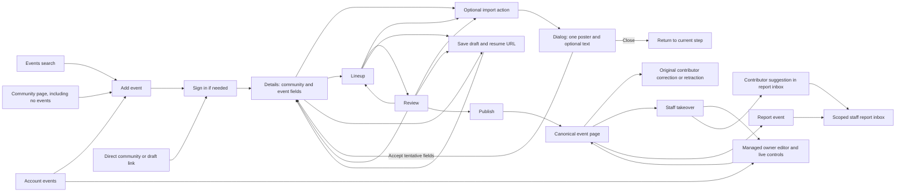
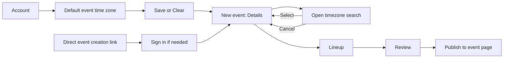

# Browser event contribution

The browser intake at `/events/new` uses `eventIntake.saveEventIntakeDraft`,
`getEventIntakeDraft`, and `publishEventIntake`. The `community` query parameter
preselects a community. Saving sets a resumable `draft` URL and stays on the form.
Publishing replaces the route with the command's canonical `eventPath`.

Timezones are selected from the runtime IANA list with city and regional aliases.
Abbreviations are search terms, not stored fixed offsets. The compact selector
opens a search popover. Opening, searching and cancelling leave the selected
IANA value and occurrence choices unchanged. Selection commits once. Search results show
an abbreviation and offset only when the event start resolves to an instant;
incomplete or ambiguous starts show the region without guessing an offset.
Repeated local hours require an occurrence choice and missing local hours cannot
publish. Existing owner timestamps remain exact when unchanged.

New drafts use the private Account default event time zone, then browser
detection, then UTC. Authenticated editor wrappers query the self viewer;
fixture and demo editors receive preferences explicitly. Persisted drafts and
events keep their authored zone, including missing-zone validation. Manual
schedule edits and accepted imports prevent a late preference from changing the
zone. Selecting a zone for an event never changes the account preference.
Account settings save or clear the preference only through explicit actions.

Continue advances without validating the other mounted stages. Publish reveals
and focuses invalid controls. Saving a partial draft remains available.

Accepted timing suggestions keep their proposal calendar dates in either
acceptance order. Accepting Date normalizes pending clocks onto that date, and
later Starts edits retain their calendar dates through draft save and resume.
Accept is disabled for clocks with no usable accepted or source date, or when a
translated offset would fall outside -1 through 7. Selecting a compatible Date
can make a dated suggestion available again. If a later base edit makes a pending
offset invalid, its prior reference date stays in the private tentative fields.

Time TBA keeps newly accepted timing in a reversible editor backup. Unrelated
remembered fields survive, and removed lineup keys cannot restore. Timezone
changes clear remembered occurrence choices. Date-only saved and published
commands remain untimed. Reloading a date-only draft discards the backup and
cannot restore stale stored clocks.

Staff Details has Start and an optional Ends control using the selected event
timezone. An untouched stored end retains its instant, including the later
occurrence of a repeated hour. Clearing Ends sends null on update; creation
omits an unknown end. A final known lineup end remains valid when Ends is
clear. Staff creation still requires a known start, and date-only editing
retains its existing restrictions.

An unknown end remains absent from saved and public schedule fields. Public
listing eligibility and live status use the existing six-hour watch fallback
from the start. Explicit ends and date-only schedules retain their separate
rules. See [event runtime windows](../backend/event-schema.md#event-times).

The owner editor loads contributed date-only events with Time TBA selected.
Title, venue, artwork and lineup corrections preserve the authored date without
a start instant. Turning off Time TBA requires a start time. Contributed untimed
performers have editable names, optional person matches and roles, plus remove
controls. Lineup or schedule edits replace the canonical lineup and retain
unchanged timed-set stream selections. Content-only saves leave contributed
performer links unconfirmed. Schedule-only saves preserve each existing person
match's confirmation state. Clearing optional editor fields sends explicit
values so they do not silently retain old content. Contributor correction
readback merges timed and untimed performers by authored position. Existing
timed owner events keep the slot/participant editor.

`getEventContributionAccess` returns capabilities only. Contributor identifiers
stay out of the public event DTO. Correction mutations retain server authorization
and optimistic revision checks. Staff takeover closes direct contributor editing;
the subsequent suggestion goes through `reportEvent`, not a second store.
`/account/events/reports` checks staff access before querying its paginated inbox.

Manual intake remains available without extraction. Source text is private draft
input. `/api/event-intake` binds extraction and private poster operations to the
website session. One extraction uses the current poster and optional text.
Candidates remain tentative until accepted. A verified poster becomes artwork
by default; replacing or removing it replaces or clears that artwork. Private
source evidence remains separate from the public derivative. See
[source handling](../backend/event-intake-sources.md). Date-only publishing remains subject to the backend
`EVENT_DATE_ONLY_ENABLED` gate.

Browser fixtures test form behavior and navigation without a live Convex backend.
The intake fixture uses session storage. The owner fixture exercises the real
editor serialization through a local Convex transport. Neither proves a live
authenticated backend journey. Backend tests independently cover authorization,
publication, corrections, reports, and takeover.

The [integrated checkpoint](../testing/event-intake-checkpoint.md) records desktop/mobile
fixture screenshots, exact copy awaiting approval and the connected hosted journey
that remains unverified. Fixed public fixtures do not prove write persistence.
