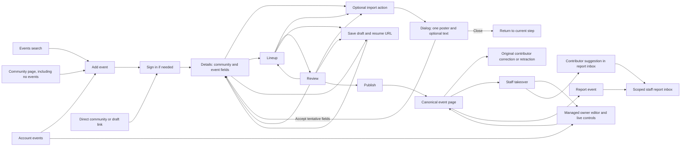
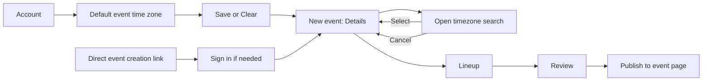

# Browser event contribution

The browser intake at `/events/new` uses `eventIntake.saveEventIntakeDraft`,
`getEventIntakeDraft`, and `publishEventIntake`. The `community` query parameter
preselects a community. Saving sets a resumable `draft` URL and stays on the form.
Publishing replaces the route with the command's canonical `eventPath`.

## Details identity and optional fields

Generic Add event starts without a selected community. A community entry link
preselects that community. The empty picker offers owner and staff communities
under Your communities; public search remains available for other groups.
Selection, preview and Review share the retained display name and image. Public
presentation refreshes without replacing known names with slugs. Staff editing
keeps its existing community restriction.

Where searches published worlds or accepts an explicit manual location. A saved
world and custom venue label remain separate. The label appears in the selected
world's Details. World-only locations display their resolved title in preview and
Review without storing a venue override. Hydration updates presentation only.
Switching to manual retains the displayed name in an editable location field,
including an empty field when public presentation is unavailable. Clearing its
text keeps that manual field open. The switch clears only the represented world
link. Unrelated published and protected world associations remain attached.

The authorized staff readback adds `editableWorldAssociation` for the first
projected public world. Its association ID stays in the parent command adapter.
Explicit replacement or clearing excludes only that ID from the preserved
snapshot. The mutation scopes preserved IDs to the current event and returns a
new mapping for the explicitly selected world. Unrelated saves keep the live
mapping. Public/API event projections contain no editor mapping or private slugs.

Doors-open time starts collapsed when absent. Stored or accepted imported values
expand it. Collapsing preserves the value; clearing the input removes it.
Original event post is optional and starts in a collapsed disclosure, preserving
the existing source URL and provenance rules.

Timezones are selected from the runtime IANA list with city and regional aliases.
Abbreviations are search terms, not stored fixed offsets. The compact selector
opens a search popover. Opening, searching and cancelling leave the selected
IANA value and occurrence choices unchanged. Selection commits once. Search results show
an abbreviation and offset only when the event start resolves to an instant;
incomplete or ambiguous starts show the region without guessing an offset.
Repeated local hours require an occurrence choice and missing local hours cannot
publish. Existing owner timestamps remain exact when unchanged.

New drafts use the private Account default event time zone, then browser
detection, then UTC. Authenticated editor wrappers query the self viewer;
fixture and demo editors receive preferences explicitly. Persisted drafts and
events keep their authored zone, including missing-zone validation. Manual
schedule edits and accepted imports prevent a late preference from changing the
zone. Selecting a zone for an event never changes the account preference.
Account settings save or clear the preference only through explicit actions.

## Scheduling and Review

An empty lineup offers `Slots` and `Minutes each`, initially 4 and 60. Only
`Generate` creates the rows. The setup disappears while rows exist, including
partial saved or imported rows. `Add slot` inserts at a resolved boundary;
positive whole-minute durations are limited to 1,440 and lineups to 80 rows.
Unknown boundaries require the existing timing controls or an untimed addition.
Insertion, removal and committed duration edits shift later timed rows by elapsed
minutes, preserving durations, gaps, keys, performer matches and stream choices.
Enter followed by blur commits a duration change once. Changing Starts shifts
the timed lineup together. Compact row times use the authored timezone and retain
crossing dates, seconds and milliseconds where present.

`Reset lineup` requires confirmation and removes editable timed and untimed rows.
Cancel keeps edits; confirmation keeps details, artwork, timezone and explicit end.
Time TBA preserves timing only in the current editor backup; removed keys stay removed.
Canonical staff and contributor lineups retain untimed row positions. Legacy staff
`participantLinks` remains a separate untimed group because that command has no
position field. Legacy creation still requires `startAt`.

Entered and persisted event ends remain fixed through all lineup/start edits.
Lineup and Review repeat an overrun with actual bounds. `Set event end to lineup end`
changes only the end to a fully known timed lineup end. Partial rows never produce
an invented extension target. Contributor drafts can retain unresolved overruns;
publication and staff saves must resolve them. Clearing Ends restores fully known
lineup derivation, while unknown ends remain absent.

Review contains one primary submit near its summary: `Publish event` for new events,
`Save and publish` for staff drafts, and `Save changes` for published staff events
or scoped contributor corrections. It reuses the existing form handlers and commands.
The button mounts only during Review so native Enter on earlier steps keeps navigation.
Pending guards prevent repeated submissions; Save draft and withdrawal stay secondary.
Contributor correction still sends only changed permitted fields and closes back to
its existing event surface. New publication and staff publication/save return directly
to the command's event page. Validation reveals and focuses Details or Lineup,
including missing timezone, DST gaps and unresolved repeated-hour choices.

### Legacy stored-slot identity

`events.updateCommunityEvent` accepts the optional update-only
`storedSlotAssociations: Array<{ position: number; slotId: Id<"eventSlots"> }>`.
`position` is the submitted slot index before start-time sorting. Editor readback
uses legacy `playbackKey` for the stored ID, separately from local row keys.
Only surviving IDs in `preservedSlotAssociationIds` are mapped. New rows are unmapped.
The response returns current IDs at submitted positions; the editor reconciles them
to captured submitted keys so edits made while saving cannot take another row's ID.

After existing actor/event permission checks and before writes, the backend checks
integer in-range positions, unique IDs/positions, at most 80 mappings, protected
snapshot inclusion and current membership in the same event. Mappings require
submitted slots and cannot accompany canonical `lineup`. Matching by ID preserves
omitted legacy source label/URL/notes, hidden performer links and unchanged unavailable
streams through reflow. Deliberate removal/replacement still detaches/revalidates choices.
An unmapped row is new when mappings are supplied; omitting the argument retains
older API-owner compatibility. Create, slotLinks schemas, revision checks, permission
rules and canonical commands are unchanged. This is the controller-approved narrow
exception to the original no-payload-expansion constraint.

Continue advances without validating the other mounted stages. Publish reveals
and focuses invalid controls. Saving a partial draft remains available.

Accepted timing suggestions keep their proposal calendar dates in either
acceptance order. Accepting Date normalizes pending clocks onto that date, and
later Starts edits retain their calendar dates through draft save and resume.
Accept is disabled for clocks with no usable accepted or source date, or when a
translated offset would fall outside -1 through 7. Selecting a compatible Date
can make a dated suggestion available again. If a later base edit makes a pending
offset invalid, its prior reference date stays in the private tentative fields.

Time TBA keeps newly accepted timing in a reversible editor backup. Unrelated
remembered fields survive, and removed lineup keys cannot restore. Timezone
changes clear remembered occurrence choices. Date-only saved and published
commands remain untimed. Reloading a date-only draft discards the backup and
cannot restore stale stored clocks.

Staff Details has Start and an optional Ends control using the selected event
timezone. An untouched stored end retains its instant, including the later
occurrence of a repeated hour. Clearing Ends sends null on update; creation
omits an unknown end. A final known lineup end remains valid when Ends is
clear. Staff creation still requires a known start, and date-only editing
retains its existing restrictions.

An unknown end remains absent from saved and public schedule fields. Public
listing eligibility and live status use the existing six-hour watch fallback
from the start. Explicit ends and date-only schedules retain their separate
rules. See [event runtime windows](../backend/event-schema.md#event-times).

The owner editor loads contributed date-only events with Time TBA selected.
Title, venue, artwork and lineup corrections preserve the authored date without
a start instant. Turning off Time TBA requires a start time. Contributed untimed
performers have editable names, optional person matches and roles, plus remove
controls. Lineup or schedule edits replace the canonical lineup and retain
unchanged timed-set stream selections. Content-only saves leave contributed
performer links unconfirmed. Schedule-only saves preserve each existing person
match's confirmation state. Canonical editor updates request that preservation
consistently, including repeated saves. The backend compares stable lineup keys
and resolved people across the whole submitted lineup: a genuinely new or
replaced explicit person match retains the existing staff confirmation behavior,
even when another unchanged row names the same person. Timing, ordering, labels
and roles alone do not confirm an unchanged match.

Surviving canonical slots retain their source type, label, URL and notes.
Stable-key timed-to-untimed and untimed-to-timed conversions carry that provenance
through four optional internal fields on `eventLineupEntries`; unchanged untimed
saves retain it too. Legacy date-only conversion uses the same storage fields.
Old untimed records and new rows use event source type/label defaults. The untimed
records contain no hidden clocks, and canonical inputs and public/operator lineup
projections expose none of these internal provenance fields. No backfill is needed.
Existing participant records also retain their IDs and source metadata while
schedule, role and confirmation fields update. Removed people and duplicate
participant records are deleted; new records use event provenance. Deliberate
source edits remain available through the existing explicit source-capable
commands. Clearing optional editor fields sends explicit
values so they do not silently retain old content. Contributor correction
readback merges timed and untimed performers by authored position. Existing
timed owner events keep the slot/participant editor.

`getEventContributionAccess` returns capabilities only. Contributor identifiers
stay out of the public event DTO. Correction mutations retain server authorization
and optimistic revision checks. Staff takeover closes direct contributor editing;
the subsequent suggestion goes through `reportEvent`, not a second store.
`/account/events/reports` checks staff access before querying its paginated inbox.

Manual intake remains available without extraction. Source text is private draft
input. `/api/event-intake` binds extraction and private poster operations to the
website session. One extraction uses the current poster and optional text.
Candidates remain tentative until accepted. A verified poster becomes artwork
by default; replacing or removing it replaces or clears that artwork. Private
source evidence remains separate from the public derivative. See
[source handling](../backend/event-intake-sources.md). Date-only publishing remains subject to the backend
`EVENT_DATE_ONLY_ENABLED` gate.

Browser fixtures test form behavior and navigation without a live Convex backend.
The intake fixture uses session storage. The owner fixture exercises the real
editor serialization through a local Convex transport. Neither proves a live
authenticated backend journey. Backend tests independently cover authorization,
publication, corrections, reports, and takeover.

The [integrated checkpoint](../testing/event-intake-checkpoint.md) records desktop/mobile
fixture screenshots, exact copy awaiting approval and the connected hosted journey
that remains unverified. Fixed public fixtures do not prove write persistence.
