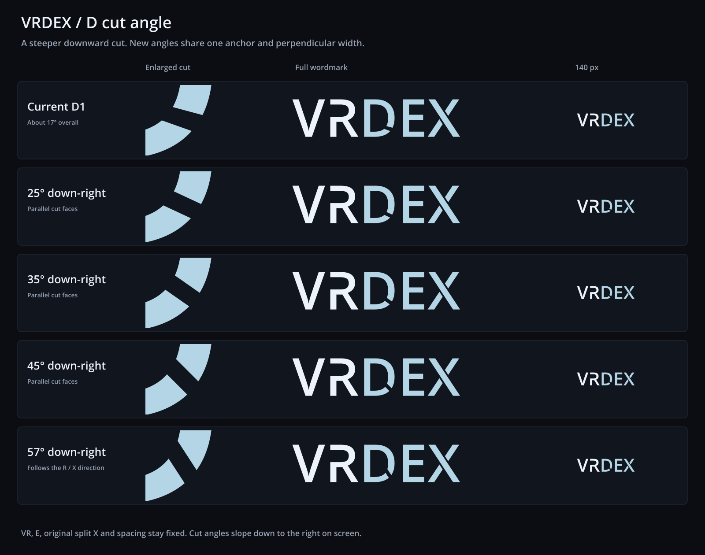

# VRDex D cut angles

The user asked for the D cut to slope farther downward to the right. This
study retains D1/X2 as the control, then compares four steeper slits. A's
approved V and open-upper R, the standard E, original split X, colors and
spacing stay fixed. No study is applied to the production app.



| Study | SVG | Transparent PNG | 140 px proof |
| --- | --- | --- | --- |
| Current D1 | [SVG](./vrdex-control.svg) | [PNG](./vrdex-control.png) | [Navbar](./vrdex-control-navbar.png) |
| 25° down-right | [SVG](./vrdex-angle-25.svg) | [PNG](./vrdex-angle-25.png) | [Navbar](./vrdex-angle-25-navbar.png) |
| 35° down-right | [SVG](./vrdex-angle-35.svg) | [PNG](./vrdex-angle-35.png) | [Navbar](./vrdex-angle-35-navbar.png) |
| 45° down-right | [SVG](./vrdex-angle-45.svg) | [PNG](./vrdex-angle-45.png) | [Navbar](./vrdex-angle-45-navbar.png) |
| 57° down-right | [SVG](./vrdex-angle-57.svg) | [PNG](./vrdex-angle-57.png) | [Navbar](./vrdex-angle-57-navbar.png) |

Current recommendation: 57° echoes the roughly 57° R leg and continuous X
diagonal. The 45° version is a gentler change. Both give the D a more deliberate
cut than the shallow control.

## Geometry

The control is the exact D1 path from the previous matrix. Its two faces are
about 15° and 19.5° down-right, with an average direction of 17.299°. The
new versions have parallel faces, a fixed anchor at source-font coordinates
`1136.7782915, 327.19523325`, and a constant perpendicular width of
`138.88326832` source font units. That width comes from the separation of
D1's face midpoints, measured normal to its average direction.

Angles are measured clockwise from horizontal in the rendered image. The
original D bowl remains intact outside the slit. Line/curve intersections
are solved against its native quadratic curves, and de Casteljau subdivision
provides the exact retained segments. At 45° and 57°, the lower face crosses
into the next lower-bowl quadratic. The width and anchor do not move to
accommodate that transition.

Every standalone SVG is transparent and self-contained, with direct path
outlines and no masks, cover-up shapes, linked fonts or bitmap artwork.
PNG masters are 900 by 248 px; navbar proofs are 140 by 39 px. VR is
`#EDF3FA` and DEX is `#B4D5E5`. The [comparison SVG](./d-angle-comparison.svg)
uses cropped vector details and outlined labels on charcoal.

## Reproduce and verify

From the repository root, with Python FontTools and the workspace's installed
Sharp package:

```sh
python docs/planning/assets/wordmark-d-angle-study-2026-10-21/build_d_angle_studies.py
```

The script reads `/usr/share/fonts/truetype/open-sans/OpenSans-Semibold.ttf`,
builds the actual SVG contours and renders them through Sharp. It installs
no dependencies. [manifest.json](./manifest.json) includes the font checksum,
slit measurements, source curves and solved intersection points.

Verification checks the fixed V/R/E/X paths and advances against D1/X2,
compares the control PNG pixel for pixel, checks the measured cut angles and
normal widths, and reads back SVG structure, PNG sizes and transparency.
The actual comparison PNG was visually inspected at enlarged and navbar sizes.

## Typeface provenance

Open Sans Semibold 1.10, digitized data copyright 2011 Google Corporation.
The installed source identifies Apache License 2.0, and its upstream
[license](./LICENSE-OpenSans.txt) is included. The font is not bundled.
This uses the same outlined interpretation of the generated wordmark as
the previous studies. R retains approved A's edit; D and X are custom contours.
