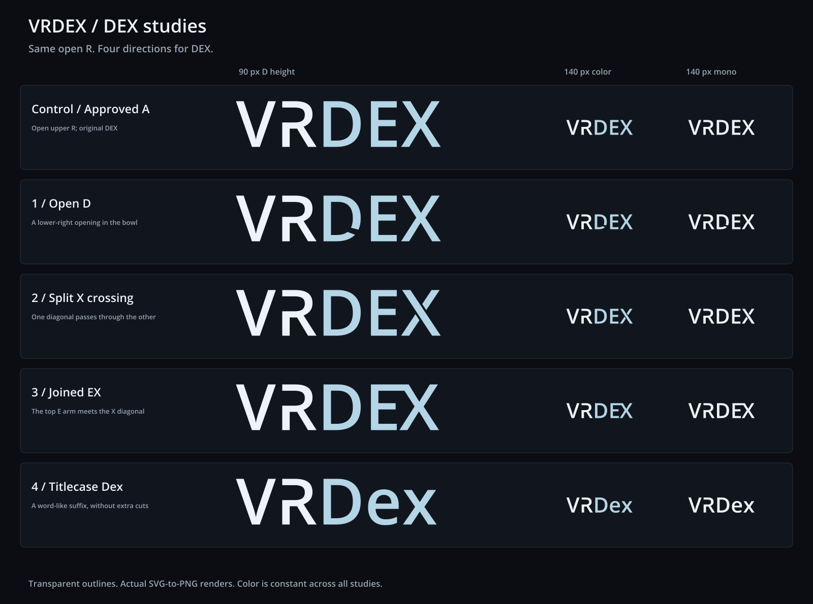

# VRDex DEX studies

The user selected A from the earlier stroke study and rejected B, C and D.
This comparison preserves A's V and open-upper R exactly, then explores four
directions for the DEX suffix. All versions keep the same soft cyan.
These are reviewable studies, with no production branding change.



| Study | Construction | SVG | Transparent PNG |
| --- | --- | --- | --- |
| Control | Approved A, with its original DEX | [SVG](./vrdex-control.svg) | [PNG](./vrdex-control.png) |
| 1 | D bowl opened at the lower right | [SVG](./vrdex-open-d.svg) | [PNG](./vrdex-open-d.png) |
| 2 | X has one continuous diagonal and two separated arms | [SVG](./vrdex-split-x.svg) | [PNG](./vrdex-split-x.png) |
| 3 | E top arm and X diagonal form a single connected outline | [SVG](./vrdex-joined-ex.svg) | [PNG](./vrdex-joined-ex.png) |
| 4 | Titlecase Dex, using lowercase e and x | [SVG](./vrdex-titlecase-dex.svg) | [PNG](./vrdex-titlecase-dex.png) |

Current recommendation: compare 2 and 4 against the control. The split X adds
a clear detail while preserving uppercase DEX. Titlecase Dex makes the name
reference easier to read without adding more cuts. The open D adds a second
opening to the wordmark, but can suggest a Q at a glance. The EX join is more
compact and gives the suffix a custom outline, though it adds weight along
the top of E.

The rejected open-lower R, open E and shared VR designs are not reused. V and
R contours, placement and spacing are identical across all five source SVGs.
The E stem stays intact in every version. The EX connection is a single
continuous contour, with no antialiasing seam between separate shapes.

## Exports

Each study includes two SVGs and four PNGs:

- `vrdex-{study}.svg` and `.png`: off-white VR, soft cyan DEX, transparent
  canvas and a 900 px-wide PNG.
- `vrdex-{study}-navbar.png`: a 140 px-wide color rendering.
- `vrdex-{study}-mono.svg` and `.png`: the same construction in off-white.
- `vrdex-{study}-mono-navbar.png`: a 140 px monochrome rendering.

The [comparison SVG](./dex-comparison.svg) uses a charcoal background and
outlined labels. The large wordmarks share a 90 px D cap height. Both small
columns use an actual 140 px canvas width. Titlecase and joined EX are a
little narrower at the same cap height, so their navbar proofs have slightly
taller letters when normalized to 140 px.

VR is `#EDF3FA`, DEX is `#B4D5E5`, and monochrome is `#EDF3FA`. All standalone
assets have transparent backgrounds. Letter edits use direct contours, with
no cover-up rectangles, masks, live text, linked fonts or embedded bitmap art.

## Reproduce and verify

From the repository root, with Python FontTools and the workspace's installed
Sharp package:

```sh
python docs/planning/assets/wordmark-dex-study-2026-10-21/build_dex_studies.py
```

The script reads `/usr/share/fonts/truetype/open-sans/OpenSans-Semibold.ttf`,
outlines the letters, applies the geometry edits and renders those SVGs using
Sharp. It installs no dependencies. [manifest.json](./manifest.json) records
the font checksum, colors and viewBoxes.

Verification compares V and R with the approved A source, checks every SVG
for external dependencies and masks, reads back PNG sizes and alpha, and
compares color/monochrome alpha. The actual rendered comparison was visually
inspected at large and navbar sizes. The control PNG matches the earlier A
PNG pixel for pixel.

## Typeface provenance

Open Sans Semibold 1.10, digitized data copyright 2011 Google Corporation.
The installed font identifies Apache License 2.0, and its upstream
[license](./LICENSE-OpenSans.txt) is included. The font itself is not bundled.
These are vector interpretations of the generated mockup, using the same
source font as the earlier studies. The original generated raster does not
provide an extractable vector font source. The R contour is retained from A;
the D, X and connected EX contours are modified for this study.
