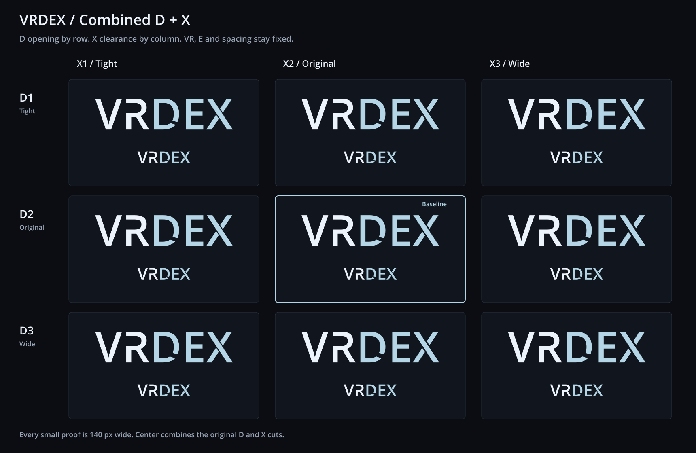

# VRDex combined D and X cuts

This study combines the open D and split X from the previous DEX comparison.
The center, D2/X2, preserves those two selected paths exactly. A's approved V
and open-upper R, the standard E, all advances and the colors remain fixed.
No study is applied to the production app.



Rows change only the D opening. Columns change only the X clearance.

| D opening | X1: tight | X2: original | X3: wide |
| --- | --- | --- | --- |
| D1: tight | [D1/X1](./vrdex-d1-x1.png) | [D1/X2](./vrdex-d1-x2.png) | [D1/X3](./vrdex-d1-x3.png) |
| D2: original | [D2/X1](./vrdex-d2-x1.png) | [D2/X2](./vrdex-d2-x2.png) | [D2/X3](./vrdex-d2-x3.png) |
| D3: wide | [D3/X1](./vrdex-d3-x1.png) | [D3/X2](./vrdex-d3-x2.png) | [D3/X3](./vrdex-d3-x3.png) |

Current recommendation: D1/X2. The slightly tighter D opening retains more
of the bowl, while the original X gap stays clear at navbar size. D2/X2 is
the direct combination requested by the user.

## Geometry and exports

D1, D2 and D3 use 80%, 100% and 120% of the original cut's parameter range.
Exact de Casteljau subdivisions retain the D's original quadratic bowl.
The upper and lower cut boundaries move around fixed parameter midpoints.
X1, X2 and X3 use clearances of 55, 80 and 105 source font units. The X's
continuous descending diagonal stays identical; only the two rising arms'
endpoints move.

Every cell includes a true 140 px proof below a 76 px-cap-height example.
The [comparison SVG](./dx-comparison.svg) has outlined labels. Individual
transparent exports follow this naming pattern:

- `vrdex-d{row}-x{column}.svg`: self-contained vector paths.
- `vrdex-d{row}-x{column}.png`: 900 by 248 px transparent PNG.
- `vrdex-d{row}-x{column}-navbar.png`: 140 by 39 px transparent PNG.

For example, D1/X2 is available as an [SVG](./vrdex-d1-x2.svg),
[900 px PNG](./vrdex-d1-x2.png) and [navbar PNG](./vrdex-d1-x2-navbar.png).
The baseline is available as an [SVG](./vrdex-d2-x2.svg) and
[navbar PNG](./vrdex-d2-x2-navbar.png).

VR is `#EDF3FA` and DEX is `#B4D5E5`. The cuts are transparent contours.
There are no cover-up shapes, masks, live text, linked fonts or bitmap art
inside the SVGs.

## Reproduce and verify

From the repository root, with Python FontTools and the workspace's installed
Sharp package:

```sh
python docs/planning/assets/wordmark-dx-study-2026-10-21/build_dx_studies.py
```

The script builds the actual SVG geometry and renders it with Sharp. It
reads `/usr/share/fonts/truetype/open-sans/OpenSans-Semibold.ttf` and installs
no dependencies. [manifest.json](./manifest.json) records its checksum,
colors, cut parameters and viewBoxes.

Verification compares the center paths with the prior D and X studies,
checks that each axis changes only its intended letter, checks all SVGs for
external dependencies and masks, and reads back PNG dimensions and alpha.
The actual comparison PNG was visually inspected at large and navbar sizes.

## Typeface provenance

Open Sans Semibold 1.10, digitized data copyright 2011 Google Corporation.
The installed source identifies Apache License 2.0, and its upstream
[license](./LICENSE-OpenSans.txt) is included. The font is not bundled.
The wordmark is a vector interpretation of the original generated mockup,
using the same source font as the earlier studies. R retains approved A's
edit. D and X are modified outlines for this exploration.
