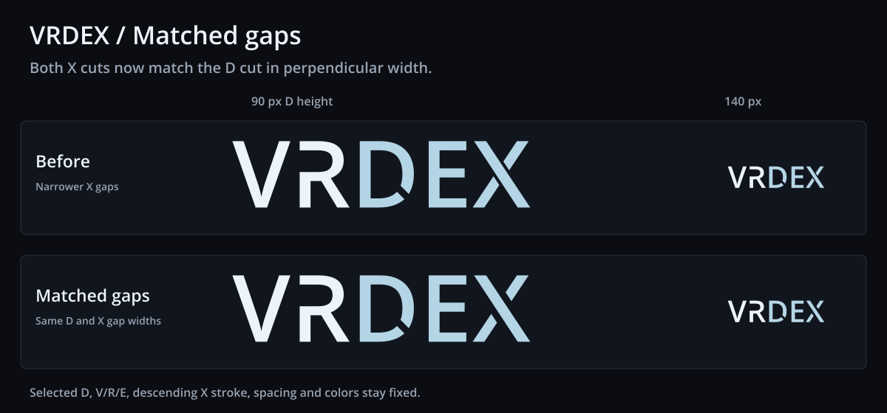

# VRDex matched D and X gaps

The user asked for the X gaps to match the selected D gap. This candidate
gives both X separations the D's perpendicular width of 149.99392978 source
font units. The selected 45° D with its 8% wider cut remains exact, along
with V/R/E, spacing, colors and the X's continuous descending stroke.
No app integration is included.



- Primary [SVG](./vrdex-wordmark.svg), [transparent 900 px PNG](./vrdex-wordmark.png)
  and [140 px navbar PNG](./vrdex-wordmark-navbar.png).
- Monochrome [SVG](./vrdex-wordmark-mono.svg), [900 px PNG](./vrdex-wordmark-mono.png)
  and [140 px navbar PNG](./vrdex-wordmark-mono-navbar.png).
- Self-contained [before/after proof SVG](./matched-gaps-proof.svg).

Master PNGs are 900 by 248 px; navbar PNGs are 140 by 39 px. VR is `#EDF3FA`
and DEX is `#B4D5E5`. Monochrome is `#EDF3FA`. Standalone assets are transparent
outlined paths, with no masks, cover-up shapes, linked fonts or bitmap art.

## Letter spacing follow-up

BASIC liked this glyph/cut treatment and requested letter-spacing exploration
on 2026-10-21. The [spacing study](../wordmark-spacing-study-2026-10-21/README.md)
keeps all contours and cuts exact while comparing tighter, looser and
individually adjusted spacing at common letter heights.

## Geometry and reproduction

The X's earlier 80-unit values were projection thresholds. They were not
perpendicular distances. For each descending-stroke edge `x + a*y = b`,
the new threshold clearance is `149.99392978 * sqrt(1 + a*a)`. The two
edges use `a = 969/1462` and `a = 960/1462`. This gives both gaps the same
normal width while retaining the original stroke and its angles. Only the
endpoints of the rising arms move.

From the repository root, with Python FontTools and the workspace's installed
Sharp package:

```sh
python docs/planning/assets/wordmark-matched-gaps-2026-10-21/build_matched_gaps.py
```

The script reads the [selected source SVG](../wordmark-refined-2026-10-21/vrdex-wordmark.svg)
and imports pure clipping helpers from [the angle study](../wordmark-d-angle-study-2026-10-21/build_d_angle_studies.py).
It renders the actual SVG files through Sharp and installs no dependencies.
Exported SVGs work independently of those scripts and the source font.
[manifest.json](./manifest.json) records source checksums and gap measurements.

Verification measures all three normal gaps from the exported path segments,
compares fixed letters and the descending X subpath against the prior SVG,
and checks before/after proof geometry, PNG dimensions, transparency and
matching color/mono alpha. The actual proof PNG was visually inspected at
large and navbar sizes.

## Typeface provenance

Open Sans Semibold 1.10, digitized data copyright 2011 Google Corporation.
The installed font at `/usr/share/fonts/truetype/open-sans/OpenSans-Semibold.ttf`
identifies Apache License 2.0. Its upstream [license](./LICENSE-OpenSans.txt)
is included; the font itself is not bundled. This retains the outlined
interpretation and custom R/D/X contours from the previous studies.
