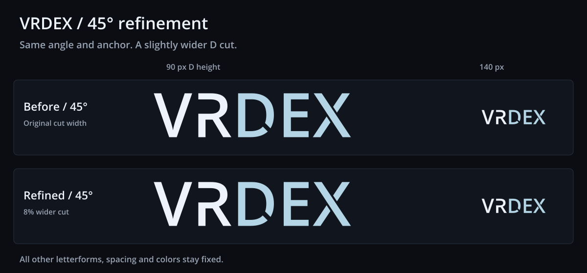

# VRDex refined wordmark

The user selected the 45° D cut and asked for it to be slightly wider.
This single candidate increases its perpendicular width by 8%, from
138.88326832 to 149.99392978 source font units. The angle, anchor, V/R/E/X
contours, advances and colors remain fixed. No app integration is included.



- Primary [SVG](./vrdex-wordmark.svg), [transparent 900 px PNG](./vrdex-wordmark.png)
  and [140 px navbar PNG](./vrdex-wordmark-navbar.png).
- Monochrome [SVG](./vrdex-wordmark-mono.svg), [900 px PNG](./vrdex-wordmark-mono.png)
  and [140 px navbar PNG](./vrdex-wordmark-mono-navbar.png).
- Self-contained [before/after proof SVG](./refinement-proof.svg).

The master PNGs are 900 by 248 px, and navbar PNGs are 140 by 39 px.
VR is `#EDF3FA`; DEX is `#B4D5E5`. Monochrome is `#EDF3FA`.
All standalone exports have transparent backgrounds and outlined paths, with
no linked fonts, masks, cover-up shapes or bitmap artwork inside the SVGs.

## Reproduce and verify

From the repository root, with Python FontTools and the workspace's installed
Sharp package:

```sh
python docs/planning/assets/wordmark-refined-2026-10-21/build_refined_wordmark.py
```

The script imports the checked-in geometry helpers from
[the angle study](../wordmark-d-angle-study-2026-10-21/build_d_angle_studies.py),
which solve slit intersections against the native D quadratics and retain
them with exact subdivisions. It renders the actual SVGs through Sharp.
The exported SVGs work independently of the helper script or source font.
[manifest.json](./manifest.json) records source checksums, fixed anchor and
measured intersections.

Verification checks the exported faces remain at 45° with an 8% wider normal
gap, compares unchanged letter paths and spacing with the prior 45° version,
and checks PNG dimensions, transparency and matching color/mono alpha.
The actual before/after PNG was visually inspected at both proof sizes.

## Typeface provenance

Open Sans Semibold 1.10, digitized data copyright 2011 Google Corporation.
The installed font at `/usr/share/fonts/truetype/open-sans/OpenSans-Semibold.ttf`
identifies Apache License 2.0. Its upstream [license](./LICENSE-OpenSans.txt)
is included; the font itself is not bundled. This retains the same outlined
interpretation and custom R/D/X contours used in the previous studies.
