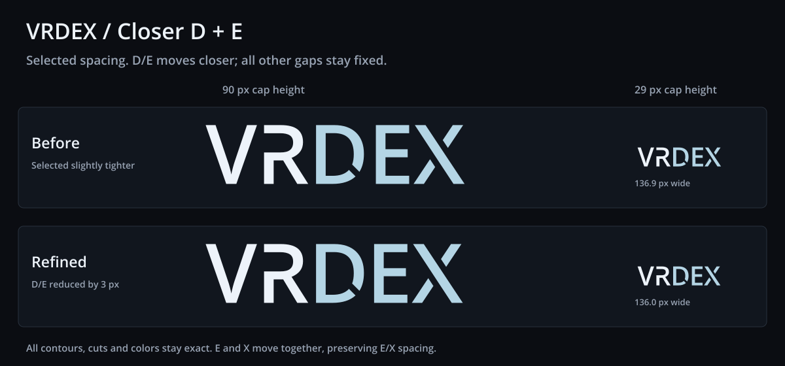

# VRDex closer D/E spacing

The user selected the slightly tighter wordmark and asked to bring D and E
closer. This approved version reduces only D/E spacing by another 3 px at
100 px cap height. E and X move left together; V/R/D positions, E/X spacing,
all contours, cuts, colors and vertical placements remain exact.
Locked decision: BASIC approved this final wordmark in chat on 2026-10-21.
The [canonical assets](../../../brand/wordmark/README.md) are the stable source
for future use. App adoption is a separate implementation step.



- Primary [SVG](./vrdex-wordmark.svg), [900 px PNG](./vrdex-wordmark.png)
  and [navbar PNG](./vrdex-wordmark-navbar.png).
- Monochrome [SVG](./vrdex-wordmark-mono.svg), [900 px PNG](./vrdex-wordmark-mono.png)
  and [navbar PNG](./vrdex-wordmark-mono-navbar.png).
- Self-contained [before/after proof SVG](./spacing-refinement-proof.svg).

The D/E ink-edge gap changes from 20.277 to 17.277 px at 100 px cap height.
The proof fixes large cap height at 90 px and small cap height at 29 px.
Small content width changes from 136.9 to 136.0 px, with no per-word scaling.
The transparent navbar PNG has a 137 by 39 px canvas. The downloadable master
PNG is normalized to 900 px width; the SVG retains 100 px cap height.

VR is `#EDF3FA`; DEX is `#B4D5E5`. Monochrome is `#EDF3FA`. Standalone assets
are transparent direct outlines, with no masks, cover-up shapes, linked fonts
or bitmap art inside the SVGs.

## Reproduce and verify

From the repository root, with Python FontTools and the installed workspace
Sharp package:

```sh
python docs/planning/assets/wordmark-spacing-refined-2026-10-21/build_refined_spacing.py
```

The script reads the [selected source SVG](../wordmark-spacing-study-2026-10-21/vrdex-slightly-tighter.svg)
and uses label helpers from [the angle study](../wordmark-d-angle-study-2026-10-21/build_d_angle_studies.py).
It changes E/X horizontal translations and canvas width, then renders the
actual SVGs with Sharp. It installs no dependencies. Exported SVGs work
without the source scripts or font. [manifest.json](./manifest.json) records
checksums, exact spacing changes, ink-edge gaps and proof dimensions.

Verification compares all five contours and colors with the selected source,
measures the sole D/E change and unchanged other gaps, checks fixed cap-height
proofs, and reads back SVG structure, PNG dimensions, transparency and matching
color/mono alpha. The actual before/after PNG was visually inspected.

## Typeface provenance

Open Sans Semibold 1.10, digitized data copyright 2011 Google Corporation.
The installed font at `/usr/share/fonts/truetype/open-sans/OpenSans-Semibold.ttf`
identifies Apache License 2.0. Its upstream [license](./LICENSE-OpenSans.txt)
is included; the font itself is not bundled. Every selected glyph contour
and custom R/D/X cut is preserved.
