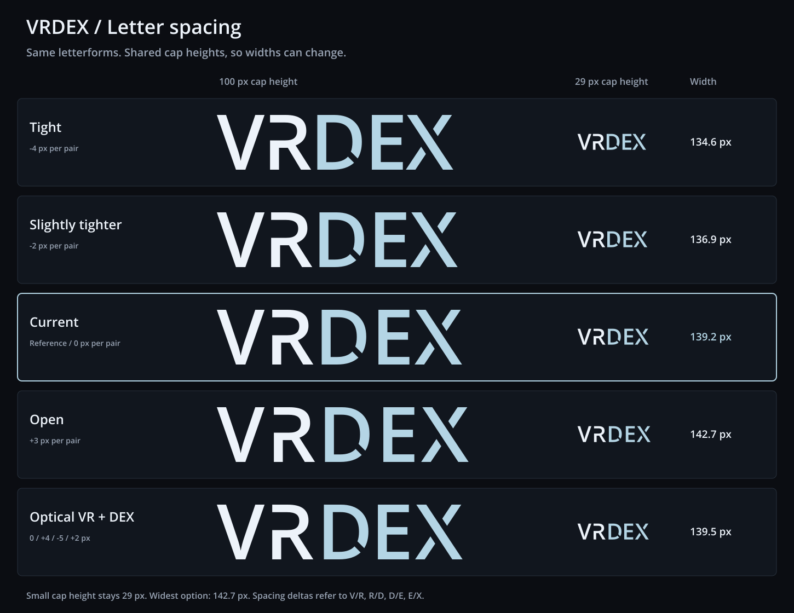

# VRDex letter spacing

Five spacing treatments of the selected wordmark. Every V/R/D/E/X contour,
internal cut, color and vertical placement stays exact. Only glyph x positions
and canvas width change. These are study assets, with no app integration.



Pair deltas below are relative to the current font advances plus 0.8 px
tracking, measured at 100 px cap height. They are not literal ink-edge gaps.

| Study | Pair deltas: V/R, R/D, D/E, E/X | SVG | 900 px PNG | Navbar proof |
| --- | --- | --- | --- | --- |
| Tight | -4, -4, -4, -4 px | [SVG](./vrdex-tight.svg) | [PNG](./vrdex-tight.png) | [Navbar](./vrdex-tight-navbar.png) |
| Slightly tighter | -2, -2, -2, -2 px | [SVG](./vrdex-slightly-tighter.svg) | [PNG](./vrdex-slightly-tighter.png) | [Navbar](./vrdex-slightly-tighter-navbar.png) |
| Current | 0, 0, 0, 0 px | [SVG](./vrdex-current.svg) | [PNG](./vrdex-current.png) | [Navbar](./vrdex-current-navbar.png) |
| Open | +3, +3, +3, +3 px | [SVG](./vrdex-open.svg) | [PNG](./vrdex-open.png) | [Navbar](./vrdex-open-navbar.png) |
| Optical VR + DEX | 0, +4, -5, +2 px | [SVG](./vrdex-optical.svg) | [PNG](./vrdex-optical.png) | [Navbar](./vrdex-optical-navbar.png) |

Current recommendation: optical. The added R/D spacing makes VR read as a
prefix. Bringing D/E closer and giving E/X more room balances DEX. Its total
width is just 1 px above current at 100 px cap height. Slightly tighter is a
useful compact alternative. Even the tightest setting retains positive
ink-edge separation between every pair.

## Comparison scale

The [comparison SVG](./spacing-comparison.svg) fixes large examples at 100 px
cap height and small examples at 29 px. It does not resize each word to a
shared width. Small content widths range from 134.6 to 142.7 px. These widths
include the same fixed padding; transparent navbar PNG canvases round up to
whole pixels, with a maximum of 143 by 39 px.

The downloadable 900 px PNGs are normalized to 900 px canvas width for
convenience, so their cap heights vary. Use the comparison or the navbar PNGs
to judge spacing at a consistent size. Individual SVGs retain the original
100 px cap height and transparent canvas.

VR is `#EDF3FA` and DEX is `#B4D5E5`. SVGs contain direct outlined paths, with
no masks, cover-up shapes, linked fonts or bitmap artwork.

## Reproduce and verify

From the repository root, with Python FontTools and the workspace's installed
Sharp package:

```sh
python docs/planning/assets/wordmark-spacing-study-2026-10-21/build_spacing_studies.py
```

The script reads the [selected source SVG](../wordmark-matched-gaps-2026-10-21/vrdex-wordmark.svg)
and uses outlined-label helpers from [the angle study](../wordmark-d-angle-study-2026-10-21/build_d_angle_studies.py).
It changes only horizontal translations and canvas width, then renders the
actual SVG geometry through Sharp. It installs no dependencies.
[manifest.json](./manifest.json) records checksums, pair deltas, ink-edge gaps
and proof sizes. Exported SVGs work without the source scripts or font.

Verification checks all five path strings against the accepted source,
checks exact relative x-position changes and fixed vertical scale, compares
the current PNG pixel for pixel, and checks SVG resources, PNG dimensions and
transparency. The actual comparison was visually inspected at both sizes.

## Typeface provenance

Open Sans Semibold 1.10, digitized data copyright 2011 Google Corporation.
The installed font at `/usr/share/fonts/truetype/open-sans/OpenSans-Semibold.ttf`
identifies Apache License 2.0. Its upstream [license](./LICENSE-OpenSans.txt)
is included; the font itself is not bundled. All glyph contours and custom
R/D/X cuts are preserved from the selected wordmark.
