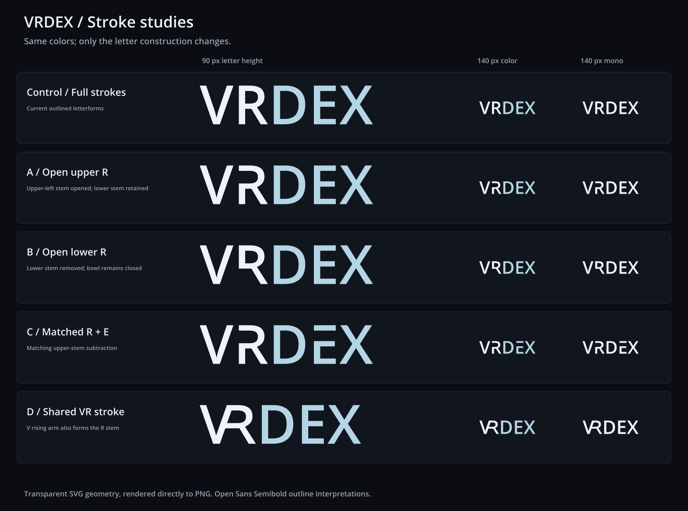

# VRDex stroke studies

One current reference and four original letterform variations, with DEX kept
soft cyan so the construction can be compared independently of color. The
uppercase wordmark uses Open Sans Semibold 1.10 outlines as its starting point.
These are vector interpretations of the generated mockup, not an extraction of
an unavailable original font or vector source.



| Study | Construction | SVG | Transparent PNG |
| --- | --- | --- | --- |
| Control | Current full strokes | [SVG](./vrdex-reference.svg) | [PNG](./vrdex-reference.png) |
| A | R upper-left stem opened; lower stem and diagonal retained | [SVG](./vrdex-open-upper-r.svg) | [PNG](./vrdex-open-upper-r.png) |
| B | R lower-left stem removed; closed bowl retained | [SVG](./vrdex-open-lower-r.svg) | [PNG](./vrdex-open-lower-r.png) |
| C | Matching upper-stem subtraction in R and E | [SVG](./vrdex-matched-r-e.svg) | [PNG](./vrdex-matched-r-e.png) |
| D | The V rising arm also forms a slanted R stem | [SVG](./vrdex-shared-vr.svg) | [PNG](./vrdex-shared-vr.png) |

A reconstructs the upper-left R opening visible in the organizer mockup. It
keeps the name clearest while adding a distinctive detail. C is a bolder
alternative, extending the subtraction to E. B removes more of the familiar R
structure. D is a genuine shared-stroke ligature and reads more like a compact
VR emblem, so it takes longer to parse.

Current recommendation: A first, with C as the stronger stylized alternative.
No candidate is applied to the production app or declared approved branding.

## Exports

Each study has four PNG proofs and two SVG files:

- `vrdex-{study}.svg` and `.png`: soft cyan DEX, transparent canvas, 900 px PNG.
- `vrdex-{study}-navbar.png`: the actual 140 px-wide color rendering.
- `vrdex-{study}-mono.svg` and `.png`: the same construction in one color.
- `vrdex-{study}-mono-navbar.png`: actual 140 px monochrome rendering.

The [comparison SVG](./stroke-comparison.svg) is also self-contained. Its large
examples share a 90 px cap height; both small columns are rendered at 140 px
canvas width. The shared-stroke variant is narrower at the same cap height and
therefore slightly taller when normalized to that navbar width.

VR is `#EDF3FA` and DEX is `#B4D5E5`. Monochrome is `#EDF3FA`. Transparent SVG
contours create the openings. There are no background-colored cover-up shapes,
masks, embedded bitmap artwork, live text, linked fonts or external resources.

## Reproduce and verify

From the repository root, with Python FontTools and the installed workspace
Sharp package available:

```sh
python docs/planning/assets/wordmark-stroke-study-2026-10-21/build_stroke_studies.py
```

The script reads `/usr/share/fonts/truetype/open-sans/OpenSans-Semibold.ttf`,
builds editable SVG path geometry, and rasterizes the actual SVG files using
Sharp. It does not generate raster approximations or install dependencies.
Font checksum, colors and each variant's viewBox are in [manifest.json](./manifest.json).

Verification parsed every SVG and checked for external/live-text dependencies,
read back PNG dimensions and alpha channels, confirmed the changed contours
affect the expected letters, and visually inspected the comparison at large
and actual navbar sizes. Color and monochrome exports retain identical alpha.

## Typeface provenance

Open Sans Semibold 1.10: Digitized data copyright 2011 Google Corporation.
The installed source font identifies Apache License 2.0; its upstream
[license](./LICENSE-OpenSans.txt) is included. The font itself is not bundled.
The R/E and shared VR contours are modified here for this design exploration.
