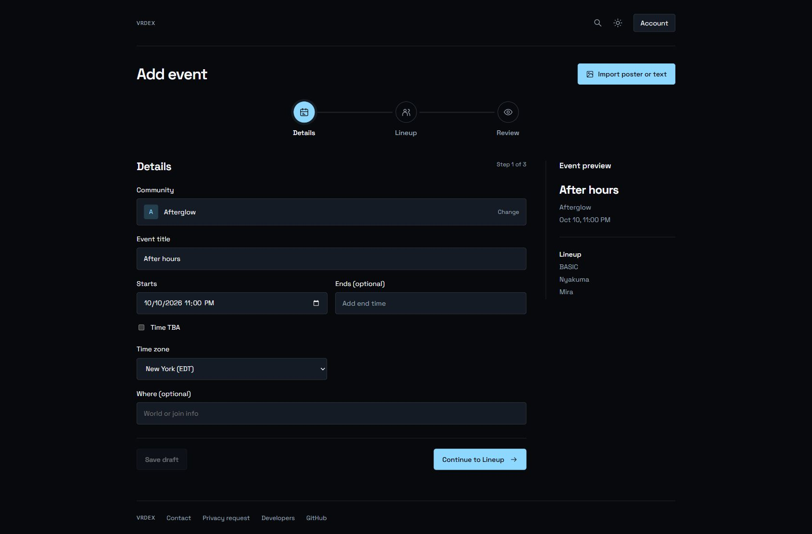
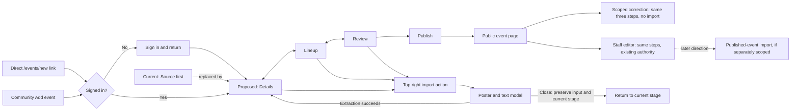

# Event editor wizard refinement

## Status and reference

Locked decision: use the layout developed in this conversation as the reference
for one implementation PR. The screenshot is a layout reference, not a running
production editor or a complete list of fields.

The archived clickable prototype at
`docs/planning/assets/event-editor-wizard-refinement-2026-10-11.html`
uses illustrative data and disconnected save/extraction controls. Its native
calendar popup is browser-owned and is not included in page screenshots.
The latest top-right placement was checked on desktop. Recheck mobile in the
real implementation; the last prototype viewport override did not apply.

## Agreed changes

- Three connected icon steps across the main pane: Details, Lineup, Review.
  Start at Details, allow direct stage access, and use Back and Continue to
  guide progress. Icons indicate position, not successful validation.
- A compact blue Import poster or text action lives at the top right beside
  the page heading, above the steps. It is outside the form sequence and opens
  an optional intake modal from any stage where import is supported.
- The modal accepts one poster, text, or both in one extraction run. Closing
  preserves inputs. Successful extraction returns to Details with existing
  tentative suggestions and questions; it does not publish or overwrite
  accepted fields. A poster remains artwork by default.
- Community is a directory selection, not a freeform community-name field.
  Search by name or slug, show the selected name, and provide Change and Clear.
  Clearing is allowed in drafts. Keep fixed-community staff contexts and
  contributor correction restrictions intact.
- Starts is one date/time control with the native calendar/time picker.
  Optional Ends uses the same control after Add end time. They share the
  selected event timezone, sit side by side on desktop, and stack when needed
  on narrow screens. Timezone search retains current aliases and IANA values.
- Time TBA shows a date-only control and preserves reversible time edits within
  the open editor. Saved date-only drafts still omit timed fields under the
  existing contract. Do not resurrect removed performers when restoring times.
- No end is required or fabricated. Preserve existing stored ends and valid
  ends derived from the legacy staff lineup; remove the arbitrary one-hour
  fallback for an event without a known end.
- Where (optional) replaces Venue visually and keeps the `venueLabel` field.
  Keep description, source URL, existing world association, doors, artwork and
  staff controls available. The mock's omission of these is not a deletion.
- Publish continues directly to the event page. Preview and public schedule
  displays stay viewer-local; authoring inputs use the selected event timezone.

## Capability boundary

Current recommendation, awaiting the scope question sent during planning:
keep extraction on contributor drafts, where `IntakeSourceAction` already
exists. Apply shared navigation and Details improvements to staff create/edit
and scoped contributor corrections. Keep staff artwork/link controls in a
Details disclosure instead of a Source stage. Do not show a nonfunctional
import action on staff published-event editing or scoped corrections.

Adding extraction to staff edits of published events requires a separately
specified proposal/apply path through staff authority. It must not smuggle
changes through contributor correction permissions. The current plan does not
include that extension. If BASIC chooses it, revise the plan before execution.

## Preservation requirements

- Reuse the current agent, upload limits, automatic artwork, source ownership,
  revision checks, retries and publication commands. No new server or model.
- Keep partial intake drafts, duplicate handling, scoped correction patches,
  staff-only operations and association preservation.
- Preserve the existing staff-create requirement for a known start time.
  This PR does not extend legacy staff commands to date-only creation.
- Keep DST-gap rejection, repeated-hour occurrence selection, explicit
  overnight dates and hidden-field error revelation.
- Keep source contents and private controls inside existing replay exclusions.
- No new picker dependency, sidebar, multi-image flow or artwork checkbox.
- The profile editor cleanup remains a separate documented follow-up.

## Journey

## Copy

Use these concise labels from the reviewed mock: Details, Lineup, Review,
Import poster or text, Import event info, Starts, Ends (optional), Add end time,
Time TBA, Where (optional), World or join info, Change, Clear and Close.
Retain existing approved error/suggestion copy. No AI tagline or new help
paragraph is proposed. Any substantive new copy introduced during execution
must be shown exactly to BASIC before shipping, under `AGENTS.md`.
