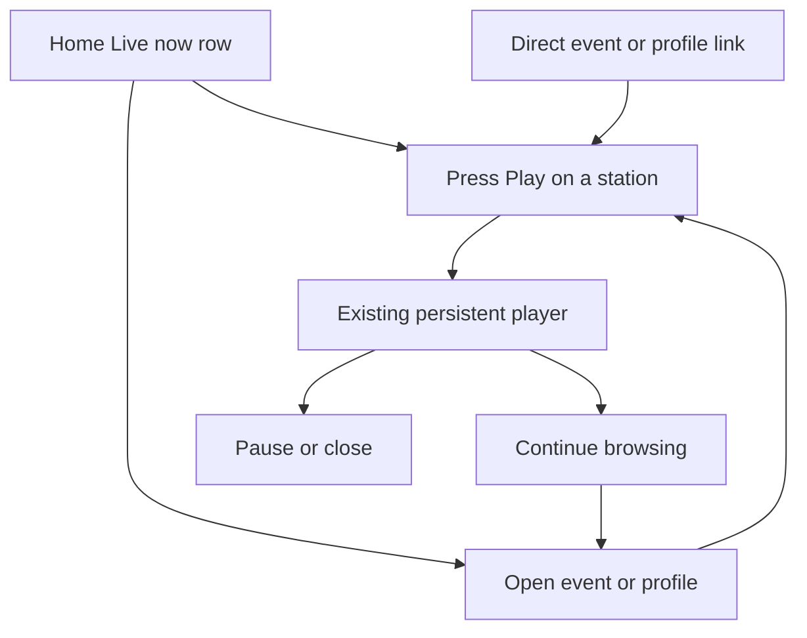

# Player repair and live discovery

## Recommendation and decision

Repair the existing foreground player first. Start live discovery with public
performers scheduled in current or near-future events, using one shared server
index. Defer a sweep of every public linked profile until provider limits and
VRCDN connection accounting are established.

This is a source repair and an investigation. It does not authorize relay
enablement, new provider credentials, infrastructure, fleet polling, or release.
BASIC's judgment is needed on the event-scoped first slice and, separately,
whether to complete the existing native relay release gates for true audio-only
and phone background playback.

## What is established

- Production serves current main, excluding PR #432. The public bundle and
  deployment record agree. Production has no configured
  `NEXT_PUBLIC_MEDIA_RELAY_ENABLED` variable.
- The relay is deliberately disabled. Its native HLS path has separate audio
  and video playlists and never connects media to Web Audio. The disabled path
  cannot provide that audio rendition.
- The retained player nevertheless offers Audio only. Selecting it on the
  disabled path stops playback, and a saved audio preference also refuses the
  next legacy connection. This is configured behavior exposed by an unsuitable
  control, rather than evidence that the relay's audio encoder failed.
- Local VRCDN playback fetches MPEG-TS, transmuxes through mpegts.js/MSE, and
  decodes a video element. Local lineup following also routes it through Web
  Audio. Hiding that element does not remove video decoding.
- Twitch uses its iframe SDK. Native HLS, MPEG-TS, Twitch, relay admission, and
  event broadcasting are distinct paths. The broadcasting worker is not involved
  in ordinary legacy playback.
- The installed mpegts.js live buffer automatically cleans up, but its defaults
  retain 120 to 180 seconds behind playback. Its startup stash is enabled.
  These are avoidable buffering costs, not proof of the reported phone freeze.
  Worker enablement alone is unsuitable: its configuration is posted to a worker,
  while our cancelable `customLoader` is a class that cannot be structured-cloned.

Phone model, OS, browser, affected URL, and the exact app-switch/lock failure are
still requested. No physical phone, Safari, hardware-volume, or locked-screen
acceptance is claimed.

## Source repair

The shared transport removes the startup stash and retains 15 to 30 seconds of
old buffered media. Standalone and retained players use this same helper.
Less startup buffering can increase sensitivity to network jitter. Actual
phone responsiveness remains unmeasured.

Audio only is disabled when the selected adapter has no audio rendition.
Native and relay adapters declare this capability; global rollout configuration
does not override an instantiated adapter's capabilities.
Video remains available, including recovery from an existing saved audio
preference. No preference is silently erased and no hidden video is presented
as an audio optimization. The exact public label remains `Audio only`; its
disabled tooltip is the existing utility label `Unavailable`.

PR #432 separately had an expired-candidate review bug. Its fix preserves a
next-timed-start selection bound without filling an unknown end or crossing an
untimed progression barrier. The silence experiment remains separate from
native background playback and relay rollout.

## Why live status arrives late

Current profile rendering waits for provider checks before returning its initial
profile. VRCDN has a five-second probe budget and a 30-second server cache.
The profile's visible heartbeat also immediately starts a fresh probe, then
normally checks every minute. This can duplicate work around initial rendering.
The five-second budget was intentionally increased after slower valid provider
responses, so simply shortening it would turn latency into false unknowns.

Event watch controls also wait for browser hydration and a client clock. Their
scheduled watchability is not provider-confirmed liveness. Current Home has a
schedule and discovery cards, without a global provider-live stations index.
The exact late-loading surface in BASIC's report remains unconfirmed.

A warmed shared index would make status available without waiting for each
viewer to open an event/profile. Render the cached index alongside Home's
initial data; refresh it independently of the timeline, images, and playback
imports. Do not open media connections from each homepage viewer.

## Provider evidence and scope

| Scope | Benefit | Cost and limits |
| --- | --- | --- |
| Current/upcoming event performers | Answers who can be heard around scheduled events; reuses public event eligibility and stream normalization | Misses spontaneous DJs outside events; small bounded candidate set |
| Every eligible public linked profile | Finds spontaneous stations too | Polls dormant/invalid links continuously; requires a population inventory, fairness, and stronger provider-budget evidence |

Twitch's [Get Streams](https://dev.twitch.tv/docs/api/reference/#get-streams)
accepts up to 100 logins per request and requires an app or user token. Use
`first=100`, map returned logins, and follow pagination when present. Only a
successful complete response establishes that a requested login is offline.
Auth failures, timeouts and quota failures are unknown. Existing source performs
one-login reads and caches each for 30 seconds; batching belongs in the index.
No Twitch client binding is currently listed in the web project.

The [Twitch rate-limit guide](https://dev.twitch.tv/docs/api/guide/#twitch-rate-limits)
requires response-header accounting and reset-based backoff after 429. Its
example bucket of 800 is not an entitlement to hard-code.

VRCDN's [public API documentation](https://api.vrcdn.live/api-docs) and
[published schema](https://api.vrcdn.live/api-docs.json), inspected November 6,
document server status and per-stream viewer counts, without a broadcasting
boolean. Zero viewers cannot distinguish offline from live with nobody watching.
No bulk liveness endpoint or published rate quota is documented there.

VRDex currently GETs the public `.live.ts` transport and immediately cancels its
body. It maps 200 to live, 404/401 to offline, and other failures to unavailable.
That is a transport observation, not confirmation of audible music. Existing
observations found HEAD and HLS URLs unsuitable. Whether a brief media GET spends
a viewer slot remains unresolved in issue #217. Do not run a fleet sweep until
that provider question is answered. A working embed or saved URL proves neither
broadcasting nor audible output.

## Proposed bounded index

**Candidate direction:** once per minute, select public streams in events active
now or starting within 30 minutes. Deduplicate by normalized provider identity.
Begin with a hard cap of 50 stream identities and four concurrent VRCDN probes,
each with the existing five-second deadline. Use one scheduled owner with a
lease; overlapping runs must not multiply probes. These numbers are proposals.

Store provider identity, state, observation time, expiry, and eligible public
event/profile references. Recheck public visibility when projecting Home, so an
index entry cannot retain a hidden link. Consumers read a bounded shared result.
Never carry credentials, grants, or ingest URLs in that result.

Proposed freshness is 90 seconds. Expired live results become unknown and leave
the Live now row. A failed check preserves its last observation only until that
expiry; it never becomes offline because of a timeout. Hide empty modules rather
than add explanatory public prose. Show provider-confirmed broadcasting without
claiming confirmed audio; keep provider failures in operator diagnostics.

At a 60-second cadence, V VRCDN candidates require roughly V media probes per
minute; T Twitch candidates need at least ceil(T/100) API calls per minute,
plus token refresh and any pagination. Fifty VRCDN candidates therefore mean
up to 72,000 probes per day if that population remains eligible all day. A
1,000-profile VRCDN sweep would mean 1.44 million. Those are upper-bound examples,
not measured population or bills. At four concurrent probes, a fully timed-out
50-source run takes about 65 seconds, so the lease skips overlapping work and
the next iteration needs fairness or a lower cap.

Budget server time as probes times actual latency, plus bounded database reads,
writes, and shared fanout. Browser media egress begins only after Play. Dollar
cost and provider viewer-slot impact remain unknown; no capacity purchase is
proposed. Event scoping reduces work whenever its unique candidates are fewer
than the public-profile population.

## Proposed listening flow

Current recommendation: a small Live now row with performer artwork/name,
optional event identity, Play, and a separate event/profile link. Keep search
and the schedule prominent. Sign-in and purchase are unnecessary for public
listening; provider restrictions can still require an external destination.
Use the existing retained owner, so navigation does not create another player.
Defer a dedicated Stations page until the row has enough useful supply.

The [Apple Music Radio capture](https://mobbin.com/flows/e7c28ffc-abd2-4f81-846c-6b309d41e1d1)
shows New to Radio navigation, station browsing, and a persistent bottom player
in three preview positions. All three previews were inspected. It supports
separating browsing from persistent playback, but does not show an actual
station-play transition, authentication, failure recovery, or background audio.
Mobbin query: `radio browsing stations and playing a station`, web, November 6.
No reference screenshots are republished.

## Evidence appendix

- Source/deployed main: `2f58403fb2eb6ee66e8bf697bd34ad0ec223bc18`.
- Vercel production deployment: `dpl_DE2GdCWfhEEhfu6A8HJRjXyaruqu`.
- [Automatic viewer PR #432](https://github.com/BITRATE-Labs/VRDex/pull/432),
  candidate-expiry fix `f7b5437f0`, 64 focused tests passed. Existing browser and
  visual CI failures remain open, separately from deployed behavior.
- Player repair: 1,145 web tests passed, web types and targeted lint passed,
  four desktop/mobile composed browser cases passed. The loopback stream reached
  decoded progress in 478 ms and remained playing at 38.1 seconds with its buffer
  starting at 16.1 seconds, proving old buffered media was removed. This is one
  local synthetic run, not a before/after speed comparison or phone CPU result.
  Real-device acceptance remains unknown.
- [Installed transport API](https://github.com/xqq/mpegts.js/blob/v1.8.1/docs/api.md).
  Installed source has a 64 KiB initial stash, unlike the API table's 384 KB
  description. The repair disables the stash rather than relying on either size.
- Owning source: `vrcdn-transport.ts`, `event-playback-adapters.ts`,
  `event-lineup-runtime.ts`, `native-hls-adapter.ts`, `relay-playback-adapter.ts`,
  `src/convex/server.ts`, `server/vrcdn-live.ts`, `server/twitch-live.ts`.
