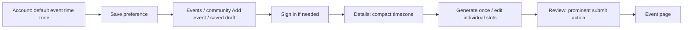

# Event editor scheduling implementation plan

> **For agentic workers:** REQUIRED SUB-SKILL: Use superpowers:subagent-driven-development, the previously requested method, to implement this plan task-by-task. Steps use checkbox (`- [ ]`) syntax for tracking.

**Goal:** Deliver compact timezone selection, editable generated lineups and prominent Review actions in one implementation PR.

**Architecture:** Keep the three-step wizard and both existing submission paths. Share pure lineup timing operations and small UI controls, with explicit adapters for staff instants and contributor local-time fields. Store the optional timezone default on the signed-in account, outside public profile data.

**Tech Stack:** Existing Next.js, React, TypeScript, Convex, Node test runner, convex-test and Playwright. No added dependency.

**Spec:** [Approved design](../specs/2026-10-13-event-editor-lineup-timezone-publish-design.md). BASIC approved the full design and its five proposed public strings in chat on 2026-10-13.

## Global constraints

- One implementation PR, with internal commits. No separate planning PR.
- Details, Lineup and Review remain the only wizard stages. Import stays optional, beside Details.
- Preserve partial drafts, optional end time, Time TBA, untimed performers and the term Slot. Publishing goes directly to the event page.
- Keep the familiar initial values of 4 and 60. Preserve existing maximums: 80 slots, with positive whole-minute durations up to 1,440 minutes.
- Use elapsed minutes on absolute instants for the cascade. Display the results in the chosen event timezone.
- An end explicitly entered in Details remains fixed during insertion, removal, duration changes and event-start changes.
- Keep existing submission authority, revision checks, private associations, streams, duplicate and spam checks intact.
- No new calendar library, sidebar, scheduling service, extraction redesign, multiple-poster support, world picker, recurring events, drag-and-drop or per-slot fixed-time locks.
- Use shared design tokens. Meaningful UI work requires screenshots and VLM review.
- Preserve approved copy. The exact new strings approved with the design are `Clear the lineup and start again?`, `Event details and artwork will stay.`, `Clear lineup`, `The lineup ends after the event.`, and `Set event end to lineup end`.

## Execution boundary

The planning checkout is `C:/Users/steve/.codex/worktrees/event-editor-wizard-resume/VRDex`, on `codex/event-editor-wizard-refinement`, at `77146a33b49c4f545d569f454b5e32be04439eed`. The primary `D:/bench/VRDex` checkout has unrelated work and must not be switched, cleaned or committed.

At planning time, prerequisite [PR #365](https://github.com/BASIC-BIT/VRDex/pull/365) is still open and unmerged. Keep this plan and spec local until execution creates a separate managed worktree and branch `codex/event-editor-scheduling`. Refresh upstream first. If #365 has merged, start from current main and verify its wizard changes are present. Otherwise start from its verified head, retain the dependency, and retarget/rebase after it merges. Do not add scheduling commits to #365. Include the two approved documents in the first scoped implementation commit.

This plan authorizes no merge or deployment. Follow the repo's current review loop and 30-minute readiness window at delivery. Preserve the user's subagent-driven execution preference without asking them to choose a method again.

## Proposed page and action flow



Import remains an optional Details modal with return to the same editor. Existing lineups skip generation; confirmed reset returns to it. No additional wizard page is introduced.

## Review focus

- A saved preference arriving after a contributor types or accepts an import must not overwrite the authored timezone. Task 2 tests this race.
- A shifted slot crossing a repeated hour must serialize the same instant it displays, without minute rounding of untouched staff data. Tasks 3 and 4 test this.
- Accepted partial lineups can have unknown ends and noncontiguous times. Insertion must preserve gaps and must not infer a missing duration. Tasks 3 and 4 test this.
- Enter followed by blur must apply a duration change once. Cancelling reset or insertion must preserve every row and stream. Task 4 tests this.
- Review must submit the right command once, including scoped corrections and published staff edits. Task 5 tests this.

## File map

Paths below are relative to the execution worktree.

| File | Responsibility |
| --- | --- |
| `convex/schema.ts`, `convex/accounts.ts` | Optional private account timezone field, self viewer projection and self-only mutation. |
| `apps/web/src/app/account/event-timezone-preference.tsx` (new), `account-panel.tsx` | Small explicit preference control on Account. |
| `apps/web/src/lib/event-timezones.ts`, `_components/event-timezone-picker.tsx` | Friendly labels, aliases, compact searchable picker and selection semantics. |
| `apps/web/src/lib/event-timezone-default.ts` (new) | Validated preference/browser/UTC resolution. |
| `apps/web/src/lib/calendar/event-lineup-timing.ts` (new) | Pure generation, insertion, duration, removal, start shift and conflict calculations. |
| `apps/web/src/lib/calendar/event-end-time.ts` | Stored or explicit ends stay fixed; clear returns to legitimate derivation. |
| `apps/web/src/lib/calendar/event-lineup-adapters.ts` (new) | Exact conversion between existing staff/intake fields and timing operations. |
| `apps/web/src/app/events/event-lineup-controls.tsx` (new) | Generator, duration commit, insertion and reset controls shared by the two editors. |
| `apps/web/src/app/events/event-editor-form.tsx`, `event-intake-form.tsx` | Integrate controls, timezone defaults, end conflict, serialization and Review placement. |
| Existing Playwright fixtures and specs | Capture real editor payloads and prove keyboard, partial-data and visual behavior. |
| Existing authoring docs and `docs/testing/event-editor-scheduling-checkpoint.md` (new) | Document behavior and distinguish local, CI, review and deployment evidence. |

Do not extract a generic form framework. Keep performer lookup and privileged staff fields in their current owners. Shared controls accept rendered performer inputs instead of acquiring backend permissions themselves.

### Task 1: Private account timezone preference

**Files:** Modify `convex/schema.ts` and `convex/accounts.ts`. Create `tests/backend/account-event-timezone.test.ts`. Regenerate checked-in Convex API bindings using the existing local workflow. The Account UI belongs to Task 2.

**Interfaces:**

- Add `users.defaultEventTimezone: v.optional(v.string())`.
- Extend the self-only `accounts.viewer` projection with `user.defaultEventTimezone?: string`.
- Add `accounts.setEventTimezonePreference`, args `{ timezone: string | null }`, result `null`. Identify the actor with `requireCurrentUser`; accept a valid IANA identifier, or clear the field on null. Accept no actor/user ID argument.
- Task 2 consumes the viewer field and mutation. No new public endpoint or profile field is added.

- [ ] **Step 1: Write backend tests against the actual viewer and mutation.** Seed two accounts with Clerk identities. Assert one actor can set `America/New_York`, read that value only from their own viewer, clear it with null, and cannot modify another account. Assert signed-out mutation fails and invalid timezone input leaves the row unchanged. Assert `users.ensureCurrentUser` does not erase the preference when refreshing mirrored identity fields. Extend the fixture module map for accounts and users.
Example assertion for the new backend operation, using a `fixture()` helper defined in this test file that returns `actor`, `other` and `t` with the two seeded identities:

```ts
it("keeps the event timezone preference private to its account", async () => {
  const { actor, other } = await fixture();
  await actor.mutation(api.accounts.setEventTimezonePreference, { timezone: "America/New_York" });
  assert.equal((await actor.query(api.accounts.viewer, {}))?.user.defaultEventTimezone, "America/New_York");
  assert.equal((await other.query(api.accounts.viewer, {}))?.user.defaultEventTimezone, undefined);
});
```

- [ ] **Step 2: Run the focused test and verify the new operation/projection assertions fail.** Run `node --conditions=import --import tsx --test tests/backend/account-event-timezone.test.ts`.
- [ ] **Step 3: Implement the optional field and self-only mutation.** Reuse Intl timezone validation and existing structured auth errors. Keep the setting out of public profile contracts, MCP responses and identity-update payloads. No migration/backfill is needed for an optional field.
- [ ] **Step 4: Audit the self-only projection and identity refresh.** Verify public profile and MCP serializers do not project this field, and identity refresh patches retain optional account preferences. Add the retained-field assertion to the real identity-refresh test, without modifying auth policy.
- [ ] **Step 5: Generate bindings locally and rerun the focused test plus `pnpm typecheck:backend`.** Expected: all assertions pass and backend typecheck succeeds. Inspect generated changes before committing.
- [ ] **Step 6: Commit only the preference files, generated bindings and approved spec/plan.** Suggested message: `feat: add private event timezone preference`.

### Task 2: Compact timezone picker and safe defaults

**Files:** Modify `apps/web/src/lib/event-timezones.ts`, `apps/web/src/app/_components/event-timezone-picker.tsx`, both editor forms and `apps/web/src/app/account/account-panel.tsx`. Create `apps/web/src/app/account/event-timezone-preference.tsx`, `apps/web/src/lib/event-timezone-default.ts` and `tests/web/event-timezone-default.test.ts`. Modify `tests/web/event-timezone-picker.test.ts`. Create `apps/web/e2e/event-timezone-picker.flow.spec.ts`; extend existing preview fixtures only where needed.

**Interfaces:**

- Keep `searchEventTimezones(query: string, date: string | null, instant?: number): EventTimezoneOption[]`; enrich option labels using the resolved instant when supplied. With no resolved instant, show a region without an exact event offset. Update the old noon-offset test accordingly.
- Produce `eventTimezoneLabel(value: string, instant?: number): string` for the selected compact label. Use curated region names for existing aliases and a readable IANA fallback for other valid zones.
- Produce `resolveEventTimezoneDefault({ savedPreference, browserTimezone }: { savedPreference?: string | null; browserTimezone?: string | null }): string`.
- Produce `AccountEventTimezonePreference({ value }: { value?: string }): ReactNode`, with explicit Save and Clear actions using the Task 1 mutation. Add it to the Account pane outside profile-specific settings, with label `Default event time zone` and existing pending/error conventions.
- Extend `EventTimezonePicker` props with optional `instant`, `preferredValue` and `name`; keep existing `value`, `date`, `onChange`. Default hidden-input name stays `timezone`; the Account control uses `defaultEventTimezone`.

- [ ] **Step 1: Write unit tests for default precedence and labels.** Assert preference `America/New_York` wins over browser `Europe/London`; invalid preference falls back to the browser; invalid/missing browser falls back to UTC. EST, EDT and eastern all find New York. At `2026-11-01T05:30:00Z`, the Eastern selection shows EDT and UTC-04:00 in results; at `2026-11-01T06:30:00Z`, it shows EST and UTC-05:00. No resolved instant must not advertise a guessed offset. Preserve selection of valid legacy `America/Indiana/Indianapolis`.

```ts
test("a valid account preference wins over browser detection", () => {
  assert.equal(resolveEventTimezoneDefault({
    savedPreference: "America/New_York", browserTimezone: "Europe/London",
  }), "America/New_York");
  assert.equal(resolveEventTimezoneDefault({ savedPreference: "invalid", browserTimezone: "invalid" }), "UTC");
});
```

- [ ] **Step 2: Run `node --import tsx --test tests/web/event-timezone-picker.test.ts tests/web/event-timezone-default.test.ts` and confirm new assertions fail.**
- [ ] **Step 3: Implement labels, aliases and default resolver.** Preserve ambiguous-result choices; do not treat EST as a fixed UTC-5 zone. Keep a deduplicated selected/preferred/common result group for an empty query and retain the 30-result limit.
- [ ] **Step 4: Implement a compact selector that opens a search popover.** Separate query state from selected state. Opening, typing and Escape call no `onChange`. Selecting a result calls it once. Scroll the active option into view and preserve focus/selected accessibility semantics. Keep the hidden value unchanged until selection. Use the existing approved search placeholder and empty-result label.
- [ ] **Step 5: Integrate preference and browser defaults.** Query the self viewer only in connected authenticated flows. Apply defaults only to new drafts with no authored zone. Track whether a manual/imported value has been authored so late queries cannot overwrite it. Existing missing-zone events retain their current validation behavior. Pass preview preference values explicitly to fixture/demo paths, which must not depend on live auth. Choosing a zone preserves authored wall-clock fields and resets occurrences once, as the current forms do.
- [ ] **Step 6: Add browser tests.** Search and cancel from a selected zone and assert hidden value and occurrence choices stay unchanged; select once and assert they update once. Arrow through more results than fit visibly and verify the active result scrolls into view. Resolve a deferred preference after manual selection/import and assert the authored value wins. Save the Account preference, reload, clear it and verify event defaults revert to browser detection.
- [ ] **Step 7: Run the focused unit tests and `pnpm --filter web exec playwright test event-timezone-picker.flow.spec.ts --project=desktop-chromium --project=mobile-chromium`.** Expected: passing assertions in both projects, no production-service dependency.
- [ ] **Step 8: Commit the picker, default integration and tests.** Suggested message: `feat: simplify event timezone selection`.

### Task 3: Shared timing operations and fixed event ends

**Files:** Create `apps/web/src/lib/calendar/event-lineup-timing.ts` and `tests/web/event-lineup-timing.test.ts`. Modify `apps/web/src/lib/calendar/event-end-time.ts` and `tests/web/event-end-time.test.ts`.

**Interfaces:**

```ts
type LineupTimingRow = { key: string; startAt?: number; endAt?: number };
type LineupEditResult<T> =
  | { ok: true; rows: T[] }
  | { ok: false; reason: "invalid_duration" | "invalid_count" | "slot_limit" | "missing_boundary" | "missing_duration" | "missing_row" };
```

Produce these pure functions, preserving every caller-owned property on surviving rows:

- `generateLineupTimings({ startAt, count, durationMinutes, keys }: { startAt: number; count: number; durationMinutes: number; keys: string[] }): LineupEditResult<LineupTimingRow>`.
- `insertLineupSlot<T extends LineupTimingRow>({ rows, index, row, durationMinutes, eventStartAt }: { rows: readonly T[]; index: number; row: T; durationMinutes: number; eventStartAt?: number }): LineupEditResult<T>`.
- `changeLineupDuration<T extends LineupTimingRow>(rows: readonly T[], key: string, durationMinutes: number): LineupEditResult<T>`.
- `removeLineupSlot<T extends LineupTimingRow>(rows: readonly T[], key: string): LineupEditResult<T>`.
- `shiftLineupStart<T extends LineupTimingRow>(rows: readonly T[], deltaMs: number): T[]`.
- `getLineupEndConflict(explicitEndAt: number | undefined, rows: readonly LineupTimingRow[]): { latestKnownAt: number; lineupEndAt?: number } | undefined`. Report a known start or end beyond the event boundary. Offer a lineup-end target only when the timed lineup's ends are all known; untimed performers do not gain made-up clocks.

Keep the existing `resolveAuthoredEventEndAt` call signature to avoid unrelated caller churn. Change its precedence to authored numeric end, authored null clearing to derivation, untouched stored end fixed, then legitimate derived end. Existing start/schedule arguments no longer cause an implicit stored-end shift.

- [ ] **Step 1: Add focused timing assertions.** Given A 23:00-00:00 and B 00:10-01:10, inserting 15 minutes after A produces new 00:00-00:15 and B 00:25-01:25. Shortening A to 45 shifts B to 23:55-00:55; lengthening to 75 shifts it to 00:25-01:25. Removing the insertion restores the original rows and gap. Assert surviving keys, person references and stream fields are unchanged, inputs are not mutated, and untimed rows stay untimed.

```ts
test("inserting fifteen minutes preserves the following ten-minute gap", () => {
  const base = Date.parse("2026-10-13T23:00:00Z");
  const rows: LineupTimingRow[] = [
    { key: "a", startAt: base, endAt: base + 3_600_000 },
    { key: "b", startAt: base + 4_200_000, endAt: base + 7_800_000 },
  ];
  const result = insertLineupSlot({ rows, index: 1, row: { key: "new" }, durationMinutes: 15, eventStartAt: base });
  assert.equal(result.ok, true);
  if (!result.ok) assert.fail(result.reason);
  assert.equal(result.rows[1]?.startAt, base + 3_600_000);
  assert.equal(result.rows[1]?.endAt, base + 4_500_000);
  assert.equal(result.rows[2]?.startAt, base + 5_100_000);
  assert.equal(result.rows[2]?.endAt, base + 8_700_000);
  assert.equal(rows[1]?.startAt, base + 4_200_000);
});
```

- [ ] **Step 2: Add boundary tests.** Cover insertion before first and after last, 80-row cap, invalid/zero/fractional/1,441-minute durations, missing boundary, unknown prior duration, imported unknown end, and no known rows. Across `2026-11-01T05:55:00Z`, a 15-minute insertion advances by exactly 900,000 ms. Shift a row with subminute timestamps and assert milliseconds survive.
- [ ] **Step 3: Replace existing stored-end-shift expectations with fixed-end assertions.** With previous end 4,000 and derived end 5,000, the end stays 4,000 regardless of start/schedule changes. Explicit null uses a known derived end or undefined. No rows and no end stays undefined. A row starting after the explicit end flags a conflict even if its own end is unknown; its unknown end cannot become the extension target.
- [ ] **Step 4: Run `node --import tsx --test tests/web/event-lineup-timing.test.ts tests/web/event-end-time.test.ts` and confirm the new behavior fails before implementation.**
- [ ] **Step 5: Implement the pure transformations and end precedence.** Insert at event start or preceding known end, then shift later timed fields by the elapsed delta. Removal uses a fully known duration or zero delta for an untimed row. A partially timed row with unknown duration is removed without guessing a delta. Preserve gaps, order and caller metadata; allocate fresh arrays without generating new surviving keys.
- [ ] **Step 6: Rerun the focused command.** Expected: all timing and end assertions pass.
- [ ] **Step 7: Commit the timing core and tests.** Suggested message: `feat: add lineup timing edits and fixed event ends`.

### Task 4: Individual lineup editing in both forms

**Files:** Create `apps/web/src/lib/calendar/event-lineup-adapters.ts`, `apps/web/src/app/events/event-lineup-controls.tsx` and `tests/web/event-lineup-adapters.test.ts`. Modify both editor forms, `apps/web/src/app/playwright/event-editor/preview.tsx`, `apps/web/src/app/playwright/event-lineup/client.tsx` and `apps/web/src/app/playwright/event-intake/preview.tsx`. Create `apps/web/e2e/event-lineup-editing.flow.spec.ts`. Extend `tests/backend/event-intake.test.ts` for persistence/publication bounds.

**Interfaces:**

- Export the existing staff `SlotFormRow` type from the adapter module, preserving its existing metadata fields. Add optional exact `startAtOverride` and `endAtOverride` values for stored or transformed instants. Treat these as editor state, never API fields. `parseSlotRows` reads the exact overrides when present; direct legacy timing edits clear the affected override and use the existing validated input path.
- Produce `readStaffLineupTimings(rows: readonly SlotFormRow[], eventStartAt: number): LineupTimingRow[]` and `applyStaffLineupTimings(rows: readonly SlotFormRow[], timings: readonly LineupTimingRow[], eventStartAt: number): SlotFormRow[]`.
- Produce `readIntakeLineupTimings(fields: EventIntakePatch): LineupTimingRow[]` and `applyIntakeLineupTimings(fields: EventIntakePatch, timings: readonly LineupTimingRow[]): EventIntakePatch`. Use schema-derived types from `packages/api-contracts/src/event-intake.ts`.
- Reads retain each row key even when timing is unresolved. Applies preserve all original performer/role/source metadata by key, update positions, and preserve unresolved raw local-time fields on surviving untouched rows. New timing keys produce partial rows that the normal performer input can fill.
- Serialize changed contributor instants to existing local time, dayOffset and occurrence fields. Determine earlier/later occurrence by comparing the target instant to `resolveEventLocalTime` choices. Reject a transformation atomically if it cannot fit the existing -1..7 day-offset contract; keep the original rows and focus the existing timing controls. Do not change the wire schema or silently clamp.
- Produce `EventLineupSetup({ disabled, onGenerate, onAddPerformer })`, with `onGenerate(count: number, durationMinutes: number): void` and `onAddPerformer(): void`.
- Produce `EventLineupInsert({ index, disabled, onInsert, onAddUntimed })`, with `onInsert(index: number, durationMinutes: number): void` and `onAddUntimed(index: number): void`.
- Produce `EventSlotDuration({ value, disabled, onCommit })`, with `value: number | undefined` and `onCommit(durationMinutes: number): void`. Unknown prior durations use existing timing fields to establish a baseline first.
- Produce `EventLineupReset({ disabled, onConfirm })`, with `onConfirm(): void`, using the existing native dialog pattern and approved reset strings.

- [ ] **Step 1: Write adapter tests.** Map staff exact start/end instants, including milliseconds, through unchanged and 15-minute-shifted rows without rounding. Map intake clocks across midnight and both occurrences of the repeated hour; serialize and resolve them back to the same instants. Retain partial unmatched performers, unknown ends, row order and keys. A changed row beyond dayOffset 7 must fail atomically, while an untouched unresolved row remains unchanged. Deleting a row must not resurrect it from a Time TBA backup.

```ts
test("an unchanged partial intake row survives timing roundtrip", () => {
  const fields: EventIntakePatch = {
    eventDate: "2026-10-13", timezone: "America/New_York",
    lineup: [{ clientKey: "partial", position: 0, performerLabel: "Guest", start: { time: "23:00" } }],
  };
  const timings = readIntakeLineupTimings(fields);
  assert.equal(timings[0]?.endAt, undefined);
  assert.deepEqual(applyIntakeLineupTimings(fields, timings), fields);
});
```

- [ ] **Step 2: Run `node --import tsx --test tests/web/event-lineup-adapters.test.ts` and confirm these assertions fail before adapter implementation.**
- [ ] **Step 3: Implement the adapters using Task 3's exact timing representation.** Seed staff overrides directly from stored slots instead of rounded offsets. Avoid a second independent timeline store; the original row state remains authoritative. Resolve only known valid clocks and preserve unresolved raw inputs. Keep the existing hidden protected-association lists independent of editable rows.
- [ ] **Step 4: Implement setup and row controls.** New staff events must start empty, replacing today's automatic four rows. Keep 4/60 as generator inputs, with an explicit Generate action. Hide setup after generation or manual addition. Existing/imported rows skip it. Disable timed generation without a valid start while keeping untimed addition and Continue available.
- [ ] **Step 5: Wire interstitial insertions, known-duration commits and removals to the timing core through the adapters.** Generate fresh keys only for added rows. Preserve source/person/stream fields on surviving rows. Apply Enter/blur commits once per changed value; intermediate text remains a local buffer. Support untimed insertion at unresolved boundaries. Keep advanced timing fields reachable and explicit conflicts visible for noncontiguous or overlapping imported data.
- [ ] **Step 6: Wire reset confirmation.** Confirm clears the editable lineup, corresponding editable untimed performers and timing backup keys, then returns to setup with 4/60. Keep event details, artwork, timezone and explicit end. Cancel leaves all state untouched. Ensure a later Time TBA toggle cannot restore removed rows.
- [ ] **Step 7: Wire event-start changes and end conflicts.** On an authored event-start edit, once a new valid start resolves, shift timed rows by the instant delta exactly once. Do not fire this cascade from a generic effect on every state/default/import change. An explicit timezone change keeps the existing authored-wall-clock semantics from Task 2 and must not run a second start-change cascade; accepted imports are applied as a coherent patch, not shifted again. Keep explicit or stored ends fixed. Show the approved overrun message with real end times and the adjacent approved extension action in Lineup and Review. The extension uses the latest fully known timed lineup end, changes only the event end and becomes fixed for future edits. If ends remain unknown, show the conflict without an invented extension target. Clearing an explicit end resumes legitimate derivation.
- [ ] **Step 8: Add flow tests for both editor paths.** Generate 4 x 60, assign performers, insert 15 minutes in the middle and assert updated visible times and submitted payload. Shorten a row to 45 and assert one cascade when Enter then blur occurs. Remove a row, cancel insertion/reset, then confirm reset and assert details/artwork/explicit end survive. Resume a partial saved/imported lineup and verify generator stays hidden. Under Time TBA, add untimed rows, remove one and toggle back without restoring it.
- [ ] **Step 9: Add end-conflict flow and backend assertions.** Preserve explicit end on insertion; prevent canonical publication/save until resolution; click the adjacent action and assert only the end plus intended lineup edits enter the payload. Save an unresolved contributor draft, reload and confirm the conflict survives. Use the actual intake backend test to prove such drafts save and publication bounds still reject the overrun; no new authority path is introduced.
- [ ] **Step 10: Run adapter/timing unit tests, the focused intake backend test, and `pnpm --filter web exec playwright test event-lineup-editing.flow.spec.ts event-editor-end.flow.spec.ts --project=desktop-chromium --project=mobile-chromium`.** Expected: all pass; submitted clocks match displayed instants. Update old tests that expected generated staff rows on page load or automatic end movement to match the approved behavior.
- [ ] **Step 11: Commit the shared controls, adapters and editor integration.** Suggested message: `feat: make event lineups editable slot by slot`.

### Task 5: Review action, visual verification and delivery documentation

**Files:** Modify both editor forms, `apps/web/e2e/event-editor.snapshots.spec.ts`, relevant existing flow specs, their Linux screenshot baselines, `docs/planning/event-routing-and-authoring.md`, `docs/engineering/event-contribution-browser.md` and `docs/testing/event-intake-checkpoint.md`. Create `apps/web/e2e/event-review-actions.flow.spec.ts` and `docs/testing/event-editor-scheduling-checkpoint.md`.

**Interfaces:** Consume the existing submission functions unchanged: contributor `submit(publish: boolean)`, existing correction callback, and staff native form submission intents. The prominent action must use the existing form/submit mechanism, not a new mutation or a second submission handler.

- [ ] **Step 1: Add action tests before moving the buttons.** Assert Review contains one prominent primary button near the summary and within the initial desktop/mobile viewport. Assert its name and captured command for new publication, existing staff draft publication, published staff Save changes and scoped contributor Save changes. Trigger Enter and a click while pending and assert one command is sent. Verify draft save remains secondary and Back remains navigation.

```ts
test("new event publication is in the main Review pane @fixture", async ({ page }) => {
  await page.goto("/playwright/event-editor");
  await page.getByRole("navigation", { name: "Event editor" }).getByRole("button", { name: "Review" }).click();
  await expect(page.locator('[data-editor-step="Review"]').getByRole("button", { name: "Publish event", exact: true })).toHaveCount(1);
  await expect(page.getByRole("button", { name: "Publish event", exact: true })).toHaveCount(1);
});
```

- [ ] **Step 2: Run `pnpm --filter web exec playwright test event-review-actions.flow.spec.ts --project=desktop-chromium --project=mobile-chromium` and confirm the new placement/command assertions fail where intended.**
- [ ] **Step 3: Move the primary submit action into the main Review summary area.** Keep existing state-specific labels, busy disabling, native validation and correction authority. Leave only navigation and appropriate secondary controls in the footer. Keep withdrawal/unpublish actions secondary. Preserve direct event-page return after success and error focus into the correct wizard panel.
- [ ] **Step 4: Complete cross-feature flow tests.** From Review, an unresolved overrun offers the same extension action; fix it and publish once. A DST gap or unselected repeated occurrence reveals/focuses the proper Details or Lineup field. Verify near-duplicate/version conflicts, unknown end and optional lineup retain current behavior. Changing a timezone for an event must leave the account default unchanged.
- [ ] **Step 5: Capture real desktop/mobile screens in both supported themes.** Update Linux Chromium baselines for staff create/edit and contributor Details, setup, populated lineup and Review. Include an open timezone popover, inline insertion, reset confirmation and an end conflict. Inspect screenshots with VLM review for compact layout, overflow, focus visibility, action hierarchy and retained VRDex header/footer styling. Fix visual findings before calling the UI complete. Snapshot acceptance alone is insufficient.
- [ ] **Step 6: Update authoring docs and write the checkpoint.** Describe explicit generation, cascading edits, reset, fixed end conflicts, account default precedence and prominent Review actions. Record exact approved copy, tested commits, fixture limitations and the deferred profile-editor cleanup. Keep the spec's journey diagram as the source and update it only if actual entry/return behavior changed.
- [ ] **Step 7: Run the final check set in the execution environment.** Run `pnpm lint:web`, `pnpm typecheck:web`, `pnpm typecheck:backend`, `pnpm test:web`, `pnpm test:backend`, `pnpm build:web`, `pnpm lint:markdown`, and the focused flow/snapshot specs on desktop/mobile. Follow the existing generated-binding check and docs build if relevant docs/build configuration changed. Use the Linux fixture environment for Linux baselines; do not accept Windows-generated snapshots as hosted Linux proof. Record any genuine environment blocker rather than reporting the check as passing.
- [ ] **Step 8: Commit final UI, test baselines and docs.** Suggested message: `feat: finish event scheduling review experience`.
- [ ] **Step 9: Review and deliver the combined branch as one PR.** Run the preserved subagent-driven whole-branch review, address findings, and update the checkpoint. If the branch depends on unmerged #365, keep that dependency explicit and establish the final main baseline before calling it merge-ready. Attach the created PR to this chat, inspect every review surface, and follow the repo's post-commit 30-minute gate. Do not merge or deploy under this plan.

## Self-review and handoff

All approved spec sections map to a task: account preference in Task 1, picker/defaults in Task 2, elapsed timing and fixed ends in Task 3, generation/individual editing/reset/partial data in Task 4, and publication hierarchy/docs/visual evidence in Task 5. The five Review focus cases have explicit assertions in their owning tasks.

The adapters keep current payload schemas, the pure timing functions preserve row metadata, and the Review action reuses existing submissions. Exact saved timestamps and unknown durations are explicit cases rather than guesses. This is a five-task plan with internal commits and one implementation PR.

Execution method remains subagent-driven. Review this plan before execution; no product code has changed during planning.
