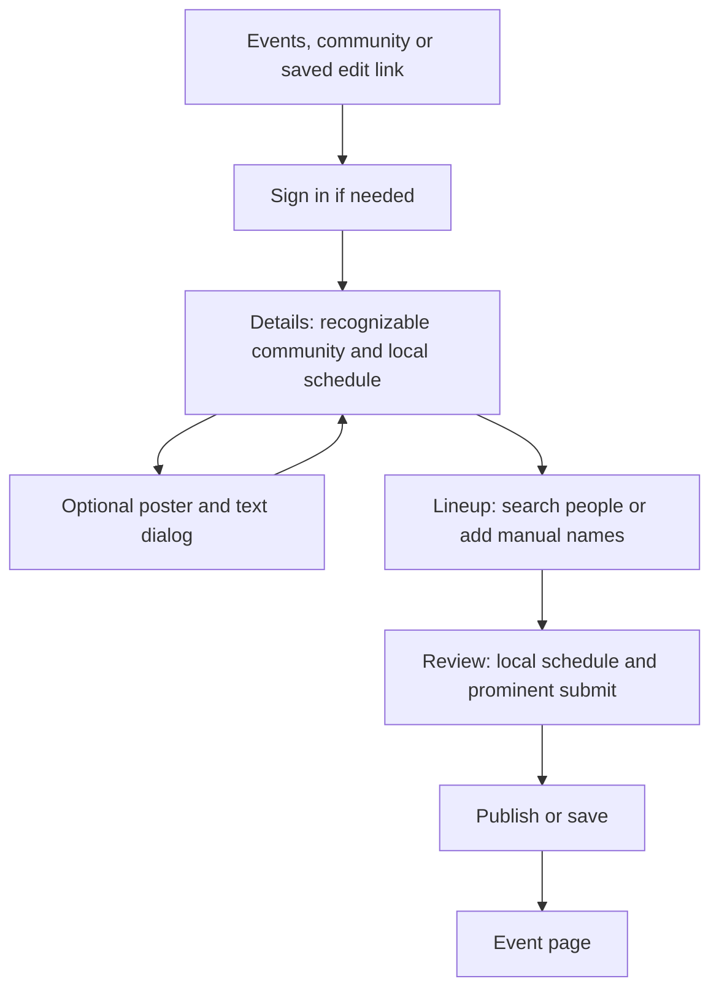

# Event editor identity and local-time implementation plan

> **For agentic workers:** REQUIRED SUB-SKILL: Use superpowers:subagent-driven-development, the previously requested method, to implement this plan task-by-task. Steps use checkbox (`- [ ]`) syntax for tracking.

**Goal:** Make event editing use recognizable people, communities and locations, consistent local times, and reliable protection against losing unsaved work, in one implementation PR.

**Architecture:** Keep the existing contributor and staff commands, persistence formats and three-step wizard. Share identity presentation and performer selection, project resolved instants into a separate editing zone, and track successful saves by the snapshot each request actually submitted. Keep form-specific adapters at the existing command boundaries rather than replacing both editors with a new form framework.

**Tech Stack:** Existing Next.js App Router, React, TypeScript, Convex, Node test runner, convex-test and Playwright. No new dependency or database migration is planned.

**Spec:** [Approved design](../specs/2026-10-15-event-editor-identity-local-time-design.md). BASIC approved the full design and its exact copy on 2026-10-15. The design governs behavior where this plan summarizes it.

## Global constraints

- The existing entry paths and Details, Lineup, Review stages remain. Import stays optional beside Details.
- Slugs remain routing and identity values internally, not secondary labels or temporary display-name fallbacks.
- Timed and untimed rows use the same identity interaction.
- Changing the editing zone is a display conversion for already resolved times. It does not shift the event or cascade the lineup.
- Opening an existing event in local time must not mark the event dirty or change its stored canonical zone/date.
- Date-only events stay calendar dates; never convert midnight to manufacture a neighboring date.
- An absent doors-open value starts collapsed. Stored or accepted imported values are expanded so an existing schedule is not hidden.
- Collapsing a control never clears its value; clearing is a deliberate edit.
- Preserve row keys, confirmation state, source provenance, stream choices and protected associations.
- Keep broad signed-in contribution, scoped corrections, revision checks, spam/duplicate checks and protected/private association handling intact.
- Preserve initial 4 slots of 60 minutes, maximum 80 slots, duration maximum 1,440 whole minutes, elapsed-time cascades and the fixed explicit event end.
- Use the approved copy table in the spec. Any additional substantive product sentence needs BASIC's exact-copy review before shipping.
- One implementation PR with internal commits. No planning-only PR, merge or production deployment is authorized by this plan.
- Global favorites, profile/world creation, image-ingestion redesign, extraction redesign, multiple posters, recurring events and the separate profile-editor cleanup remain deferred.

## Review focus

1. A saved profile becomes unavailable, or a query returns out of order. Keep the stored association and selected presentation; never silently link or unlink. Tasks 1 and 3 test this.
2. A saved partial clock cannot resolve while other clocks can. Preserve source context and raw values, and do not make opening the draft dirty. Tasks 4 and 5 test this.
3. A local display crosses midnight or a repeated hour, including subminute staff timestamps. Preserve exact instants and explicit ends through display conversion, saving and Time TBA restoration. Tasks 4 and 5 test this.
4. An upload, save or publication finishes after newer local edits. Persisted snapshots and server revisions advance without erasing those edits or publishing twice. Task 6 tests this.
5. Browser Back, Forward, reload or a same-tab link leaves a dirty editor. Cancel keeps the editor and inputs intact; accepted navigation happens once. Task 6 tests this in the running browser.

---

## Review brief and delivery order

The user will see richer selectors, fewer optional fields, local schedule controls, and confirmation before destructive or abandoning actions. The largest behavior change is that the timezone picker converts the view. Changing Starts still reschedules the event through the existing single cascade.

There are six tasks. Tasks 1 through 3 improve identity and Details controls. Task 4 defines the time conversion rules; Task 5 connects them to both editors. Task 6 protects work, verifies the combined experience and prepares the single PR. Execute sequentially with a fresh implementation worker and fresh reviewer per task, then review the complete branch. Do not parallelize edits to the two large forms.

The approved journey remains:



Saving a draft stays in the editor. Corrections retain their existing scoped return. Unsaved-change protection applies to abandonment, not wizard navigation or closing a dialog that retains its contents.

### Execution setup

- [ ] Refresh current main and inspect this chat's worktree attachments. Reuse a suitable existing clean worktree or create a managed one from verified current main using `superpowers:using-git-worktrees`. Use branch `codex/event-editor-identity-local-time`. Verify the checkout exists before using or linking it.
- [ ] Copy this plan, the approved spec and its three referenced Square images into that checkout. Read applicable AGENTS instructions and the current TypeScript and Convex skills. Leave unrelated primary-checkout changes untouched.
- [ ] Install the pinned workspace dependencies and prepare the repository's isolated local runtime using [local development](https://github.com/BASIC-BIT/VRDex/blob/21e48169d4f0cd54e55bbe48b1662ff128c8fe7f/docs/engineering/local-development.md). Use the current checked-out revision of that guide during execution. Run the current targeted event tests once before editing and retain baseline failures separately.

## Files and responsibilities

Paths below are repository-relative in the execution checkout. New names are decisions for this implementation, not claims that those modules already exist.

| Files | Responsibility |
| --- | --- |
| `apps/web/src/app/_components/profile-suggestion.tsx` (new), `lookup-search-box.tsx` (existing) | Shared image/name/context presentation without copying the lookup page's workflow. |
| `apps/web/src/lib/event-editor-identity.ts` (new) | Typed public-result adapters and pure performer billing-name transitions. |
| `apps/web/src/app/events/event-identity-picker.tsx` (new) | Accessible community/person/world lookup and retained selected-result presentation. |
| `apps/web/src/app/events/event-performer-field.tsx` (new) | Search/manual/link/change/override interaction for all lineup rows. |
| `apps/web/src/app/events/event-location-field.tsx` (new) | One optional world/manual location chooser. |
| `apps/web/src/app/events/event-intake-form.tsx`, `event-editor-form.tsx`, `event-editor-page.tsx`, `event-editor-preview.tsx` | Integrate shared controls, keep existing command adapters and remove obsolete inline inputs. |
| `convex/events.ts` | Add public logo presentation to the existing authorized managed-community result. |
| `apps/web/src/lib/calendar/event-editor-time.ts` (new) | Pure resolved/unresolved clock projection and local edit resolution. |
| `apps/web/src/lib/calendar/event-intake-date-time.ts`, `event-intake-suggestions.ts`, `event-lineup-adapters.ts`, `event-lineup-display.ts`, `event-end-time.ts`, `zoned-date-time.ts` | Existing serialization, acceptance, exact timing and display helpers. Change only where integration needs it. |
| `apps/web/src/lib/event-timezones.ts`, `event-timezone-default.ts`, `apps/web/src/app/_components/event-timezone-picker.tsx` | Friendly region/alias/offset display and existing preference precedence. |
| `apps/web/src/lib/event-editor-persistence.ts` (new), `apps/web/src/app/events/use-event-editor-leave-guard.ts` (new) | Submitted-snapshot bookkeeping and browser navigation protection. |
| `apps/web/src/app/events/event-lineup-controls.tsx`, `event-contribution-controls.tsx`, `event-intake-source.tsx` | Removal confirmation, scoped correction completion and intermediate source-save integration. |
| `apps/web/src/app/playwright/event-intake/preview.tsx`, `timezone-preview.tsx`, `revision-preview.tsx`, `apps/web/src/app/playwright/event-lineup/preview.tsx` | Existing local fixtures; add deterministic identities and deferred request responses where required. |
| `tests/web/`, `tests/backend/`, `apps/web/e2e/` | Behavioral tests named under their owning tasks below. |
| `docs/engineering/event-contribution-browser.md`, `docs/backend/event-intake.md`, `docs/testing/event-editor-identity-checkpoint.md` (new) | Update behavior and record runtime, screenshot and delivery evidence. |

No persisted performer or timing schema change is expected. Existing `performerLabel`/`displayLabel`, person associations, `venueLabel` and world associations already express the approved data. A new persisted field requires evidence that these cannot preserve an approved behavior, followed by a focused design amendment rather than a speculative migration.

## Task 1: Shared identity presentation and lookup data

**Files:** Create `apps/web/src/app/_components/profile-suggestion.tsx`, `apps/web/src/lib/event-editor-identity.ts`, `apps/web/src/app/events/event-identity-picker.tsx`, `tests/web/event-editor-identity.test.ts`, `apps/web/e2e/event-editor-identities.flow.spec.ts`. Modify `lookup-search-box.tsx`, `convex/events.ts`, `tests/backend/event-foundation.test.ts` and the listed fixture previews.

**Interfaces:**

- Derive `EventSearchResult` from `FunctionReturnType<typeof api.search.searchUniversal>[number]`, and `EventPersonResult` from `FunctionReturnType<typeof api.profiles.lookupPeople>[number]`. Do not duplicate whole backend result schemas.
- Export `EventIdentityOption` with `kind: "person" | "community" | "world"`, `slug`, `title`, `href`, optional `imageUrl`, `imageKind: "profile" | "logo"`, optional public avatar appearance, optional `context` and optional public trust label. Derive appearance/trust types from the existing lookup DTO. The type contains routing identity; the presenter never renders its slug.
- Export `personIdentityOption(person: EventPersonResult): EventIdentityOption` and `searchIdentityOption(result: EventSearchResult): EventIdentityOption | null` in the identity module. Unsupported search entity types return null.
- Export `ProfileSuggestion({ option }: { option: EventIdentityOption }): ReactNode`. Use the existing `EntityImage`, `ProfileAvatarImage` and trust treatment. The lookup page adapts its public rows into this presenter; keep private-seed rows and their permission behavior separate.
- Export `EventIdentityPicker({ kind, selectedSlug, selectedOption, shortcuts, disabled, onSelect, onClear, manualAction })`. Props use the identity types above; callbacks are `onSelect(option: EventIdentityOption): void`, `onClear(): void`; optional `manualAction` is `{ label: string; onChoose: (text: string) => void }`. `shortcuts` is a readonly array of options, default empty. Keep search text separate from selected identity.
- Extend `events.listManagedCommunities({})` additively with optional public `imageUrl`. Reuse the established public media-kit resolver for discovery logo/avatar fallback, preserve its current role and visibility filtering, and update a returns validator if required. No new query or authorization mechanism.

- [ ] **Step 1: Write failing identity and lookup tests.** Assert person role/context and image survive adaptation, missing context does not become a raw profile path, community logos use containment, and unsupported events cannot become profile/world options. Backend tests assert an owner and authorized staff see the same allowed communities as before, a nonmember does not gain access, and hidden image fields remain hidden. Browser cases assert selected title/image persist while a refresh is delayed, image failure leaves stable dimensions, and a stale response cannot replace the current query or selection. Explicitly select duplicate-name people using their public context/profile link.
- [ ] **Step 2: Run those tests and record the expected failures.** Run `node --import tsx --test tests/web/event-editor-identity.test.ts`, `node --conditions=import --import tsx --test tests/backend/event-foundation.test.ts`, and `pnpm --filter web exec playwright test event-editor-identities.flow.spec.ts --project=desktop-chromium`. Expected failures concern the missing adapter/picker behavior, not fixture startup.
- [ ] **Step 3: Implement the interfaces above.** Use `profiles.lookupPeople` for rich person results and `search.searchUniversal` filtered to communities or worlds for the other kinds. Use exact `profiles.getPublicBySlug`/`worlds.getPublicBySlug` hydration for resumed selections where presentation was not provided. Public world lookup requires its existing `now` argument. Keep the latest selected option through query revalidation; hydrate existing links without clearing them on null/error. Use fixed-size loading/fallback presentation when no title is yet known. Keyboard arrows, Enter, Escape, pointer selection and focus restoration must work; blur never selects. Keep profile-inspection actions separate from combobox options. Limit person results to the existing maximum 25 and use 8 results in these pickers.
- [ ] **Step 4: Rerun the same tests, plus existing lookup tests.** All new cases pass; the public and private lookup page retains its current selection and access behavior. Capture one rich-result screenshot and inspect it before changing the forms.
- [ ] **Step 5: Commit only Task 1 files**, including this plan/spec/assets, with `feat: share event identity selection and presentation`.

## Task 2: Community, location and optional Details controls

**Files:** Create `apps/web/src/app/events/event-location-field.tsx`. Modify both forms, `event-editor-page.tsx`, `event-editor-preview.tsx`, `apps/web/e2e/event-editor-identities.flow.spec.ts`, `apps/web/e2e/event-editor-end.flow.spec.ts` and `docs/engineering/event-contribution-browser.md`.

**Interfaces:**

- Consume Task 1's `EventIdentityPicker` and `EventIdentityOption`.
- Export `EventLocationField({ worldSlug, venueLabel, selectedWorld, onChange, disabled })`, where strings may be empty, `selectedWorld?: EventIdentityOption`, `onChange(next: { worldSlug: string; venueLabel: string }): void`, and `disabled?: boolean`. Keep protected association IDs in the parent command adapter, outside this public chooser.
- Add `community?: EventIdentityOption` to `EventEditorPreview` props. Carry the already available `communityName` from `EventEditorPage` into the staff form immediately; hydrate its logo using public presentation. The contributor form passes its retained selection. Review uses that same selection, not another slug lookup.

- [ ] **Step 1: Write failing browser tests for Details.** Opening a generic Add event shows no automatic selection; an explicit community entry preselects its title. Empty search shows `Your communities` for owner/staff, while public search still selects another group. Assert title/logo appear in selected state, preview and Review and raw slug text does not. Assert missing doors is collapsed, populated/imported doors is expanded, collapsing preserves data and explicit clearing removes it. Assert world plus custom label round-trips untouched; manual switch removes only the editable world association; an unavailable public world never clears a protected link. `Original event post` remains optional and retains its existing serialized source URL.
- [ ] **Step 2: Run `pnpm --filter web exec playwright test event-editor-identities.flow.spec.ts event-editor-end.flow.spec.ts --project=desktop-chromium` and confirm the new cases fail for current UI behavior.**
- [ ] **Step 3: Integrate Details controls.** Replace inline `CommunityInput`; adapt the managed query into shortcut options. Keep staff community restrictions unchanged. Replace simultaneous raw world/Where inputs with `EventLocationField`, and put any saved differing venue label in selection details. Match the existing end disclosure for doors without deleting values on collapse. Move source URL into optional details under its approved label. Use shared tokens, header/footer layout and restrained radii. Remove slug fallbacks from preview/Review; absent presentation gets a deliberate loading/fallback state. Update the Details documentation in the same change.
- [ ] **Step 4: Rerun the two browser files and the protected-association backend tests.** Run `node --conditions=import --import tsx --test tests/backend/event-lineup-preservation.test.ts`. Expect all cases to pass and zero protected-association changes on an unrelated title edit.
- [ ] **Step 5: Commit Task 2 files** with `feat: simplify event details and community selection`.

## Task 3: One performer field with explicit linking and billing override

**Files:** Create `apps/web/src/app/events/event-performer-field.tsx`. Modify `event-editor-identity.ts`, both forms, preview, `tests/web/event-editor-identity.test.ts`, `apps/web/e2e/event-editor-identities.flow.spec.ts`, `apps/web/e2e/event-lineup-editing.flow.spec.ts`, and `tests/backend/event-lineup-preservation.test.ts` where existing fixtures need new coverage.

**Interfaces:**

- Export `EventPerformerValue = { kind: "manual"; label: string } | { kind: "linked"; personSlug: string; billing: { kind: "default" } | { kind: "override"; label: string } }` from the identity module. This is transient editor state; existing row keys and persisted fields remain authoritative.
- Export pure `selectEventPerformer({ current, person }: { current: EventPerformerValue; person: EventIdentityOption }): EventPerformerValue` and `eventPerformerLabel({ value, profileName }: { value: EventPerformerValue; profileName?: string }): string`. Call selection only with a person option. A missing public profile name never writes an empty label over a saved one.
- Export `EventPerformerField({ value, selectedPerson, onChange, disabled })`, where `value: EventPerformerValue`, `selectedPerson?: EventIdentityOption`, `onChange(value: EventPerformerValue): void`, and `disabled?: boolean`.
- Parent adapters map contributor `performerLabel/personSlug` and staff `displayLabel/personSlug` to this transient state. Initialize saved differing labels as overrides after name hydration; preserve saved raw labels while hydration is pending or unavailable. Keep explicit override intent in memory across profile changes. Persist through the existing row contracts.

- [ ] **Step 1: Add failing transition tests and browser cases.** Test manual `Guest A` linked to profile `Aurora` retains `Guest A` as an override, changing that profile retains the override, clearing it adopts the profile name, and changing a default follows the new name. Test exact-name typing and blur never link, manual action remains the last option with matches or search failure, empty query cannot create an empty manual entry, and a saved unavailable linked person remains linked. In both timed and untimed rows assert stream choice, row key, confirmation/source metadata and exact times survive each identity action.
- [ ] **Step 2: Run `node --import tsx --test tests/web/event-editor-identity.test.ts` and `pnpm --filter web exec playwright test event-editor-identities.flow.spec.ts --project=desktop-chromium`.** Confirm the new transitions fail before implementation.
- [ ] **Step 3: Implement the transitions and shared field.** Label the combobox `Performer` with `Search performers`, show image/name for a selection, and offer `Change`. Manual rows show `Unlinked` and `Link profile`. Use the optional `Display name as` disclosure, expanded for a saved override. Replace both inline performer implementations and every timed/untimed caller, then delete the obsolete editor datalists. Update existing browser tests to explicitly choose a person or `Add manual entry`; do not weaken assertions to accept arbitrary typed slugs.
- [ ] **Step 4: Run the new tests and existing row-preservation suites.** Run `node --import tsx --test tests/web/event-participants.test.ts tests/web/event-lineup-adapters.test.ts` and `node --conditions=import --import tsx --test tests/backend/event-lineup-preservation.test.ts tests/backend/event-slot-identity.test.ts`. Run `pnpm --filter web exec playwright test event-lineup-editing.flow.spec.ts event-editor-identities.flow.spec.ts --project=desktop-chromium`. Expect old and new cases to pass.
- [ ] **Step 5: Commit Task 3 files** with `feat: unify event performer lookup and manual entries`.

## Task 4: Pure local editing-time conversion

**Files:** Create `apps/web/src/lib/calendar/event-editor-time.ts`, `tests/web/event-editor-time.test.ts`. Modify `event-timezones.ts`, `tests/web/event-timezone-picker.test.ts`, `tests/web/event-timezone-default.test.ts` and only the existing calendar helpers that need shared conversion logic.

**Interfaces:**

- Reuse contract `EventIntakePatch` and `EventIntakeLocalTime` and the existing `resolveEventLocalTime`/`selectEventLocalTime`. Do not create a second timezone resolver.
- Export `EditorTimeResolution = { kind: "empty" } | { kind: "invalid" } | { kind: "gap" } | { kind: "ambiguous"; instants: readonly number[] } | { kind: "resolved"; instant: number }`.
- Export `resolveEditorTime({ value, timezone, occurrence }: { value: string; timezone: string; occurrence?: EventIntakeLocalTime["occurrence"] }): EditorTimeResolution`. It parses a local datetime input and resolves it in that display/source zone. Empty/invalid/gap/unselected repeated hour are distinct outcomes.
- Export `projectEditorTime({ instant, timezone }: { instant: number; timezone: string }): { value: string; occurrence?: EventIntakeLocalTime["occurrence"] }`. The input control may display minute precision; the existing exact instant stays authoritative until that clock is deliberately edited.
- Export `readIntakeEditorClock({ fields, local }: { fields: EventIntakePatch; local: EventIntakeLocalTime | null | undefined }): { kind: "empty" } | { kind: "resolved"; instant: number } | { kind: "unresolved"; date: EventIntakePatch["eventDate"]; timezone: EventIntakePatch["timezone"]; local: EventIntakeLocalTime }`. Missing source context stays unresolved, never local by assumption.
- Keep `resolveEventTimezoneDefault({ savedPreference, browserTimezone }): string`. Extend existing `eventTimezoneLabel(value: string, instant?: number): string` to include a friendly region, date-correct abbreviation and offset for resolved instants. Preserve search aliases and distinguish fixed offsets from regional IANA values.

- [ ] **Step 1: Write failing pure tests with exact expected values.** Cover the following assertions:

```ts
// Resolved 23:00 Los Angeles becomes 02:00 next day in Indianapolis.
assert.equal(projectEditorTime({ instant: Date.UTC(2026, 9, 16, 6), timezone: "America/Indianapolis" }).value, "2026-10-16T02:00");
// New York repeats 01:30 on November 1, 2026. No choice cannot become an instant.
assert.equal(resolveEditorTime({ value: "2026-11-01T01:30", timezone: "America/New_York" }).kind, "ambiguous");
assert.deepEqual(resolveEditorTime({ value: "2026-11-01T01:30", timezone: "America/New_York", occurrence: "later" }), { kind: "resolved", instant: Date.UTC(2026, 10, 1, 6, 30) });
assert.equal(resolveEditorTime({ value: "2026-03-08T02:30", timezone: "America/New_York" }).kind, "gap");
```

Also assert missing date/zone stays unresolved with unchanged source clock, blank differs from invalid, regional aliases including EST/eastern/EDT find Eastern options, Indianapolis has EDT/UTC-4 in summer and EST/UTC-5 in winter, and undated labels contain no invented date-specific offset. Both `America/Indianapolis` and the valid `America/Indiana/Indianapolis` identity display sensibly without rewriting stored IDs. Untouched millisecond instants remain exact outside the input projection.

- [ ] **Step 2: Run `node --import tsx --test tests/web/event-editor-time.test.ts tests/web/event-timezone-picker.test.ts tests/web/event-timezone-default.test.ts`.** Confirm the new adapter and friendly-label assertions fail for missing behavior.
- [ ] **Step 3: Implement the interfaces above.** Use calendar-date arithmetic only for calendar dates, never offset hours to calculate elapsed time. Keep resolution pure and presentation nonmutating. Existing intake serialization must enforce day offsets from -1 through 7 atomically. Reuse the current format/occurrence helpers and preserve compatible exports. Do not pass display-zone changes into a schedule mutation helper.
- [ ] **Step 4: Run the tests above plus `node --import tsx --test tests/web/calendar-timezone.test.ts tests/web/event-intake-date-time.test.ts tests/web/event-lineup-adapters.test.ts tests/web/event-lineup-timing.test.ts tests/web/event-end-time.test.ts`.** Expect all tests to pass with no new rounding or offset-bound behavior.
- [ ] **Step 5: Commit Task 4 files** with `feat: separate event clock display from authored timing`.

## Task 5: Local schedule controls, imports and Time TBA

**Files:** Modify both forms, `event-editor-preview.tsx`, `event-timezone-picker.tsx`, `event-intake-source.tsx`, `event-intake-suggestions.ts`, `event-lineup-display.ts`, relevant fixture previews and `docs/engineering/event-contribution-browser.md`. Create `apps/web/e2e/event-editor-local-time.flow.spec.ts`. Extend `tests/web/event-intake-source.test.ts`, `tests/web/event-lineup-adapters.test.ts` and existing timezone/end browser suites.

**Interfaces:**

- Consume Task 4's projection/resolution functions. Each form owns `editingTimezone: string` independently of existing canonical timing state. Track deliberate selection so late preference data cannot overwrite it. Once a new draft has timing context, late defaults must not reinterpret it.
- Extend `EventEditorPreview` props with required `editingTimezone: string`; all callers, including fixtures, pass the same zone used by the controls. Date-only preview uses the authored date directly.
- Extend `IntakeTime` with explicit `displayTimezone` and `onPendingEditChange?: (pending: boolean) => void`. Its existing date/time/zone inputs still identify canonical source fields. Project resolved clocks; place unresolved clocks in `Unresolved time` with their source-zone context. Pending meaningful invalid buffers participate in Task 6's dirty state and block display-zone changes until corrected/cancelled.
- Keep `readIntakeLineupTimings`, `applyIntakeLineupTimings`, `readStaffLineupTimings`, `applyStaffLineupTimings` and `shiftLineupStart` as the existing command/timing boundaries. Conversion alone calls none of the cascade operations. A deliberately resolved Starts edit calls the existing cascade exactly once, then serializes into the canonical zone. Validate the whole prospective update before installing it.

- [ ] **Step 1: Add failing browser and serializer tests.** Run both staff and contributor cases: open an existing foreign-zone event locally, switch display zones, change only title and save; assert canonical date/zone/occurrence and exact timestamps are unchanged. Accept known LA import times and assert local start/end/doors/slots roll over together, with no second cascade and no automatic person matches. Keep partial/missing-zone/gap/repeated-hour suggestions unresolved. Opening a partial saved draft leaves its authored serialization unchanged; Task 6 adds the resulting clean-navigation assertion. Attempt a display-zone switch with an invalid input buffer and assert the zone/value stay put and focus returns to that buffer.
- [ ] **Step 2: Add failing Time TBA and rescheduling cases.** LA October 15 at 23:00 displays Indianapolis October 16 at 02:00; selecting Time TBA yields date-only October 16. Toggling off without timing edits restores the exact original canonical schedule. Editing that date while TBA is on applies one local start-date change on restoration, preserves the explicit end and flags any conflict. Removed rows never return. An ordinary Starts change shifts exact slot instants once. An unrepresentable -1/7 day-offset update keeps every previous field intact and reveals the existing correction control. A DST-crossing lineup displays each row with its correct offset when needed to disambiguate the repeated hour.
- [ ] **Step 3: Run `pnpm --filter web exec playwright test event-editor-local-time.flow.spec.ts event-timezone-picker.flow.spec.ts event-editor-end.flow.spec.ts --project=desktop-chromium` and the Task 4 pure test command.** Confirm new form-level tests fail for the old authoring-zone behavior.
- [ ] **Step 4: Integrate local display and source-context editing.** Keep the canonical draft/event payload as the persistence source. Use the private preference, browser, UTC precedence for display, without writing account preferences. Place the compact timezone picker beside Starts and one proof near Review's first schedule. Remove repeated raw zone labels, and use the same zone in slot controls, preview, Review and conflict ranges. Resolve accepted source clocks in their source zone before projection; retain source evidence/questions and all unresolved values. Implement the approved TBA backup/date rules without copying stale deleted rows. Update docs to replace the earlier zone-reinterpretation description.
- [ ] **Step 5: Run all new cases plus existing source and scheduling suites.** Run `node --import tsx --test tests/web/event-intake-source.test.ts tests/web/event-intake-date-time.test.ts tests/web/event-lineup-adapters.test.ts tests/web/event-lineup-timing.test.ts tests/web/event-end-time.test.ts`, then `pnpm --filter web exec playwright test event-editor-local-time.flow.spec.ts event-timezone-picker.flow.spec.ts event-editor-end.flow.spec.ts event-lineup-editing.flow.spec.ts event-intake-source.flow.spec.ts --project=desktop-chromium`. Expect passing tests and unchanged backend payloads for display-only actions.
- [ ] **Step 6: Commit Task 5 files** with `feat: edit event schedules in the creator local timezone`.

## Task 6: Confirm removal, protect unsaved work and verify delivery

**Files:** Create `apps/web/src/lib/event-editor-persistence.ts`, `apps/web/src/app/events/use-event-editor-leave-guard.ts`, `tests/web/event-editor-persistence.test.ts`, `apps/web/e2e/event-editor-unsaved.flow.spec.ts`, `docs/testing/event-editor-identity-checkpoint.md`. Modify both forms, `event-lineup-controls.tsx`, `event-contribution-controls.tsx`, source integration, relevant fixture previews, existing browser/snapshot tests and the two behavior docs listed above.

**Interfaces:**

- Export `AuthoredSnapshot = string`, `authoredSnapshot(value: unknown): AuthoredSnapshot` and `hasUnsavedEventChanges({ current, persisted, pendingInput }: { current: AuthoredSnapshot; persisted: AuthoredSnapshot; pendingInput: boolean }): boolean` from the persistence module. Build snapshots from the command-relevant authored DTO, not rendered form DOM, transient queries, disclosure, display zone or presentation caches. Use deterministic object-key order; preserve array order and command-significant null/omission distinctions.
- Export `useEventEditorLeaveGuard({ dirty }: { dirty: boolean }): { requestLeave: (navigate: () => void) => boolean }`. Dirty cancellation returns false and does not call `navigate`; clean/confirmed abandonment calls it exactly once. Install `beforeunload` only when dirty, and remove all listeners on unmount. Use `Leave without saving?` for in-app browser confirmation; native before-unload text belongs to the browser.
- Add `EventSlotRemove({ label, range, disabled, onConfirm })` to lineup controls, with optional data strings `label`/`range`, optional boolean `disabled` and `onConfirm(): void`. Reuse the reset dialog's native-dialog/focus pattern and approved `Remove this slot?`, `Remove slot`, `Cancel`. Invoke the existing keyed removal/cascade only after confirmation.
- Change intake save/publish callbacks to return completion data instead of navigating inside the transport. Define `EventSubmitCompletion = { kind: "saved" } | { kind: "published"; eventId: Id<"events">; eventPath: string }` beside the form; use `Promise<EventSubmitCompletion>` for `onPublish`. Preserve request revisions and idempotency keys in the connected wrapper. The form records the submitted snapshot before awaiting, updates the persisted snapshot only on success and then requests any return navigation.
- If publication succeeded but the user stays with newer changes, retain event identity and use the existing `eventCorrections.getOwnContributedEvent` / `updateOwnContributedEvent` path and its current revision/patch restrictions. Staff creation similarly retains the returned event identity and uses the existing update command next time. Do not call creation/publication again. Keep correction authority failures visible through existing errors, including staff takeover during the request.

- [ ] **Step 1: Write failing persistence tests.** Assert equal authored payloads are clean despite different object insertion order, arrays retain meaning, invalid pending time/duration/name-override input is dirty, and search/focus/image/disclosure/display-zone changes are clean. Initialize the baseline from loaded authored data after non-authored initialization; default-zone setup on an otherwise untouched new draft and delayed presentation hydration do not create a false dirty state. An intermediate source save makes only its submitted snapshot the persisted baseline. Newer fields/overrides stay dirty after successful save; failure/validation never advances the baseline. Publication success plus newer edits remains dirty and records a published identity.
- [ ] **Step 2: Write failing removal/navigation/race browser tests.** For both editors, cancel removal preserves row and schedule; confirm removes once and cascades once, including untimed/partial rows and TBA backups. Dirty refresh/close/document navigation trigger native confirmation after user activation. Dirty header/exit links and Back/Forward use confirmation; cancel retains URL, mounted editor and values, accept reaches the intended destination once. Test repeated cancellation and a second traversal after acceptance. Wizard switches and retained modal close do not prompt. Opening partial drafts, display-zone conversion, profile hydration and saving unchanged drafts leave navigation clean. Include correction-panel close as abandonment. Use real browser history/dialogs, not just unit tests of `window.confirm`.
- [ ] **Step 3: Add deferred-request browser cases.** Edit while save, upload and extraction requests are pending, then resolve them and assert newer local values survive and remain dirty. Publish with newer edits, cancel leaving, submit again and assert the existing edit command runs with the new revision and the creation/publication count stays one. Accept leaving and assert one event-page transition. Successful clean publish returns directly without a second warning. Test a failed save and stale revision. Cover both staff creation and contributor creation with local authenticated command tests where fixture callbacks cannot establish authority.
- [ ] **Step 4: Run `node --import tsx --test tests/web/event-editor-persistence.test.ts` and `pnpm --filter web exec playwright test event-editor-unsaved.flow.spec.ts event-lineup-editing.flow.spec.ts --project=desktop-chromium`.** Record expected failures for missing protection and race behavior.
- [ ] **Step 5: Implement snapshots, confirmation and command completion.** Separate successful server revision bookkeeping from replacing live fields. Reconcile async source results against the submitted state so changed fields/row overrides win locally, while recording saved source IDs and revisions. Register meaningful uncommitted inputs with the form; clear each only on commit/cancel. Guard same-tab links from the surrounding page shell as well as editor buttons, and use `requestLeave` for explicit router navigation and correction-panel close. Use public History API entries that preserve Next's existing history state for same-document traversals; restore a cancelled editor entry and replay an approved traversal once. Do not patch private Next internals or accumulate duplicate history entries on wizard changes. Test the concrete mechanism in Chromium before relying on it. Keep the guard mounted while a dirty editor can be abandoned, including during requests. Use an explicit one-navigation bypass only after the approved leave decision or clean submitted-state match, never a blanket saving flag. Preserve native validation and return focus to rejected inputs.
- [ ] **Step 6: Run the targeted tests from Steps 4 and 3.** Expect all navigation, request race and removal cases to pass. Run `node --conditions=import --import tsx --test tests/backend/event-corrections.test.ts tests/backend/event-intake.test.ts tests/backend/event-lineup-preservation.test.ts` to retain revision, permission and association guarantees. Update affected old removal tests to confirm explicitly.
- [ ] **Step 7: Update behavior docs and the checkpoint.** Explain local display versus canonical storage, partial clock context, optional Details controls, manual/link/override behavior, and native exit protection limits. Record the prior [Square discard journey](https://mobbin.com/flows/f142a720-3023-4b5f-9ccb-d6f5d5b04398) as evidence for a discard decision at abandonment. Its three inspected screens show editor, confirmation, overview; they do not prove save/discard persistence. Reuse this settled evidence, with this spec's native confirmation choice. Keep the separate profile-editor progressive-disclosure request documented as deferred, without implementing it here.
- [ ] **Step 8: Run combined automated verification.** Run `pnpm lint:web`, `pnpm typecheck:web`, `pnpm test:web`, `pnpm typecheck:backend`, `pnpm test:backend`, `pnpm build:web`, `pnpm check:backend:generated`, and `pnpm verify:docs` in the execution checkout. `check:backend:generated` must use the isolated local Convex runtime. Run the event flow files from Tasks 2, 3, 5 and 6 plus `event-contribution.flow.spec.ts` and `event-review-actions.flow.spec.ts` on desktop and mobile Chromium. Fix failures caused by this change; record unrelated failures with evidence rather than claiming the gate passed. Confirm the report includes executed, not merely skipped, cases.
- [ ] **Step 9: Capture and visually inspect the running editor.** Use current `event-editor.snapshots.spec.ts` and the new identity/local-time fixtures on desktop/mobile in light/dark themes. Capture Details with optional times, community/world result lists, linked/manual/override lineup, repeated/unresolved time controls, Review with logo/proof/submit, and removal confirmation. Inspect screenshots with VLM review for truncation, contrast, logo fit, focus and mobile overflow. Update affected baselines only after inspection; rerun `pnpm --filter web exec playwright test event-editor.snapshots.spec.ts --grep @snapshot --project=desktop-chromium --project=mobile-chromium`. Keep screenshots/video and links in the checkpoint, and distinguish local fixture, authenticated command and any hosted evidence. Do not claim production deployment from local results.
- [ ] **Step 10: Commit Task 6 files** with `feat: protect unsaved event edits and confirm slot removal`.

## Whole-branch review and one-PR handoff

- [ ] Run fresh whole-branch review for spec compliance, correctness, accessibility, Convex permissions and React behavior. Review time conversion, source-save merging and navigation together, because their boundaries can lose work even when individual controls pass. Address valid findings and rerun affected checks.
- [ ] Recheck changed public copy against the approved table. Request exact-copy review only if additional substantive strings are actually necessary. Do not introduce explanatory cards to fill layout space.
- [ ] Commit all in-scope docs and screenshot baseline changes, push the latest implementation branch and open one PR. Attach it to this chat with the native artifact tool. Include the approved design/plan and a short behavior description with useful visual and risk-specific validation evidence. Avoid routine policy boilerplate in the PR body.
- [ ] Complete the repository's PR feedback loop. Before every follow-up push, triage every outstanding review comment, reply or react with its disposition, and resolve handled threads. New commits reset the required 30-minute window.
- [ ] After at least 30 minutes from the latest commit timestamp, refresh checks, ordinary comments, inline threads, formal reviews and mutable sticky AI summaries for the exact pushed head. Address valid new feedback, then reread the mutable summaries. Call the PR merge-ready only with acceptable terminal checks, clean mergeability, no unresolved blocking feedback and a final post-window refresh. Report the PR URL and remaining limits.

## Evidence appendix

- Planning inspected fetched `origin/main` at `21e48169d4f0cd54e55bbe48b1662ff128c8fe7f` on 2026-10-15. Refresh again at execution. Source evidence came from Git objects because the shared primary checkout contains unrelated edits and deletions.
- Existing contributors use `eventIntake.saveEventIntakeDraft`, `getEventIntakeDraft` and `publishEventIntake`. Existing contributor edits use `eventCorrections.updateOwnContributedEvent`. Keep their distinct authority and version contracts.
- Existing managed shortcuts use `events.listManagedCommunities`. Rich people use `profiles.lookupPeople`; universal results already contain public person presentation. Existing exact hydration is `profiles.getPublicBySlug` and `worlds.getPublicBySlug`.
- Existing timing storage is contributor local date/time/zone with occurrence and bounded day offsets, and staff absolute instants with exact timing overrides. The plan changes presentation and deliberate-edit adapters, not the persisted time format.
- The stable planning copies are in `D:/bench/VRDex/docs/superpowers/`. The earlier `event-editor-identity-polish` managed checkout disappeared. Do not use that path as an execution location or user link without verifying it exists.
- Plan self-review checked approved-spec coverage, shared interface names, task dependencies, all five review-focus risks and document size. BASIC approved this implementation plan in chat on 2026-10-15. Execution began in the isolated event-editor-identity-local-time checkout. Task reports record implementation and test evidence as each task completes.
