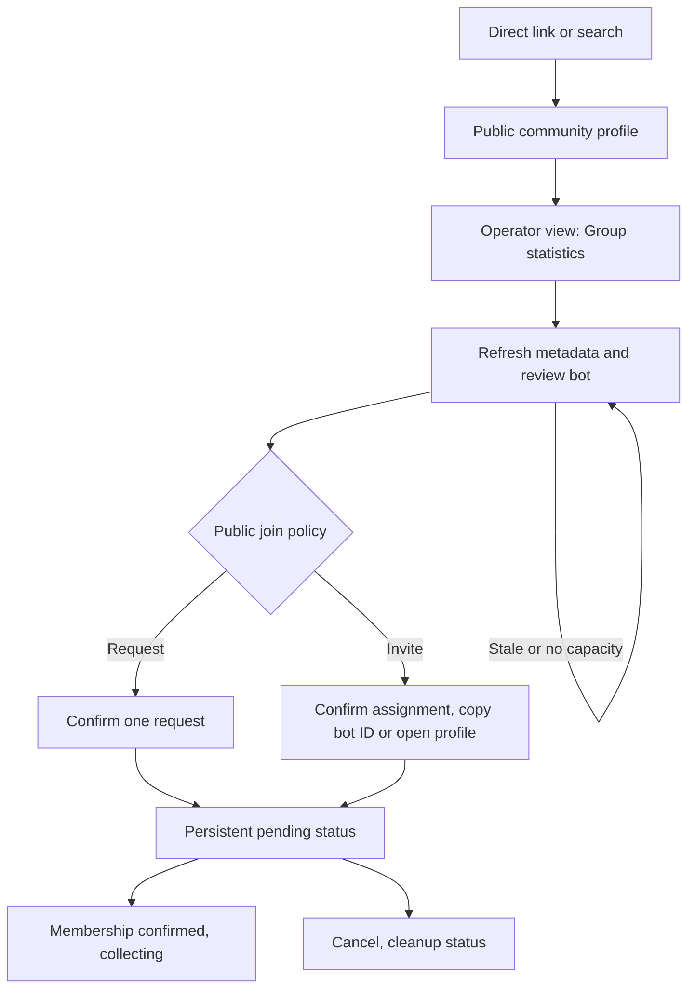

# Super-admin group admission implementation plan

> **For agentic workers:** REQUIRED SUB-SKILL: Use superpowers:subagent-driven-development (recommended) or superpowers:executing-plans to implement this plan task-by-task. Steps use checkbox (`- [ ]`) syntax for tracking.

**Goal:** Let super admins admit public request-to-join and public invite-only groups to aggregate statistics, with group administrators retaining control of bot membership.

**Architecture:** Keep the existing automatic collection scope, canonical group integration, account allocator, request budgets and public aggregate projection. Add an explicit audited admission grant to that integration and carry its identity through assignment, request authorization and cleanup. Extend the existing profile Operator view rather than adding a dashboard.

**Tech Stack:** Existing Node 24, pnpm 10.15.1, TypeScript, Convex, Next.js, Node test runner, convex-test and Playwright. No new dependencies or services.

**Spec:** [Approved super-admin admission design](../specs/2026-10-27-super-admin-group-admission-design.md), approved October 27, 2026. The [automatic statistics design](../specs/2026-10-25-automatic-group-statistics-design.md) still governs aggregate privacy. BASIC approved execution on October 27, 2026. Local implementation is complete with review fixes in progress. Release, live-provider acceptance and incomplete broad-suite gates remain separate; source implementation does not authorize merge or deployment.

## Review brief

The super admin opens a public community's Operator view, reviews its selected primary group and exact bot, and authorizes one admission. Request groups receive one join request. Invite-only groups show that bot's identity and wait for an invitation. Both paths retain their status on the profile and start publishing only after confirmed membership.

Build this in five sequential tasks. The main cost is lifecycle correctness, particularly cancellation during approval and recovery after a lost response. Retain pending capacity rather than risking duplicate requests from different accounts. An unverified request-withdrawal operation falls back to honest Cleanup pending with manual instructions, so uncertainty does not block the implementation or become false success.

No product decision remains open. Exact explanatory UI copy needs BASIC's review before shipping. Implementation should use the subagent method previously requested for this feature, with sequential tasks because they share contracts.

## Global constraints

- "Private groups remain excluded."
- "Only super admins see admission controls, assigned-account identity, reasons and request history."
- "Collection starts only after provider-confirmed membership."
- "Pending and active aggregate admissions count toward the current ceiling of 50; this action cannot increase it."
- "No account creation, fleet expansion or quota change."
- "No existing record is backfilled into this exception."
- Keep `collectionScope.kind: "automatic"`, `publicationPolicy: "automatic_aggregate"`, `namedMembershipCollectionEnabled: false` and analytics-only features. Admission never grants ownership or management access.
- Explicit grants are independent of the automatic free-join enable boolean. Fleet/account kill switches, cooldowns, managed priority, reserved headroom, group stops and budgets still apply.
- Persist an attempt before each membership write. An uncertain reply permits inspection, never a second request or a different bot.
- Cancel hides current and retained output and fences work before cleanup. Preserve pre-existing and managed membership. Retain capacity while cleanup is uncertain.
- Add no raw payloads, rosters, users, instance rows, worlds or private instance links to aggregate storage or public responses. Keep bot identity and internal reasons out of public output and metric dimensions.
- Use the existing isolated checkout without disturbing unrelated changes. At execution, reconcile with current main before editing and load applicable Convex, TypeScript and execution skills. Do not reset shared checkouts.
- No deployment, production configuration, Homie Hub request, invitation acceptance or message to another human is authorized by plan approval.

## Review focus

1. Two admins confirm different preview accounts at once. Exactly one account is reserved, and the other confirmation refreshes. Task 2 pins this race.
2. A provider reply disappears after a successful request or invitation acceptance. Restart inspects the same bot and never repeats the write. Task 3 pins both paths.
3. Cancellation races external approval or a stale worker result. Output stays hidden, owned membership is cleaned up, and capacity remains held until safe. Tasks 2 and 3 pin this race.
4. Duplicate profiles, a slug rename and a primary-group relink must not bypass group privacy or leak old history. Task 4 pins each change across protocols.
5. A group changes join policy or becomes private while pending. No different operation follows the old grant, and publication stops. Tasks 3 and 4 pin these changes.

## File map and contracts

| Task | Files and responsibility |
| --- | --- |
| 1. Model and metadata | `convex/schema.ts`, `convex/_communityTelemetry.ts`, new `convex/_groupAdmission.ts`; `convex/profileLinkDestinations.ts`, `convex/_profileLinkDestinationCache.ts`, `workers/group-telemetry/profile-link-destination.mjs` and its `.d.mts` declaration for bounded group metadata |
| 2. Admin commands | `convex/groupObservations.ts`, `_groupAdmission.ts`, `communityTelemetry.ts`; atomic reservation, audit, cancellation, retry and status |
| 3. Collector lifecycle | `convex/communityTelemetry.ts`, `convex/http.ts`, `convex/_claimObservability.ts`, `workers/group-telemetry/worker.mjs`, `vrchat-client.mjs`, `runtime.mjs`; guarded request/invite operations and cleanup |
| 4. Public policy | `convex/_groupObservationPolicy.ts`, `_communityTelemetryPublic.ts`, `groupObservations.ts`, `communityTelemetry.ts`, `groupMemberSnapshots.ts`; shared projection, orphan cleanup and managed adoption |
| 5. UI and release proof | `apps/web/src/app/_components/profile-public-page.tsx`, `profile-private-record.tsx`, new sibling `group-statistics-admission.tsx`; browser fixtures/tests, existing deployment/backend docs and collector Terraform if alarm coverage changes |

Extend existing tests where they own the behavior. New lifecycle tests belong in `tests/backend/group-statistics-admission.test.ts` and `workers/group-telemetry/group-statistics-admission.test.mjs`. Existing suites include `group-observation-controls.test.ts`, `automatic-group-statistics.test.ts`, `community-telemetry.test.ts`, `profile-link-destinations.test.ts`, `automatic-group-collection.test.mjs`, and `tests/web/group-statistics-protocol.test.ts`.

### Shared representation

Keep the grant on the canonical `communityVrchatIntegrations` row as optional `statisticsAdmission`. Missing means existing free-join behavior, never manual authority. Derive TypeScript types from the validator, with these fields:

- `authorizedAt: number` as the attempt identity, strictly greater than the previous attempt's timestamp; `actor` uses the existing audit actor validator; `reason: string`, trimmed and limited to 500 characters.
- `collectorAccountId: Id<"collectorAccounts">`, `joinPolicy: "request" | "invite"`, `epochStartedAt: number`. The containing row supplies immutable group and integration identities.
- `phase: "pending" | "active" | "paused" | "ended" | "cleanup_pending" | "cancelled"`, `lastCheckedAt?: number`, `revokedAt?: number`.
- `membershipOrigin: "unknown" | "preexisting" | "admission"`. Mark admission ownership before an actual write; discovering an already pending request without prior ownership does not authorize its withdrawal or leaving later membership.
- `operation?: { kind: "request" | "accept_invite" | "leave" | "withdraw_request"; startedAt: number; outcome: "uncertain" | "confirmed" }`. Store before sending, and never clear uncertainty to permit an automatic repeat write. Existing append-only audit events retain prior attempts and outcomes.

`_groupAdmission.ts` exports schema-derived `StatisticsAdmission` and `StatisticsAdmissionView`, plus `admissionMatches(integration, admissionAt: number, collectorAccountId): boolean`. Matching requires the same integration epoch/account, a non-revoked grant and a usable phase. Cleanup has a separate revoked-grant authorization path and cannot obtain collection authority.

Use a normalized group metadata object `{ visibility: "public" | "private" | "unknown"; joinPolicy: "free" | "request" | "invite" | "unknown" }` in the existing destination result/cache. Stamp `observedAt` server-side only on an accepted worker result. Confirmation requires an observation no older than six minutes, matching `CURRENT_FRESHNESS_MS`; the collector fetches metadata again before membership writes. Unknown and omitted fields fail closed. No temporary reservation table or new queue.

## Task 1: Add explicit grant types and a read-only metadata preview

**Files:** Model/metadata files in the map; test `tests/backend/group-statistics-admission.test.ts`, `tests/backend/profile-link-destinations.test.ts`, `workers/group-telemetry/profile-link-destination.test.mjs`.

**Interfaces:** Produce the shared representation above and add optional `statisticsAdmission` to integrations. Extend the existing group destination result with optional normalized `groupMetadata`; legacy workers may omit it. Existing user/Discord results and public artwork contracts stay compatible. Reuse `profileLinkDestinations.requestForProfile({slug})` to enqueue refresh, with existing deduplication, authorization and request throttles. Do not add a direct browser-to-VRChat fetch.

- [ ] **Step 1: Add failing metadata and storage tests.** In the existing harnesses assert `assert.equal(result.groupMetadata.joinPolicy, "request")` for public request metadata, private stays private, and missing/unrecognized fields become unknown. Assert user/Discord results do not acquire group metadata. Insert a legacy integration without a grant and assert `assert.equal(row.statisticsAdmission, undefined)`. Reject malformed policy/phase combinations at the new helper boundary.
- [ ] **Step 2: Run the focused tests and record the expected failure.** Run `node --conditions=import --import tsx --test tests/backend/group-statistics-admission.test.ts tests/backend/profile-link-destinations.test.ts` and `node --test workers/group-telemetry/profile-link-destination.test.mjs`. Expect failure at the new metadata/grant assertions, rather than fixture initialization.
- [ ] **Step 3: Implement the validators and normalized metadata result.** Modify the files in this task's map. Persist only the normalized fields and accepted observation time. A new successful legacy result without group metadata clears prior group metadata rather than making it fresh. Do not mutate grants on ordinary destination refresh. Add `admissionMatches` with schema-derived arguments and a boolean result; keep its checks centralized for Tasks 2 through 4.
- [ ] **Step 4: Repeat both commands and run `pnpm typecheck:backend`.** Expect all added assertions to pass and generated types to accept legacy rows. No migration creates a grant.
- [ ] **Step 5: Commit only this task's intentional files.** Message `feat: model explicit group statistics admission`.

## Task 2: Add audited super-admin admission commands

**Files:** Admin files in the map; extend `tests/backend/group-statistics-admission.test.ts`, `tests/backend/group-observation-controls.test.ts`.

**Interfaces:** All functions live in `groupObservations.ts` and derive response validators from the shared types:

- `getStatisticsAdmission({profileId: Id<"profiles">}): StatisticsAdmissionView | null`, a query. Return null for non-super-admin viewers before exposing metadata, account identity or audit detail. The view contains eligibility/block reason, group metadata/time, a bot preview with account ID, alias, VRChat user ID/profile URL, and existing grant/status/check times when present. No secret/account credential fields.
- `admitStatistics({profileId, expectedVrchatGroupId: string, expectedCollectorAccountId: Id<"collectorAccounts">, expectedMetadataObservedAt: number, reason: string}): {integrationId: Id<"communityVrchatIntegrations">; admissionAt: number}`, a mutation. The server resolves the public primary reference and validates every expected value. Reuse the allocator's readiness/headroom checks and atomically reserve that exact account, canonical row and grant. On stale preview/capacity conflict, reject with a refresh-required error and no partial write.
- `cancelStatisticsAdmission({integrationId, admissionAt: number}): null`, a mutation. Revoke/fence/hide synchronously and schedule existing cleanup. Repeated cancellation is harmless and cannot target a newer attempt.
- `checkStatisticsAdmission({integrationId, admissionAt: number}): null`, a mutation. Bring inspection due through existing scheduling/backoff; it does not reset an operation or grant write permission. Retry uses `admitStatistics` after safe terminal cleanup and a fresh preview.

- [ ] **Step 1: Add failing authorization and transaction tests.** Assert non-admin calls reject, including a claimed community owner without super-admin access; unauthorized queries return null. Private, stale/unresolved, stopped, conflicting and non-primary inputs create no grant/audit/allocation. Test two concurrent confirmations with different accounts: `assert.equal(granted.length, 1)` and `assert.equal(totalReserved, 1)`. A duplicate confirmation for the same live admission returns its identity without another audit or reservation. No capacity creates no grant.
- [ ] **Step 2: Run `node --conditions=import --import tsx --test tests/backend/group-statistics-admission.test.ts tests/backend/group-observation-controls.test.ts`.** Expect new endpoint/authorization assertions to fail.
- [ ] **Step 3: Implement the four endpoints.** Use `requireActiveBrowserSessionSubject` plus `getAccountFeatureAccess(...).superAdmin` on every mutation, including Check status. Reuse bounded canonical/reference queries and allocator checks. Count every assigned automatic integration, including pending and cleanup, toward `automaticEnrollmentLimit`, capped at 50. Explicit admission must work when free-join automatic enrollment is disabled, but not when capacity settings are absent, zero or invalid. Preserve managed queue priority and candidate quota controls for ordinary automatic work.
- [ ] **Step 4: Add cancellation and retry assertions.** Cancel increments `leaseGeneration`, releases active leases and suppresses public history before any provider response. Assert a stale grant token cannot cancel a newer grant; opt-out cannot be resumed by admission; repeated Check status cannot bypass cooldown or trigger joins. Pending admissions hold capacity indefinitely. Safe retry creates a later identity and a new history epoch, leaving audit events intact. Unsafe cleanup rejects retry.
- [ ] **Step 5: Repeat the focused command and `pnpm typecheck:backend`.** Expect new tests to pass and existing stop/resume tests unchanged. Commit as `feat: authorize and cancel super-admin statistics admissions`.

## Task 3: Implement guarded request and invitation collection

**Files:** Collector files in the map; tests in the new worker suite, existing automatic/provider worker suites and backend admission suite. Extend `tests/scripts/group-telemetry-worker.test.ts` for HTTP/control validation.

**Interfaces:** Add capability `explicit_group_statistics_admission_v1` to the shared capability validator and worker declaration. Manual assignments require both the existing `automatic_group_aggregates_v2` capability and the new one in a fresh matching heartbeat. Assignment stays `collectionMode: "automatic"` and adds `statisticsAdmission: {admissionAt: number; joinPolicy: "request" | "invite"; revoked: boolean}`. Never send a manual assignment to a legacy v2 worker, including cleanup.

Extend `reserveRequestBudget` and its HTTP adapter with optional `statisticsAdmissionAt: number` and operation values `request_join`, `accept_invite`, `withdraw_request` alongside the existing metadata/join/instances/leave values. The backend checks grant identity, epoch, account, lease and phase for every manual reservation, then persists any new membership operation in that same transaction. Bare `join` cannot authorize a manual grant. Add internal `recordStatisticsAdmissionInspection({integrationId, collectorAccountId, workerId, fencingToken, admissionAt, membership: "member" | "requested" | "invited" | "absent" | "banned", visibility, joinPolicy}): {accepted: boolean}` and route it through the existing authenticated worker HTTP control handler. No provider raw body crosses the handler.

Extend provider options to `admissionMode: "explicit"` with the exact authorized request/invite policy, attempt identity and guarded `authorizeRequest(operation)` callback. Keep `managed` and existing automatic behavior intact. `connectGroup` returns its current normalized membership result; the worker records inspections separately and cannot turn an absent membership read into permission to retry.

- [ ] **Step 1: Add failing lifecycle assertions using fake transport and existing worker harnesses.** Request absence produces one POST, observed request produces zero, invite absence produces zero, exact invitation produces one accept, existing membership produces zero. Assert the matching reservation happens before each POST. Reject foreign invitation/account/grant, policy change, private/unknown metadata, expired lease, old capability, budget exhaustion and revoked authorization. Check the backend gate directly, not only the provider wrapper.
- [ ] **Step 2: Run `node --test workers/group-telemetry/group-statistics-admission.test.mjs workers/group-telemetry/automatic-group-collection.test.mjs workers/group-telemetry/vrchat-client.test.mjs` and the backend admission test.** Expect failures for missing explicit handling and capability gating.
- [ ] **Step 3: Implement assignment, reservation, inspection and provider branches.** Inspect membership and fetch uncached metadata before a possible write, with each actual GET/POST budgeted. No request cache may supply write authority. After a reserved POST loses its reply, retain uncertain outcome and inspect only the same account. A later member result activates collection. A previously observed request disappearing becomes ended; never guess rejection versus expiry. Invite acceptance has the same single-attempt boundary. Missing invitations remain awaiting invitation. Group policy change pauses for renewed review, including a later change to free join. Confirmed removal/ban ends the grant without rejoining.
- [ ] **Step 4: Implement provenance-aware cleanup and test its races.** Existing membership or an existing request has `preexisting` origin. Only a write made under this grant can establish `admission` ownership. Cancellation racing approval must inspect membership and leave only what this grant created, after checking no managed adoption now depends on it. For a network write already in flight, retain cleanup responsibility even if the initial inspection is absent. Require a confirmed provider outcome or documented consistency guarantee before freeing capacity; otherwise retain Cleanup pending. Test restart after lost request/accept/leave replies, late stale results, managed adoption during cleanup and repeated cancellation. Assert no duplicate writes and no account rotation.
- [ ] **Step 5: Resolve withdrawal behavior without inventing an endpoint.** Inspect the provider API/library source used by this repo and record the exact supported withdrawal operation and its semantics in `docs/engineering/group-telemetry-provider-proof.md`. If support or confirmation remains unknown, implement no withdrawal call. Return Cleanup pending and manual instructions, retain the account reservation, and test that retry remains blocked. An uncertain leave outcome likewise remains pending unless inspection can conclusively establish safe cleanup. No live write is part of this task.
- [ ] **Step 6: Run `pnpm test:group-telemetry`, `pnpm typecheck:backend`, the backend admission suite and `node --import tsx --test tests/scripts/group-telemetry-worker.test.ts`.** Expect passing new cases, unchanged managed and free-join semantics, and malformed HTTP fields rejected. Commit as `feat: collect explicitly admitted public groups safely`.

## Task 4: Apply the exception through shared public policy

**Files:** Public-policy files in the map; extend `tests/backend/automatic-group-statistics.test.ts`, `tests/backend/public-group-membership.test.ts`, `tests/backend/group-statistics-admission.test.ts`, `tests/web/group-statistics-protocol.test.ts`. Audit REST/hosted MCP/stdio callers of the shared resolver before editing; change those adapters only if a test finds a bypass.

**Interfaces:** Extend the existing public policy result, without a new public response variant or schema. A matching active explicit grant allows public request/invite policy through the existing `automatic_aggregate` result only after confirmed membership. Preserve managed category precedence. All public readers use this decision, including member-count sampling and retained history. Refresh/inspection timestamps must not masquerade as successful aggregate observation timestamps.

- [ ] **Step 1: Add failing projection assertions.** A pending, revoked, mismatched epoch/account, private, unreadable or ended admission yields no manual aggregates/history. Confirmed public request and invite membership publish allow-listed totals, including visible members-only instance counts. For every output assert `assert.equal(JSON.stringify(output).includes(privateInstanceId), false)` and equivalent checks for fixture user, bot identity, internal reason and private link. Repeat against web, REST, hosted MCP and stdio fixture paths.
- [ ] **Step 2: Run `node --conditions=import --import tsx --test tests/backend/automatic-group-statistics.test.ts tests/backend/public-group-membership.test.ts tests/backend/group-statistics-admission.test.ts` and `node --import tsx --test tests/web/group-statistics-protocol.test.ts`.** Expect new restricted-policy positive cases to fail before implementation.
- [ ] **Step 3: Extend the shared resolver and reconciliation.** Require exact grant, integration, epoch, public visibility and compatible current join policy. Retain existing free-join semantics for rows without grants. All duplicate public profiles need a current matching primary reference. A slug rename preserves the grant; relinking hides that profile's old output; losing the final eligible reference invokes existing orphan cleanup. Automatic reconciliation must never overwrite manual state, reassign its bot, or erase uncertain operations.
- [ ] **Step 4: Pin transitions.** Test private/unknown visibility suppresses current/history immediately on observation, even if the last good sample is fresh. Test duplicate profiles cannot expose managed-private data; group stops beat pending polls and the independent member sampler. Test verified managed adoption preserves aggregate-only publication and keeps named history off until its existing separate permission/proof checks pass. Cancellation cleanup cannot leave an adopted bot. Retry starts new history rather than republishing a suppressed epoch.
- [ ] **Step 5: Repeat both commands and run `pnpm test:api-contracts`.** Expect unchanged public response contracts and passing privacy/transition cases. Commit as `feat: publish aggregate statistics for explicit admissions`.

## Task 5: Add the Operator flow and release evidence

**Files:** UI files in the map; create `apps/web/e2e/group-statistics-admission.fixture.spec.ts`, `apps/web/src/app/playwright/group-statistics-admission/page.tsx` and its sibling `preview.tsx`, following the existing local-only fixture configuration. Extend existing fixture helpers rather than binding production. Update `docs/backend/community-group-telemetry.md`, `docs/deployment/group-telemetry-collector.md`, `docs/deployment/automatic-group-statistics-release.md`, `workers/group-telemetry/README.md` and the provider-proof document. Add Terraform/tests only for a demonstrably uncovered failure path.

**Interfaces:** `GroupStatisticsAdmission({profileId: Id<"profiles">})` consumes Task 2's query and mutations. Pass the existing resolved profile ID from `profile-public-page.tsx` through `ProfilePrivateRecord` and mount under the Operator view for community profiles. Preserve the existing no-Convex-provider guard. Its backend query independently enforces super-admin access, including direct component/API entry. No account-community ownership gate may hide this from an authorized super admin on an unclaimed profile.

- [ ] **Step 1: Add failing browser scenarios.** Cover direct public profile entry, unclaimed profile, non-admin absence, request confirmation, invite copy/profile link, reload while pending, Check status and cancellation. Assert exact group/account is shown before submission, stale account refreshes rather than silently changes, reason is required, and no capacity cannot submit. Include paused/ended/cleanup states and retry blocked until cleanup. Browser fixtures record mutation calls and assert double click sends no duplicate operation.
- [ ] **Step 2: Run `pnpm --filter web exec playwright test e2e/group-statistics-admission.fixture.spec.ts --project=desktop-chromium --project=mobile-chromium` using the existing local fixture configuration.** Follow `apps/web/playwright.config.mjs` environment requirements; do not substitute an authenticated production session. Expect the new controls to be absent initially.
- [ ] **Step 3: Implement the component using existing buttons/dialogs/status primitives.** Use approved utility labels from the design. Show bot alias and immutable ID with a fixed `https://vrchat.com/home/user/{id}` link and a copy action that reports clipboard failure. Show age/last successful inspection and keep the external-wait state across navigation. Render server errors beside the affected control, preserve keyboard focus and prevent repeat submit. Provide manual withdrawal instructions only where provider cleanup remains uncertain. Present any new explanatory sentences verbatim to BASIC before shipping, as required by repo copy rules.
- [ ] **Step 4: Verify browser behavior and visuals.** Repeat the browser command, run `pnpm lint:web`, `pnpm typecheck:web` and `pnpm test:web`. Capture request confirmation, invite waiting and cleanup pending screenshots at desktop/mobile widths; inspect them and obtain VLM review. Add `ci:browsers` and `ci:visuals` if a PR is later authorized. Capture real rendered evidence, not a source-only UI claim.
- [ ] **Step 5: Prove observability and document rollout.** Distinguish approval/invitation waits from collector errors. Add bounded phase/count/age diagnostics with no group/user IDs. Test that external waiting does not create a retry storm or false backlog failure, while actionable processing/cleanup failures still reach an alarm. Reuse the collector's existing email-action alarm where its coverage is sufficient; if a new failure path is uncovered, add its alarm and SNS action to `basic@basicbit.net` in the same change. Update `tests/scripts/group-telemetry-deployment.test.ts` for any alarm change. The runbook records exact-head worker capability readiness, backend-first compatibility, source/CI versus runtime proof, rollback, and separately authorized request/invite test groups and accounts.
- [ ] **Step 6: Run final source checks and review the whole change.** Run backend and worker suites, API contracts, web checks, focused browser tests, `pnpm lint:markdown`, `pnpm build:docs` and `git diff --check`. Compare failures to then-current main, not the old PR #386 exception. Any newly requested exception needs explicit acceptance. Review authorization, every membership write, publication and cleanup together. Commit as `feat: add super-admin statistics admission controls`.

## Handoff and later live verification

Plan execution ends with tested source, reviewed exact copy and a concise evidence report. No merge or deployment is implied. If asked to make a PR merge-ready, follow the repository's 30-minute exact-head review window and refresh all feedback/checks after that window.

After separate rollout authorization, deploy compatible backend before the capable worker and verify its exact release and fresh capability heartbeat. Then use separately authorized exact public request/invite groups and bot identities to prove one request, one observed invitation acceptance, pending-state persistence, confirmed collection, conservative public output and safe cancellation. Do not treat fixtures as provider proof. Rollback must fence manual work and preserve grant/cleanup records; an older worker must never consume these assignments.

Unknown provider withdrawal semantics are an explicit operational limit. The fallback retains capacity and requires manual reconciliation, so an administrator cannot unknowingly reuse the bot while a request or membership may still exist.
