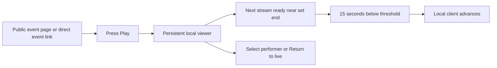

# Automatic event viewer and inferred set ends

Make public community events watchable from their existing lineup without staff configuration. Use one derived schedule for lineup displays and the browser player. Authored times stay unchanged.

## Agreed behavior

- A missing set end uses the immediate next unambiguous start. The final set uses the event end when known. Otherwise it stays open-ended. Explicit ends win; missing or ambiguous rows remain barriers.
- Timed events with a playable public DJ stream offer the existing viewer automatically. A configured event stream keeps precedence. Playback still begins with the viewer pressing Play, and persists while navigating.
- Enable the requested client-side silence trial: 15 continuous seconds below -60 dBFS, within five minutes before or after the derived set end, with a prepared next stream. This changes only the local client, with manual selection and Return to live retained.
- Pause, hidden documents, stale observations and unavailable next streams prevent automatic handoff. Viewer volume and mute do not alter measured levels.
- No broadcasting worker, relay enablement, source-data backfill, guessed stream identity or music calibration project is included.

## Implementation and checks

1. Add and test a pure shared end-inference helper. Apply it to public lineup/slot projections and browser schedule consumers without persisting derived values.
2. Test automatic viewer eligibility, existing explicit event-stream precedence, cancellation/date-only behavior, and local-only adapter selection. Update the existing watch settings to reflect automatic lineup behavior.
3. Add deterministic threshold/window/handoff tests before enabling the existing client analysis path. Keep failure recovery and stale-evidence guards.
4. Run focused tests, types/lint, appropriate backend tests and browser/visual verification. Inspect screenshots, then open one reviewable PR.

The numerical silence defaults are implementation choices for the requested trial, not a claim of calibration against real DJ sets. Real-music usefulness remains a live trial question.

## Source verification, November 6

Implementation preserves authored timing in both host and editor reads, including
repeated saves after clearing an end. The timed playback projection carries an
untimed-row barrier so filtering the public lineup cannot reconnect across it.
The editor offers Automatic or Event stream. These are utility labels; no new
public explanatory prose is introduced.

The full web suite passed 1,154 tests, plus web/backend typechecking, web lint
and Markdown lint. The integrated timing, authoring and playback regressions
passed 101 tests.
API-contract tests passed 85 tests. Desktop and mobile browser checks passed
for automatic, explicit-sequence and event-stream playback surviving consumer
unmount, plus the Automatic/Event stream selector. An independent review found
no blocking source or screenshot issues.

The full backend run reported four failures in unchanged broadcast tests and did
not reach a terminal summary before it was stopped. Isolated runs reproduced the
encoder pipe, renderer anchoring and fake-AWS dispatch failures. This is not a
green backend result. The opt-in FFmpeg loopback proof was updated but not run.
Real DJ silence usefulness and deployed behavior remain unverified. Merge and
deployment are outside this source-only completion.

## Review follow-up, November 6

A review regression distinguished joining from following: an unknown earlier end
must not prevent a new viewer from joining a later timed set. Selection now uses
the next timed start as a bound while preserving the unknown displayed end and
untimed automatic-progression barrier. The regression was verified red/green;
63 focused playback tests passed.

Hosted backend, native/restream and ordinary source checks passed on the first
head, resolving the local-platform uncertainty for that head. Browser CI still
needs work: the live-lineup synthetic tests assume the former two-minute
preparation window, and eight editor/lineup visual baselines changed with the
watch control. The intake match-navigation test also failed; its cause is not
established. These checks remain open. No merge or deployment is authorized by
this follow-up.

The player investigation also reproduced candidate expiry after an untimed barrier.
The next timed start now bounds candidate selection without filling the unknown
end or permitting progression across that barrier. The regression failed before
the fix and passed afterward, with 64 focused playback tests passing. Browser
and visual CI remain open; this does not establish phone acceptance.

## Browser and visual recycle, November 6

The fixture clock now starts before the five-minute preparation window. Its
eligibility controls use that boundary, and composed navigation tests explicitly
enter it before expecting a second connection. The retry-delay fixture arms its
failure before promotion, since the following source may now prepare immediately.
The production policy and assertions remain intact.

All seven real-transport lineup cases passed across Chromium and Firefox, with
the Firefox lifecycle verified in a focused rerun after its first local attempt
recorded a development full reload that erased the session. Seven composed,
silence-handoff, overlap and retry-delay cases also passed. The requested
15-second silence experiment was exercised with actual decoded synthetic media.

Visual review accepted eight Linux CI baseline updates. Six add the selected
Stream controls for linked performers; two replace the promotion opt-in with
Automatic mode. Desktop and mobile captures showed no introduced clipping or
overlap. The earlier intake-navigation failure did not recur in the latest
290-case browser flow run. Fresh exact-head CI and the post-window feedback
audit remain required. Physical-phone and real-music acceptance remain unknown.
