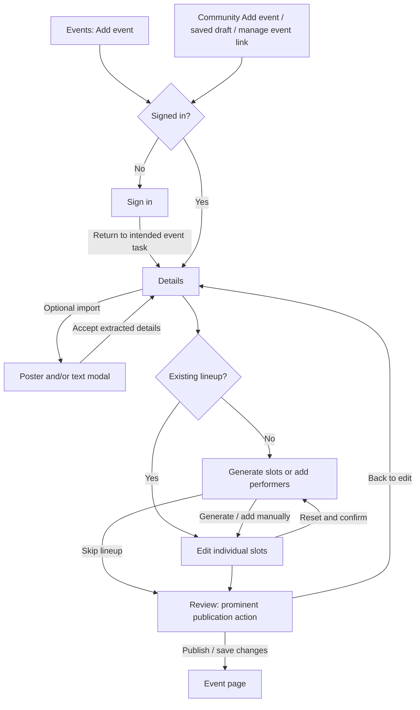

# Event editor: timezone, lineup and publication

Status: Approved by BASIC in chat on 2026-10-13, including the exact reset and conflict strings below. Implementation plan is a separate review.

Date: 2026-10-13

## Intent

Make the event editor useful for ordinary event scheduling. Picking a timezone should take one compact control. Generating a lineup should give the contributor a starting point that they can change freely. Review should make publication the obvious next action.

This continues the approved Details, Lineup and Review wizard. It is one changeset, with no separate planning PR. This document does not authorize implementation yet.

## Locked decisions from BASIC

- Keep the wizard across the top of the main pane, within VRDex's header/footer layout.
- Keep import as an optional action beside Details. A poster and/or text feed the same extraction flow and return to editable details.
- Timezone selection should be compact and searchable, including familiar aliases such as EST, EDT and eastern.
- Make the primary publication action prominent in Review.
- Offer Slots and Minutes each as initial lineup generation. Hide that setup after generation.
- Allow insertion between entries. Inserting a 15-minute slot moves later slots 15 minutes later.
- Changing a known slot duration moves every later timed slot by the duration difference. Changing 60 minutes to 45 moves later slots 15 minutes earlier.
- Provide a reset action with confirmation that returns to initial generation.
- Keep an explicitly entered event end fixed. Flag an overrun and put a button at that conflict to move the event end to the lineup's end.
- Preserve partial drafts, optional end time, Time TBA, untimed performers and the term Slot. Publishing goes directly to the event page.

## Current experience and proposed journey

The current staff editor keeps generation controls visible and can replace the lineup as those controls change. The contributor editor lacks that same generation setup. The timezone control displays a raw IANA identifier across a full row, and searching clears the current selection. Review leaves publication in the bottom navigation.

The proposed editor shares the scheduling interactions across contributor and staff routes. Their permissions and submission commands remain distinct.

The longer-term world picker and profile-editor cleanup remain separate work. They do not add steps to this wizard.

## Timezone picker

### Current recommendation

Place a compact timezone selector beside the event date/time controls. Its width follows its content within a sensible maximum; opening it reveals a popover with a search input and scrollable results. On small screens it can use the available width without forcing a full desktop row.

The selected value shows a readable region and the applicable abbreviation, for example `Eastern · EDT`. Search accepts region names, cities, IANA identifiers and aliases. Results identify the actual region and offset so ambiguous abbreviations produce choices instead of a silent guess. The stored value remains a valid IANA timezone. EST and EDT both find America/New_York; neither forces a fixed offset throughout the year.

Search text is separate from the selected value. Typing, opening, cancelling or closing the popover does not change the event timezone. Choosing a result commits once and runs the existing local-time/DST validation. Preserve the existing behavior of authored local date/time fields on an explicit timezone change. Reset occurrence choices only after that change, not while searching.

Compute the displayed abbreviation and offset at the resolved event start when available. For an unresolved or date-only schedule, display the region without claiming an exact event offset. Preserve valid legacy IANA identifiers even if they are absent from the browser's preferred zone list.

Use normal combobox keyboard behavior, a visible active result that scrolls into view, accessible selected state, and sensible focus return on close. Empty search shows the selected zone, the user's default and commonly used regions without duplicate entries.

### Default precedence and preference scope

For a new draft without an authored timezone, use:

1. The signed-in user's saved private event timezone preference.
2. Browser timezone detection.
3. UTC if detection is unavailable or invalid.

Existing event or draft values, manually selected values and accepted import values win over defaults. A preference arriving asynchronously must not overwrite something the user has already entered. Existing persisted events with missing timezone are not silently reinterpreted.

My recommendation is a private account preference, configured explicitly in account settings using the same picker. Selecting a timezone for one event does not update that preference. Browser detection already exists in the new staff flow; extend it consistently to new contributor drafts. Do not use an arbitrary claimed profile or community's freeform timezone as the user's preference. The preference is readable and editable only by its account and is absent from public profile responses and MCP results.

This adds a small account setting, not a profile-editor redesign. The builder chooses the exact existing settings location and storage shape while retaining these ownership and default rules.

## Lineup setup and individual editing

### Setup state

An empty lineup offers Slots, Minutes each and an explicit Generate action. Keep the familiar initial values of 4 and 60. Changing the setup inputs does not generate or replace anything until Generate is pressed. Preserve existing maximums: 80 slots, with positive whole-minute durations up to 1,440 minutes.

Once generated, replace the setup controls with the lineup rows and their editing actions. A saved or accepted imported lineup opens directly in the row editor. Manually adding the first performer also enters row editing. An empty lineup can continue to Review.

Timed generation requires a valid event start. Time TBA and incomplete drafts can still add untimed performers. Persisting a reusable duration-only schedule before a start is known is outside this slice; do not invent absolute timestamps for those drafts.

### Row layout

Keep performer lookup, avatar/name, time range and editable duration together. Secondary role, source and stream controls use the existing disclosure where appropriate. Keep stable row identities and performer/stream assignments when moving times.

Show a small Add slot control before the first row, between rows and after the last row. Activating it opens a compact inline insertion form with duration and the normal performer selection. A 15-minute entry can be inserted without reopening generation. Partial draft rows can remain unnamed; existing publication requirements still apply.

Commit valid timing edits on an explicit insertion action, Enter or blur. Do not apply cascades repeatedly to every intermediate keystroke. Cancelling an insertion makes no changes. Preserve focus at the edited or inserted row and show updated time ranges immediately.

### Schedule behavior

Use elapsed minutes on absolute instants for the cascade. Display the results in the chosen event timezone. Overnight dates and DST transitions must not turn a 15-minute insertion into a different elapsed duration.

| Action | Effect |
| --- | --- |
| Insert a timed slot | Create it at the selected boundary and move every later timed row by its duration. |
| Change a known duration | Change that row's end and shift later timed rows by new duration minus old duration. |
| Remove a fully timed row | Remove it and shift later timed rows earlier by its duration. This inverse behavior is my recommendation. |
| Remove an untimed row | Remove that row; no fabricated timing delta. |
| Edit performer, role or stream | Preserve all schedule times and other row identities. |
| Reset confirmed | Clear the editable lineup and return to generation. Keep event details and artwork. |

A boundary is the preceding row's known end; before the first row it is the event start. Preserve any gap after that boundary when shifting subsequent rows. For example, adding 15 minutes at 01:00 before an existing 01:10 start makes that later start 01:25, keeping the ten-minute gap. Display existing gaps as breaks; do not silently compact them.

If the boundary cannot be resolved, offer an untimed addition or the existing timing controls to complete it first. Do not guess a missing end or assume an unknown duration is 60 minutes. An imported row without a known old duration must establish its timing explicitly before duration-difference editing is available. Untimed rows retain their order and stay untimed when later timed rows move.

Changing the event start shifts existing timed rows together, preserving their durations and gaps. It does not move an explicit event end. Timing changes stay local until the normal save/publication operation. Preserve source associations, selected streams, revision checks and protected associations that the actor cannot edit. Reset acts only on the lineup the actor is authorized to replace.

Time TBA retains the existing reversible in-editor timing behavior. Saved untimed drafts do not acquire hidden persisted clocks as a side effect of this work.

### Reset

Use `Reset lineup` as a secondary action. Ask for confirmation before removing rows. Confirming clears editable slots and untimed performers together, then restores the generator. Cancel preserves every row and its current edits. Keep details, artwork, timezone and any explicit event end.

## Event end and overrun

An end explicitly entered in Details remains fixed during insertion, removal, duration changes and event-start changes. Do not silently stretch it or truncate the lineup.

Show an overrun at the lineup's end, beside the affected timing information, and repeat it in Review if unresolved. Show both the event end and the lineup end in the event timezone, including dates when they differ. Place `Set event end to lineup end` immediately beside the conflict. Clicking it changes only the event end to the latest known lineup end. The new value is an explicit end and remains fixed during subsequent edits.

If no end was entered, retain automatic derivation from fully known lineup timing. For old persisted events, an existing end is treated as fixed because the data does not reliably say whether a person typed it. Do not infer provenance just because it matches the last slot. Clearing an explicit end returns to the existing derived-end behavior.

The backend already rejects slots beyond a defined event end. Preserve that constraint and surface it before submission. Publication and canonical staff saves require resolution by extending the end or editing the lineup. Incomplete contributor drafts remain saveable under the existing draft contract, including unresolved timing; do not strengthen draft validation to match publication. Unknown ends do not produce a made-up target for the conflict button or a claim that the entire lineup fits.

## Implementation rulings, 2026-10-13

These controller decisions narrow implementation at existing command boundaries:

- `getLineupEndAt` is shared by both adapters for fully known end derivation. Untimed
  performers are ignored; incomplete timed rows prevent a whole-lineup end claim.
- Legacy staff creation retains required `startAt`, and legacy `participantLinks`
  keeps untimed performers in a separate group. Canonical and contributor positional
  lineups keep their existing Time TBA/untimed support. No command migration is included.
- Legacy staff updates may add optional `storedSlotAssociations` with pre-sort submitted
  positions and stored event-slot IDs from the protected snapshot. Backend validation
  requires uniqueness, valid positions and current same-event membership before writes.
  IDs preserve hidden links and unchanged unavailable streams through reflow; explicit
  removal remains deliberate. Current IDs return at submitted positions and reconcile
  by captured local row key after pending saves. The absent argument preserves existing
  API-owner compatibility. This narrow update-only exception to the initial
  no-payload-expansion constraint leaves create and permission/revision authority intact.

See [browser command details](../../engineering/event-contribution-browser.md#legacy-stored-slot-identity).
The journey diagram above remains unchanged because entry and return routes did not change.

## Review and publication

Put the primary action in the main Review pane, next to the final event summary and above the long secondary details. It should be a prominent blue button with enough space to read as the completion of the wizard. Keep Save draft secondary and Back as navigation. Use one primary submission action rather than duplicating prominent Publish buttons at the top and bottom.

Preserve context-specific labels and commands:

- New contributor or staff event: Publish event.
- Existing staff draft: Save and publish.
- Existing published staff event: Save changes.

Keep destructive or withdrawal actions secondary. Maintain pending-submit protection, duplicate checks, spam checks, validation focus/reveal, correction and takeover permissions, optimistic concurrency and direct event-page navigation after success. Review never accepts extraction guesses implicitly. An optional lineup remains optional.

## Exact proposed public copy

Existing approved labels remain wherever their behavior remains the same. New utility labels include `Generate`, `Add slot`, `Duration`, `Reset lineup` and `Default event time zone`.

BASIC approved these exact substantive strings with this design on 2026-10-13:

- Reset prompt: `Clear the lineup and start again?`
- Reset supporting sentence: `Event details and artwork will stay.`
- Reset confirm action: `Clear lineup`
- Overrun message: `The lineup ends after the event.`
- Adjacent action: `Set event end to lineup end`

Show the actual times as data beside the overrun message. Avoid extra help paragraphs or AI-promotional copy. Accessibility names may describe the insertion position or affected row explicitly.

## Constraints, non-goals and failure cases

Use the existing stack, design tokens, forms and validated scheduling contracts. Share interaction logic where it prevents contributor/staff drift, while keeping their authority and backend commands explicit. A new calendar library, sidebar, additional wizard step or scheduling service is unnecessary.

This slice does not redesign extraction, add multiple-poster support, add a world picker, rebuild profile editing, add recurring events, drag-and-drop scheduling or introduce per-slot fixed-time locks. Existing timing controls remain available to resolve incomplete or noncontiguous schedules.

The work fails if a duration edit replaces performer assignments, searching changes the timezone, imported partial times are guessed silently, a reset changes unrelated details, publication becomes harder to find, or contributor permissions widen. Schedule edits also affect live-event advancement, so canonical times must remain consistent with the public event and operator views.

## Builder choices and verification

The builder chooses component boundaries, preference field names, popover dimensions, insertion form presentation and styling details. Use shared primitives and keep the desktop layout compact. No new dependency is required by this design. Any change to the timing or permission rules above needs an explicit design amendment.

The implementation plan should cover real schedule transformations and persistence, not tests that repeat component markup. Verify insertion, shortening, lengthening, removal, preserved gaps, stable identities, partial rows, reset cancellation, limits, overnight/DST cases, stored-end preservation and explicit conflict resolution. Verify self-only preference access and default precedence, including late-arriving preferences. Cover both editors and their existing submission modes.

Perform desktop and mobile visual verification with screenshots and VLM review. Check keyboard search and focus, the main Review action, partial draft resume, and event-page return. Keep local visual approval, merge readiness and deployment as separate states.

## Related work

- [Approved wizard refinement](../../planning/event-editor-wizard-refinement-2026-10-11.md)
- [Wizard implementation plan](../plans/2026-10-11-event-editor-wizard-refinement.md)
- [Deferred profile-editor cleanup](../../planning/profile-editor-progressive-disclosure-2026-09-28.md)
