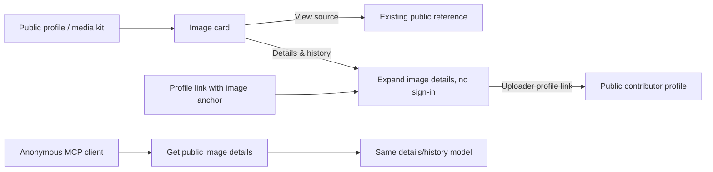

# Public media details and history

Status: design agreed in chat; implementation plan awaiting review.

## Intent and locked decisions

An image's source is different from the person who uploaded it to VRDex.
The current linked text, such as "Shared by Karly", can imply that the named
person participated on VRDex. Keep the useful reference link without that claim.

- Public media cards show **View source**, not the uploader's name.
- **Details & history** is public and does not require sign-in.
- Uploader attribution appears only in details/history and links to the
  uploader's public VRDex person profile when one can be resolved safely.
- Source/reference, uploader, publisher/reviewer and artist credit stay separate.
- Website and MCP use the same sanitized public read model.
- This is a follow-up PR, with the usual subagent implementation and independent
  review workflow. Do not reopen or extend merged PR #364.

## Proposed user journey

Today, the card shows a linked freeform credit and a download. The proposed card
replaces that linked text with View source and adds a collapsed Details & history.
The image, title, file information and download retain their current presentation.

The card and its disclosure remain on the profile page. Do not introduce a new
image-management page, account setup step or attribution chooser in this slice.
A direct profile URL with `#media-<assetId>` opens the corresponding disclosure.

## Attribution and source rules

The existing public `creditUrl` is the reference that View source opens in this
slice. Never substitute the internal asset/submission `sourceUrl`, which can
contain private message references or signed queries. A missing or unsafe
reference produces no source link.

Preserve stored `credit` and `creditUrl` and the existing public API fields.
Display the existing credit text in details under **Credit**, without calling it
verified artist authorship. Do not parse "Shared by" prefixes, rewrite legacy
credit values, infer an artist, or introduce a second creator-credit editor.
Adding separate structured creator attribution is a later feature.

Uploader identity comes from the validated source submission's
`submitterUserId`, or the stored `uploadedBy` subject for an asset with no
submission. Publication/review identity comes from the recorded publication
actor and reviewer. Editing credit, source, image label or alt text cannot
rewrite these identities.

## Public identity resolution, planner recommendation

Resolve a recorded actor to exactly one currently active, owned, publicly
readable person profile. Use that profile's public displayName and slug,
not the account name, email or authentication identifier. For BASIC this means
the public BASICBIT profile; BASIC in the mockup was illustrative.

Use indexed user and ownership reads. Examine at most 11 ownership records,
support up to ten records, and return no public actor on overflow or ambiguity.
Ignore community profiles as personal contributor identities. If there is no
eligible person profile, return `actor: null`; the UI shows **Unavailable** for
the uploader and retains an actorless history event. Do not choose the first
profile, create a profile, or expose a private identity as a fallback.

Revalidate visibility and ownership on every read. A hidden, deleted or
transferred contributor profile loses its public link/name. Do not freeze a
formerly public name into a permanently public snapshot.

## Public history, planner recommendation

Version one is an image's upload and publication/review history, not a complete
copy of the site's audit log:

- Uploaded: original asset upload timestamp and original uploader.
- Approved: only an actual recorded independent approval.
- Published: only recorded trusted publication or independent-review publication.

An independent approval and its publication may share a timestamp and actor.
A trusted publisher does not acquire an independent-approval event.
Owner-authored/imported assets without publication evidence show the upload
event only. Identity-replacement proposals must not become the source image's
publication history.

Use immutable `uploadedAt`, `reviewedAt`, or the receipt matching the exact
`publicationOperationId`. Never use mutable asset/submission `updatedAt`,
profile timestamps, current time, or an arbitrary receipt as historical dates.
Missing legacy evidence remains missing: omit an unsupported event or use a null
event date when the action is known but its date is unavailable.

The public response contains at most three events, in upload/approval/publication
order. Do not publish private reasons, reviewer notes, contributor notes,
declaration checklists, rejection history, dispute/hold information, correction
payloads or general profile audit rows.

## Interface and privacy boundary

- Add an on-demand public image-details query, REST read and MCP read tool.
- List/profile payloads receive only an optional details URL. Do not eagerly
  resolve actors/history for every gallery image.
- Details must be unavailable wherever the corresponding image is unavailable
  in the existing canonical public media projection. Reuse its profile, field,
  asset, placement and feature visibility rules rather than granting access from
  knowledge of an asset or submission ID.
- A profile hidden after the card loads must refuse the subsequent details read.
- Anonymous and signed-in callers receive the same public details.
- Public actor responses contain only a public name and profile link.
  Raw user IDs, Clerk subjects, token identifiers and emails remain internal.
- The new model is an explicit allowlist, never serialized stored documents.

The existing authenticated contribution-management and reviewer tools retain
their separate permissions and private fields.

## Copy and presentation

Agreed utility labels: **View source**, **Details & history**, **Uploaded by**,
and linked public contributor names. Reuse **Credit** and existing loading/error
utility patterns. Proposed history labels: **Uploaded**, **Approved**, **Published**.
Show recorded timestamps in the viewer's locale. No new explanatory cards.

Proposed MCP description, included for exact-copy approval with the plan:
"Read an image's public details, uploader attribution and publication history."

Keep the disclosure closed initially. Fetch on first open, keep interaction
keyboard accessible, and support opening from the image anchor. Do not fetch,
publish or render private source descriptions for convenience.

## Delivery and exclusions

Keep one PR with three internal tasks: shared read model, website, MCP.
Use additive contracts and normal generated-code/OpenAPI workflows. Start
implementation from current main, preserving unrelated local configuration.
No dependency or storage migration is expected. No production data changes,
new grants, quota changes, upload-policy changes, public review notes or connector
reinstallation belong to this plan.

Staging acceptance must exercise an actual anonymous MCP read and website
disclosure against synthetic owner-uploaded, trusted-published and independently
approved images, including visibility revocation. Production acceptance is
read-only after a separately authorized release.
