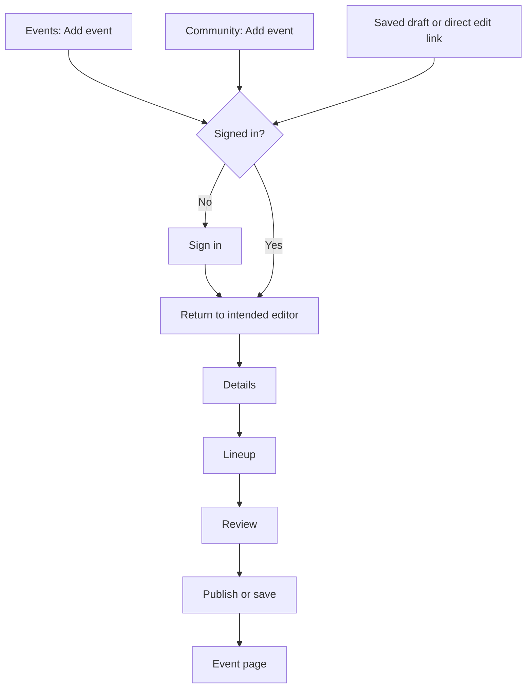
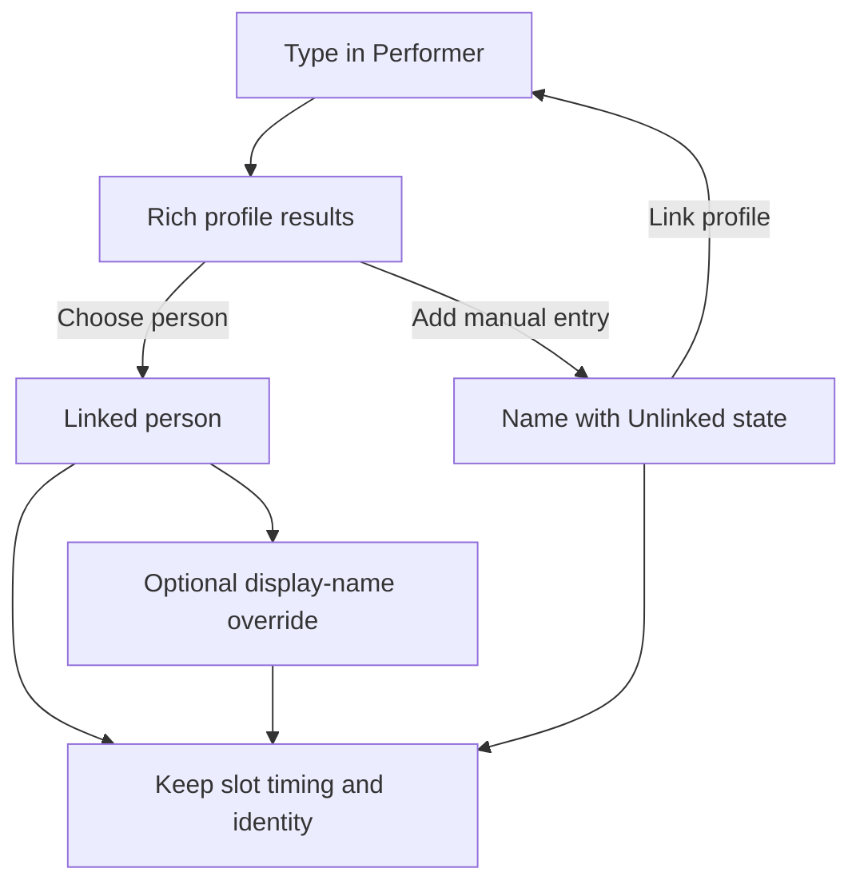
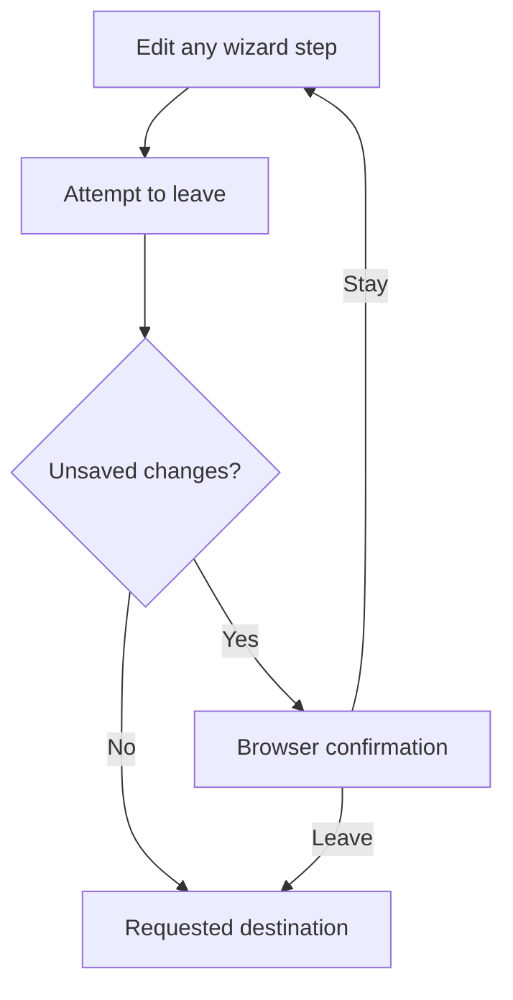

# Event editor: clear identities, local times and safer edits

## Review brief

Make adding an event feel like arranging an event: select recognizable people and a community, enter times in your own zone, and keep optional details out of the way. Remove raw profile slugs from the visible editing flow and protect work when leaving.

This is the approved follow-up to the merged event scheduling work. The three-stage wizard, import dialog, flexible lineup, fixed explicit end, public contribution permissions and prominent publish action stay in place. The scope is one implementation changeset with shared controls across contributor and staff editors.

BASIC approved the complete design and its exact product-copy table in chat on 2026-10-15, after reviewing the restored document. This includes the location behavior, managed-community shortcuts, local-time conversion, partial drafts, Time TBA and publication with newer unsaved edits. Recommendation labels below record how these choices were proposed; they are now approved within this changeset. No product code has changed for this design.

The main tradeoff is that local editing needs a clear distinction between changing how a time is displayed and rescheduling the event. Opening an existing event or switching the display zone must never move its scheduled moments. This needs behavioral verification beyond screenshots.

## Decisions and scope

| Status | Decision |
| --- | --- |
| Locked decision | Imported resolved times display in the creator's local editing zone. |
| Locked decision | Linked performers may have an optional collapsed display-name override. |
| Requested behavior | Doors-open disclosure, titles instead of slugs, community logo, richer performer selection, removal confirmation and unsaved-change protection. |
| Current recommendation | One location chooser supports either a VRDex world or a manual location. |
| Current recommendation | Offer managed communities immediately when opening the picker. Do not build a general favorites feature in this slice. |
| Current recommendation | Use one editable time-zone proof beside the schedule and one compact proof in Review. |
| Deferred | Global favorites, new profile creation from the lineup, provider image-ingestion redesign, recurring events, world ingestion and the separate profile-editor cleanup. |

## Enter and publish an event

The existing entry paths and Details, Lineup, Review stages remain. Import stays optional beside Details. Existing authentication requirements remain, including return to the intended authoring route.

### Task: reach the editor and publish

Corrections retain their existing scoped submission and return behavior; this design does not turn a correction into direct publication. Saving a draft keeps the current draft editor available.

## Details

### Optional times

Starts stays primary. End time and doors-open time use matching compact disclosures. An absent doors-open value starts collapsed. Stored or accepted imported values are expanded so an existing schedule is not hidden. Collapsing a control never clears its value; clearing is a deliberate edit. Time TBA retains the existing treatment of hidden timing values and backups.

### Recognizable community selection

Use display name and community logo in search results, the selected community, preview and Review. Slugs remain routing and identity values internally, not secondary labels or temporary display-name fallbacks. While resolving a saved selection, show a fixed-size loading state instead of a slug. A new selection retains the result's title and image immediately, without waiting for another search by slug.

Reuse the shared image treatment, including logo containment and an initial/fallback state with stable dimensions. Reuse cached presentation data while the selection is unchanged; revalidate without clearing its title or image. Do not wait for image decoding before allowing selection. An unavailable or failed image leaves a deliberate fallback, not a moving layout. This removes avoidable loading churn; it does not promise that an uncached network image appears instantly.

When the picker opens without a query, offer communities the signed-in user manages, including ownership and existing staff access. Preselect only when the editor was entered from a specific community. Do not silently choose one community on a generic Add event page. Keep public community search available so any signed-in contributor can submit for another group. Accounts without managed communities get the normal search.

The current source exposes a managed-community query. A bounded source search found no established community-favorites path; that is not proof no such feature exists anywhere. The builder should reuse one if current source reveals it, without introducing a favorites backend here. Managed shortcuts satisfy this slice's shortcut requirement. Cross-device favorites remain separate work.

### One location control

Replace the simultaneous raw World profile and Where inputs with one optional Where chooser. Search published VRDex worlds using recognizable name and artwork, or deliberately keep typed text as a manual location. Selecting a world establishes the existing world association; a manual location uses the existing venue label. Do not create a world profile or require one to publish.

Keep a selected world's identity separate from its visible label. An optional location-label override can live inside that selection's details when an existing custom venue label differs. An untouched existing world plus custom label must round-trip intact. Switching explicitly to a manual location removes the editable world link but preserves unrelated protected associations and the existing permission checks. Do not change a protected/private world link merely because its public search result is absent.

This adds a world lookup interaction but no world-management feature. A simpler manual-only field would reduce work, but would hide an existing world association and make later corrections harder. The unified chooser is the recommendation.

### Original event post

Move Source URL into collapsed optional details and label it Original event post. It remains optional and retains its existing provenance meaning and visibility rules. It is not an instance join URL or a new generic links collection. Keep the import dialog's pasted text/poster flow and original evidence intact. Opening a source link must not bypass unsaved-change protection in the current tab.

## Lineup identity

### One Performer field

Replace the separate performer-name and person-profile fields with a clearly searchable Performer combobox. The empty control has a search icon and Search performers placeholder. Results reuse the richer profile presentation already used elsewhere: picture, display name and relevant public role/context. Extract a reusable result row when needed; do not transplant the lookup page's bulk-edit workflow or its raw-path fallback.

The selected state shows a person's picture and display name, with Change reachable. Internal slugs never become the input's visible value. Selecting a result is explicit with pointer or keyboard; blur, a late response, and typing an exact name do not implicitly link a person. Search results must follow the active query and ignore stale responses. Duplicate names use available image/context and a profile-inspection link rather than a primary slug label. Preserve existing public/unclaimed indicators required by the product, without adding a badge pile.

A nonempty query always offers Add manual entry as its final action, including when there are matches. That action retains the typed text as a manual performer name and creates no person profile. An empty query does not create an empty manual row. Empty or failed searches must not pretend no person exists; manual entry remains available. Selecting a manual entry shows its name and plain Unlinked text with Link profile. The person can be connected later without losing the row's schedule or custom name.

### Optional display name

For a linked person, use their display name by default. Display name as is collapsed until needed; a saved explicit override is visible when reopening the row. Clearing the override returns to the profile name. An override changes billing text only, never the profile identity.

Existing differing performer labels are treated as explicit overrides and preserved. When linking a manual name to a profile, preserve that name as the override if it differs; make it visible in the expanded control. Changing a linked profile retains an explicit override until the user clears it. Changing an untouched default name adopts the new person's display name. Keep enough editor state to distinguish a default from an override, using existing persistence contracts where possible.

Timed and untimed rows use the same identity interaction. Preserve row keys, confirmation state, source provenance, stream choices and protected associations. Untouched hidden/private person links remain intact; search failure never silently unlinks them. Retire the editor-specific datalist implementations in both paths. Broader lookup-page redesign is outside scope.

### Task: choose or link a performer

## Local time editing

### A consistent editing zone

The creator's editing zone comes from an explicit saved private account timezone preference, otherwise browser detection, otherwise UTC. This uses the existing preference as an intentional override of detection. Do not write an account preference just by opening an editor or changing this event's display zone. A deliberate selection within the current editor survives step navigation and late-arriving account data.

Show one compact editable control beside Starts, using a friendly region, date-correct abbreviation and offset. For example, Indianapolis can display Eastern (Indianapolis) with EDT and UTC-4 at a summer event, or EST and UTC-5 at a winter event. Do not permanently label it EST or replace its regional IANA identity with a fixed numeric offset. Keep the searchable alias behavior; IANA identifiers can remain in search details when needed to distinguish regions, not as the main schedule label.

Details, slot controls, editor preview and Review must all use this editing zone. Review supplies a second small proof near its first schedule time. Remove repeated raw zone identifiers from each row and summary. If a schedule crosses a DST transition, each displayed offset must correspond to the time it describes; repeated-hour selection stays explicit. An undated draft cannot claim a date-specific offset. Public event pages continue using each viewer's zone.

### Conversion preserves moments

Changing the editing zone is a display conversion for already resolved times. It does not shift the event or cascade the lineup. Entering a new Starts value remains an intentional rescheduling edit and uses the existing single cascade. Ordinary slot edits and fixed event-end conflicts keep their existing rules.

Opening an existing event in local time must not mark the event dirty or change its stored canonical zone/date. Serialize deliberate timing edits through the existing event zone and contracts, preserving precise instants, occurrence and day offsets. For a new event, the initial canonical zone is the local editing zone. Do not introduce a user-facing distinction between two editable zone fields.

After import, resolve times in the supplied source zone first, then convert accepted resolved values together into the local editing view. For example, 11 PM in Los Angeles may display as 2 AM the next day for an Eastern creator. Starts, end, doors and lineup must stay on their correct local dates; optional or missing values remain missing. Preserve exact duration and source evidence. Merely converting the view must never run the start-change cascade a second time.

Partial source times, missing zones, DST gaps and unresolved repeated hours are not known instants. Keep them as source suggestions with the required context until the user resolves them. Do not silently interpret them as local time, invent a zone, auto-accept uncertain lineup matches or discard questions. Date-only events stay calendar dates; never convert midnight to manufacture a neighboring date. If an edit cannot fit the existing day-offset bounds, retain the prior values and expose the existing timing correction controls rather than clamping.

### Partial drafts and Time TBA

Author recommendation: saved unresolved authored clocks keep their original zone context until they can resolve. Convert the resolved portions into the local view; place unresolved controls in a compact Unresolved time group with their original friendly zone label. Correct those clocks in that stated zone, then render their resolved moments in the local editing view. Do not relabel an unresolved source clock as local or make opening a partial draft dirty.

If a display-zone change is attempted while a meaningful invalid input buffer is active, keep the current display zone and focus that input for correction or cancellation first. A zone switch must not discard the buffer or reinterpret it. This exception needs a contextual zone label even though the normal screen has only two proof spots.

Author recommendation: switching a timed event to Time TBA keeps the calendar date currently displayed in Starts. Thus an October 15 Los Angeles event displayed as October 16 in Indianapolis becomes an October 16 date-only event when that creator explicitly selects Time TBA. This changes the event into a chosen date, not a midnight instant. Once date-only, viewers see that same authored calendar date without conversion.

Retain the precise original timed schedule in the existing backup so toggling Time TBA off without other timing edits restores it exactly, including the canonical date, zone, occurrences and explicit end. If the creator edits the date while Time TBA is on, that is a deliberate new local start-date edit when timing is restored. Use the existing single start-change cascade and fixed-end conflict rules, rather than silently replacing every stored end. Do not restore removed lineup rows from backups.

This presentation conversion supersedes the earlier editor behavior where changing the single authoring zone reinterpreted all entered wall clocks. The implementation plan must distinguish display-zone changes from deliberate rescheduling and keep old stored data compatible.

## Safer edits and leaving

Remove slot first asks for confirmation. Cancel preserves the entire row and times; confirmation performs the existing duration-aware removal and cascade exactly once. The dialog identifies the performer when available and can show the current range as data. It must work for manual, linked, partial and untimed rows. Reset lineup retains its existing separate confirmation.

Track unsaved authored changes across every wizard step and the import modal. Refresh, closing the tab and document navigation use the browser's native before-unload confirmation where supported. In-app links, editor exit controls and browser history navigation also require confirmation before abandoning dirty work. Use browser confirmation for the in-app leave decision; no extra recovery page is needed. Internal step switches and closing a modal that retains its state do not abandon the editor.

Dirty state compares current authored data and uncommitted meaningful input with the last successfully persisted snapshot. Search queries, selection highlights, image loading, disclosure state and local display-zone conversion alone are not event edits. A saved but unpublished draft is clean. Successful Save draft or Save changes clears only the snapshot actually saved; a failed save, validation error or later edits made during a request remain dirty. Source upload/extraction may save an intermediate draft, so it must not clear newer local fields or pending overrides.

Allow the existing successful publish/save return without a second warning only when the current authored state equals the submitted state. Author recommendation: if newer edits exist when publication succeeds, use the same browser leave confirmation before navigating. Staying retains those edits and records the successful publication, so the next submission uses the existing authorized edit command rather than creating or publishing a duplicate. Leaving proceeds to the event page and deliberately discards only the unsaved changes. Do not weaken revision conflicts, native validation, authentication or correction authority. Native dialogs are browser-controlled and cannot guarantee recovery after a crash or every mobile process termination; the UI must not claim durable autosave because it has an exit warning.

### Task: leave with unsaved work

## Approved product copy

These exact product strings were approved with the complete design on 2026-10-15. Existing approved copy remains wherever unchanged. Use a native before-unload message rather than inventing its text.

| Purpose | Proposed copy |
| --- | --- |
| Doors disclosure | Add doors-open time |
| Source field | Original event post |
| Performer label and placeholder | Performer; Search performers |
| Manual option and state | Add manual entry; Unlinked; Link profile |
| Optional billing override | Display name as |
| Managed-community shortcut | Your communities |
| Partial-time group | Unresolved time |
| Location choices | Where; Search worlds; Use manual location |
| Slot confirmation | Remove this slot? |
| Confirmation choices | Remove slot; Cancel |
| In-app leave confirmation | Leave without saving? |

No new explanatory cards or public AI copy are proposed. Error and accessibility wording should reuse approved patterns; show any necessary new substantive sentences before shipping.

## Delivery and acceptance

Recommend one implementation PR after design approval, with internal tasks for shared identity presentation, local-time conversion, optional Details controls and dirty-state safety. Keep a live desktop/mobile preview for UI review before calling the result release-ready. This document is a design, not the implementation plan or shipping approval.

Verification must cover both contributor and staff create/edit paths, untimed performers, saved partial drafts and scoped corrections. Prove selection titles/images survive async responses without slug flashes; accessible keyboard selection works; manual-to-linked and override round-trips preserve protected data; source images retain existing eligibility; and no new selector exposes private profile details.

For timing, cover source-to-local midnight and DST conversions, mixed source/target dates, exact milliseconds, save/reload in another viewer zone, unresolved source suggestions and saved authored clocks, zone switching with an invalid input buffer, date-only drafts, timed-to-TBA date choice, exact toggle-back restoration, an intentional date edit during TBA, display-zone changes without dirty state, and a real Starts edit that cascades once. Account preference and event canonical zone must not change on mere open/view.

For safety, cover cancelled and confirmed slot removal, each exit route while dirty and clean, failed saves, edits during pending saves, import intermediate saves, successful publication return with and without newer edits, cancelling that leave confirmation after publication, and current revision conflicts. Inspect desktop/mobile screenshots and VLM evidence in both themes, including open rich search, manual performer, override, local-time proof, community preview/logo fallback and removal confirmation. Native browser-dialog behavior requires a browser test, not only a mocked callback.

## Evidence appendix

### Current source

Design source inspection used upstream main at `7f06484932075ea75d57c6e369f6cefdd8a722d3` on 2026-10-15. The implementation plan refreshed source at `21e48169d4f0cd54e55bbe48b1662ff128c8fe7f`. These are source observations, not claims about the currently served live build. The earlier event-editor-identity-polish checkout disappeared; this restored design and its reference images now live under `D:/bench/VRDex/docs/` for reliable access. The primary checkout has unrelated changes, so implementation must use a verified isolated checkout.

Relevant current paths: event-intake-form.tsx, event-editor-form.tsx, event-editor-preview.tsx, event-editor-page.tsx, shared event-timezone-picker.tsx, event-timezones.ts, lookup-search-box.tsx and convex/events.ts. The current preview prints communitySlug; selected community presentation re-searches the slug and falls back to it; the staff person picker uses a native datalist with slug values; contributor rows expose separate label/profile controls. The existing shared lookup UI has richer avatar/context presentation. Managed-community queries already exist, but their current DTO needs presentation-data enrichment for this proposal.

Read docs/agentic/profile-derived-behavior.md before interpreting the delayed logo. Community images already support provider-derived fallbacks. This design does not diagnose a live ingestion failure or replace those fallbacks. Investigate any remaining image delay against the actual image request and deployed revision during implementation.

### Bounded UX reference research

Research question: how should an editor interrupt leaving when unsaved changes exist? Actor: signed-in creator; platform: web; entry: editor exit; outcome: deliberately stay or abandon unsaved work. The three wizard stages and optional-time disclosure were already settled and were not reopened by research.

Native Mobbin search_flows succeeded on 2026-10-15. No Mobbin entry was found in the integration decision registry's scoped search. Account identity is not exposed by this operation. Query: editing an event draft then leaving the editor and choosing to discard unsaved changes or continue editing. Limit two flows, one call, output_destination doc. Original Square screenshots were downloaded from returned image_url values and viewed at all three positions.

| Reference | Observed sequence | Useful pattern and decision | Limits |
| --- | --- | --- | --- |
| [Square: Discarding changes](https://mobbin.com/flows/f142a720-3023-4b5f-9ccb-d6f5d5b04398) | Position 1 invoice editor with close and draft action; position 2 discard dialog over the editor with close, save-as-draft and discard choices; position 3 invoice overview. | Interrupt abandonment in place, without another wizard step. Use a clear leave decision in VRDex; retain its existing separate draft save action. | Images do not prove which action caused the final transition or whether saving succeeded. Native tab-close behavior, mobile recovery and persistence are unobserved. Do not copy Square's full menu or infer effectiveness from its presence. |

Square flow ID is f142a720-3023-4b5f-9ccb-d6f5d5b04398. Screen IDs at positions 1, 2, 3 are 4a4883e0-b2d7-4720-b79c-8192a70e51f7, 242e8bff-dd6f-42d3-8e25-5387b42e7cf7, cec3ecdd-ab58-4b4c-9013-9d0deb6b8a34. Saved originals are [position 1](../../planning/assets/event-editor-identity-polish-2026-10-15/square-discard-01.webp), [position 2](../../planning/assets/event-editor-identity-polish-2026-10-15/square-discard-02.webp), [position 3](../../planning/assets/event-editor-identity-polish-2026-10-15/square-discard-03.webp).

Circle's Preview an event flow was also returned, ID 1b5ce510-e710-4deb-a776-5b0cc6a59524, but only inline positions 1, 3 and 5 were sampled. It did not answer unsaved-exit recovery and is not a basis for this design. No complete-flow claim is made for it. No second search was needed.

### Design review

A fresh builder check raised unresolved-clock conversion, the timed-to-Time-TBA date choice, and navigation after publication with newer edits. The author recommendations above answer them; the scoped answer check returned nothing important left. Plain-language editing was applied after these revisions. BASIC approved the complete design and proposed product copy on 2026-10-15. No product implementation or PR was created during design. The [implementation plan](../plans/2026-10-15-event-editor-identity-local-time.md) carries this scope forward.
