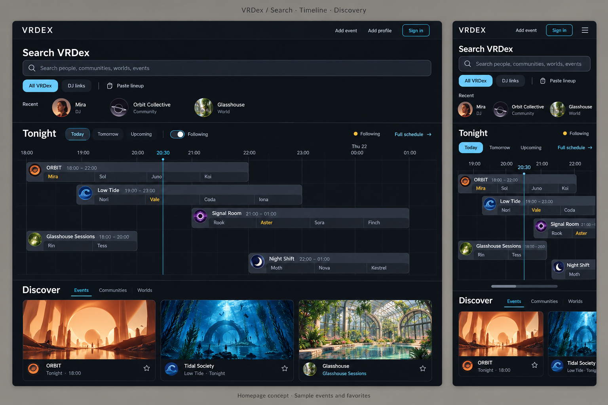
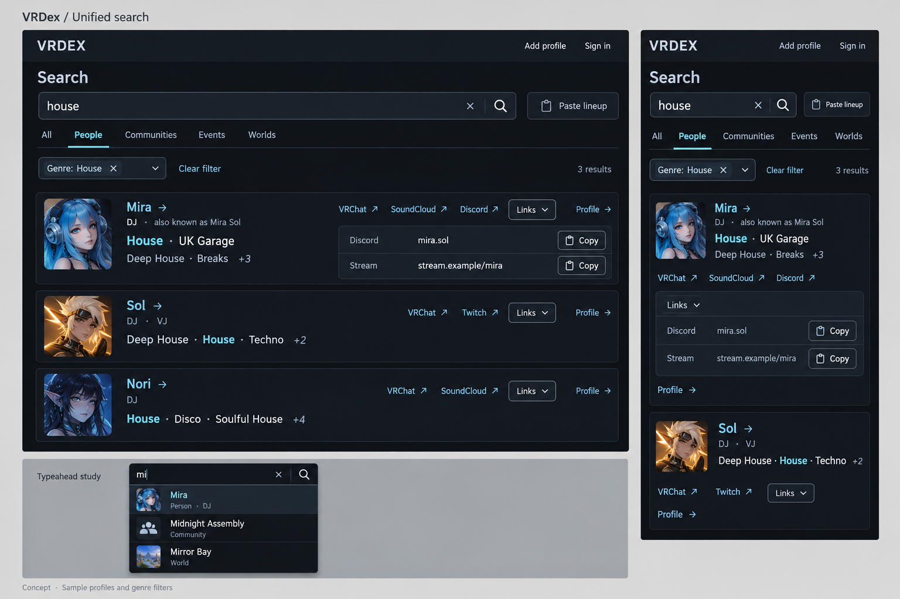
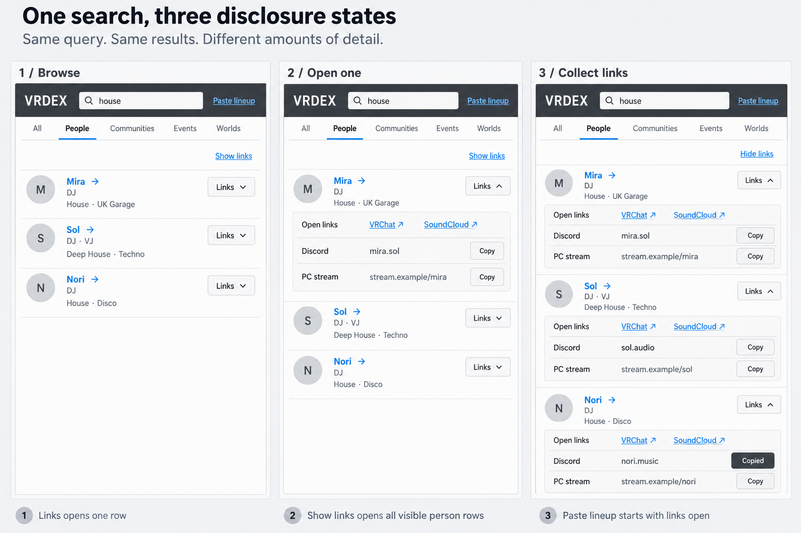

# Homepage search and schedule design

## Review brief

Give VRDex a homepage where visitors can find a person or community and see
what is happening today. Search, a compact event/set timeline and visual
discovery have roughly equal weight on Home.

BASIC supports this direction and plans to contact groups manually and offer
to enter their events. That supplies the initial content without making group
self-service onboarding a launch dependency. How quickly groups join and how
often they publish remain assumptions to test through that outreach.

Observed workflow from BASIC's follow-up: organizers plan events in Discord,
then copy the details to VRCTL and VRCPop. BASIC wants VRDex to become the place
events are planned and maintained, with Discord and VRCPop as intended mirror
destinations. BASIC explicitly excludes VRC.tl as a publishing/integration
destination. Automatic integrations with the intended destinations have not
been established by this design.

Single-name link lookup remains useful. BASIC retained compact search and
individual expanded results, but rejected the proposed third search scenario
for collecting all lineup links. Event planning and lineup operations belong
in the event workspace, where the canonical event is being managed.

Status: revised draft for BASIC's review. BASIC requested a Gantt-like timeline
after reviewing concept B: event bars and nested DJ set intervals make
concurrent events and favorite performers easier to scan. Search, timeline and
discovery each occupy roughly one third of Home. The current mockup interprets
those thirds as stacked, full-width sections so the timeline stays readable;
that orientation is a design recommendation, not an explicit user constraint.
BASIC also requested retiring the separate DJ links search mode while keeping
its stronger search/result interactions and improving genre display. The
unified search study below incorporates that request. Specific route changes,
date behavior, favorites and copy below remain proposed production behavior.

The current root-lookup decision in
[Product direction](../../planning/product-direction.md#homepage-direction)
remains in force until this design is approved and implemented. This proposal
would replace it with search plus a public schedule and individual expanded
link details. Existing bulk lookup remains a compatibility workflow until the
event-management replacement is usable; it is not a new search product bet.

## Visual reference

This generated study uses invented events, artwork, set times and favorite
highlights. It establishes visual hierarchy, not exact time geometry, product
copy, completed responsive behavior or browser-test evidence. In particular,
the mockup's Following toggle does not establish an existing follows feature.
Its discovery category labels are exploratory; the mixed card collection should
not imply an active event-only filter.

BASIC supplied a VRC.tl screenshot showing a shared hourly axis, time-proportional
event bars and nested performer segments. That supplied image is the functional
reference. No VRC.tl service access or scraping is part of this work. Reuse
VRDex's charcoal theme, semantic tokens and shared primitives. Prefer quiet
controls, subtle corners, readable type and aligned times. Event artwork
supplies the stronger colors.

The earlier [A/B study](../../planning/assets/homepage-search-schedule-2026-10-21/desktop-mobile-concepts.png)
records the preceding composition exploration; the timeline study now leads.

### Unified search results

This study uses sample profiles, genre assignments and copy targets. It replaces
the separate All VRDex / DJ links mode choices still visible in earlier
homepage studies. The homepage now has one search box; Paste lineup is no
longer proposed as its primary search action. Entity-type filters belong to
the results page. The illustrated genre filter is proposed behavior, not an
existing exact-genre filtering capability.

### Result disclosure interaction study

BASIC rejected the preceding study's operator-heavy presentation for ordinary
search. This low-fidelity state study supersedes its result disclosure defaults;
it does not replace the agreed charcoal visual direction. Closed results show
identity and readable genres. Copy destinations appear only after a deliberate
Links action. BASIC retained states 1 and 2; state 3, its Show links/Hide links
controls and a search-centered collection workflow are withdrawn. The retained
image records the state comparison, not approval of all three panels.

## First version

Below the existing brand/account header and an accessible Add event entry,
Home has three full-width sections with approximately equal visual weight:

1. One search across public entities with the stronger autocomplete and
   recent-search interactions and individual link disclosures in results.
2. A compact, date-selectable event timeline with a shared horizontal time axis
   and performer set segments inside each event band.
3. Artwork-led discovery of events and their connected communities and worlds,
   with readable titles, times and relationship context outside the images.

These are rough proportions, not fixed-height containers. Search can become
compact once in use; the timeline can grow to fit a useful number of readable
rows. Keep the homepage chart bounded, with access to the focused full schedule.
No large selected-poster sidebar displaces timeline width. Event/performer
details open on demand. Omit empty optional discovery collections rather than
filling space with unrelated records or unsupported popularity claims.

Group outreach and concierge event entry use the existing authorized event
authoring and contribution paths. This homepage slice adds no new publication
authority, automatic group sync, recurring-event system, social feed or
mandatory onboarding. Favorite-DJ highlighting is a candidate interaction:
public browsing must work without it, and a production follows/preferences
contract must be reviewed before treating the mockup's highlights as real data.

## Event-management product direction

VRDex is intended to be the organizer's working event application. Planning,
performer selection, lineup timing, approved profile links/assets, publication
and later revisions should stay connected to one canonical event. The public
homepage and search help people find that activity; the event workspace is
where organizers manage it. Keep creation and management clearly reachable
through working navigation rather than treating authoring as a secondary import
task.

The target flow is: plan in VRDex, publish the canonical event, then distribute
it to supported destinations. A lineup pasted into the event editor becomes
an editable event draft with explicit identity resolution, not a detached list
of URLs to carry between apps. Known linked performers can supply the eligible
links and assets already held by their profiles.

Discord and VRCPop are requested destinations. Locked decision: VRC.tl is
excluded from planned publishing and integration destinations; the supplied
timetable screenshot is a visual reference only. Each intended destination needs independent
capability, permission, field-mapping, update/cancellation and delivery research.
No automatic or bidirectional mirroring is promised here. Saving and
publishing the VRDex event must remain useful when an external delivery is
unavailable. Destination delivery state belongs with the event in the organizer
workspace; it must not be confused with whether the canonical event was saved.

Design that workspace as a separate product slice before expanding management
scope into this homepage implementation. Its central role is the agreed product
direction, not a follow-up link-collection utility. No new mirror integration,
booking system or event-management permission model ships as part of this
homepage/search redesign.

## Search and routes

Use one search experience on Home and `/search`. Remove the visible All VRDex /
DJ links mode switch. Keep All, People, Communities, Events and Worlds as
results filters. People includes DJs and other people; do not turn it into a
DJ-only directory or force everyone into performer-specific result fields.

Reuse the lookup input's keyboard selection, clear action, autocomplete and
recents against the canonical public universal
search/suggestion source. Suggestions distinguish entity types with recognizable
identity context. Preserve explicit selection and stale-response handling.
Lineup paste/import belongs to event authoring in the target product. Preserve
existing bulk lookup as a compatibility path while that replacement is built;
do not create a new search-centered collection flow or expose a DJ links mode
in the primary search UI.

Person results default to recognizable identity, role, a readable genre line
and one Links disclosure control. Keep provider-button clusters, raw URLs,
Discord handles and Copy controls out of the closed row. The result name
remains a profile link, independent of the disclosure. Events, communities and
worlds use their own relevant public metadata in the same result composition;
they do not acquire performer-only copy fields.

### Individual result disclosure

A single-name visitor can search, open Links and copy a needed value. Opening
Links expands content immediately beneath that result without navigation or a
modal. Keep several disclosures open simultaneously. The expanded panel has
recognizable external links and aligned copy destinations, with explicit
labels for Discord and different stream variants. Include only the public or
otherwise explicitly authorized values available to that viewer. Copy reports
success accessibly without closing the panel, jumping the list or changing
the search.

Default new ordinary result sets to closed link disclosures. Several rows may
remain open for inspection within the current results. There is no new
search-wide collection action, expand-all preference or automatic opening of
all performer links. Preserve the collapsed/expanded behavior on desktop and
mobile, with independent profile navigation and accessible state.

Submit new public searches to `/search` with the existing query and entity-type
contract. Preserve current `/search?view=dj` and `/lookup` behavior as legacy
compatibility entry points for working bulk and permission-scoped lookup until
their replacements are delivered. Preserve old nonempty `/?q=...` lookup
bookmarks by forwarding their query to the existing legacy lookup destination.
Keep those compatibility tools out of the primary search-mode switch, which is
removed. Keep the legacy `/discover` redirect.

Retain existing viewer-access checks and rollout eligibility for private seed
lookup. Sign-in alone must not grant access; do not mix private suggestions,
caches or result payloads into public unified search. Retiring compatibility
tools later requires a usable event-management replacement and explicit
migration of their users, URLs and authorized private workflows.

### Genre presentation and filtering

Public person results already carry genre slug, display name, optional custom
display label and a featured display flag. Render that existing metadata instead
of dropping it in universal search. Prefer the custom label when supplied.
Show up to three readable genre names beneath identity, with quiet separators
and an explicit +N disclosure for the rest. Let labels wrap on mobile. Keep
roles and freeform tags separate from genre names.

Order explicitly featured entries first while preserving stable order within
each group. Featured is display intent, not proof of a single primary genre,
owner favorite or verified classification. Use restrained emphasis for featured
entries and the matched genre; avoid assigning a different strong color to
every label. Do not infer genre families from fragments of their names.

Add one optional searchable Genre selector to People results. Choosing a genre
sets a visible, removable filter using its stored slug, while leaving keyword
text unchanged. Apply keyword and genre conditions together on the server before
the result limit. Clicking a genre label may set this same filter; +N only
expands labels. Clearing it retains the query and People selection. Switching
away from People clears this person-only filter rather than pretending every
other entity has equivalent genre metadata.

The selector also works without keyword text: an empty query plus a selected
genre returns eligible matching people in stable display-name/identity order,
with bounded pagination. An empty query without a genre retains the initial
search/recent state, not an unbounded directory dump.

Derive each option's identity from a genre slug actually assigned on an eligible
public profile, together with its public label. Vocabulary keys alone are not
an authoritative genre-slug mapping. Keep option retrieval bounded and recheck
public eligibility before showing options or matches. Recorded aliases may help
find an option; do not promise a complete global genre graph, automatic parent
expansion or inherited event/community genres. Exact genre filtering is new
query work. Preserve it in the canonical search URL and in history navigation.
Never silently turn keyword text into an exact genre filter.

Use `/discovery` as the full schedule destination, sharing the same date-aware
schedule composition. Build and review the new composition there before
promoting it to `/`. A Full schedule link on Home reaches that focused view.
The homepage's discovery section remains distinct from that focused schedule.

## Dates and event ordering

Current recommendation: Today, Tomorrow and Upcoming controls. Upcoming covers
the rest of today plus the following six viewer-local calendar days. Resolve
calendar boundaries in the viewer's IANA timezone, including daylight-saving
changes. Group and display times in that same timezone. Once resolved, persist
the chosen period and zone in schedule navigation so date changes and browser
Back restore the same view.

The server cannot assume that UTC is the viewer's date. Before the browser zone
is available, show a stable schedule loading layout rather than incorrect local
date groups. Search and navigation remain usable. Re-evaluate Today at local
midnight and refresh schedule state when the tab regains focus.

Include timed events that overlap the visible interval, even when they started
the previous day. Place each event on its own stable row; horizontal position
and length convey the authored interval. Past portions in the selected window
may remain visible with subdued styling for context. Current-time emphasis must
not reorder rows while someone is reading. Sort rows by event start with a
stable identity tie-break.

Draw a solid event or performer bar only for an authored start/end interval.
An absent end uses an open-ended or unresolved-time marker, not a solid
invented duration. The existing six-hour runtime fallback may support its
existing eligibility behavior, but cannot establish an authored bar endpoint.
A current-time line shows time, not verified streaming or attendance.

Date-only events retain their authored calendar date and Time TBA treatment.
Place them in a separate untimed group for that date. Do not convert them to
midnight instants or invent performer times. Exclude cancelled, ended and
nonpublic events from discovery. Earlier scheduled events in the selected
timeline window remain distinguishable from upcoming discovery items.

Changing dates clears an invalid selection and selects the first eligible
event in the new result. If nothing remains, clear its disclosure/details too.
An empty Today view stays on Today and offers Upcoming; it never silently
relabels later events as today's.

## Event selection and mobile

Use one shared horizontal time axis and one row per event. The upper part of
each event band identifies the event; the nested lower part divides authored
performer intervals proportionally. Preserve host and venue in a stable label
area or accessible detail, including manual venue labels when no world is
linked. Keep text readable at the chosen scale, with exact set times available
on selection. Untimed or unresolved entries remain accessible in event details,
outside the timed grid.

Initially show a six-to-eight-hour desktop window and about three hours on
mobile. Allow earlier/later navigation and horizontal panning at a readable
scale. Show midnight as a day boundary on one continuous axis. Repeated DST
hours need disambiguating offset context in exact-time detail. A focused
schedule can offer a broader window; Home must not shrink a whole day into
unreadable cells.

Use an explicit keyboard-accessible control to select an event or expand its
lineup. Event-title and performer links retain their independent navigation.
Expose selected and expanded state accessibly. Selecting a row must not
unexpectedly navigate or move focus to another part of the page.

On wide screens, the chart spans the content width. On narrow screens, retain
event identity while the time grid scrolls horizontally. Provide explicit
earlier/later controls and an accessible agenda alternative; panning is not the
only way to reach a set. Reveal full lineup and poster details on demand and
keep discovery below the compact chart. Fit intact posters inside their detail
frame and allow separately cropped discovery images. Missing images use the
existing deliberate identity fallback. Respect reduced motion, touch targets,
contrast, text wrapping and visible keyboard focus.

## Data and component boundaries

Reuse the existing public event projections, canonical event paths, viewer-local
time components, schedule primitives and media eligibility. Keep backend
publication/surfacing checks authoritative for events, hosts, performers and
worlds. A hidden performer must not regain a profile link or private metadata
through a new join.

Three verified gaps need implementation:

- `fetchDiscovery` requests only 12 events, and `listPublicUpcoming` accepts
  `now` and a bounded limit, not a selected interval. Add a bounded,
  interval-aware public timeline query with pagination and explicit error
  state, including relevant elapsed/ongoing intervals in the visible window.
  Apply range and public eligibility before forming each result page.
  Do not filter the first 12 events to implement Tomorrow or Upcoming.
- Preview `nextSlots` contains at most three current/future timed slots, not
  the intervals needed to draw this chart. The bounded timeline projection
  must include every publicly eligible authored timed set interval overlapping
  the visible window for each returned event. Reuse canonical lineup and public
  projection rules. Fetch full mixed timed/untimed detail only on demand;
  avoid one full-detail request per visible event and discard stale responses.
- Universal person results already include genre/link metadata, but the current
  result card does not render it, and public search exposes only entity-type
  filtering. Integrate the richer person presentation and lookup interactions
  into that results page and add the explicit public genre-filter contract.
  Do not build a second matching implementation or infer private genre fields.

Let Home display a bounded first page and link to the full schedule. Let the
focused schedule load further bounded pages without losing the selected range.
Discovery derived from a partial page is a contextual sample, not a claim to
list every host in the interval. A partial timeline must expose that more events
exist; its visible row count must not be presented as total concurrency. Any
future count at a selected time requires complete, eligible interval coverage.

Keep empty, loading and failed reads distinct. A schedule failure must not
become No events. Retain working search and date controls, offer retry, and
clear details that are no longer public. Missing optional artwork or analytics
must not break browsing. No autoplay media or provider-presence integration is
needed for the first version.

This uses the current Next.js/Convex stack and existing media delivery. No new
service, paid integration or infrastructure migration is proposed. Keep reads
bounded, defer unselected detail loads and size images for their actual display.
Preserve existing optional search/event click instrumentation without adding
raw search text or private lookup results to analytics.

## Proposed copy

Retain existing approved utility labels where unchanged. The strings below are
the exact proposed additions or changed wording for review with this design.
Mockup text is not an additional copy specification.

| Purpose | Proposed wording |
| --- | --- |
| Universal search placeholder | Search people, communities, worlds, events |
| Result-type filters | All; People; Communities; Events; Worlds |
| Genre filter | Genre |
| Clear genre selection | Clear filter |
| Profile link disclosure | Links |
| Copy destination action and success | Copy; Copied |
| Schedule heading | Schedule |
| Period controls | Today; Tomorrow; Upcoming |
| Full schedule destination | Full schedule |
| Event detail link | Event details |
| Lineup disclosure | Lineup |
| Discovery heading | Discover |
| Empty selected day | No events today; No events tomorrow |
| Empty upcoming interval | No upcoming events |
| Failed schedule read | Events unavailable |
| Retry action | Try again |

New substantive product or error wording identified during implementation must
be shown for review under the existing public-copy rule. Preserve that rule's
exemptions for explicit accessibility names, required legal/safety wording and
obvious utility labels. Existing claimed, unclaimed and community-submitted
identity treatment remains accurate; manual entry does not imply owner
verification.

## Delivery and acceptance

Recommend one implementation PR with internal tasks for date-aware data,
responsive composition, unified search/genre presentation, route preservation
and verification. Before
that work, produce a written implementation plan from this reviewed design.

First review checkpoint: a running desktop/mobile preview with representative
fixture content, initially at `/discovery`. Verify the rough search/timeline/
discovery balance on Home separately from the full schedule. Use a busy day with simultaneous
events and more than 12 entries, one event, a quiet day with later events, no
events, missing/failed artwork, long names and partial/untimed lineups. The
generated concept board is not verification of that preview.

Before promoting the new composition to `/`:

- Prove interval loading is not starved by earlier dates or hidden records;
  pagination, interval geometry, overlap, overnight events, local midnight,
  DST and date-only values work. Unknown endpoints must not gain fake durations.
- Verify search scopes, legacy query URLs, keyboard/touch operation, recent
  searches, existing multiline bulk lookup and result-copy actions still work.
  Verify all entity types share the new public search, without a visible DJ
  mode, while legacy URLs retain their compatibility behavior.
- Verify closed ordinary results contain no raw copy fields or provider-button
  clusters; individual disclosure and several open rows work without changing
  the result set. Verify closed defaults for new result sets, mobile operation
  and non-disruptive Copy feedback. Do not add the withdrawn search collection
  state or use it as a substitute for the event-management workspace.
- Verify custom genre labels, featured ordering, missing/long genre lists and
  +N expansion on mobile. Prove the explicit genre facet filters before limits,
  combines with keyword text, works without keyword text, clears on entity-type
  change and survives search navigation. Confirm option identities correspond to
  public stored assignments and missing genre data adds no fabricated labels.
- Verify rapid date/selection changes, failed reads, retry, cancellation and
  publication/surfacing changes never leave mismatched or stale event details.
  Verify horizontal panning, earlier/later controls, stable labels and the
  accessible agenda. Favorite highlighting remains sample-only until its
  explicit preference contract is implemented and reviewed.
- Inspect real desktop/mobile screenshots in supported themes for busy, sparse
  and error states. Include visual review, not only screenshot generation.
- Run relevant backend tests, web checks and route/browser coverage. Update
  visual baselines only for intentional changes. Select `ci:browsers` and
  `ci:visuals` for the UI PR under the repository's CI rules.
- Update Product direction, Home and discovery direction, backend search/
  discovery docs and public navigation docs with the final shipped behavior.

BASIC's initial content pass can run alongside implementation: enter the next
couple of events for willing groups, including the available poster, local
schedule, host, venue and performer links. Confirm event details with the group
and use existing publication permissions. The new layout must remain useful
before every group has complete artwork or linked performers.

## Source notes

Source inspected at `0d7246b` on 2026-10-21:

- `apps/web/src/app/page.tsx`, `search/page.tsx`, `lookup/page.tsx` and
  `discovery/page.tsx`: current route contracts.
- `apps/web/src/app/_components/discovery-public-page.tsx` and
  `apps/web/src/convex/server.ts`: current composition and bounded feed.
- `convex/events.ts`, `convex/_eventPublic.ts` and `convex/_eventRuntime.ts`:
  public eligibility, previews, canonical lineup and runtime semantics.
- `convex/_profileLookup.ts`, `convex/_publicSearch.ts`,
  `docs/planning/genre-graph.md` and `docs/backend/vocabulary-model.md`:
  current genre projection, person-result enrichment and taxonomy boundaries.
- [Design system](../../engineering/design-system.md),
  [Search and discovery](../../backend/search-discovery.md) and
  [Feature design loop](../../agentic/feature-design-loop.md): shared UI,
  disclosure and visual-verification requirements.

The preceding Mobbin research informed composition, not product effectiveness:
[Perplexity search](https://mobbin.com/screens/00fc974e-2367-4479-a8dc-3e0a919604b2),
[Sweatpals schedule](https://mobbin.com/screens/05e9f0a6-db81-4efa-aa67-1ae733110c67),
[Apple Music artwork hierarchy](https://mobbin.com/screens/a917d88f-d15a-4f53-92d3-1daecf59d05f)
and [Sweatpals discovery](https://mobbin.com/screens/662d8730-bc42-419f-b0cc-4fef551e15f0).
