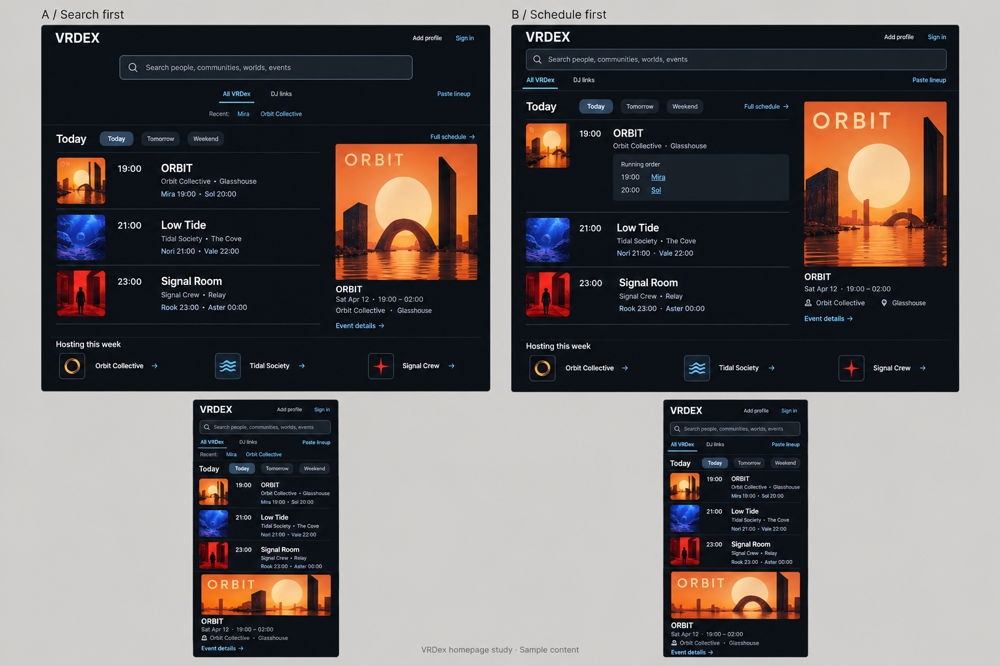

# Homepage search and schedule design

## Review brief

Give VRDex a homepage where visitors can find a person or community and see
what is happening today. Search stays prominent. A chronological event schedule,
linked performers and owner artwork provide the main browsing content.

BASIC supports this direction and plans to contact groups manually and offer
to enter their events. That supplies the initial content without making group
self-service onboarding a launch dependency. How quickly groups join and how
often they publish remain assumptions to test through that outreach.

Status: draft for BASIC's review. The schedule-first concept B is the current
recommendation, with compact performer summaries from A and full lineups expanded
on demand. The specific route changes, date behavior and copy below are proposed,
not approved production behavior.

The current root-lookup decision in
[Product direction](../../planning/product-direction.md#homepage-direction)
remains in force until this design is approved and implemented. This proposal
would replace it with search plus a public schedule while preserving focused DJ
lookup at its existing search destination.

## Visual reference

These generated studies use invented events and artwork. They establish visual
hierarchy, not exact product copy, completed responsive behavior or browser-test
evidence. Reuse the existing charcoal theme, semantic tokens and shared
primitives. Prefer quiet controls, subtle corners, readable type and aligned
times. Event artwork supplies the stronger colors.

## First version

The homepage has five parts, in this order:

1. Existing brand, account controls and an accessible Add event entry.
2. Search across public entities, with an explicit DJ links scope and access to
   the existing bulk lookup workflow.
3. A date-selectable chronological event schedule.
4. Details and intact artwork for one selected event, beside the schedule on
   wide screens and within that event's disclosure on narrow screens.
5. A compact collection of public communities hosting in the displayed range,
   derived from loaded events and deduplicated. Omit it when empty.

Keep event titles, times, host and location outside posters. Names link to their
canonical public pages where available. Do not fill empty space with unrelated
people, worlds or community recommendations.

Group outreach and concierge event entry use the existing authorized event
authoring and contribution paths. This homepage slice adds no new publication
authority, automatic group sync, recurring-event system, social feed,
personalization or mandatory onboarding.

## Search and routes

Default the new homepage search to All VRDex. Selecting DJ links visibly changes
the search scope and uses the existing name/genre lookup behavior. Preserve
autocomplete, recent DJ searches, multiline paste, bulk lookup and result-copy
actions by reusing their existing implementation.

Submit search to the existing `/search` route with its current query/view
contract. Paste lineup enters the existing bulk-capable DJ lookup experience;
do not invent a second bulk parser or expose private lookup data in homepage
event or community modules.

Preserve existing nonempty `/?q=...` DJ lookup links by redirecting them to the
equivalent `/search?view=dj&q=...` destination. Keep the current `/lookup`
redirect and legacy `/discover` redirect. Do not change their meaning as part
of the visual redesign.

Use `/discovery` as the full schedule destination, sharing the same date-aware
schedule composition. Build and review the new composition there before
promoting it to `/`. A Full schedule link on Home reaches that focused view.
The older unrelated directory rails are not part of the new composition.

## Dates and event ordering

Current recommendation: Today, Tomorrow and Upcoming controls. Upcoming covers
the rest of today plus the following six viewer-local calendar days. Resolve
calendar boundaries in the viewer's IANA timezone, including daylight-saving
changes. Group and display times in that same timezone. Once resolved, persist
the chosen period and zone in schedule navigation so date changes and browser
Back restore the same view.

The server cannot assume that UTC is the viewer's date. Before the browser zone
is available, show a stable schedule loading layout rather than incorrect local
date groups. Search and navigation remain usable. Re-evaluate Today at local
midnight and refresh schedule state when the tab regains focus.

Include ongoing timed events that overlap the selected interval, even when they
started the previous day. For Today and Upcoming, put ongoing events first,
then future events by start time with a stable identity tie-break. Use the
existing public runtime rules for an unknown end; do not display the inferred
runtime as an authored end or imply that a stream is live.

Date-only events retain their authored calendar date and Time TBA treatment.
Place them in a separate untimed group for that date. Do not convert them to
midnight instants or invent performer times. Exclude cancelled, ended and
nonpublic events from normal upcoming browsing under existing public rules.

Changing dates clears an invalid selection and selects the first eligible
event in the new result. If nothing remains, clear the poster and details too.
An empty Today view stays on Today and offers Upcoming; it never silently
relabels later events as today's.

## Event selection and mobile

Rows show a small thumbnail, time, title, public host, location when known and
a compact current/upcoming performer summary. Preserve manual venue labels
when no linked world exists. Missing metadata removes that line without
manufacturing placeholder facts.

Use an explicit keyboard-accessible control to select an event or expand its
lineup. Event-title and performer links retain their independent navigation.
Expose selected and expanded state accessibly. Selecting a row must not
unexpectedly navigate or move focus to another part of the page.

On wide screens, the selected event's poster and details occupy roughly one
third of the schedule region. Fit the complete poster inside its frame; use
separate cropped thumbnails for rows. Without artwork, use a compact identity
and details presentation instead of reserving a large empty rectangle.

On narrow screens, keep search, date selection and event rows first. Reveal
lineup and artwork within the selected event on demand. Avoid appending a
second large copy of every event after the list. Respect reduced motion, touch
targets, contrast, text wrapping and visible keyboard focus.

## Data and component boundaries

Reuse the existing public event projections, canonical event paths, viewer-local
time components, schedule primitives and media eligibility. Keep backend
publication/surfacing checks authoritative for events, hosts, performers and
worlds. A hidden performer must not regain a profile link or private metadata
through a new join.

Two verified gaps need implementation:

- `fetchDiscovery` requests only 12 events, and `listPublicUpcoming` accepts
  `now` and a bounded limit, not a selected interval. Add a bounded,
  interval-aware public schedule query with pagination and explicit error
  state. Apply range and public eligibility before forming each result page.
  Do not filter the first 12 events to implement Tomorrow or Upcoming.
- Preview `nextSlots` contains at most three current/future timed slots, not
  the full lineup. Fetch canonical public event detail for the selected event
  on demand. Its mixed timed/untimed lineup supplies expansion. Avoid one
  detail request per visible event and discard stale selection responses.

Let Home display a bounded first page and link to the full schedule. Let the
focused schedule load further bounded pages without losing the selected range.
Communities derived from a partial page are a contextual sample, not a claim to
list every host in the interval.

Keep empty, loading and failed reads distinct. A schedule failure must not
become No events. Retain working search and date controls, offer retry, and
clear details that are no longer public. Missing optional artwork or analytics
must not break browsing. No autoplay media or provider-presence integration is
needed for the first version.

This uses the current Next.js/Convex stack and existing media delivery. No new
service, paid integration or infrastructure migration is proposed. Keep reads
bounded, defer unselected detail loads and size images for their actual display.
Preserve existing optional search/event click instrumentation without adding
raw search text or private lookup results to analytics.

## Proposed copy

Retain existing approved utility labels where unchanged. The strings below are
the exact proposed additions or changed wording for review with this design.
Mockup text is not an additional copy specification.

| Purpose | Proposed wording |
| --- | --- |
| Universal search placeholder | Search people, communities, worlds, events |
| DJ search placeholder | Name or genre |
| Bulk lookup entry | Paste lineup |
| Schedule heading | Events |
| Period controls | Today; Tomorrow; Upcoming |
| Full schedule destination | Full schedule |
| Event detail link | Event details |
| Lineup disclosure | Lineup |
| Host collection | Hosting |
| Empty selected day | No events today; No events tomorrow |
| Empty upcoming interval | No upcoming events |
| Failed schedule read | Events unavailable |
| Retry action | Try again |

New substantive product or error wording identified during implementation must
be shown for review under the existing public-copy rule. Preserve that rule's
exemptions for explicit accessibility names, required legal/safety wording and
obvious utility labels. Existing claimed, unclaimed and community-submitted
identity treatment remains accurate; manual entry does not imply owner
verification.

## Delivery and acceptance

Recommend one implementation PR with internal tasks for date-aware data,
responsive composition, search-route preservation and verification. Before
that work, produce a written implementation plan from this reviewed design.

First review checkpoint: a running desktop/mobile preview with representative
fixture content, initially at `/discovery`. Use a busy day with simultaneous
events and more than 12 entries, one event, a quiet day with later events, no
events, missing/failed artwork, long names and partial/untimed lineups. The
generated concept board is not verification of that preview.

Before promoting the new composition to `/`:

- Prove interval loading is not starved by earlier dates or hidden records;
  pagination, overnight events, local midnight, DST and date-only values work.
- Verify search scopes, legacy query URLs, keyboard/touch operation, recent
  searches, multiline bulk lookup and result-copy actions still work.
- Verify rapid date/selection changes, failed reads, retry, cancellation and
  publication/surfacing changes never leave mismatched or stale event details.
- Inspect real desktop/mobile screenshots in supported themes for busy, sparse
  and error states. Include visual review, not only screenshot generation.
- Run relevant backend tests, web checks and route/browser coverage. Update
  visual baselines only for intentional changes. Select `ci:browsers` and
  `ci:visuals` for the UI PR under the repository's CI rules.
- Update Product direction, Home and discovery direction, backend search/
  discovery docs and public navigation docs with the final shipped behavior.

BASIC's initial content pass can run alongside implementation: enter the next
couple of events for willing groups, including the available poster, local
schedule, host, venue and performer links. Confirm event details with the group
and use existing publication permissions. The new layout must remain useful
before every group has complete artwork or linked performers.

## Source notes

Source inspected at `0d7246b` on 2026-10-21:

- `apps/web/src/app/page.tsx`, `search/page.tsx`, `lookup/page.tsx` and
  `discovery/page.tsx`: current route contracts.
- `apps/web/src/app/_components/discovery-public-page.tsx` and
  `apps/web/src/convex/server.ts`: current composition and bounded feed.
- `convex/events.ts`, `convex/_eventPublic.ts` and `convex/_eventRuntime.ts`:
  public eligibility, previews, canonical lineup and runtime semantics.
- [Design system](../../engineering/design-system.md),
  [Search and discovery](../../backend/search-discovery.md) and
  [Feature design loop](../../agentic/feature-design-loop.md): shared UI,
  disclosure and visual-verification requirements.

The preceding Mobbin research informed composition, not product effectiveness:
[Perplexity search](https://mobbin.com/screens/00fc974e-2367-4479-a8dc-3e0a919604b2),
[Sweatpals schedule](https://mobbin.com/screens/05e9f0a6-db81-4efa-aa67-1ae733110c67),
[Apple Music artwork hierarchy](https://mobbin.com/screens/a917d88f-d15a-4f53-92d3-1daecf59d05f)
and [Sweatpals discovery](https://mobbin.com/screens/662d8730-bc42-419f-b0cc-4fef551e15f0).
