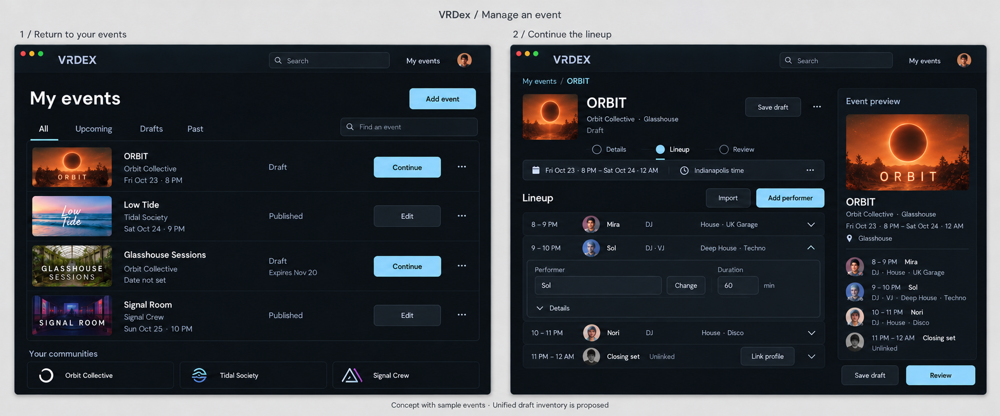

# Organizer event workspace design

## Review brief

Make VRDex the organizer's working event application. The first concrete slice
is a reliable My events inventory and return-to-edit journey: find an event or
unfinished draft, continue its lineup, save, publish and later revise it.

Status: BASIC approved this first implementation slice and visual direction
in chat on 2026-10-21. Implementation planning follows that approval. BASIC
requested event management as a core workflow and excluded VRC.tl as a
distribution destination. The separate wordmark/color study does not change
production branding as part of this slice.

The public [homepage and search design](./2026-10-21-homepage-search-schedule-design.md)
continues to cover search, the compact event timeline and discovery. Organizer
work belongs here, with an obvious authenticated My events entry. Ordinary
search keeps compact results and individual Links disclosures; it is not a
search-wide lineup-link collection interface.

## Visual study

The study uses invented events and artwork. It proposes a combined draft
inventory and a more compact lineup composition. It does not prove an existing
unified Drafts view, automatic saving, complete asset collection or destination
integrations. The established charcoal theme remains the visual direction.

## Existing foundations

- `/account/events` already combines managed-community events and the user's
  contributions, including retracted ones. Reuse its identity deduplication and action policy.
  Managed results are currently capped at 100; contribution results paginate.
- Staff drafts are canonical `draft_private` event records. Contributor intake
  drafts are separate versioned records, resumable at `/events/new?draft=...`,
  with an existing 30-day expiry. The current account inventory does not list
  those resumable intake drafts.
- Both authoring paths use Details, Lineup and Review. Existing behavior covers
  recognizable or manual performers, timed and untimed entries, local editing
  time, source intake, artwork, preview, explicit save and dirty-state guards.
- A published staff event's Save draft operation explicitly unpublishes it with
  confirmation. Save changes and publication are distinct existing commands.
- Published, noncancelled events can expose a generated Discord-ready post.
  Copying that text is manual distribution, not an automatic Discord mirror.

## First implementation slice

### Find work in My events

Make `/account/events` a clear organizer destination from authenticated
navigation and authoring return links. Retain Add event and the existing
community-specific authoring entry. Do not require management authority merely
to reach the contributor path.

Show managed canonical events, the viewer's contributions and their active
resumable intake drafts in one inventory. Each row carries its real source
identity and authorized continuation action. Use established event/draft links
to deduplicate published work; never merge records by a similar title.

Current recommendation for filters:

- All includes accessible events and drafts, including undated drafts.
- Upcoming includes dated, noncancelled events that are ongoing or upcoming in
  viewer-local time. Unknown dates do not enter this view.
- Drafts includes accessible canonical drafts and the viewer's active intake
  drafts, retaining the appropriate continuation route for each. Retracted
  contributions are not resumable drafts and cannot gain Continue through this
  filter.
- Past shows completed dated events. Cancelled records remain identifiable in
  All and cannot appear as ordinary upcoming events.

Retain retracted contributions in All with their existing Retracted state and
eligible actions. A retracted contribution does not gain ordinary editing or
correction merely by appearing in the inventory; existing contributor
corrections require the published, scheduled event and the current authority.

Use plain Draft, Published, Cancelled and Retracted state labels. Display an intake
draft's actual expiry where applicable, in viewer-local date presentation;
do not invent an expiry for canonical drafts or silently extend retention.
Expired intake drafts cannot offer a working Continue action. Longer-lived
planning-draft retention needs a separate product/data-lifecycle decision.

Find an event searches titles and community display names within the viewer's
authorized inventory. Apply matching/filtering before each bounded result page.
Do not filter only the first 100 managed events and imply the rest were searched.
Keep source reads bounded and paginated, with stable identity ordering and a
visible way to continue loading results. Distinguish no results from failed
inventory sources; a failed source cannot make saved work appear deleted.

Private intake drafts remain creator-private. Community management access to
canonical event drafts does not grant access to another person's intake
evidence. Use safe authorized thumbnails where available and a deliberate
identity fallback otherwise; never turn private source posters into public art
merely to decorate the inventory.

### Continue one event

Continue routes an intake draft to `/events/new?draft=...` and a canonical
staff draft to its existing community-bound editor. Published work uses its
existing authorized edit/correction path. Retain both the staff and contributor
flows; a shared inventory must not turn contributions into staff management.
Do not promise restoration of an unsaved editor buffer or last visited step.

Keep Details, Lineup and Review, including their existing validation, source
review and publication boundaries. The inventory work does not require a new
event database or a replacement authoring state machine.

The lineup study makes rows compact for scanning and expands one row's existing
Performer, Duration and optional Details controls for editing. It preserves
manual entries, linked identities and overrides, optional end/doors times,
fixed explicit event ends, insertion/removal cascades, Time TBA and unresolved
source clocks. The study is not approval of drag resizing or new scheduling
logic. Genre and media-kit context must come through existing eligible profile
projections, without creating a new asset library or exposing private fields.

Show the event's community, location, publication state and one friendly local
editing-timezone proof throughout editing. Keep the preview in the same editing
zone. On narrow screens, the editor precedes the preview and compact rows wrap
or expand; do not compress desktop columns into illegible fields.

### Save, publish and return

Save draft remains explicit for an unpublished event or intake draft. Retain
version/revision checks, failed-save state and unsaved-change protection. No
autosave or indefinite draft retention is claimed.

Review remains the deliberate publication point. For published staff events,
preserve Save changes and the separately confirmed Unpublish and save draft
operation. Do not relabel unpublishing as a harmless Save. Do not clear newer
edits that were made while a save or publication request was pending.

Retain the existing successful-publication return to the canonical event page.
Provide working My events and permitted edit navigation so organizers can
return to management. Changing the post-publication destination to stay inside
a new event hub would require a separately reviewed flow change.

Keep generated Discord-post copying available for eligible published,
noncancelled events under the existing staff-editor authorization. A published
contribution appearing in My events does not itself grant that export access.
Do not expose private draft URLs as public event links or
show successful external delivery merely because text was generated/copied.

## Distribution direction

The longer-term goal is to plan and maintain the event in VRDex, then distribute
its published information and changes to supported destinations. Discord and
VRCPop are intended destinations. VRC.tl is explicitly excluded; its supplied
timetable screenshot is only a public-homepage visual reference.

Destination capabilities, authentication, field mapping, updates, cancellation
and per-destination delivery state need their own design and verified provider
support. This first slice adds no connected mirror, delivery status, booking
workflow, payment integration or widened event/media permission. Canonical
event saving and publication must work independently of external delivery.

## Verification and handoff

Recommend one initial implementation slice for inventory completeness and
continuation/navigation, reusing the existing forms. Review compact lineup
styling separately within the existing scheduling contract; do not make a full
editor rewrite a prerequisite for reliable draft access.

The working browser checkpoint is:

1. Enter My events and find both canonical and resumable intake drafts.
2. Continue each type, edit a performer or set time, explicitly save and reopen.
3. Publish through Review, inspect the canonical event, then return to edit.
4. Revise a published lineup with Save changes, retain its published state and
   confirm generated Discord text reflects the saved public event.

Cover viewer isolation, revoked authority, staff takeover/corrections, expired
drafts, retracted contributions, duplicate inventory origins, more than 100 managed events, pagination,
undated and date-only drafts, overnight/DST times, empty/failed inventory reads,
missing/private artwork, save conflicts and pending-save edits. Confirm a
cancelled or unpublished event never exposes a public Discord export through
the new inventory.

Use real desktop/mobile screenshots and visual review in supported themes.
Run relevant inventory/backend tests, authoring journeys and existing web
checks. Update public/developer docs to the final shipped routes and draft
behavior. A generated concept image is not evidence that the flow works.

Proposed utility wording for the next taste review: My events, All, Upcoming,
Drafts, Past, Find an event, Continue and Add event. Preserve existing approved
editor labels and errors. The sample Expires date must come from the actual
record; no new explanatory product copy is approved by this document.

## Source notes

Source inspected on 2026-10-21 at product-code revision `0d7246b`:

- `apps/web/src/app/account/events/managed-events-panel.tsx` and
  `convex/events.ts`: current inventory, deduplication and authority.
- `apps/web/src/app/events/new/page.tsx`, `event-intake-form.tsx` and
  `convex/_eventIntake.ts`: intake draft resume, versioning and expiry.
- `apps/web/src/app/events/event-editor-form.tsx`, `event-editor-page.tsx` and
  `event-editor-steps.tsx`: current staff composition, save and wizard behavior.
- `apps/web/src/app/events/event-edit-page.tsx`,
  `apps/web/src/app/_components/event-discord-export-panel.tsx` and
  `convex/_eventDiscordExport.ts`: generated public Discord text.
- [Approved editor design](./2026-10-15-event-editor-identity-local-time-design.md),
  [Product direction](../../planning/product-direction.md) and
  [Event routing and authoring](../../planning/event-routing-and-authoring.md).
