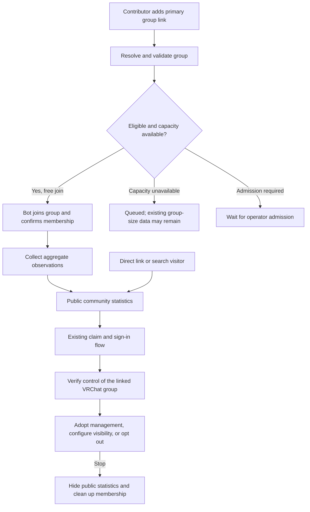

# Automatic aggregate statistics for linked VRChat groups

**Status:** Approved by BASIC on October 25, 2026. [Implementation plan](../plans/2026-10-25-automatic-group-statistics.md) prepared for review.

## Review brief

VRDex should begin collecting and publishing a bounded set of group statistics when a public community profile has a valid primary VRChat group link, even if no verified operator has claimed the community. This makes profiles useful before onboarding and records event population without relying on someone remaining in an instance with VRCX.

The recommended approach reuses the existing collector, leases, budgets, observations and charts. It introduces a system-managed aggregate-only collection mode alongside the existing operator-managed mode. Linking a group never grants ownership, private workspace access or permission to operate that group.

**Confirmed by BASIC:** aggregate counts may include members-only instances visible to our bot. Individual users and private instance links must not be exposed.

**Confirmed enrollment decision, October 25:** BASIC selected automatic enrollment with limits over a VRDex-reviewed enrollment queue.

**Approved defaults within that direction:** eligible primary links; free-join admission only without operator action; a fixed public aggregate projection; one collection assignment per immutable group; verified operator opt-out; existing managed communities keep their settings. BASIC approved these design details and the migration direction on October 25. This is approval to plan the implementation, not to perform live migration or activation.

**Main tradeoff:** a public population graph can reveal that a small members-only gathering is happening, even without names or links. This design permits that aggregate activity signal as requested. It does not claim that aggregate statistics prevent all inference.

Design only. No implementation, group join, provider probe, deployment or production setting change is authorized by this document.

## Approaches

| Approach | Benefit | Cost or limitation | Disposition |
| --- | --- | --- | --- |
| Automatic aggregate-only enrollment, shared collector | Delivers useful history before operator onboarding; reuses collection infrastructure | Requires group deduplication, an explicit privacy contract, admission limits and opt-out | Selected by BASIC on October 25; removes the manual onboarding bottleneck while bounding admission |
| VRDex-reviewed enrollment, shared collector | Limits unsolicited joins and capacity abuse through manual review | Preserves a human onboarding bottleneck and misses activity while waiting | Not selected; BASIC chose automatic enrollment with limits |
| A separate discovery collector | Isolates discovery implementation | Duplicates credentials, budgets, joins, history and failure handling | Rejected; there is one fleet and collection lifecycle |

This is a product and authorization change, not a switch that bypasses `manage_integrations`.

## User experience

A signed-in contributor uses the existing community contribution flow to add a primary VRChat group link. The community can remain unclaimed. After VRDex resolves the link to a valid immutable group, eligible enrollment is queued automatically. The contributor has supplied directory data, not consent on the group's behalf and not authority over the bot.

Visitors see the existing community page with group size, observed active-instance count, observed population and their histories once available. Counts carry an observation time. Charts preserve gaps. Before the first observation, no count is shown. A stale population is unavailable, not zero. Statistics are observations by VRDex and must not imply the group endorsed the page.

The claim entry point remains available. Signing in or claiming a profile does not interrupt collection and does not automatically grant VRChat group control. A verified group operator can adopt management, configure publication or stop observation. Private workspace access keeps its existing authorization.

### Journey question: how does a linked group become useful without an operator?

The existing pages and claim return flow are reused. No new navigation or authentication journey is proposed, so reference-journey research is not required for this version. Exact new public explanatory copy is a separate review item before release.

## Eligibility and enrollment

1. The source profile must be a publicly readable, unsuppressed community with one active primary `vrchat_group` link. Ordinary footer links and additional groups do not trigger joining in this release.
2. Resolve short links through existing link resolution. Use the provider's immutable group ID, visibility and join policy. Submitted names, slugs and caller-supplied join policy are not authoritative.
3. Automatic admission requires a publicly listed free-join group, no group-level observation opt-out and no existing conflicting managed connection. Members-only instances inside that eligible group remain included in aggregate counts.
4. One idempotent enrollment exists per immutable group across profiles. Repeated saves, short links, duplicate profiles and concurrent submissions must not allocate extra bot memberships or duplicate observations. A primary link does not reserve ownership of the group.
5. Admission uses existing healthy-account capacity, reserved headroom and request budgets. Managed assignments have priority in queue ordering only; no immediate slot is guaranteed and neither mode evicts an active assignment. Existing reserved headroom remains untouched. Full capacity leaves enrollment queued rather than creating more accounts or raising capacity. Queue entries are fair and rate-limited per contributor; an implementation default is at most five new group candidates per contributor per day, with an operator override. The numeric limit is a proposed builder default.
6. Never automatically submit membership requests to request-to-join groups. An administrator can invite the disclosed service account or admit it through the managed onboarding flow. A pending invitation alone is not group ownership proof.
7. A ban, kick, removal or explicit stop blocks automatic rejoining, including through another bot. Ambiguous membership loss pauses for reconciliation rather than repeatedly joining. Provider backoff, account quarantine and global kill switches remain authoritative.
8. Removing or changing the last eligible link stops public projection immediately and queues leave cleanup unless a managed integration still needs the membership. Re-adding a link cannot bypass a group-level stop. Suppressed profiles never project observations.

Admission does not mean launching a VRChat client or entering a world. The bot joins group membership and polls the provider's group instance endpoint. No in-world observer is needed.

## Public data contract

| Data | Aggregate-only public result |
| --- | --- |
| Group size | Latest observed member count and timestamp; observed count history |
| Membership growth | Net difference across named observation windows; never gross joins, departures or a user list |
| Active instances | Count of instances visible to the collector, including members-only instances |
| Population | Sum of provider population counts across those instances at a poll |
| Population history | Timestamped group totals and instance counts, with explicit gaps |
| Peaks and player-hours | Observed peak concurrency and gap-aware population integration over a selected window |
| Collection quality | Last observation and measured temporal coverage, without private operational details |
| Instance links and identifiers | Omitted, including private locations, instance IDs, internal session IDs and reconstructable join URLs |
| People | No usernames, user IDs, rosters, named attendance or individual membership history collected in this mode |
| Worlds and per-instance breakdowns | Omitted from the automatic public result, including nested world distributions and session lifecycle rows |
| Event recaps | No automatic official event attribution. A visitor may view the aggregate graph over an event's time range; authorized confirmation remains required for official recaps |
| Queue | Unavailable in this version; never substitute zero or infer it from capacity/population |

Population counts describe visible occupancy, not all VRChat activity, unique visitors or group-member attendance. Instance populations may include guests. Temporal coverage measures successful observation over time and cannot prove the bot saw every instance.

Keep current freshness and gap rules: population expires after six minutes; player-time integrates only between observations at most five minutes apart; failures are gaps. A successful complete visible-instance response with no instances may record an observed zero. A 403, malformed response, lost membership or missing response cannot.

For a useful night graph, expose bounded group-total observation series for ranges up to 24 hours, rather than only hourly rollups. Return at most 720 chronological buckets with observed minima, maxima and last values; preserve missing positions and segment gaps before reducing points. Hover reports the actual observation time. Longer ranges use existing hour/day rollups. Sampling never pretends to recover unobserved peaks or unique attendance.

## Collection, authority and storage

### Reuse one group collection lifecycle

Generalize the existing `communityVrchatIntegrations` record into a canonical group collection assignment while retaining its physical table and observation foreign keys for this change. Add an explicit mode distinguishing system aggregate-only collection from operator-managed integration. Existing records migrate as managed records with their current community binding and settings.

Aggregate-only records have no managing community owner. They are looked up by immutable group ID from eligible profile links. A managed record retains its managing community binding. Enforce the variant at the schema and validation boundary so a system record cannot carry management privileges. Do not fabricate a VRDex user, owner role or community authority for automatic work.

All profile reads resolve the current primary group before reading shared statistics. Editing or removing a link must not move old observations to the replacement group. Per-group epochs preserve connection changes and honest coverage gaps. Duplicate public profiles may reference the same observed totals; each profile's public-read and suppression checks still apply.

A verified operator adopting an already observed group reuses the assignment and history. It does not join again or reset history merely because management became available. Validate external group control using the existing proof system; owning an unrelated or unverified VRDex profile is insufficient. Existing duplicate managed connections require reconciliation, not silent reassignment.

Approved adoption default: preserve the exact safe aggregate public projection until the verified operator explicitly saves managed publication settings. Record that publication-policy variant independently from collection mode; becoming managed must not expose worlds, instance rows, membership movement detail or event recaps through broader category defaults. Adoption enables no named collection or group management feature automatically. Those require the existing explicit feature configuration and authority. Existing managed integrations migrate directly to their existing category policy, never to this adoption default.

### Explicit worker and ingest boundary

The current worker executes management reads/operations and membership-page collection around aggregate polling. Setting `enabledFeatures` to analytics alone is not the isolation contract.

An aggregate-only lease permits only group metadata, one admission/leave lifecycle, visible instance aggregate reads and aggregate ingest. Branch before management readiness, management reads/operations and `collectMembershipPage`. The control plane independently rejects management jobs, named member/presence ingestion and membership-page results for that mode. Lease fencing, immutable account matching and per-request budget checks stay in force.

Provider payloads are parsed in memory into counts and the minimum existing sanitized instance identity needed for deduplication/session rollups. Do not request roster, audit-log, member-list, user-profile or friend endpoints. Do not persist raw provider responses. Public APIs receive an allow-listed aggregate result rather than a filtered private dashboard object.

### Shared member counts and retention

Reuse `vrchatGroupMemberSnapshots`, metadata and `recordGroupMemberObservation`; do not create a second competing member-count history. Active aggregate polls refresh that shared source. The existing daily standalone member sampler skips a group when a healthy active assignment supplies fresh counts, and resumes metadata-only sampling if no assignment can do so. Metadata-only fallback never implies an active-instance count.

Keep the currently accepted permanent retention policy for existing aggregate observations. This design adds no person-level history. Internal sanitized instance locators remain private. Opt-out immediately removes public current and historical statistics but does not silently erase retained records. Deletion remains the existing separately authorized moderation/deletion process. Reconnection cannot republish previously suppressed history without explicit operator choice.

## Visibility, opt-out and recovery

Automatic collection uses a fixed aggregate-only public policy. It does not set every existing club visibility category to public, enable individual membership history or turn on the private workspace.

Existing managed communities retain their current enabled features, category audiences, explicit analytics disablement and disconnect decisions. Their group policy is authoritative across every duplicate profile referencing the group. A duplicate or unclaimed profile cannot reveal a metric hidden by the group's managed policy or trigger an automatic fallback because a primary link still exists. Profile suppression adds another restriction and never broadens that group policy. The policy is selected once in a shared projection used by the website, REST API, hosted MCP, stdio MCP and exports, including the separate `getPublicGroupMembership` result.

An operator who proves control of the actual VRChat group can stop observation or adopt managed configuration. A VRDex moderator can pause collection immediately during a dispute while control is checked. Stop state is keyed by group ID and checked at enrollment, claim, every provider request and public read. It also stops the independent daily member sampler and suppresses retained group-size results in `getPublicGroupMembership`; metadata fallback is not an opt-out escape hatch. Public statistics disappear before asynchronous cleanup. Any other integration still using membership must be reconciled before leaving; no unrelated managed capability is silently broken.

Removing the bot in VRChat is also honored as a stop. Do not rotate accounts to regain visibility. Resume after a blocked or suppressed state is an explicit verified-operator or authorized VRDex moderation action. Revoking a profile claim does not silently change group observation policy.

## Scope and affected contracts

| Area | Required design reach |
| --- | --- |
| External links and contributions | Idempotent enrollment scheduling and paged reconciliation on primary-link changes, publication and suppression |
| Schema and assignment resolver | Mode variants, optional managing-community binding only for system records, unique group admission and persistent group-level stop |
| Collector and HTTP control plane | Aggregate-only provider allow-list and server-side denial of management/named-data operations |
| Existing managed authorization | Preserve club owner/delegate checks, category visibility, management jobs and explicit disabled state |
| Observations and rollups | Resolve by canonical assignment/group; no cross-group history on relink; bounded night-range graph and unchanged gap semantics |
| Member sampler | Reuse shared counts and avoid duplicate polling; metadata fallback stays independent of bot membership |
| Public projection and contracts | Explicit automatic aggregate DTO; website, REST/OpenAPI, MCP tools, exports and generated contracts agree |
| Web | Reuse community statistics components; chart receives only aggregate series; claim return behavior stays unchanged |
| Operations | Enrollment reconciliation, capacity queue, blocked admission, cleanup, kill switches and aggregate-only health evidence |
| Docs and fixtures | Update telemetry public/backend/deployment docs, claim/link descriptions and managed-versus-automatic fixtures together |

Physical names and exact helper decomposition remain builder choices where these invariants hold. No new provider, background service, account fleet or chart dependency is proposed.

## Validation and rollout

Before implementation completion, prove:

- Concurrent enrollment for duplicate links produces one assignment and one bot membership; contribution never creates owner or staff authority.
- Automatic leases cannot read rosters, collect membership pages, execute group operations or ingest person-level records, even through direct worker calls.
- A fixture containing private locations, world IDs, person identifiers and session identifiers returns only approved aggregate fields on every public protocol and export.
- Relink, suppression, opt-out, ban/removal, lost membership, stale responses and explicit managed disablement suppress the correct public fields without writing false zeros or rejoining.
- Existing managed visibility and management remain unchanged. Verified adoption preserves history; incorrect group proof cannot adopt or suppress another group.
- Duplicate unclaimed profiles cannot bypass managed group visibility. Adoption preserves only the safe existing aggregate projection until explicit settings changes, enables no named collection, and does not inherit broader public defaults. Group opt-out stops both aggregate polling and the independent member sampler.
- Queue saturation, retries, fair admission, orphan cleanup, multiple profile references and daily member sampling remain bounded and idempotent.
- Night-range charts preserve gaps and peaks after reduction on desktop and narrow screens. Browser payloads and links contain no private-instance identifiers.

Backfill eligible links in bounded pages after rollout authorization. Existing managed integrations migrate first and retain precedence. Start with one expressly approved free-join group and a small configured admission cap. Verify actual membership and non-empty aggregate collection, public website/API/MCP output, removal/opt-out behavior and unchanged managed behavior. Homie Hub is a candidate, not an approved live test in this design.

Use the existing collector alarms and verify their actionable email path to `basic@basicbit.net` before unattended expansion. Add an alarm for a sustained automatic-enrollment backlog only if no existing liveness/capacity alarm covers that failure. Do not create a new email-delivery system.

Launch remains separate from design and implementation approval. Preserve the existing provider-session operating decision and request limits; this feature does not establish provider permission for fleet scale-out. No bot registration or capacity increase is part of this design.

## Decision status

1. Confirmed October 25: automatic enrollment with limits. A reviewed enrollment queue is not the chosen approach.
2. Approved October 25: the fixed public aggregate set, including members-only occupancy, while excluding worlds, per-instance rows, names and private links.
3. Approved October 25: verified group-level opt-out and preservation of every existing managed privacy/disable decision. This changes the earlier operator-only collection/publication contract for newly automatic groups once implemented.

No additional open architecture decision is required from BASIC. The builder may choose names and module boundaries; changes to collection scope, authority, visibility, retention or admission require returning to this contract.

## Evidence appendix

- Source baseline: `f6b0b95ef8e51e941951533034b8a8216151fd3e`, refreshed from `origin/main` on October 25, 2026. Isolated branch: `codex/automatic-group-statistics-design`. Shared checkout contains unrelated work and was not edited.
- `convex/communityTelemetry.ts`: current operator-managed connect/disconnect, leases, assignment and visibility changes.
- `convex/groupMemberSnapshots.ts`, `convex/_groupMemberSnapshots.ts`: existing group-keyed membership observations and daily link-driven sampling.
- `convex/_communityTelemetryPublic.ts`, `convex/_clubAccess.ts`: shared public projection, primary-group matching and current category visibility.
- `workers/group-telemetry/worker.mjs`, `vrchat-client.mjs`, `membership-collection.mjs`: aggregate adapter, admission, management phases and named membership collector to exclude.
- `convex/_externalControl.ts`, `profileExternalLinks` and `externalControlProofs`: identity, primary links and group-control proof boundaries.
- `docs/planning/group-instance-analytics/2026-09-10-club-staff-and-visibility-design.md`: later permanent-retention and visibility decisions supersede older telemetry docs.
- Topical parent: `docs/planning/community-group-telemetry.md`. That document links this approved amendment. Its operator-only/public-off behavior remains the current implementation until the approved change is built and released.
- [VRChat Creator Guidelines, API Usage / Bots](https://hello.vrchat.com/creator-guidelines#api-usage-bots), checked October 25, 2026: unsupported mutable API, identifying User-Agent, caching, metered requests, randomized polling and error backoff. Existing service-account/session posture remains an independent operating decision.
- No live provider, deployment, queue-count capability or admission-capacity verification was performed for this design.
