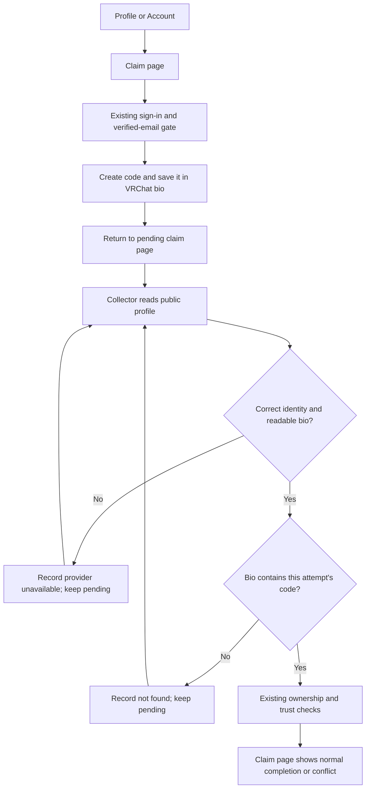

# Restore VRChat person-profile verification

## Proposal and decision

Read person-proof bios from VRChat's public-profile endpoint and validate that the response actually contains a readable bio for the requested person. A valid bio without the code is a negative result. Missing or invalid evidence is a provider failure, preserving the attempt for retry.

This fixes the endpoint mismatch and prevents the same missing-field failure from silently becoming "code not found" again.

**Locked decision:** BASIC selected the focused fix with one controlled collector proof. A recurring live check is out of scope.

**Current recommendation:** implement the bounded provider change, update the existing fixtures and operator documentation, then prove one real verification through the released collector. This document is proposed for approval. No implementation or live action is authorized by writing it.

The main tradeoff is deliberate refusal when the response is incomplete. Some users will remain pending during a provider-contract problem instead of receiving a negative verdict. That is preferable to claiming we inspected evidence we could not read.

## Claimant experience

The existing journey stays the same: sign in with the required verified email, create a code, save it in the linked VRChat account's bio, and return to the claim page. The page observes normal claim completion when the collector finds it. No additional provider consent, page, or manual ownership override is introduced.

Existing unexpired pending attempts remain usable and retry through the ordinary collector schedule. Expired or canceled attempts retain their existing terminal states; the claimant starts over normally. This fix does not extend expiration or restore discarded codes.

### How does a pending person proof settle?

The diagram omits the unchanged cooldown and expiry gates. Retries always pass through those gates. A match does not bypass an ownership race or grant a stronger trust label than the existing association rules allow.

Provider failure is distinguished in the existing attempt outcome and sanitized collector log. The browser's existing pending/queued presentation is unchanged. It does not currently expose every background provider outcome, and this design does not promise a new outage message or add public copy.

## Approaches

| Approach | Benefit | Limitation | Decision |
| --- | --- | --- | --- |
| Change only the URL | Smallest edit | Missing fields could still become false negatives; stale fixtures could still pass | Rejected as incomplete |
| Update the endpoint, validate evidence, repair fixtures, and prove one real collector check | Addresses the observed failure and its validation gap within the existing protocol | Requires controlled live acceptance after release approval | Selected focused scope |
| Add a recurring controlled-account check as well | Could detect future HTTP-200 contract drift automatically | Adds provider traffic, scheduling, and account maintenance | Deferred by BASIC |

## Provider contract

For `vrchat_user`, `VrchatClient.findProofCode` makes one request to `GET /profile/{targetExternalId}` using the current authenticated collector transport. It does not fall back to `/users`, make a second status request, or use the separate operator integration to attest ownership.

Before matching, require a non-null, non-array object, an `id` matching the requested immutable user identity, and a string `bio`. Reject missing, null, wrong-type, or mismatched fields with the existing `VrchatProviderError` category `schema_drift`. Use a generic error message without the payload, target identity, or code.

| Response | Result |
| --- | --- |
| Matching identity and bio containing the current code | Return `true`; ordinary claim settlement decides the outcome |
| Matching identity and readable bio without the code, including an empty string | Return `false`; record `not_found` |
| Missing, null, or non-string bio | Throw `schema_drift`; record `provider_unavailable` |
| Missing or mismatched identity, array, or invalid envelope | Throw `schema_drift`; record `provider_unavailable` |
| HTTP, network, timeout, authentication, or rate-limit failure | Preserve the existing transport and worker error handling |

Person proofs inspect `bio` only. The public claim flow already instructs users to paste the code there. `statusDescription` is not a fallback source and cannot rescue an unreadable bio. Update the existing person-field helper and its assertions accordingly. Group proofs retain their endpoint and field selection.

Keep short-code boundaries and legacy-code matching unchanged. Keep bios, codes, cookies, and provider payloads inside the worker, outside logs and saved receipts. There is no cache in the proof read and no new provider dependency.

## Failure handling and recovery

Reuse the worker's existing thrown-error path: `schema_drift` becomes a `proof_outcome` with `provider_unavailable` and a bounded `collector_proof_check` log category. Do not send `proof_result` with `found: false` when response validation failed.

The existing backend outcome recorder keeps the attempt pending and records the check. Preserve collector binding, key checks, shared request reservations, cooldown, expiry, kill switches, authentication shutdown, and rate-limit backoff. One person check still costs one provider request, so no budget or deployment configuration changes are needed.

A later readable response can resolve that same still-valid attempt. No schema migration, new outcome enum, backend authorization change, retry loop, or operator repair mutation is needed.

## Change boundary and verification

| Area | Required work |
| --- | --- |
| `workers/group-telemetry/vrchat-client.mjs` | Change the person endpoint and validate identity and bio before matching |
| `workers/group-telemetry/proof-matching.mjs` | Limit person evidence fields to bio; retain both code-format matchers and group fields |
| `workers/group-telemetry/proof-matching.test.mjs` and provider-client tests | Replace the stale users fixture; cover positive, empty, different-code, absent/invalid bio, invalid envelope, and identity mismatch |
| `tests/backend/short-claim-codes.test.ts` | Update response identity and endpoint expectations for person fixtures; preserve short/legacy and group settlement coverage |
| Worker outcome regression coverage | Exercise a schema-drift throw through the actual worker handling and assert `provider_unavailable`, no negative verdict, and no raw evidence in logs |
| `docs/deployment/claim-verification-enablement.md` and collector operator reference | Document the endpoint, readable-empty versus unavailable distinction, recovery, and acceptance evidence limits |

Use the existing test harnesses. If a worker outcome harness is missing, add the smallest isolated test of the current handler; do not refactor the worker or add a test-only production interface for this fix. Confirm the existing backend outcome test keeps `provider_unavailable` pending; add a focused assertion only if that invariant lacks coverage.

Run the affected worker tests, the complete collector suite, the short-code backend settlement tests, and Markdown checks. Expand checks only if implementation changes more than this boundary. Browser adapter tests remain useful for the claim UI but are not evidence of a live VRChat bio read. There is no UI change requiring new visual evidence.

## Release and one controlled proof

Before live work, identify the exact controlled VRChat identity, test profile, claimant, expected trust outcome, and cleanup responsibilities. Prefer an existing dedicated test fixture. If none exists, obtain approval for its creation rather than substituting an unrelated person's profile. Live profile edits and claim settlement remain separate authorized actions.

After an approved rollout, confirm that the exact collector release has converged, then complete one fresh or still-valid controlled attempt through the ordinary queue. The proof must actually be dispatched and checked by the collector; an old stored control proof, fixture adapter verdict, or manual verification is not sufficient.

Acceptance requires a collector `found` result for that attempt, normal backend settlement, and the expected reactive claim-page result. Verify the outcome against the fixture's existing associations rather than promising `claimed_verified` universally. Retain only the release, timestamps, bounded outcomes, and approval reference. Keep the actual code, bio, provider session, and claimant details private. The owner can remove the code after completion.

Release readiness and this proof are separate evidence. A healthy heartbeat alone does not pass acceptance.

The current collector workflow can deploy automatically after successful main-branch Baseline Checks. **Treat merge as a possible production release trigger and hold it until rollout approval.** Design approval does not authorize merge, deployment, test-profile edits, or production ownership changes.

For rollback, use the existing collector release recovery procedure and captured immutable image. Reverting to the old reader can restore the false negatives, so distinguish fleet recovery from restored person-verification behavior. Do not rewrite claim history or manually grant ownership to conceal a failed rollout.

## Deferred work and limits

Recurring canaries, new alerts or dashboards, a user-facing outage-state redesign, group-proof contract hardening, other VRChat consumers, and VRCLinking are outside this fix. An inaccessible or incomplete public profile remains unavailable; we cannot make a provider return private evidence.

The operator-account reads and offline replay already support this design. The exact collector account's public-profile access and actual settlement remain unproven until the controlled acceptance check. No historical successful person-proof receipt or exact provider transition date is assumed.

## Evidence appendix

- Current upstream main was checked on October 25, 2026: `f6b0b95ef8e51e941951533034b8a8216151fd3e`. The shared checkout predates it; design inspection used that exact source revision in an isolated worktree.
- The [upstream September contract update](https://github.com/vrchatapi/specification/pull/600) records removal of profile fields from the users operation. This community specification is not an official VRChat guarantee.
- [Provider boundary at the inspected revision](https://github.com/BASIC-BIT/VRDex/blob/f6b0b95ef8e51e941951533034b8a8216151fd3e/workers/group-telemetry/vrchat-client.mjs).
- [Stale endpoint and response fixture](https://github.com/BASIC-BIT/VRDex/blob/f6b0b95ef8e51e941951533034b8a8216151fd3e/workers/group-telemetry/proof-matching.test.mjs).
- [Existing worker outcome handling](https://github.com/BASIC-BIT/VRDex/blob/f6b0b95ef8e51e941951533034b8a8216151fd3e/workers/group-telemetry/worker.mjs) and [backend recorder](https://github.com/BASIC-BIT/VRDex/blob/f6b0b95ef8e51e941951533034b8a8216151fd3e/convex/communityTelemetry.ts).
- [Automatic collector release trigger](https://github.com/BASIC-BIT/VRDex/blob/f6b0b95ef8e51e941951533034b8a8216151fd3e/.github/workflows/group-telemetry-release.yml).
- Incident notes remain in private local research artifacts. This design includes no live proof values or personal bio text.
