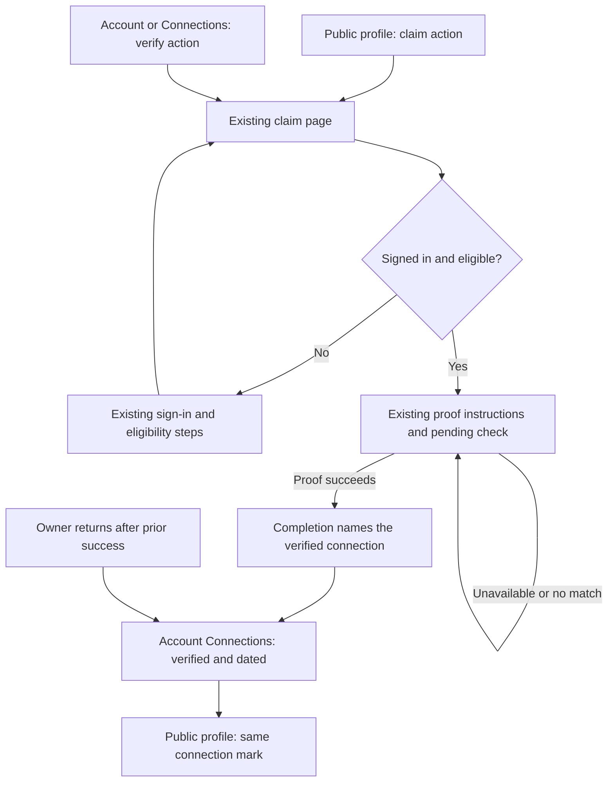

# Verified profile connections

## Review brief

Show a verified mark on the specific VRChat account or group the current
profile owner proved, with the date of that proof. A successful connection
proof must remain understandable when the profile's stored state is
`claimed_unverified`.

BASIC selected a focused connection-verification fix. This design retains the
existing profile states, ownership checks, claim authorization, and search
ranking. The broader [trust-signals proposal](../../planning/profile-trust-signals.md)
remains unadopted. This document is a design for approval, not implementation
or release authorization.

The recommendation reuses stored evidence. A claimant with a successful proof
does not need to prove again just to make the connection display correctly.
The main tradeoff is deliberate: the connection shows a dated historical
fact, while privileged actions can still require fresh evidence. The old
profile-level trust labels remain during this slice.

A second review point is publication. A verified VRChat connection without a
manually saved outbound link becomes visible under the profile's existing
`outboundLinks` visibility setting. Private links remain private. Owners who
want an account proof kept private use that setting; introducing separate
per-connection publication controls is deferred.

Approval covers the rules below and the candidate copy. The implementation
plan follows design approval.

## Decision status and approaches

| Approach | Result and tradeoff | Decision |
| --- | --- | --- |
| Correct connection verification over existing data | One shared rule, dated evidence, consistent web/API/MCP output, no stored-state migration | Selected by BASIC |
| Retire profile-level verification in the same change | Also changes profile labels, ranking, persisted enums, and orphaned-profile handling | Deferred by BASIC |

Confirmed direction: proving a VRChat account should show verification on that
connection. Current recommendation: apply the same owner and proof-lifetime
rules to the existing connection query for all supported asset types, while
public additions in this slice expose only VRChat users and groups. Discord
guilds retain their existing management UI and gain consistent proof handling;
this work does not add their identifiers to public profile responses.

Builder choices proposed here include the public field name
`verifiedConnections`, date formatting, and reusing the existing Links area.
They do not imply BASIC already approved their exact wording.

## Experience

### View the account that was proved

On a public profile, the existing Links area shows the linked VRChat account
or group with its name, a canonical VRChat destination, a verified mark, and
the proof date. If its display name is unavailable, show the immutable account
ID. A generic platform name alone cannot identify what was proved.

A matching outbound link and connection form one displayed item. If the owner
has a verified VRChat connection without a corresponding outbound link, derive
the displayed item from the connection. Do not insert or rewrite stored
`outboundLinks`. Existing link ordering and customization remain; append
connection-only items in the existing primary-first order. Match by normalized
asset type and immutable ID, never by display name. Another website or another
VRChat account cannot inherit the mark.

An ordinary unverified link remains usable without a verification date or
mark. Removing or revoking evidence removes the mark without deleting an
independently saved outbound link. An item derived only from a verified
connection disappears when that connection is no longer eligible.

The account Connections page shows the same status and date beside the named
asset. Its existing connect, primary, and disconnect actions remain. The
account summary and returning claim page use this same result, so an owner
with a proved VRChat connection is not asked to repeat that proof merely
because of `claimed_unverified`.

### Finish a proof and return

Keep the current claim route, authentication requirement, provider steps, and
collector polling. A successful proof identifies the connection just verified
in the completion message, even when the profile trust state stays unchanged.
Do not use a profile-level verified boolean to decide whether that account
proof succeeded. Preserve the distinction between a new claim and adding a
connection to an existing owned profile.

Proposed journey: how does an owner prove an account and see its result?

An expired or canceled attempt follows the existing retry journey. This design
does not turn an unavailable provider read into failure or automatically
restart a completed proof. The existing pages settle navigation and recovery,
so reference-flow research is unnecessary for this slice.

### Candidate copy for BASIC's approval

Use the existing checkmark component beside the account, not the profile name.
Proposed visible status: `Verified`, followed by a date such as `25 Oct 2026`.
Use an explicit accessible name such as `Verified VRChat account` or
`Verified VRChat group`, and a semantic date element with an ISO date value.

Proposed successful account-proof sentence: `VRChat account verified.`
Proposed successful group-proof sentence: `VRChat group verified.`
Ownership completion stays a separate existing statement. Do not describe this
as verification of a person's real-world identity. Display a calendar date in
UTC consistently across server and client, avoiding a one-day hydration
disagreement. These strings are candidates, not approved shipping copy.

## Verification rule

Use one server-side projector over existing owners, links, and control proofs.
Both `listProfileConnections` and the public profile projection consume it.
UI code only renders the projected result.

A connection is verified for the current owner when all these conditions hold:

1. The profile has an active owner and the link is active.
2. The link is a control association. Explicit `directory_reference` provenance
   never qualifies. A legacy link with absent provenance can qualify through
   the actual attached proof, without a provenance backfill.
3. The link has an attached proof whose `userId` is the current owner's ID and
   whose asset type and immutable ID exactly match the connection. A missing,
   dangling, foreign-owner, or mismatched proof reference fails closed.
4. That owner's attached proof or another proof for that same owner and asset
   is non-revoked, has a valid recorded date, and meets the existing minimum
   control level for its asset type. VRChat user proofs require `self`; group
   and Discord authority retain their existing minimum levels.

Choose the latest `verifiedAt` among qualifying proofs, with a stable tie
break for equal dates. An alternative proof may replace a revoked referenced
proof only after the reference's owner/asset binding passes condition 3.
This preserves the existing multiple-Discord-login behavior without borrowing
evidence from another VRDex user. Do not require `linkedByUserId` to be the
owner: a legitimate operator-created association may have no author field.

Both `active` and `stale` proof rows count as historical evidence unless
revoked. Crossing `revalidateAfter` changes eligibility for new privileged
actions, not whether the account was proved on the recorded date. Keep
`requireControlProof`, fresh-proof selection, and the stale-proof cron's
authorization behavior unchanged.

| Change | Display result |
| --- | --- |
| Proof ages or provider is temporarily unavailable | Keep the mark and proof date |
| Referenced proof revoked, another qualifying proof survives | Keep the mark using the surviving proof's date |
| Every qualifying proof revoked | Remove the mark |
| Owner disconnects the link | Remove the connection-derived mark and item |
| Owner removed or changed | Former owner's proofs no longer qualify |
| New owner proves and attaches the same account | Show the new owner's proof date |
| Another user proves the same account | Do not automatically revoke this owner's proof or grant a profile badge |

No new ownership-transfer feature or conflict-review system is included.
Existing transfer, removal, and claim operations must immediately affect the
projection through their active owner/link records.

## Revocation must reach old evidence

Before showing stale proofs as historical verification, repair Discord's
subject-scoped reconciliation. It currently selects active proofs, so stale
rows can escape affirmative revocation when a complete OAuth guild response
shows access was lost. Reconcile both active and stale non-revoked rows for
the authorizing Discord identity, preserving existing handling of legacy
subjectless rows. Never revoke another identity's surviving proof.

An authentication failure, timeout, partial response, or missed revalidation
does not establish loss of control. Keep those paths separate from a complete
successful provider response. A second administrator proving a shared group
or guild is not evidence that the first administrator lost control.

This is a narrow companion change to the shared display rule. It adds no
provider requests, recurring jobs, credentials, or automated bio rechecks.

## Shared data and public contract

Keep existing `listProfileConnections` fields and its `verified` boolean for
compatibility. Add `verifiedAt`, populated only for a verified connection.
Compute both from the same selected proof. Managers keep their current
management details; anonymous readers receive no proof IDs, owner IDs,
evidence subjects, raw summaries, codes, or internal failure reasons.

Add an array `verifiedConnections` to the public profile response. Each item
contains only:

- `assetType`, limited to `vrchat_user` and `vrchat_group` in this slice;
- `assetExternalId` and canonical HTTPS `url`;
- optional `displayName` from existing safe destination/name data;
- `verifiedAt` as a timestamp in milliseconds;
- `linkRole`, preserving primary-first ordering.

The array contains only eligible verified connections, never inferred matches
from arbitrary outbound text. A present empty array means no publicly exposed
verified VRChat connections. The schema permits absence for older backend
responses during rollout; consumers treat absence as no assertion. Emit it
from `profiles:getPublicBySlug` so person, community, API, and both MCP profile
read paths receive the same data. Update API schema, generated OpenAPI, MCP
document text, and contract fixtures together.

Use `outboundLinks` field visibility for this derived list. Public profile/API
reads use the existing `profile_page` visibility rules, which include unlisted
fields on a direct profile read and exclude private fields. Any discovery
reuse must use `discovery` visibility, excluding unlisted and private fields.
Do not add a new discovery verification signal in this change. Anonymous
`listProfileConnections` reads must apply the same link visibility check;
manager reads remain complete. No hidden profile or private identity becomes
public through a separate connection query.

Move the current server-only outbound-link verification annotation onto the
shared public result. All renderers use that result, rather than issuing an
independent browser/server proof query with different rules. Reuse the exact
VRChat URL matcher for deduplication and identity matching. A projection or
fetch failure withholds the mark, never fabricates success or rewrites stored
proofs. Public pages update on a new server read; manager and claim pages retain
their current reactive queries. No new polling loop is needed.

## Completion, authorization, and analytics

Keep `claimState`, `trustLabel`, profile badges, corroboration checks, audit
action names, search weights, seed imports, and orphaned-verified-profile
protection unchanged. A connection proof must not upgrade any of them merely
to obtain the connection mark.

Expose the completed proof's target type and external ID to its authorized
claimant through the existing completion/context response where absent.
Render connection success from that completed proof and the common projector,
not `result.claimState === "claimed_verified"`. Do not replay an old completion
on initial page load; retain the existing new-proof detection and journey
binding. Returning owners see their named connections instead.

Keep existing `claim_completed` outcomes as profile-state outcomes for
compatibility. Do not reinterpret `claimed_unverified` as a failed account
proof. A connection-only completion still must not emit a new ownership-claim
completion. This slice adds no new analytics event or identity identifiers to
analytics. A later profile-state retirement can change those contracts
explicitly.

## Acceptance and rollout

No new table, stored-proof rewrite, state migration, or provider-account work
is planned. Existing successful proofs become visible through the new reader
when their owner/link binding qualifies. A missing or invalid binding remains
unverified and is not repaired by guessing.

Implementation acceptance requires:

1. Backend tests for a successful VRChat proof on a `claimed_unverified`
   profile, exact ID/type matching, directory references, missing or foreign
   proof references, no owner, owner change, stale historical proof,
   revocation, and alternative surviving proofs. Exercise authorization to
   prove stale display evidence still cannot grant a fresh-proof action.
2. Discord reconciliation tests for stale rows, same-subject withdrawal,
   surviving other-subject evidence, and unavailable/partial provider reads.
3. Public projection and API/MCP tests covering the same dated identity,
   absent legacy fields, private/unlisted visibility, missing outbound links,
   mismatched URLs, and absence of private proof/owner metadata.
4. Browser coverage for live-query claim completion and an owner returning
   later, not only the existing preview booleans. Cover correct dates,
   connection-only additions, loading, deduplication, and revocation.
5. Screenshot evidence and visual review of public Links, account Connections,
   and completion states. Select `ci:browsers` and `ci:visuals` for the PR.
6. After separately authorized deployment, read an already successful
   production proof and verify its connection in the public projection, API,
   and visible page. Checking the claimant's private signed-in page requires
   their session or their confirmation. Do not edit a bio, repeat ownership
   settlement, or manually elevate trust for acceptance.

Roll out the additive backend contract before or with the web consumers;
consumers tolerate an absent new field. The previous web build tolerates the
added timestamp and array. Before calling the release accepted, distinguish
synthetic tests, deployed source, API projection, and rendered UI evidence.
Rolling back the reader may restore missing marks but does not revoke proofs
or change ownership. Rollback does not reverse any legitimate revocation
recorded by reconciliation.

## Engineering reference and evidence appendix

This is one cross-layer change using the current Next.js, TypeScript, Convex,
and API/MCP stack. No dependency or infrastructure change is needed. The
builder may choose helper placement and exact test file splits. Keep the
historical-display selector separate from fresh-action authorization helpers.

| Responsibility | Current source to extend |
| --- | --- |
| Owner/proof binding and shared selector | `convex/profileConnections.ts`, `convex/_externalControl.ts`, `convex/_profileOwnership.ts` |
| Same-subject revocation | `convex/discordVerification.ts` |
| Visibility-aware public result | `convex/profiles.ts`, `convex/_profilePublic.ts`, `convex/_profileFieldVisibility.ts` |
| Exact public link matching and rendering | `apps/web/src/convex/server.ts`, `apps/web/src/lib/profile-link-verification.ts`, public profile Links components |
| Named connection status and completion | Account Connections, `profile-verification-status.tsx`, `claim-flow.tsx`, `getClaimJourneyContext` |
| Public schemas and MCP representation | `packages/api-contracts`, `packages/vrdex-mcp`, `apps/web/src/lib/server/vrdex-mcp.ts`, generated OpenAPI |
| Existing regression coverage | `tests/backend/external-control.test.ts`, `tests/web/profile-link-verification.test.ts`, `apps/web/e2e/profile-verification.fixture.spec.ts`, live claim flow tests |

Source review refreshed to main `352f4b26503120137180820a9269ebdbe9ea5a8e`
on October 27, 2026. The earlier review used the merged person-proof-recovery
branch. The refreshed source adds directory-reference provenance and group
reconciliation callbacks; implementations must preserve both.

The original proposal correctly separates ownership from account proof,
identifies current-owner binding and stale-proof revocation risks, and warns
about profile-state migrations. Its account/returning-claim notes are partly
outdated: those pages already consult connection verification, and public
VRChat outbound links already support verified marks. The remaining gaps are
the common proof rule, dated/public representation, missing-link handling,
and completion paths still coupled to profile trust state. This focused
design supersedes only those connection-related implementation notes if
approved. The larger migration remains a separate proposal.

An independent Superpowers builder check reported "nothing important left"
before planning. This is a completeness check, not design approval. An unslop
editing pass preserved the scope, proposed copy, and authorization boundaries.
