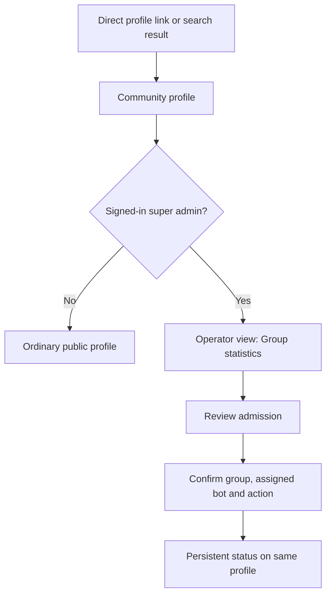
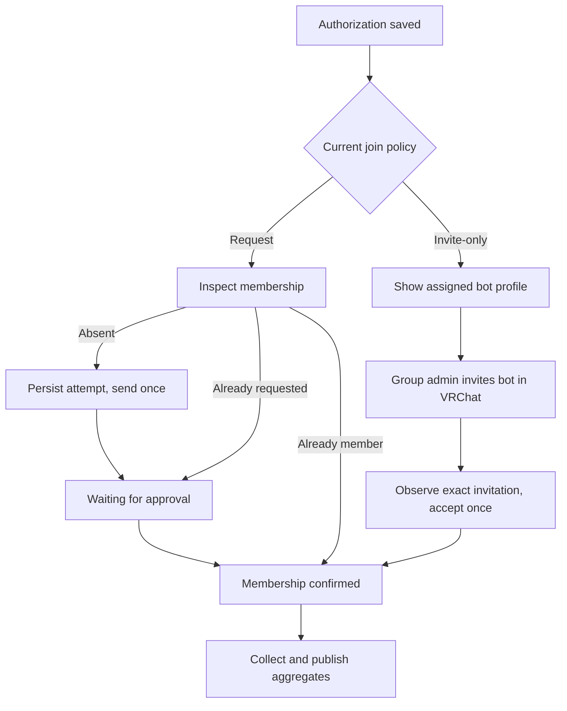

# Super-admin admission for public group statistics

Status: scope and approach confirmed by BASIC on October 27, 2026. Written design proposed for approval. No implementation or live admission authorized by this document.

## Review brief

A super admin can authorize aggregate statistics for a public request-to-join or public invite-only VRChat group without claiming its profile or proving group management authority. VRChat group administrators still decide whether the bot becomes a member. Private groups remain excluded.

The selected separate statistics-admission action lives in the community profile's existing Operator view. It reuses collector accounts, canonical group policy, budgets, aggregate observations and charts. It grants no community ownership, staff access, named membership history, posts or member management. Existing verified-operator adoption and opt-out remain available.

Request-to-join sends one explicitly authorized request. Invite-only assigns a bot and shows its profile so a group administrator can invite it. Collection starts only after provider-confirmed membership. Public output uses the same conservative aggregates, including counts from members-only instances visible to the bot. It excludes individual identities, instance rows, worlds and private links. Aggregate activity can still reveal that a small gathering exists, the tradeoff already accepted for automatic statistics.

### Decisions for approval

- Publish conservative aggregates after confirmed membership and fresh public visibility, despite the restricted join policy.
- Hold one assigned bot while pending. No automatic repeat request after rejection, removal, ban or an uncertain result.
- Keep pending admission until cancellation or an observed terminal outcome. Show age and last successful check. Reserve capacity while pending; no silent expiry.
- Cancellation hides output and fences work immediately; cleanup reports its actual provider outcome, including uncertain request withdrawal.

These lifecycle details are proposals. The public-only scope, two admission branches and separate statistics approach are confirmed by BASIC.

## Approaches

| Approach | Benefit | Tradeoff | Decision |
| --- | --- | --- | --- |
| Separate super-admin statistics admission | Works for unclaimed profiles and preserves aggregate-only behavior | Explicit authorization and pending UI needed | Selected |
| Override managed onboarding | Reuses more Connection UI | Couples admission to community management and its permissions | Rejected |

## Current behavior

Automatic enrollment accepts only public free-join groups. The worker blocks request/invite candidates before joining. Managed onboarding already supports waiting for approval and accepting invitations, but requires community capability and exact-group manager proof to adopt a blocked automatic candidate. Shared public policy currently rejects non-free join policies even after membership.

The exception changes admission and aggregate publication eligibility only. Group stops, bans, unreadable/private metadata, conflicting integrations, account readiness and capacity remain blocking. Homie Hub motivates the request branch; design approval does not authorize a live test.

## Entry and confirmation

### Task: authorize statistics from a public community profile

Use the explicitly selected primary group. Show resolved name, immutable group identity, fresh visibility and join policy. Refresh unresolved or stale metadata before authorization. No arbitrary group textbox or new general admin dashboard.

The server previews an eligible account in confirmation. Show its display name, immutable user ID and VRChat profile link. Submission atomically reserves that exact account alongside the durable grant. If capacity or the suggested account changed, require a refreshed confirmation instead of silently selecting another bot. If no account is available, show Waiting for capacity with a refresh action; no grant or membership write is created. This avoids a separate temporary reservation system. Require a short internal reason and explain the aggregate-only result and external approval required.

Only super admins see admission controls, assigned-account identity, reasons and request history. Ordinary viewers see permitted aggregates once fresh. Do not show pending admission as a public claim of group endorsement.

## Admission branches

### Task: finish externally approved membership

Request branch: an existing provider request is observed, never resubmitted. Once a sent request disappears without membership, show Admission ended; do not infer rejection versus expiry or withdrawal when the provider cannot distinguish them. Retry needs a new explicit super-admin action.

Invite branch: provide Copy ID and Open VRChat profile. Ask a group admin to invite that exact account with ordinary membership permissions, not a manager role. Accept only an observed invitation to the authorized group and account. Existing membership skips acceptance. No invitation means wait; never send an unsolicited join request for an invite-only group. The Check status action uses the same throttled provider budget as polling and cannot repeat membership writes.

Proposed status labels: Waiting for capacity, Waiting for approval, Waiting for invitation, Checking membership, Collecting, Paused, Admission ended and Cleanup pending. Returning to the profile preserves state, age and last successful check. Labels and confirmation wording require exact-copy approval before shipping.

## Authorization and policy

Store durable super-admin authorization against the canonical group and integration epoch: initiating user, internal reason, timestamp, exact group, assigned account and permitted request/invite action. Every admin mutation checks current server-side super-admin authority. Worker authority comes from the persisted grant, not a browser session or a client-supplied privilege flag.

Keep aggregate collection scope distinct from managed ownership. Add an admission source to distinguish automatic free-join from explicit super-admin admission; do not create a parallel integration system. The plan chooses the smallest typed representation that cannot confer the exception on ordinary automatic work. The grant is group-wide, while publication still requires each profile to have a currently visible primary reference to that exact group. Losing the last eligible reference hides output and invokes the existing orphan cleanup policy; renaming a slug alone does not revoke the grant.

Each membership operation requires fresh lease, grant, budget and provider metadata checks. A request/invite policy change pauses for renewed admin review rather than changing the authorized action. Private or unreadable visibility immediately hides output on observation and blocks membership writes. A later free-join policy cannot justify retry after an uncertain or ended attempt. Removal or ban ends admission and suppresses output without rejoining.

Extend the shared public policy resolver to allow current public request/invite groups only with this exact admission grant. Apply the same rule to web, REST, hosted MCP and stdio. Verified managed adoption preserves aggregate privacy until the operator explicitly changes publication; named history remains off and needs the existing separate exact-group proof and permissions.

Explicit admissions have their own opt-in, independent of the automatic free-join enable boolean. They still honor fleet/account kill switches, request budgets, capacity and reserved headroom. Pending and active aggregate admissions count toward the current ceiling of 50; this action cannot increase it. Managed work retains priority. No account creation, fleet expansion or quota change.

## Idempotency, cancellation and recovery

Persist the operation boundary before every membership write. Double clicks, concurrent admins, restarts and lost replies cannot duplicate requests or invitation acceptance. An uncertain result permits inspection only on the same account/group, not another join when membership is absent. Keep account assignment stable until cancellation and confirmed cleanup; never ask from multiple bots to improve approval chances.

Cancellation revokes authorization, fences leases and hides current/history output first. If this admission created membership, use existing leave cleanup. Never leave membership used by a managed integration or pre-existing membership whose cleanup ownership cannot be established. Track that distinction at admission. Conflicting active integrations require explicit reconciliation.

Withdraw an outstanding request only through a verified provider-supported operation. If withdrawal cannot be confirmed, retain Cleanup pending, retain capacity accounting and show manual withdrawal instructions. Never claim provider cancellation from a local state change. Cancel racing approval must inspect and clean up any membership the cancelled operation created. Later invitations are not accepted after cancellation.

Retry requires a terminal result and safe cleanup, fresh metadata and capacity, and a new audited attempt. Stop/opt-out takes precedence; admitting never resumes a stopped group or republishes suppressed history. New-history defaults remain intact.

## Reuse, observability and acceptance

Reuse canonical group policy, allocator, leases, request authorization, heartbeat, rollups, cleanup and chart interfaces. Existing managed provider code informs the branches but must not carry management privileges or weaker guards into aggregate work. Require a new explicit worker capability so existing v2 workers cannot interpret manual admission as ordinary automatic work. No existing record is backfilled into this exception.

Pending external approval is visible status, not a failed collector or a reason to retry. Keep bounded age/count diagnostics without group/user IDs in metrics. Existing backlog alarms cover actionable queued work; any new unattended failure path needs an actionable alarm using the existing email topic in the same implementation change. An unanswered invitation alone needs no new alarm.

Acceptance covers non-admin rejection; private/unresolved/stopped/conflicting groups; existing membership/request; exact versus foreign invitations; successful approval; lost replies/restarts/double clicks; budgets/headroom; capacity retention/release; request-policy changes; cancel/approval races; privacy changes; opt-out; managed adoption; and all public protocol projections. Browser coverage includes both entry branches, persistent pending state, account copy/profile links and cancellation. Live request and invitation acceptance need separately authorized exact groups/accounts. Source fixtures cannot prove request-withdrawal semantics.

## Reference and evidence

Parent: [automatic statistics design](2026-10-25-automatic-group-statistics-design.md). This design extends its admission rule only through explicit super-admin authorization.

Read-only Mobbin query on October 27: web, `inviting members`, limit one. [Dub, Inviting a member](https://mobbin.com/flows/dc000ff7-d3cc-4423-ad73-5bc04f309fa0), flow `dc000ff7-d3cc-4423-ad73-5bc04f309fa0`. Preview positions 1, 3 and 5 show a member list, invitation dialog and persistent invitation rows. Positions 2 and 4 were not inspected. This supports returning from confirmation to visible pending state; it does not establish approval, cancellation or recovery behavior.

Code grounding: `convex/groupObservations.ts`, `convex/_groupObservationPolicy.ts`, `convex/communityTelemetry.ts`, `workers/group-telemetry/vrchat-client.mjs` and the profile Operator view.
