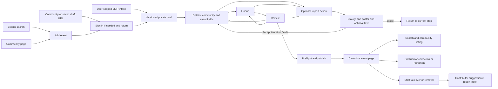

# Contributed event intake checkpoint

The 2026-10-13 scheduling follow-up is recorded in the
[event editor scheduling checkpoint](./event-editor-scheduling-checkpoint.md): explicit
generation, fixed ends, timezone preferences, prominent Review actions, Linux visual
evidence and the update-only legacy identity exception. The original acceptance
boundaries below remain historical evidence.

Date: 2026-09-28. Scope: Tasks 1 through 9, final review corrections and the
merge with `main` at `326fe66e3` on `codex/event-contribution-ai-intake-design`.
This is local evidence. Nothing here asserts deployment,
copy approval, hosted accuracy or merge readiness.

Post-review boundary fixes keep malformed or stale draft links on an unavailable
state, page staff reports within their managed communities, declare date-only
search fields in OpenAPI, and limit unconfirmed public world links to contributor
associations. Empty extraction requests return 400. Changing source text or
replacing a poster clears old extracted candidates and evidence. Exact duplicate
drafts retain their private poster evidence under draft retention, and the daily
artwork cleanup retires published derivatives after deselection or retraction.

The follow-up review fixes keep committed publication receipts replayable after
a later classifier result, settle owner media work when a timed event becomes
Time TBA, invalidate contributor event recaps on that transition, return a
client error for invalid IANA zones, preserve MCP tool errors, and serve selected
artwork only while the event still references it. Focused backend and web tests
cover those transitions. The new event Playwright flows use local fixtures and
carry the `@fixture` tag, so the hosted mutation suite does not run them against
an older shared staging deployment.

The next review pass found four boundary cases: browser corrections sent the
whole readback, queued media kept its old time after a contributor shift, recaps
kept old timed boundaries, and date-only search rows kept their initial featured
rank after expiry. Corrections now submit only changed fields, rebase queued
media times, recompute recaps after start or end changes, and demote expired
date-only rows at read time. Focused backend and desktop/mobile browser tests
cover those cases.

The latest review pass keeps contributor-linked performers unconfirmed in
person-profile feeds, maps deterministic lineup errors to client responses,
avoids classifier reports for discarded duplicate drafts, exposes an
actor-scoped contribution revision through REST/MCP, and preserves extraction
quota when the model is disabled. The event lineup still shows its authored
performers. Backend and transport regressions cover these boundaries.

Final review checks preserve contributed timed slots in the public lineup while
person links await staff confirmation. Time TBA events reject stale instance
association suggestions, and the staff review list disables confirmation until
an event time exists. The new contribution GET route also extends the developer
API reference, so its inspected desktop and mobile screenshot baselines were
updated.

A later review found that an already confirmed instance survived a transition
to Time TBA. Contributor and staff edits now return those associations to the
suggested state; restoring a time requires staff reconfirmation before an event
recap returns. Staff content-only saves omit the untouched canonical lineup so
they cannot confirm contributed person links by accident. The account event
list also shows a contributor-managed event only once.

The exact-head review then found three more edges: a lineup edit could discard
a hidden performer match, cancel/restore could lose contributed role and world
search context, and a malformed artwork ID could fail before the public 404
path. Regression tests now cover each path.

The next review found hosted MCP intake errors hidden behind a generic retry
receipt, malformed intake IDs reported as server errors, symbolic titles sharing
an empty duplicate identity, a contributor-only account page showing `No events`,
and malformed source URLs reported as server errors. Those paths now return the
specific intake error or client response, keep distinct title identities, and
show the empty state only when both event lists are empty.

## Implemented journey

Any signed-in account can save a partial private draft for any public community,
enter details manually or review text/poster extraction, and publish after
preflight. Unknown dates remain drafts. A date-only event needs an explicit Time
TBA state. Publication returns one idempotent receipt and canonical URL. Website
publication navigates there directly. API/MCP share the contract and server rules.



The owner editor retains its authority and live controls, uses searchable IANA
zones and explicit DST occurrence selection, and labels generated rows Slot N.
Its optional Ends control preserves an untouched stored instant, accepts an
explicit end, sends null to clear a stored end, and omits an unknown end on
staff create. A known final lineup end remains available after an explicit
clear. The editor still requires a known start for staff create.
Contributor import is a top-right action that opens a dialog. The same one
poster and optional text are sent through one extraction. A verified poster
becomes artwork by default, and replacement or removal updates that artwork.
Scoped corrections and staff edits do not expose this import action.
One public Lineup includes matched/unmatched and timed/untimed entries. Repeated
sets remain distinct; participant-only duplicates disappear. Performer and
event-level VRCDN/Twitch stream targets share a collapsed, deduplicated DJ links
accordion. Ordinary event links and the contextual watch player remain separate.

### Three-stage editor refinement, 2026-10-13

The current editor has Details, Lineup and Review. Draft import sits beside the
heading, outside those stages. The staff editor keeps Source fields inside the
Details disclosure, including mounted values for save and error focus. Staff
edits of published events and scoped contributor corrections have no import
action under the approved draft-only scope.

Staff Starts and optional Ends use native combined date/time controls. A stored
end survives an unrelated edit at its exact instant, including the later
repeated-hour occurrence. An entered end must follow the start. Clearing Ends
sends null for updates; a known final lineup end may still be submitted.
Creation without either end omits the field. Staff create still requires a
known start; contributor date-only drafts retain their existing commands.
When an untouched stored end shifts with a changed start, Ends displays the
pending event-local value and its repeated-hour choice. Event preview shows
the same resulting instant in the viewer's local timezone.

The new utility labels `Import poster or text`, `Import event info`,
`Ends (optional)` and `Add end time` follow BASIC's approved wording in the
[wizard specification](../planning/event-editor-wizard-refinement-2026-10-11.md).
The staff ordering error reuses `Event end time must be after the start time.`
from the existing staff error set. No new substantive product sentence was added.

The committed Linux Chromium baselines include the [desktop staff Details](../../apps/web/e2e/__screenshots__/desktop-chromium/event-editor-edit-details.png)
and [mobile staff Details](../../apps/web/e2e/__screenshots__/mobile-chromium/event-editor-edit-details.png)
screens with the optional end visible. The fixture-backed
[`event-editor.snapshots.spec.ts`](../../apps/web/e2e/event-editor.snapshots.spec.ts)
also captures create, resumed draft, correction and staff edit in light and dark
themes on desktop and mobile, plus import open/error, DST gap and repeated-time
states. Those additional captures are generated test artifacts; the two linked
baseline images are durable repository evidence. Fixture transport verifies
form behavior and payloads, not live authentication or model accuracy.

## Automated evidence

Commands run in the isolated worktree, without hosted credentials or paid calls:

| Command | Result |
| --- | --- |
| `pnpm test:backend` | 1,226 passed, zero failed/skipped after review fixes |
| `pnpm test:web` | 607 passed, zero failed/skipped after review fixes |
| `pnpm test:api-contracts` | 58 passed, zero failed/skipped after review fixes |
| `pnpm test:vrdex-mcp` | 10 passed, including local stdio and fake-transport upload |
| `pnpm typecheck:backend` | Passed |
| `pnpm typecheck:web` | Passed |
| `pnpm typecheck:api-contracts` | Passed |
| `pnpm typecheck:vrdex-mcp` | Passed |
| `pnpm lint:web` | Passed |
| `pnpm build:web` without public Convex or Clerk URLs | Passed after reports-route fix |
| `pnpm check:api-openapi` | Passed |
| `pnpm test:group-telemetry` | 162 passed, zero failed/skipped after merge |
| `pnpm build:docs` | Passed |
| Focused Playwright, desktop/mobile | 54 passed, zero failed/skipped, no baseline updates in final run |
| Public event/watch snapshots, desktop/mobile | 4 passed, zero failed/skipped |

The backend suite exercises real Convex functions in `convex-test`, with local
storage/provider doubles. `event-intake.test.ts` publishes then reads the canonical
event, community listing and discovery index. `event-corrections.test.ts` covers
staff takeover, stale writes, scoped suggestions/reports, removal across public
projections, suppression and restored authority. `event-schedule.test.ts` covers
resumable migration, real public queries, date-only ICS and disabled watch state.
`event-discord-export.test.ts` checks date text without an invented timestamp.
Source tests cover exact actor/draft/source binding, expiry, holds and the pending
artwork cleanup interleaving. These are local transaction and policy proofs.

Task 9 also found event-level stream links outside the DJ accordion. The focused
`tests/web/event-dj-links.test.ts` regression failed before the fix, then passed.
The existing parser now serves both page classification and accordion grouping;
no new component or provider fetch was added. A duplicate Twitch target appears
once across event/performer links, event-only VRCDN remains accessible, and ticket
links stay outside the accordion. The obsolete owner help sentence claiming all
links remain in the normal section was removed; its preceding sentence is unchanged.

## Browser and visual evidence

The guarded Next.js fixture server is local at `127.0.0.1:3019` with
`VRDEX_ENABLE_PLAYWRIGHT_FIXTURES=true` and local Convex URLs. The test command uses
`PLAYWRIGHT_BASE_URL=http://127.0.0.1:3019` and runs these files for desktop Chromium
and Pixel 7 Chromium with one worker:

- `event-contribution.flow.spec.ts`
- `event-intake-source.flow.spec.ts`
- `event-lineup.flow.spec.ts`
- `event-lineup.snapshots.spec.ts`
- `event-editor.snapshots.spec.ts`

Coverage includes manual/text/poster publication navigation, resumed drafts,
explicit candidate acceptance, provider-disabled manual fallback, poster
replacement/preview failures, poster artwork handling, DST gap/fold controls,
stale revisions, community/direct authentication entry, public URL reload,
search/community readback, staff takeover/removal controls and date-only calendar
export/no-player behavior. Staff fixture mutations do not prove backend authority;
backend tests provide that independent evidence.

The publish fixture returns the pre-existing Harbor event URL regardless of its
input. Public search/community readbacks use that fixed server fixture. These
checks prove redirect and readback UI, not persistence of the submitted fields or
authenticated browser-to-Convex publication. Text tests separately assert the
submitted title; canonical write/index consistency is tested in Convex. No
connected hosted end-to-end result is claimed.

Fresh screenshots are saved under `apps/web/test-results/task9-reviewed/`.
Committed baselines live under `apps/web/e2e/__screenshots__/{desktop,mobile}-chromium/`.
The evidence includes owner editor, one public lineup, closed/open DJ links,
manual intake, text/tentative review, private poster/manual fallback, pending
replacement preview and date-only public event. Review requires readable hierarchy,
contained mobile controls, no repeated participant section or per-row URL wall,
visible copy actions after expansion and a date without an invented start time.
Visual review accepted the captures. Desktop uses clear grouped rows; mobile
wraps long stream targets without overflow and keeps copy controls reachable.
Matched portraits, fallback initials, repeated sets and untimed entries remain
readable. Date-only views show the authored date and Time TBA with no player.
Text candidates have explicit Accept actions; private source preview and public
artwork remain distinct. Replacement-pending screenshots show no stale image.
Forms remain long; reducing unrelated profile/edit-page
complexity is outside this slice. The Update elsewhere button is fixture-only.

Both viewport variants were captured. Paths below are relative to `apps/web/`;
replace `{viewport}` with `desktop` or `mobile`.

| Evidence | Path |
| --- | --- |
| Owner editor | `e2e/__screenshots__/{viewport}-chromium/event-lineup-editor.png` |
| Closed public lineup | `e2e/__screenshots__/{viewport}-chromium/event-lineup-roster.png` |
| Expanded DJ links | `e2e/__screenshots__/{viewport}-chromium/event-dj-links-expanded.png` |
| Public event/watch | `e2e/__screenshots__/{viewport}-chromium/event-profile.png`, `event-watch-surface.png` |
| Date-only | `test-results/task9-reviewed/event-contribution.flow-da-6a8ac-rt-and-no-watch-player-flow-{viewport}-chromium/event-date-only.png` |
| Manual intake | `test-results/task9-reviewed/event-contribution.flow-in-ee8f4-has-no-mobile-overflow-flow-{viewport}-chromium/event-intake.png` |
| Tentative text / accepted text | `test-results/task9-reviewed/event-intake-source.flow-t-065dd-ly-and-keeps-questions-flow-{viewport}-chromium/tentative-review.png`, `text-review.png` |
| Private poster / manual fallback | `test-results/task9-reviewed/event-intake-source.flow-p-d4ad6-lback-remains-editable-flow-{viewport}-chromium/poster-private.png`, `poster-manual.png` |
| Pending source replacement | `test-results/task9-reviewed/event-intake-source.flow-r-f62a8-k-before-the-new-image-flow-{viewport}-chromium/replacement-pending.png` |

The corresponding final journey captures are also in `test-results/task9-final-proof/`.
Local test-result folders are ignored artifacts, not public assets or committed
source posters. The owned fictional poster is the only upload fixture.

An initial run failed because the inherited port 3018 server stopped. A fresh
local server resolved that infrastructure failure. The next run exposed a test
selector matching source text containing Time TBA; it now selects the checkbox
by its exact role/name. Older lineup screenshots predated contribution controls
and Slots labeling and required visual review before replacement. These failures
are not counted as passed checks. Added stream/watch selectors were corrected to
assert collapsed DOM content by href and event stream suffix before the final pass.
Existing NO_COLOR/FORCE_COLOR and Next middleware warnings remain; the docs build
reports stale Browserslist data and untracked-file update dates, not broken links.

## Final owner-correction review fixes

The final branch review found gaps between contributor publication and the owner
editor. Owner browser/API updates now preserve date-only schedules on ordinary
corrections, accept explicit timed transitions, and replace canonical lineups.
Staff can correct or remove unmatched untimed performers after takeover. Stable
timed row keys preserve stored stream choices; changing/removing a person clears
the previous choice, and a new choice must belong to the person's public streams.
Owner updates validate retained root-relative artwork against its published
server record and refresh contribution fingerprints after title/date/community
changes. Discord export uses mixed/untimed canonical lineups. World event keys
include the date, and public lineup projection replaces legacy generated Session
labels with the matched name or Slot label.

Focused tests failed first on missing owner `startAt`, missing Discord lineup,
legacy Session labels and the missing owner date-only rollout guard. The desktop
browser test first failed because the owner form had no Time TBA control.
New transaction tests exercise both browser and API owner mutations, canonical
replacement/removal after takeover, artwork retention/rejection, refreshed
duplicate identity, stored-stream retention and cross-person clearing.

Final-wave verification: backend 996 tests, web 586, API contracts 57 and MCP 10;
backend/web/API/MCP typechecks, web lint and OpenAPI parity. The relevant browser
run passed 56 desktop/mobile flows and unchanged snapshots, plus four public
event/watch snapshots. No baseline update
was needed. The first backend run had one obsolete source-text assertion for the
old assignment syntax; real mutation coverage for omission/replacement remains.

New desktop/mobile screenshots are under
`apps/web/test-results/final-fix-reviewed/event-lineup.flow-staff-ed-45b3e--removing-contributed-names-{desktop,mobile}-chromium/staff-date-only-editor.png`.
Visual inspection accepted both: the date and Time TBA state are visible, performer
editing/removal is legible, controls stay inside the mobile viewport, and the save
action remains reachable. The fixture exercises the actual form serialization
and stores the submitted fields locally. It does not prove authenticated
browser-to-Convex persistence or real artwork storage. Backend transaction tests
provide the independent persistence/authority checks.

New utility labels are `Add performer` and `Remove performer`; `Time TBA`, `Date`,
`Venue`, `Performer`, `Person profile` and `Role` reuse the intake labels above.
No new explanatory product sentence was added. Exact-copy shipping approval for
the existing intake prose remains pending.

Scoped re-review found two owner-update regressions. New failing tests reproduced
private canonical person links disappearing after editor readback and timed API
events refusing an explicit Time TBA transition. The shared owner path now uses
the editor's existing association snapshots to preserve hidden matches, including
privacy changes after readback, while replacement/removal clears old links and
stream choices. Explicit date-only API updates clear inherited event and set
times, retaining the lineup as untimed rows; contradictory supplied times still
fail. No UI, public copy, schema or OpenAPI contract changed in this follow-up.
Both tests failed before the fix, then passed. Follow-up verification passed all
998 backend tests, 105 focused related tests, the strengthened 31-test correction
suite, backend/web typechecks, markdown lint and the whitespace check. Existing
browser/visual evidence above still describes the unchanged UI; this follow-up's
readback/save and API-transition evidence is from real in-memory Convex mutations.

After merging the club management work from `main`, date-only events remain
publicly discoverable but are excluded from club controls that need a precise
start time. Changing a timed event to Time TBA cancels its pending or claimed
event-relative club actions; submitted actions are unchanged. The focused
integration tests passed, as did the merged backend (1,200), web (601) and
group-telemetry worker (162) suites, backend/web/API/MCP typechecks, web and
Markdown lint, the OpenAPI contract check, and the docs build. The merged
club scheduling paths have not been exercised against a hosted deployment.

PR review corrections also settle queued event media on contributor retraction
and moderator removal, preserve existing private performer associations on
unrelated corrections, and synchronize club actions when contributors change
an event time. Selected public artwork now reaches the generated event preview.
Contributor world links appear on the event as unconfirmed and do not promote
the event on the world page until staff confirm the association. Publish,
correction and retraction audit entries retain the actual browser, API or
hosted MCP surface. Exact replay uses the community's current route.
Time TBA cancellation remains terminal: restoring a time requires a new
reviewed club action rather than silently reviving a provider write. Focused
tests failed before the private-performer and artwork fixes, then passed. The
full backend and web suites and both typechecks passed after these changes.
The CI build also exposed that the staff reports route rendered a Convex hook
during credential-free static generation. A server route wrapper now marks that
page dynamic; the credential-free production build passes locally.

The next review pass found three contract and lifecycle gaps. The public event
schema now accepts an unconfirmed contributor world, matching the event detail
projection. A contributor's Time TBA correction cancels queued event media or
requests a stop for an active session, using the existing cancellation path.
REST and MCP retraction retries resolve the actor's hidden event and return
`changed: false` after the first successful retraction. Targeted tests failed
on each gap before the fixes and passed afterward.

The merged CI visual pass found a stale `Sessions` assertion after the approved
`Slots` rename. The corrected desktop and mobile editor test passes locally.
Twenty snapshot comparisons differed in text rasterization between Windows
captures and the Linux runner. Their Linux captures were identical across the
initial CI attempt and retry, visually inspected, and adopted as baselines.

## Release and operator gates

See [deployment sequence](../deployment/convex-environments.md#event-intake-staged-release-checks)
and [source controls](../backend/event-intake-sources.md).

These gates describe the agent as of this 2026-09-28 checkpoint. For the current
extraction budget (six turns, five read-only tool calls) and cost (computed from
the model price table, null only for unpriced models), see
[source controls](../backend/event-intake-sources.md#extraction-and-classification).

- Schema/index backfill and both schedule switch states pass locally. No deployed
  migration, index-readiness check or switch change was performed.
- Website actor/session binding, user-scoped `events:contribute`, rejection of
  application-only credentials and unchanged `events:write` authority pass local
  API/MCP/backend tests. Hosted Clerk/Convex and OAuth journeys remain unverified.
- Retention is 30 days after draft activity or the event date, capped at 180 days
  after upload. Specific report holds pause deletion. The ten-minute cleanup
  worker and storage race recovery pass local doubles, not real S3/CORS/delete
  operations. No real poster was uploaded.
- Extraction defaults off; classification defaults off. Manual publication works
  without model credentials. Both have kill switches and share 20 actor attempts
  per rolling day. Extraction allows four turns, three read-only tool calls and
  6,000 output tokens per turn. Classification allows 300 output tokens. There is
  no dedicated global contribution-write kill switch or measured dollar budget.
- Logs bound IDs/reasons, calls, latency and tokens. Cost remains null. The owned
  fictional fixture corpus and injected model responses check schema/tool/DST
  behavior, not model accuracy. Paid field accuracy, identity errors, false-block
  rates, latency and cost per publish are unmeasured. Keep extraction and blocking
  disabled until the consented evaluation and release review are complete.
- BASIC approved the exact copy below on 2026-09-28. Deployment, paid calls and actual
  uploads remain release checks. The 30-minute exact-head PR readiness gate
  still applies.

## Exact public copy for BASIC review

Approval status: BASIC approved these exact strings on 2026-09-28 in the
PR #348 review conversation. The lists below consolidate Tasks 1 through 8 and the Task 9
integration check. They exclude pre-existing unchanged copy, fixture prose,
technical protocol errors and source/model-provided evidence/questions. Dynamic
names and times are values, not newly authored claims.

Authored sentences and confirmation prompts:

1. `This local time does not exist.`
2. `Add a community, title and date.`
3. `Choose a time zone and start time, or Time TBA.`
4. `Choose a time zone.`
5. `Check similar events before publishing.`
6. `This draft changed elsewhere. Reload before saving.`
7. `Unable to submit. Try again.`
8. `Retract event?`
9. `Take over this event and close contributor editing?`
10. `Remove event?`
11. `Ambiguous local time requires an earlier or later occurrence.`
12. `Local time does not exist in this timezone.`
13. `Event date must be valid.`
14. `Time zone must be a valid IANA time zone.`
15. `Choose a PNG, JPEG or WebP image up to 12 MB.`

Long phrases, actions and placeholders:

- `City, region or abbreviation`
- `Search communities`
- `Choose occurrence`
- `Add untimed performers`
- `Suggest correction`
- `Proposed correction`
- `Submit correction`
- `Different event`
- `Manage {community display name} event`
- `Use as event artwork`

Utility labels and short states, listed for completeness:

`Time TBA`, `Community-submitted`, `Lineup`, `DJ links`, `Date`, `Venue`,
`World profile`, `Source text`, `Slots`, `Performer`, `Person profile`, `Role`,
`Slot {N}`, `Earlier`, `Later`, `Repeated time`, `Day offset`, `Start time`,
`End time`, `Draft saved`, `Submitted`, `Staff only`, `Event reports`,
`Event unavailable`, `No reports`, `Latest`, `Next`, `Correct event`,
`Retract event`, `Take over`, `Report event`, `Submit report`, `Remove event`,
`Similar events`, `No matches`, `Retracted`, `Extract details`,
`Extraction unavailable`, `Private source`, `Artwork selected`,
`Tentative details`, `Questions`, `Source evidence`, `Poster`, `Accept`,
`Contribute events`, `Event contributions`, `VRCDN`, `Twitch`, `PC`, `Quest`.

Accessibility names include `Event source`, `Source poster`,
`Accept {field label}`, `Time zone`, `Time zones`, `Start occurrence`,
`{field label} occurrence` and `{field label} day offset`. No AI branding is added.
Task 9 groups event-only streams under the event's authored title. It adds no
new public explanatory sentence. The profile-editor proposal has a separate
[copy decision list](../planning/profile-editor-progressive-disclosure-2026-09-28.md)
and is not implemented here.

## Organizer workspace checkpoint (2026-10-22)

The organizer slice adds `/account/events` inventory and source-specific
continuation. Its [browser contract](../engineering/event-contribution-browser.md#my-events-inventory-and-continuation)
covers sources, expiry, traversal order, filters, failure and navigation behavior.

`event-inventory-checkpoint.flow.spec.ts` starts
`tests/backend/helpers/event-inventory-browser-bridge.ts`. That child seeds
canonical staff and intake drafts with real commands, supplies actual inventory
pages and authorizes browser-generated query/mutation/action arguments through
`convex-test`. The gated `/playwright/event-workspace` route composes the
production inventory, staff editor, connected intake and public renderer. Only
transport and browser authentication presentation are replaced. The production
`usePaginatedQuery` hook owns accumulation and consumes actual opaque cursors.

Both draft journeys follow their supplied continuation links, edit a manual
performer and set time, Save draft, remount from saved projections, then publish
through Review. A later staff Save changes remains published and its authorized
Discord text contains the revised performer and saved timestamp. The checkpoint
also checks creator privacy, expired-draft omission, anonymous write rejection,
nonstaff export refusal and cancelled/unpublished export absence. Existing
backend tests cover revoked authority and retention; existing authoring flows
cover conflicts, pending edits, staff takeover/correction and local-time round
trips without duplicating their scheduling implementation.

Evidence boundaries:

- Inventory state screenshots from `/playwright/event-inventory` use deterministic
  reads for populated, empty, loading and failure presentation. They do not prove
  backend authority, real cursors or persistence.
- The command checkpoint runs actual Convex functions and saved projections in
  `convex-test`, with browser-generated arguments and actual Review commands.
  Its sign-in return targets prove continuation navigation intent. Publication
  attempts the returned canonical URL; the exact saved public projection is
  then rendered in the gated fixture. These child records do not exist in the
  native Next backend, so this is not native canonical-server readback.
- No live Clerk browser session or hosted provider delivery is claimed. Copy
  exercises generated text and the clipboard control, not Discord delivery.

Desktop/mobile light/dark screenshots are committed under
[`assets/organizer-workspace-2026-10-22`](./assets/organizer-workspace-2026-10-22/README.md).
The asset index records screenshot scope and visual review. Existing affected
editor golden images remain in `apps/web/e2e/__screenshots__`.

### Canonical CI visual follow-up (2026-10-22)

[Baseline Checks #1807](https://github.com/BASIC-BIT/VRDex/actions/runs/39726810845)
tested head `bda7c65` through merge checkout `268342f`. The initial local
36-case editor/lineup comparison was 26 passed and 10 failed. All ten untouched
failures reproduced on unchanged `main` with 18 byte-identical actual PNGs;
those same ten cases passed on the canonical CI runner. Preserve the local
result as qualified environment evidence, not a passing comparison run.

The canonical [Playwright Image Diff job](https://github.com/BASIC-BIT/VRDex/actions/runs/39726810845/job/119654476148)
reported **64 passed, 12 failed and 12 skipped**. Its
[failure artifact](https://github.com/BASIC-BIT/VRDex/actions/runs/39726810845/artifacts/12403712871)
contains 39 unique failing PNGs, all among the 84 updated baselines; initial and
retry actuals are byte-identical, with unchanged image dimensions. Independent
review approved the 38 mobile actuals as glyph-edge raster differences without
material changes to content, geometry, controls or navigation. The downloaded
Space Grotesk and IBM Plex Mono WOFF2 bodies match local files byte-for-byte.
Local Debian 13.6 and CI Ubuntu 24.04.5 differ, but the precise raster-rendering
cause remains unestablished. Only those reviewed mobile images are adopted;
comparison tolerances are unchanged.

The remaining desktop `schedule-light-timezone.png` actual was rejected because
its community artwork had not loaded. The retry trace records the image request
finishing after 3.55 seconds, while the first screenshot started 0.24 seconds
after the request began. Font readiness alone did not establish image readiness.
The editor snapshot spec now eagerly loads and decodes captured image elements
before both its evidence capture helper and legacy screenshot loop. Decode
failure rejects before capture. The artwork-containing desktop baseline is
preserved. A scoped held-request browser check verifies capture waits for a real
image response, and a corrupt-image case verifies failure before any screenshot.

Both readiness cases passed in desktop and mobile Chromium (4/4). A final
desktop-only run passed the two readiness cases and the normal light/dark
scheduling comparisons (4/4), preserving all 14 existing scheduling images.
The final timezone capture visibly retains the community artwork. The local
fixture server used the documented Turbopack system-TLS setting to load the
same font bytes as CI; a preceding fallback-font run failed and is not passing
comparison evidence. With that fixture server already running, the final scope
was:

```sh
PLAYWRIGHT_BASE_URL=http://127.0.0.1:3002 PLAYWRIGHT_SKIP_WEBSERVERS=true \
  pnpm --filter web exec playwright test e2e/event-editor.snapshots.spec.ts \
  --grep 'editor capture waits for artwork|scheduling states (light|dark)' \
  --project=desktop-chromium --workers=1 --retries=0
```

Other selected jobs in that run passed: Storybook Image Diff (36 passed),
Storybook Component Preview (354 passed) and Playwright Public Preview (72 passed,
12 signed-in-account skips in the local lane). Hosted account captures were
selected and reported 6 passed and 6 skipped; My events, media contributions and
media review access skipped in both viewports because shared staging did not yet
carry the branch revision. That run does not establish hosted My events coverage.
The follow-up commit still requires its own selected CI comparison result.
